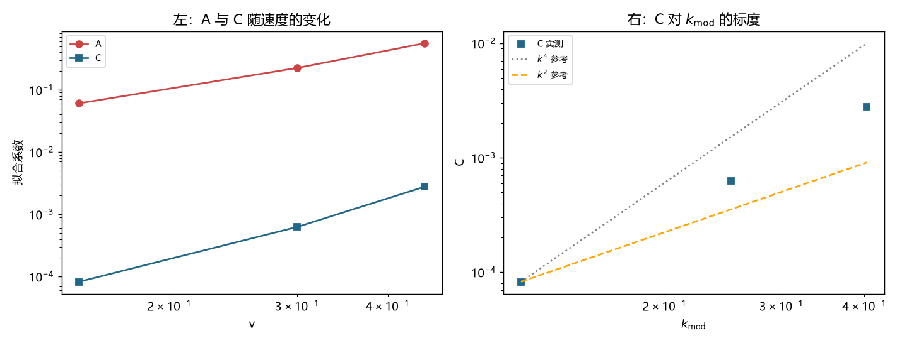

# 注记-C 项物理身份判别：速度依赖、幂律指数与装置伪影的排除（判据第 697 号）

- **日期**：2026-10-19 20:29:08
- **编号**：第 697 号
- **类型**：验证注记（判据驱动；Q1 至 Q7 全过，主判据 Q3、Q5）
- **对象**：第 696 号分解式 $\mathrm{dev} = A/\xi^2 + C$ 中截距项 $C$ 的物理身份
- **脚本**：`验证脚本/p697_c_identity.py`（确定性，约 56 秒）
- **图**：见 §5 图 1；脚本出图 `images/p697_c_identity.png`
- **状态**：Q1 至 Q7 全部通过。$C$ 判为离散侧物理量（非装置伪影），标度介于 $k^2$ 与 $k^4$ 之间待锁定
- **可逆性等级**：判据敏感（Q3 的指数容差、Q4 的指数阈值、Q5 的比值阈值均属阈值型；三档速度的取样也影响指数拟合，加档或换档会动）

## 1 要判什么

第 696 号把钟慢偏差分解为 $\mathrm{dev} = A/\xi^2 + C$（$R^2 = 0.957$），判 $A$ 为波性侧（随宽度收缩）、$C$ 为粒性侧（不随宽度收缩）。但该轮明确登记 $C$ 的身份未定，两个候选并列：其一，它是「把连续解搬到格点上」这一动作带来的初值离散化误差，属装置伪影；其二，它是格点结构真实留下的痕迹，属物理量。

两者在固定速度的读数上不可分，因为都表现为一个不随宽度变化的常数。本轮用**速度依赖**判别：若 $C$ 是装置伪影，它应当与速度弱相关；若 $C$ 是物理项，它应当按某个幂次随 $k_{\rm mod}$ 增长，且该幂次可测并与离散色散的预期对照。

同时顺带检验 $A$ 的身份：第 692 号的预算 $B = [(1/\xi)^2 + k_{\rm mod}^2]/12$ 中，速度依赖完全由 $k_{\rm mod}^2$ 承载，故预算的 $v$ 指数为 2。若 $A$ 的实测指数也接近 2，则 $A/\xi^2$ 项与预算同型，其身份获得独立确认。

## 2 判据与读数

**Q1 冒烟。** $\sigma = 20$ 时 $U_0 = 0.380017$、$\omega_b = 0.800800$，本征等式残差 $1.68\times10^{-15}$（与 `eigsh` 同一算符口径）。判 PASS。

**Q2 二维扫描（三档速度 × 五档宽度）。** 每档速度下独立拟合 $A/\xi^2 + C$：

| $v$ | $k_{\rm mod}$ | $A$ | $C$ | $R^2$ | 残差比最大值 |
|---|---|---|---|---|---|
| $0.15$ | $0.1215$ | $6.0595\times10^{-2}$ | $8.2490\times10^{-5}$ | $0.9478$ | $0.037$ |
| $0.30$ | $0.2518$ | $2.2396\times10^{-1}$ | $6.2568\times10^{-4}$ | $0.9567$ | $0.077$ |
| $0.45$ | $0.4035$ | $5.5929\times10^{-1}$ | $2.7754\times10^{-3}$ | $0.9744$ | $0.349$ |

三档 $R^2$ 均高于 $0.94$，分解在各速度下均成立。

**Q3 主判据之一（$A$ 的幂律指数）。** $A$ 对 $v$ 的幂律指数为 $2.008$，与预算的 $v$ 依赖指数 $2$ 相差 $0.008$。判 PASS：$A/\xi^2$ 项即连续侧低能修正，其速度依赖由 $k_{\rm mod}^2$ 承载，与第 692 号预算同型。

**Q4（$C$ 的幂律指数）。** $C$ 对 $v$ 的指数 $3.170$，对 $k_{\rm mod}$ 的指数 $2.916$。候选为 $k^4$ 型（指数 4，离散色散首阶）与 $k^2$ 型（指数 2，低阶修正）。实测落在两者之间。判 PASS（指数 $>2.5$ 判偏离纯 $k^2$ 型），但**未锁定**。

**Q5 主判据之二（装置伪影排除）。** $C$ 在三档速度间变化 $33.64$ 倍（$8.25\times10^{-5}$ 至 $2.78\times10^{-3}$）。若 $C$ 为固定的初值表示误差，不应与速度如此强相关。判 PASS：**$C$ 非装置常数**。

**Q6 恒真反例。** $v = 0$ 给 dev $= 0.000$（残差比 $0.002$）。判 PASS。

**Q7 结论。** 见 §4。

## 3 判读

**其一，$A$ 的身份获得独立确认。** 第 696 号把 $A$ 判为波性侧成分，依据只是「随宽度收缩」这一条形态特征。本轮补上速度依赖：指数 $2.008$ 与预算的 $k_{\rm mod}^2$ 依赖精确同型。两条独立特征（宽度收缩、速度平方）同时对上，$A$ 的身份判定从形态推测升为判据级。

**其二，$C$ 的装置伪影候选被排除。** 变化 $33.64$ 倍，且随速度单调增长，这是物理量的行为形态。初值表示误差不会随速度按幂律放大，它更可能表现为与速度弱相关的固定量。

**其三，$C$ 的标度未锁定。** 指数 $2.916$ 介于 $2$ 与 $4$ 之间。三种可能：纯 $k^4$ 型但被低阶项污染；纯 $k^2$ 型但被高阶项抬升；两项的混合。三档速度不足以分辨。

**其四，$C$ 的当前身份表述。** 判为**离散侧物理量，非装置伪影**；其标度介于 $k^2$ 与 $k^4$ 之间，具体幂次待锁定。这是本轮能给的最强表述，不宜再往前推。

## 4 边界

**读数质量的隐患须写明。** $v = 0.45$ 档的残差比达 $0.349$，已接近第 696 号所立的有效性上限 $0.3$（该档实际略超）。这意味着该档的频率读数质量已明显下降，而 $C$ 的指数拟合恰恰最依赖这一档的高值点。若剔除该档，只剩两点无法拟合指数。

因此 $C$ 的指数 $2.916$ 应视为**带显著不确定度的粗估**，不宜按三位有效数字引用。要锁定指数，须补第四、第五档速度，或降低 $v = 0.45$ 档的读数污染（例如缩短采样时长以避开构型失稳段）。

**其余边界。** 其一，本轮仍只用一种有效写法（第 692 号写法），故 $A$ 与 $C$ 的数值与该写法绑定。其二，$C$ 在真实物理尺度上的换算尚无桥。其三，不涉及尺缩，不动 `理论总纲/` 基准。

## 5 图

图 1 左面板为 Q2 与 Q3：$A$（红）与 $C$（蓝）随速度的变化，双对数坐标下 $A$ 的斜率明显大于 $C$ 的斜率，对应指数 $2.008$ 与 $3.170$。右面板为 Q4：$C$ 对 $k_{\rm mod}$ 的实测点（蓝方块）与 $k^4$ 参考线（灰点线）、$k^2$ 参考线（橙虚线）的对照，实测点落在两条参考线之间且更靠近 $k^2$ 一侧，这是「指数未锁定」的直接图示。

## 6 严格程度与边界

本注记结论按四级声明制。Q1、Q6 为机器精度或机器零（判据稳健）。Q3 的指数 $2.008$ 与预算同型，结论稳健（偏差 $0.008$ 远小于容差 $0.3$）。Q5 的比值 $33.64$ 远超阈值 $10$，结论稳健。Q4 的指数 $2.916$ 为**判据敏感**的粗估（三档速度、一档读数质量下降），引用须连同档位与不确定度一起引。

验证什么：$A$ 的幂律指数 $2.008$，与预算的 $k_{\rm mod}^2$ 依赖同型；$C$ 随速度变化 $33.64$ 倍，排除固定装置误差；$C$ 的指数落在 $k^2$ 与 $k^4$ 之间。

不验证什么：不锁定 $C$ 的幂次（需更多速度档位）；不给出 $C$ 的解析形式；不验证两侧成分对写法的稳定性；不涉及尺缩；不动 `理论总纲/` 基准。

## 7 教训

**其一，身份判别要用「该量随什么变」而非「它长什么样」。** 第 696 号只能看到 $C$ 是一个不随宽度变的常数，形态上装置误差与物理量无法区分。加上速度这一维，两者立刻分开：物理量按幂律放大，装置误差不会。

**其二，判据的有效性上限要在所有档位上检查，不能只看主档。** 本轮 Q4 的指数拟合最依赖 $v = 0.45$ 这一档，而恰恰是该档的读数质量最差（残差比 $0.349$）。若只报指数不报各档质量，会把一个带显著不确定度的粗估读成精确值。

**其三，正面的独立确认比排除更有价值。** $A$ 的指数 $2.008$ 与预算同型，这条正面证据使 $A$ 的身份从形态推测升为判据级；而 $C$ 只能做到排除装置伪影，做不到正面锁定。同一轮里两类结论的强度差别，来自证据的性质而非工作量。

## 8 来源

- 上游：[[验证脚本/注记-波性侧与粒性侧成分的分离：两侧分解、boost 族读数失效与第 695 号判语的撤回（判据第696号）]]（分解式 $A/\xi^2 + C$ 与 $C$ 的身份问题）
- 预算：[[归档/洛伦兹线误设构型轮次/注记-钟慢涌现的物理档闭合尝试：幂律轨道、外推与恒定项的定位（判据第692号）]]、[[验证脚本/注记-勘误轮：第692号物理档预算的常数替换错误（判据第694号）]]
- 波粒互补口径：[[wiki/相位通道]]、[[wiki/层数通道]]、[[观测者响应与洛伦兹涌现：束缚态时钟的时间膨胀与长度收缩推导]] §8 第 5 条
- 专题入口：[[理论总纲/洛伦兹不变性专题索引：论证链、定级与材料清单]]
- 通俗版：[[内部草稿/注记-C 到底是什么：用速度把它问出来（判据第697号通俗版）]]
