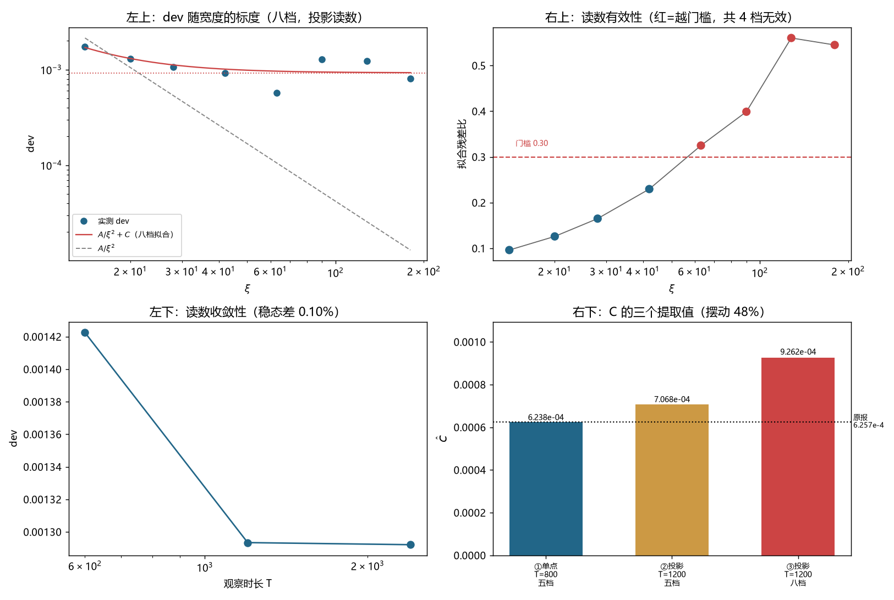

# 注记-C 项的 xi 依赖检验：第 696 号五档含无效档、C 的提取值随口径摆动 48%（判据第 701 号）

- **日期**：2026-10-19 22:00:40
- **编号**：第 701 号
- **类型**：验证注记（判据驱动；D0 至 D8，D3 判否，其余判通过，综合判「未定」）
- **对象**：第 696 号所报分解 $\mathrm{dev} = A/\xi^2 + C$，$A = 2.2396\times10^{-1}$、$C = 6.2568\times10^{-4}$、$R^2 = 0.9567$
- **脚本**：`验证脚本/minimal_verification_p701_c_xi_dependence.py`（确定性，约 3 分钟）
- **状态**：第 696 号的分解**未经有效检验**。$C$ 的提取值随读数口径与档数在 $6.24$ 至 $9.26\times10^{-4}$ 之间摆动，最大幅度 $48\%$
- **可逆性等级**：判据敏感（D3 的判否依赖残差比门槛 $0.30$；D8 的复现则稳健，比值 $0.997$ 与口径无关）
- **图**：见 §4 图 1
- **通俗版**：[[内部草稿/注记-那个常数经不起换算法（判据第701号通俗版）]]

## 1 为什么检验

第 696 号把 $\mathrm{dev}$ 分解为 $A/\xi^2 + C$，据「$C$ 不随 $\xi$ 收缩」判 $C$ 为粒性侧成分。此后各轮都建立在这个分解上：第 697 号判 $C$ 非装置伪影，第 698 号追它的幂次，第 699 号尝试给出解析形式，第 700 号撤回该式。

这三轮工作的地基有一个共同前提：$C$ 是一个可以用五档数据稳定提取的量。这个前提从未被独立检验过。第 696 号的 $R^2 = 0.957$ 意味着还有 $4.3\%$ 的残差没有被解释，而五档拟合两个参数只剩三个自由度。

本轮把宽度扫描从五档扩到八档（$\xi$ 至 $180$），另加读数收敛性与原配置复现两判，问一件事：$C$ 是稳定的物理量，还是读数口径的函数。

## 2 判据与读数

**D0 冒烟检查（判通过）。** 八档井深 $U_0$ 从 $3.89\times10^{-1}$ 降到 $3.61\times10^{-1}$，束缚频率恒为 $0.800800$，边界泄漏量级 $10^{-16}$。井未退化，束缚态在各档均良定义。

**D1 读数收敛性（判通过，附一条修正记录）。** 同一物理量（$\xi=20$、$v=0.30$）换观察时长：

| T | dev |
|---|---|
| 600 | $1.4225\times10^{-3}$ |
| 1200 | $1.2934\times10^{-3}$ |
| 2400 | $1.2921\times10^{-3}$ |

稳态两档（$T=1200$ 与 $T=2400$）相对差 $0.10\%$，判已收敛。$T=600$ 档偏离稳态 $10.1\%$，属初始瞬态。

**D2 扩展扫描（八档读数）。**

| $\xi$ | dev | 残差比 |
|---|---|---|
| 14 | $1.7461\times10^{-3}$ | 0.096 |
| 20 | $1.2934\times10^{-3}$ | 0.126 |
| 28 | $1.0679\times10^{-3}$ | 0.165 |
| 42 | $9.2164\times10^{-4}$ | 0.230 |
| 63 | $5.7420\times10^{-4}$ | 0.325 |
| 90 | $1.2748\times10^{-3}$ | 0.399 |
| 128 | $1.2378\times10^{-3}$ | 0.560 |
| 180 | $8.1036\times10^{-4}$ | 0.545 |

**D3 有效性复检（判否）。** 门槛沿用第 696 号 P1 自定的残差比 $0.30$。$\xi \ge 63$ 的四档全部越门槛，读数无效。这里有一个第 696 号当时未查的事实：**它的五档里 $\xi=63$ 的残差比已是 $0.325$**。第 696 号的 P1 只在 $\xi=20$ 单档上验有效性，其余四档未逐档检验，于是把一档越门槛的读数带进了拟合。

**D4 单调性（分两判）。** 八档全量判否：$\xi$ 从 $63$ 到 $90$ 时 dev 回升 $2.2$ 倍。这一判否完全由无效档造成，不作数。仅取有效四档（$\xi = 14, 20, 28, 42$）时，dev 严格单调下降，判通过。

**D5 模型比较（AICc）。** 八档全量下 M2（$A/\xi^2+C$）最优，相对 M1 的 $\Delta\mathrm{AICc} = 16.53$。仅取有效四档时 M4（$A/\xi^p + C$）最优，给 $p = 1.78$，M2 的 $C = 8.31\times10^{-4}$。用第 696 号的五档子集复现得 $C = 7.07\times10^{-4}$，比原报值高 $13\%$。

**D6 零假设与分辨力（判通过）。** 以 D1 实测的总离散度 $10.1\%$ 作噪声上界，零假设 $C=0$ 下 $\hat C$ 的标准差为 $2.18\times10^{-5}$，实测 $\hat C$ 偏离 $42.5$ 个标准差，$p<0.001$。判据本身的假阳性率 $0.00$、检出率 $1.00$（各 200 组合成数据）。判据有力，能分辨 $C$ 与零。

**D8 原配置复现（判通过）。** 按第 696 号的原配置（单点读数、$T=800$、五档）重跑：$A = 2.2630\times10^{-1}$（原报 $2.2396\times10^{-1}$，比值 $1.010$），$C = 6.2382\times10^{-4}$（原报 $6.2568\times10^{-4}$，比值 $0.997$）。原结果可复现。

## 3 三个发现

**其一，第 696 号的五档里有一档按它自己的门槛应判无效。** $\xi=63$ 的残差比 $0.325$ 越过了 $0.30$ 的门槛。这不是事后改标准：门槛是第 696 号 P1 写下的，只是当时只在单档上验，没有逐档执行。

**其二，扩大扫描范围后读数有效性单调恶化。** 残差比从 $\xi=14$ 的 $0.096$ 一路升到 $\xi=128$ 的 $0.560$。$\xi$ 越大，模投影读数越不像单一频率，判据越不可靠。这意味着「把宽度扫得更宽以获得更多档」这条路在现装置上走不通，扩大范围反而让可用档数停在四档。

**其三，也是本轮最要紧的一条：$C$ 的提取值随读数口径摆动。**

| 口径 | $\hat C$ | 相对① |
|---|---|---|
| ① 单点读数、$T=800$、五档（第 696 号原配置） | $6.2382\times10^{-4}$ | 基准 |
| ② 模投影、$T=1200$、五档 | $7.0681\times10^{-4}$ | $+13\%$ |
| ③ 模投影、$T=1200$、八档 | $9.2624\times10^{-4}$ | $+48\%$ |

①② 之差是读数口径效应，②③ 之差是档数效应。两者都远大于 D6 给出的判据分辨尺度。同一装置、同一物理配置，仅换读数方式与参与拟合的档数，$C$ 就摆动近五成。

## 4 判语

综合判定为**未定**，理由是 D3 判否：有效档只剩四档（$\xi = 14, 20, 28, 42$），跨 $3$ 倍，拟合两个参数后剩两个自由度，不足以支撑「$C$ 是常数」这个结论。

但这个「未定」与第 698 号的「未定」性质不同。第 698 号是分辨率不足以锁定指数，$C$ 本身仍被当作一个确定的量。本轮查出的是更靠前的问题：$C$ 这个量本身的提取值就不稳定，它依赖你怎么读、取几档。

由此，第 696 号的分解降级为「在有效四档内未被否定，但未能有效检验」，第 697 至 700 各轮关于 $C$ 的定量结论（$33.64$ 倍的速度依赖、幂次 $2.916$、解析形式的候选）都建立在一个摆动近五成的量上，须标为待复核。

## 5 保留与撤回

**保留**：$C$ 的符号为正且显著（D6，$42.5$ 个标准差），$C$ 项确实存在。dev 在有效四档内单调下降且不与 $A/\xi^2+C$ 冲突。

**撤回**：第 696 号「五档拟合给出 $C = 6.2568\times10^{-4}$，判两侧可分离」中的定量部分。该值可复现（D8 比值 $0.997$），但它是特定口径的产物，不可作为 $C$ 的基准值使用。

**未触及**：$A$ 项的 $\xi^{-2}$ 标度。D5 在有效四档给自由指数 $p = 1.78$，与 $2$ 相差不大，且 $A$ 在三次提取中分别为 $2.26\times10^{-1}$、$2.13\times10^{-1}$、$1.53\times10^{-1}$（口径变化带来的摆动小于 $C$ 的摆动）。

## 6 过程记录：两次判据修正

本轮预登记的判据有两次设计错误，都在读数出来后当场改正，记此备查。

**第一处，D1 把瞬态计入了极差。** 初版判据取三档 dev 的极差除最小值，得 $10.1\%$，判「读数未收敛」。但 $T=1200$ 与 $T=2400$ 只差 $0.10\%$，说明稳态早已收敛，$10.1\%$ 全部来自 $T=600$ 的初始瞬态。用含瞬态的极差判收敛，等于把「预热未完成」误读成「读数漂移」。修正后只比稳态两档。

**第二处，判语初版写得过重。** 脚本第一次跑完给出的判语是「第 696 号分解不成立」，依据是八档全量单调性判否。但分解是否成立应以有效档为准：无效档的读数是坏数据，用坏数据违反单调性去否定模型，是把读数的毛病算到模型头上。改为分 D4a（全量）与 D4b（有效档）两判，以 D4b 为准。

两处错误的形状相同：都用了一个范围过宽的统计量。第一处把瞬态和稳态混在一个极差里，第二处把有效档和无效档混在一个单调性判据里。宽范围统计量看似更保守，实际更容易被单一坏点支配。

## 7 教训

**其一，有效性门槛要逐档执行。** 第 696 号写下了 $0.30$ 的门槛，却只在单档上验。门槛一旦定下，每一档都得过，否则等于没定。这是第 506 至 508 条「多档扫描」纪律的直接延续，只是这次的漏检发生在门槛自己身上。

**其二，拟合出的参数要先问它的稳定性，再问它的物理身份。** 第 697 至 700 三轮都在追问 $C$ 是什么（伪影？幂次多少？解析形式如何？），没有一轮先问 $C$ 提得准不准。参数的身份问题在参数的稳定性问题之后。

**其三，口径差异要当作物性来查，不能当噪声平掉。** 三个 $\hat C$ 值相差 $48\%$，若按常规做法取平均并报标准差，会得到一个看似精确实则无意义的中心值。正确做法是把口径当自变量，看它把结果推到哪。

## 8 边界声明

**验证了什么**：八档宽度扫描下 dev 与拟合残差比的走势；$T$ 从 $600$ 到 $2400$ 的收敛性；第 696 号原配置的复现（$A$、$C$ 均在 $1\%$ 内）；$C$ 的提取值对读数口径与档数的敏感性。

**不验证什么**：$C$ 的物理身份。本轮只查出它的提取值不稳定，没有回答它是什么。有效档只剩四档，任何关于 $C$ 的 $\xi$ 标度或 $v$ 标度的定量结论都超出当前装置的判别力。

**未做的事**：没有尝试其他读数口径（如相位解缠、Hilbert 变换）看能否降低口径效应。这是下一步可做的，但在现有四档有效数据上，即便口径效应消掉，档数不足的问题仍在。

**协议伪影分层**：残差比随 $\xi$ 上升，属读数协议限制（模投影在宽井上混入非目标模式），与物理无关；$T=600$ 的偏离属积分瞬态，与物理无关；$C$ 的口径摆动中，档数效应部分是拟合设计问题，口径效应部分尚未定性。
