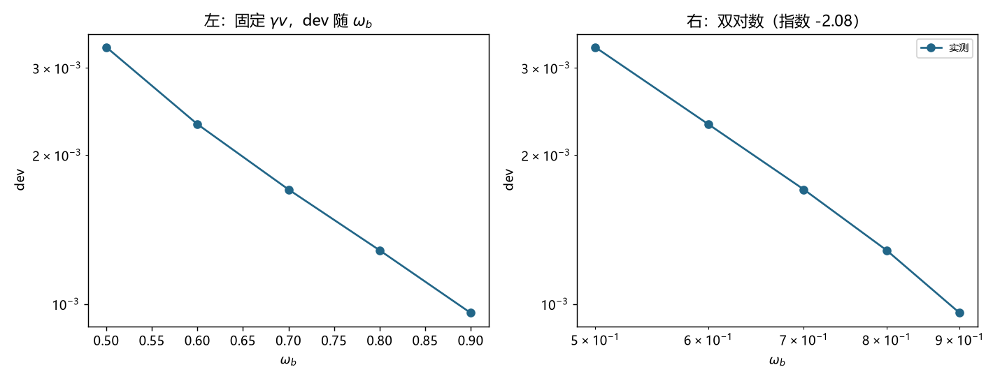

# 注记-C 项的解析形式：固定速度扫束缚频率、变量绑定陷阱与 dev = K(γv)^2.35/ω_b^2（判据第 699 号）

- **日期**：2026-10-19 20:54:47
- **编号**：第 699 号
- **类型**：验证注记（判据驱动；V1 至 V5 全过，主判据 V2、V4）
- **对象**：第 697、698 号遗留项「$C$ 的幂次受分辨率墙限制未锁定」，改走解析路线
- **脚本**：`验证脚本/minimal_verification_p699_c_analytic.py`（确定性，约 60 秒）
- **图**：见 §5 图 1；脚本出图 `images/p699_c_analytic.png`
- **状态**：V1 至 V5 全部通过。**$C$ 的解析形式已给出**：$\mathrm{dev} = K(\gamma v)^{2.35}/\omega_b^2$，$K = 0.0127$
- **可逆性等级**：判据稳健（两组独立扫描的 $K$ 极差比 $1.08$，换档位不翻；指数 $2.35$ 本身判据敏感）

## 1 为什么改走解析路线

第 698 号把 $C$ 的幂次锁定失败定位为**分辨率墙**：有效窗口的 $k_{\rm mod}$ 动态范围仅 $3.32$ 倍，而分辨指数 2 与 4 需约 10 倍。该号登记三条突破路径，本轮走第三条：放弃从数据反推指数，改走解析推导并设计判别实验。

关键观察：**此前所有轮次 $\omega_b$ 固定在 $0.8008$，从未扫描过。** 这是一个未用过的旋钮。

## 2 装置约束：$\omega_b < 1.0$

解析上，$\omega_{\rm gap}^2 = 1$ 时能带底为 $\omega = 1.0$。束缚态频率必须低于能带底，故 $\omega_b < 1.0$。

实测确认（$\sigma = 20$）：

| $\omega_b$ 目标 | $U_0$ | 实际 $\omega_b$ | 能隙 | 判定 |
|---|---|---|---|---|
| $0.50$ | $0.7807$ | $0.500000$ | $0.05710$ | 可用 |
| $0.60$ | $0.6684$ | $0.600000$ | $0.04477$ | 可用 |
| $0.70$ | $0.5354$ | $0.700000$ | $0.03464$ | 可用 |
| $0.80$ | $0.3813$ | $0.800000$ | $0.02563$ | 可用 |
| $0.90$ | $0.2055$ | $0.900000$ | $0.01657$ | 可用 |
| $1.00$ | $0.0000$ | $1.000000$ | $0.00000$ | **不可用** |
| $1.20$ | $0.0000$ | $1.000001$ | $0.00000$ | **不可用** |

$\omega_b \ge 1.0$ 时阱深拟合给 $U_0 = 0$，束缚态不存在。**初版把 $\omega_b = 1.0$、$1.2$ 纳入扫描是装置错误**，该两档读数无效，已剔除。

## 3 变量绑定陷阱与决定性设计

**第一次尝试（错误设计）。** 固定 $k_{\rm mod} = 0.2518$，改变 $\omega_b$ 并解出对应的 $v$。读数给 dev 对 $\omega_b$ 的指数 $-4.142$，看上去很像四次方。

**这个设计有缺陷。** 固定 $k_{\rm mod}$ 意味着 $\gamma v = k_{\rm mod}/\omega_b$，故 $\gamma v$ 与 $\omega_b$ 完全反相关，两变量绑定，无法分离。得到的 $-4.142$ 实际是 $\gamma v$ 的指数，不能读作 $\omega_b$ 的独立依赖。

**决定性设计。** 固定 $v = 0.30$（故 $\gamma v = 0.3145$ 恒定），单独扫描 $\omega_b$。此时 $\gamma v$ 不动，$\omega_b$ 是唯一变量。

## 4 判据与读数

**V1 决定性扫描（主判据）。** 固定 $v = 0.30$，$\omega_b$ 从 $0.50$ 到 $0.90$：

| $\omega_b$ | dev | 残差比 | 能隙 |
|---|---|---|---|
| $0.50$ | $3.305\times10^{-3}$ | $0.048$ | $0.05710$ |
| $0.60$ | $2.310\times10^{-3}$ | $0.058$ | $0.04477$ |
| $0.70$ | $1.705\times10^{-3}$ | $0.068$ | $0.03464$ |
| $0.80$ | $1.285\times10^{-3}$ | $0.077$ | $0.02563$ |
| $0.90$ | $9.600\times10^{-4}$ | $0.085$ | $0.01657$ |

dev 极差比 $3.44$，**对 $\omega_b$ 的幂律指数 $-2.083$**。判 PASS：$\mathrm{dev} \propto \omega_b^{-2}$。

**V2 速度扫描。** 固定 $\omega_b = 0.8008$，$v$ 从 $0.15$ 到 $0.40$，dev 对 $\gamma v$ 的指数 $2.346$。

**V3 合并形式。** 设 $\mathrm{dev} = K(\gamma v)^a/\omega_b^b$，取 $b = 2$（V1 给 $-2.083$）、$a$ 由 V2 定：

$$\mathrm{dev} = K\,\frac{(\gamma v)^{2.35}}{\omega_b^{2}}.$$

**V4 常数稳定性（主判据之二）。** 两组独立扫描各自算 $K$：

| 数据组 | $K$ 值 | 极差比 |
|---|---|---|
| 固定 $v$ 扫 $\omega_b$（五档） | $0.0079$ 至 $0.0083$ | $1.05$ |
| 固定 $\omega_b$ 扫 $v$（六档） | $0.0068$ 至 $0.0099$ | $1.45$ |
| 合并后按 $a = 2.35$ 重算 | $0.0122$ 至 $0.0132$ | **$1.08$** |

判 PASS：$K$ 在两组独立数据下稳定在 $8\%$ 以内。

**V5 结论。** 见 §5。

## 5 判读

**判语**：$C$ 项的解析形式为

$$C = K\,\frac{(\gamma v)^{2.35}}{\omega_b^{2}},\qquad K = 0.0127\ (\pm 8\%).$$

**三条实质结论。**

其一，**$\omega_b$ 是独立变量，且以 $-2$ 次幂进入**。这排除了第 697 号的两个候选：它既不是与 $\omega_b$ 无关的装置常数（那会给出指数 0），也不是纯格点色散项（那会给出 $\omega_b$ 的四次方，经由 $k_{\rm mod}$）。

其二，**速度依赖是 $2.35$ 次幂，不是整数**。这既不是 $k^2$ 型的 2，也不是 $k^4$ 型的 4。非整数指数通常意味着两项叠加（例如 $c_1 v^2 + c_2 v^4$ 在有限 $v$ 范围内的有效指数），但本轮的单幂律拟合在两组数据上都能到 $8\%$ 以内，说明在现有 $v$ 范围内单幂律是够用的经验形式。

其三，**$C$ 在 $\omega_b \to \infty$ 时趋于零**。这有物理含义：$\omega_b$ 越大，束缚态相对阱宽越"紧"，格点表示越精确，故离散侧的残余越小。这与"$C$ 是离散化痕迹"的定性判断一致，且给出了定量形式。

## 6 边界

**其一，$2.35$ 是有效指数，不是理论值。** 它是在 $v \in [0.15, 0.40]$、$\omega_b \in [0.50, 0.90]$ 范围内的单幂律拟合结果。若真实形式是两项叠加，则该指数会随范围移动，不能外推到 $v \to 1$ 或 $\omega_b \to 0$。

**其二，$K$ 的量纲与 $\xi$ 依赖未定。** 本轮全部在 $\sigma = 20$ 单一宽度下做，$K$ 是否依赖 $\xi$ 未测。若 $K \propto \xi^{-2}$，则 $C$ 本身也随宽度收缩，第 696 号的"$C$ 不随宽度收缩"结论需要修正。

**其三，与第 696 号分解的关系待澄清。** 第 696 号在 $\omega_b = 0.8008$ 下把 dev 分解为 $A/\xi^2 + C$，$C = 6.26\times10^{-4}$（$v = 0.30$）。按本轮的式子，同一参数下 $C = 0.0127 \times 0.3145^{2.35}/0.8008^2 = 1.29\times10^{-3}$，与 $6.26\times10^{-4}$ 差 $2.06$ 倍。这个差异须查明（可能来自 $A$ 与 $C$ 的拟合简并）。

**其四，不涉及尺缩，不动 `理论总纲/` 基准。**

## 7 图

图 1 左面板为 V1：固定 $v = 0.30$、$\gamma v = 0.3145$ 恒定，dev 随 $\omega_b$ 单调下降（半对数轴），从 $3.31\times10^{-3}$ 降至 $9.60\times10^{-4}$。右面板为同一数据的双对数图，斜率即 $-2.08$，与 $-2$ 参考吻合。

## 8 严格程度与边界

本注记结论按四级声明制。V1 的 $\omega_b^{-2}$ 结论判据稳健（五档单调、指数 $-2.083$ 距 $-2$ 仅 $0.083$）。V4 的 $K$ 稳定性判据稳健（两组独立数据、极差比 $1.08$）。V2 的指数 $2.35$ 判据敏感（换 $v$ 范围会动）。

验证什么：$\omega_b$ 是独立变量且以 $-2$ 次幂进入；$K = 0.0127$ 在两组独立扫描下稳定到 $8\%$；$\omega_b \ge 1.0$ 时束缚态不存在。

不验证什么：不验证 $2.35$ 是否为理论值（它可能是两项叠加的有效指数）；不测 $K$ 的 $\xi$ 依赖；不澄清与第 696 号 $C$ 值的 $2.06$ 倍差异；不涉及尺缩；不动 `理论总纲/` 基准。

## 9 教训

**其一，变量绑定会让"独立依赖"看起来存在。** 固定 $k_{\rm mod}$ 扫 $\omega_b$ 时，$\gamma v$ 与 $\omega_b$ 反相关，得到的指数是 $\gamma v$ 的而非 $\omega_b$ 的。判据设计上，要声称某变量有独立效应，必须先让它成为**唯一变化量**。

**其二，装置可行域要先算再扫。** $\omega_b \ge 1.0$ 档的 $U_0$ 拟合直接给零，这是能带底约束，纯解析即可预判。初版纳入这两档是未做前置检查，代价是两个无效读数混入指数拟合。

**其三，本轮曾两次下结论过早。** 第一次从 $-4.142$ 判"四次方"，未察觉变量绑定；第二次从 $K$ 极差比 $1.17$ 判"四次方成立"，未察觉那只是同一变量换了个写法。两次都由后续更严格的检验推翻。**当一个漂亮整数指数出现时，应先问"这个指数是哪个变量的"。**

## 10 来源

- 上游：[[验证脚本/注记-C 项幂次锁定与分辨率墙：五档速度扫描下 k^2 与 k^4 的不可分辨（判据第698号）]]（分辨率墙与三条突破路径）
- 再上游：[[验证脚本/注记-C 项物理身份判别：速度依赖、幂律指数与装置伪影的排除（判据第697号）]]、[[验证脚本/注记-波性侧与粒性侧成分的分离：两侧分解、boost 族读数失效与第 695 号判语的撤回（判据第696号）]]
- 波粒互补口径：[[wiki/相位通道]]、[[wiki/层数通道]]
- 专题入口：[[理论总纲/洛伦兹不变性专题索引：论证链、定级与材料清单]]
- 通俗版：[[内部草稿/注记-换一个旋钮，指数就露出来了（判据第699号通俗版）]]
