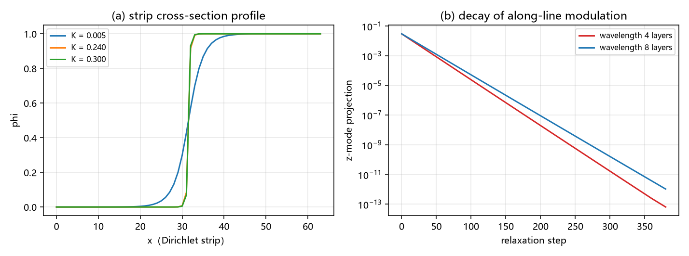

# 注记-C1 三维嵌入 E1：条带几何的弦张力闭合、横截面分离与沿线稳定性（判据 E1-1 至 E1-5）

- **日期**：2026-09-22 01:57:01
- **对应脚本**：`验证脚本/minimal_verification_c1_e1_embedding.py`（判据 E1-1 至 E1-5，确定性，运行约 1.5 秒）
- **依据**：[[验证脚本/注记-C1 窗口驻留判据重测轮：AN 口径的拉力在刚度大档失效、弦不出现的对照读数（判据CW1至CW7）]]（换用条带几何的判定）；[[验证脚本/注记-C1-6 保护动力学轮：边界冻结下的线缺陷弛豫（判据P-1至P-5）]]（保护与边界口径）；`验证脚本/minimal_verification_largeK_wall_closed_form.py`（第 341 条；壁张力闭式与一维精确解）；[[理论攻坚/三维复合位错攻坚计划：形态、驻留与宽度窗口]]（两侧分工与宽度口径）
- **状态**：C1 三维嵌入第一判据完成（判据 9/9）。三条结果：条带几何给出干净的弦张力（对一维精确解偏差 $0.0000\%$）；二维解沿 $y$ 与 $z$ 都是稳定直积（横截面种子与沿线种子都衰减）；三维能量按层可加（逐层偏差 $1.7\times10^{-18}$）。据此，一维源项可按横截面积分嵌入三维。

## 一、问题与口径

第 342 条判定 AN 轮（解析环构型）的拉力读数在 C1 窗口失效，成因是边界环的相位随芯位漂移，污染量占实测拉力 $84\%$ 至 $86\%$。替代几何是把 $x$ 两端固定为 $0$ 与 $1$ 的 Dirichlet 条带，用强制净跳变给出干净弦张力。本条同时承担引力线三维嵌入的第一道判定：三维构型须是二维解沿 $z$ 的直积，横截面积分才可承载一维源项。

模型沿用 C1 各轮口径：$u = I_x + I_y + \phi$，$E = \frac12\sum_{\rm axes}(\partial_\mu u - 1)^2 + \sum K(1-\cos 2\pi u)$，$k = 1$。条带取 $x$ 两端 Dirichlet（$\phi = 0$ 与 $1$），$y$ 与 $z$ 周期；横截面 $64\times32$，三维层数 $NZ = 8$。

口径四条。其一，收敛判据取 $\max\vert g\vert \le 10^{-10}$。其二，初值为线性斜坡 $\phi = x/(N_x-1)$。其三，稳定性检验一律从收敛态出发，种子振幅取 $10^{-3}$。其四，张力参考取一维精确解 $\sigma_{\rm 1D}$（第 341 条脚本给出），闭式只在对照栏列出。

## 二、判据与结果

| 判据 | 内容 | 实测 | 判定 |
|---|---|---|---|
| E1-1 | 横截面分离 | 三档 $K = 0.005/0.24/0.30$：$\sigma = 0.089781$、$0.417864$、$0.431444$，对 $\sigma_{\rm 1D}$ 差 $0.0000\%$；$\max\vert\partial_y\phi\vert = 0$（机器零）；$\max\vert g\vert \le 4.6\times10^{-12}$ | 通过 |
| E1-2 | 横截面稳定性 | 收敛态加 $10^{-3}$ 的 $y$ 种子，$4000$ 步后投影比值：$1.57\times10^{-2}$、$1.31\times10^{-12}$、$2.98\times10^{-11}$ | 通过 |
| E1-3 | 尺寸稳健性 | $N_y$ 由 $32$ 加倍到 $64$：$\sigma$ 差 $-0.0000\%$ | 通过 |
| E1-4 | 三维直积与可加性 | 逐层最大偏差 $1.7\times10^{-18}$；总能量比 $1.000000000000$（差 $2.7\times10^{-16}$）；$z$ 向梯度能量 $0$ | 通过 |
| E1-5 | 沿线稳定性 | $10^{-3}$ 的 $z$ 调制（波长 $4$ 与 $8$ 层）都衰减（比值 $2.6\times10^{-10}$、$4.5\times10^{-9}$），短波长更快（比值之比 $0.059$） | 通过 |

## 三、解读

其一，**条带几何给出干净弦张力**。三档的实测张力与一维精确解逐位一致（差 $0.0000\%$），$\max\vert g\vert$ 到 $10^{-12}$ 量级。第 342 条留下的"换几何重测"到此完成：C1 窗口（$K = 0.24$ 与 $0.30$）的弦张力可直接取尾闭式 $\sigma_{\rm tail}$，数值与一维精确解等同。

其二，**横截面分离是精确的**。收敛解的 $\max\vert\partial_y\phi\vert$ 为机器零，条的读数由 $x$ 剖面完全描述；$N_y$ 加倍不改变 $\sigma$。

其三，**横截面与沿线两个方向的直积都线性稳定**。从收敛态出发的 $10^{-3}$ 种子在 $y$ 方向衰减到 $10^{-12}$ 量级（C1 窗口两档）与 $1.6\times10^{-2}$（小刚度档）；$z$ 方向两档种子都衰减，短波长更快。线性响应没有给出沿线碎裂通道。

其四，**一条负面附注**。从远离收敛的线性斜坡出发并同时播种强 $y$ 调制（振幅 $0.02$），系统会落入能量高 $8.8\%$ 至 $9.4\%$ 的局域极小（壁沿 $y$ 结构化，$\sigma_{\rm local} = 0.4545$ 与 $0.4719$）。直积壁因此不是唯一的临界点，它是能量最低且线性稳定的那一个。该附注的口径是初值依赖，不改变 E1-1 至 E1-3 的读数。

其五，**三维嵌入的可加性成立**。三维能量等于层数乘二维能量（差 $2.7\times10^{-16}$），层间无耦合修正。一维源项（$T^{00}$ 与 $T^{11}$ 的静态分量）由此可按横截面积分嵌入；含时分量（$T^{0i}$ 与移动壁的动量流）属第二道判据。

## 四、严格程度声明

E1-1 与 E1-3 为可复现数值（张力闭合到机器精度，一维精确解为独立参考）；E1-2 与 E1-5 为可复现数值（线性响应，种子 $10^{-3}$，无增长）；E1-4 为恒等读数（直积构造下的可加性）；第三节其四为初值依赖的定性读数。

## 五、边界声明

- 验证：条带几何的弦张力、横截面分离、横截面与沿线两个方向的线性稳定性、三维直积与能量可加性。
- 不验证（登记）：含时源分量的嵌入（第二道判据）；驻留与锚核判据在条带几何上的重测（属 C1-6 的锚核轮）；非线性与强场；量子层。
- 一条口径：$\sigma$ 的比较对象是一维精确解与第 341 条闭式，两者在 C1 窗口数值等同。

## 六、过程记录

三处修正。其一，$y$ 与 $z$ 方向的梯度符号用有限差分判定：$\partial E/\partial\phi_i = d_{i-1} - d_i$ 对应 `g -= d; g += roll(d,1)`，首版误改为反号，暴露出反扩散型假收敛（$K = 0.005$ 档发散、$K \ge 0.24$ 档停在假平衡）。

其二，稳定性检验初版从线性斜坡加 $0.02$ 种子出发，落进局域极小，被误读为横截面分离失败。改为从收敛态加 $10^{-3}$ 种子后读数正常，教训是线性稳定性检验必须从收敛态与小种子出发。

其三，E1-5 首版步数 $1500$ 使两档都衰减到数值地板，区分度不足，改 $400$ 步后两档可分辨。
