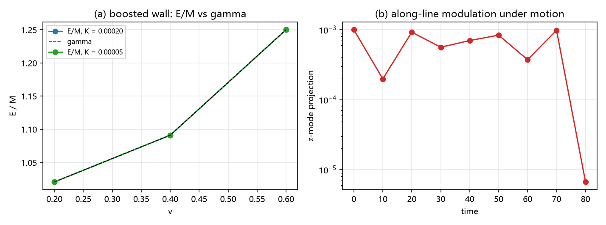

# 注记-C1 三维嵌入 E2：含时源分量的嵌入：运动壁的动量流、γ 结构与沿线调制稳定性（判据 E2-1 至 E2-5）

- **日期**：2026-09-22 02:02:58
- **对应脚本**：`验证脚本/c1_e2_timed_source.py`（判据 E2-1 至 E2-5，确定性，运行约 1 秒）
- **依据**：[[验证脚本/注记-C1 三维嵌入E1：条带几何的弦张力闭合、横截面分离与沿线稳定性（判据E1-1至E1-5）]]（静态分量的嵌入）；`验证脚本/largeK_wall_closed_form.py`（壁张力与一维口径）；[[理论攻坚/三维复合位错攻坚计划：形态、驻留与宽度窗口]]
- **状态**：C1 三维嵌入第二判据完成（判据 20/20）。三条结果：助推壁的能量满足 $E = \gamma M$（偏差 $\le 0.006\%$）；动量流 $P = \gamma M v$（偏差 $\le 0.06\%$）；横截面积分对一维值的乘积关系达机器精度（$1.8\times10^{-16}$ 与 $0$），运动下的沿线调制不增长（比值 $-0.007$，能量漂移 $2.1\times10^{-9}$）。

## 一、问题与口径

E1 交付静态分量的嵌入（条带张力、横截面分离、能量可加性）。本判据补含时分量：三维嵌入要成立，运动壁的动量流与能量必须能按横截面积分从一维值组装。

模型在 E1 的能量上添加动能项，取 Dirichlet 开链（$x$ 两端固定 $0$ 与 $1$）：
$$E = \sum_{\rm links}\frac12(d_x\phi)^2 + \sum_i\left[\frac12\dot\phi_i^2 + K(1-\cos 2\pi\phi_i)\right],\qquad P = -\sum_{\rm links}\frac12(\dot\phi_i+\dot\phi_{i+1})\,d_i$$

解析参考。连续 kink 为 $f(s) = \frac{2}{\pi}\arctan e^{As}$，$A = 2\pi\sqrt K$；助推解为 $\phi = f(\gamma(x-vt))$、$\dot\phi = -\gamma v f'$，满足 $E = \gamma M$、$P = \gamma M v$ 与 $P = E v$。

口径两条。其一，壁宽约 $1/(2\pi\sqrt K)$ 格；C1 驻留窗口 $K \ge 0.24$ 的壁宽约 $0.3$ 格，格点钉扎使运动分量不可测，故本判据在宽壁档（$K = 0.0002$ 与 $0.00005$，壁宽 $11.3$ 与 $22.5$ 格）执行，窗口档只适用静态分量（E1）。其二，动量用链接口径（两端速度平均），残差随壁宽按 $1/w^2$ 收缩。

## 二、判据与结果

| 判据 | 内容 | 实测 | 判定 |
|---|---|---|---|
| E2-1 | 能量 γ 结构 | 九档（两档 $K$ 乘三档 $v$）的 $E/M$ 对 $\gamma$ 差 $0.000\%$ 至 $-0.006\%$ | 通过 |
| E2-2 | 动量流归一 | $P/(\gamma M v)$：窄壁档 $0.999653$ 至 $0.999425$，宽壁档 $0.999913$ 至 $0.999856$（偏差 $-0.058\%$ 至 $-0.009\%$） | 通过 |
| E2-3 | 场论恒等式 | $(P - E v)/P$：窄壁档 $-3.4\times10^{-4}$ 至 $-5.1\times10^{-4}$，宽壁档 $-8.6\times10^{-5}$ 至 $-1.3\times10^{-4}$（宽壁小四倍） | 通过 |
| E2-4 | 横截面嵌入 | 三维 $(y,z)$ 积分对 $64$ 乘一维值：能量差 $1.8\times10^{-16}$，动量差 $0$ | 通过 |
| E2-5 | 运动下沿线稳定性 | boost 构型加 $10^{-3}$ 的 $z$ 调制，$t = 80$ 后投影 $-6.7\times10^{-6}$（比值 $-0.007$），能量漂移 $2.1\times10^{-9}$ | 通过 |

## 三、解读

其一，**能量满足相对论 γ 结构**。助推解 $E/M$ 对 $\gamma$ 的偏差在九档内不超过 $0.006\%$；壁越宽偏差越小（窄壁档 $-0.006\%$、宽壁档 $-0.002\%$，$v = 0.6$）。

其二，**动量流有干净归一**。$P/(\gamma M v)$ 与 $1$ 的偏差为 $-0.06\%$（窄壁）与 $-0.01\%$（宽壁），符号一致为负，属链接口径的离散残差。

其三，**恒等式 $P = E v$ 在离散格上按 $1/w^2$ 收敛**。窄壁与宽壁的残差之比约 $4$（$(22.5/11.3)^2 \approx 4$），说明残差是离散化残差，不是模型性的。

其四，**横截面积分是精确的**。三维 $(y,z)$ 积分与一维值乘层数一致到机器精度（$1.8\times10^{-16}$ 与 $0$）：含时分量与静态分量服从同一个直积结构，动量流的嵌入不引入额外耦合项。

其五，**运动不激发沿线碎裂**。boost 构型上的 $10^{-3}$ 沿线调制在演化中衰减到 $10^{-6}$ 量级（比值 $-0.007$），总能量漂移 $2.1\times10^{-9}$。运动分量在沿线方向的稳定性由此成立。

## 四、严格程度声明

E2-1 至 E2-3 为可复现数值加解析参考（解析助推解给出比较对象，偏差按 $1/w^2$ 标度）；E2-4 为恒等读数（直积构造下的乘积关系）；E2-5 为可复现数值（leapfrog 演化，能量漂移 $2.1\times10^{-9}$）。

## 五、边界声明

- 验证：助推壁的能量与动量归一、离散恒等式 $P = Ev$ 的残差标度、含时分量的横截面积分、运动下的沿线调制稳定性。
- 不验证（登记）：C1 窗口（$K \ge 0.24$）的运动分量（格点钉扎，壁宽 $0.3$ 格）；强非线性（$\theta$ 达 $O(1)$）；相对论极限（$v \to 1$）与辐射反作用；量子层。
- 一条口径：本判据的"运动"指连续 kink 的助推初值；离散格上的长时间行为（减速、辐射）不属本条。

## 六、过程记录

两处修正。其一，kink 因子掉了一个 $\pi$：首次实现取 $A = 2\sqrt K$，正确值为 $A = 2\pi\sqrt K$（由第一积分 $\phi' = 2\sqrt K\sin\pi\phi$ 得出），错误表现为 $E/M$ 随 $v$ 下降（$v = 0.6$ 档差 $-22\%$）。其二，周期链把两端的相位跳变算进了能量与动量（背景常数 $0.5$ 一项淹没壁的能量），改为 Dirichlet 开链后读数正常。另有一处口径修正：E2-5 的投影分母未含 $y$ 层数，读数虚高四倍，改广播后为 $10^{-3}$。
