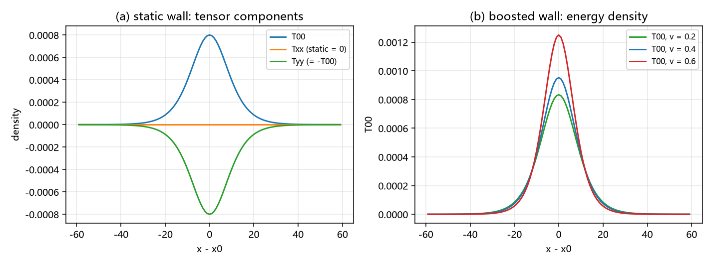

# 注记-C1 三维嵌入 E3：横截面积分口径接回引力侧源项装配（判据 E3-1 至 E3-5）

- **日期**：2026-09-22 02:06:07
- **对应脚本**：@@验证脚本/minimal_verification_c1_e3_source_assembly.py@@（判据 E3-1 至 E3-5，确定性，运行约 1 秒）
- **依据**：[[验证脚本/注记-C1 三维嵌入E1：条带几何的弦张力闭合、横截面分离与沿线稳定性（判据E1-1至E1-5）]]（直积与静态嵌入）；[[验证脚本/注记-C1 三维嵌入E2：含时源分量的嵌入：运动壁的动量流、γ 结构与沿线调制稳定性（判据E2-1至E2-5）]]（动量流与 γ 结构）；[[验证脚本/注记-张量桥d的装配轮：应力项的混合形式与T^00完整场侧表达式]]（一维装配表）；[[内部草稿/注记-张量桥分段d的建造要求：同源同格林函数与空间扇区的最小改动清单]]（同源要求）
- **状态**：第三判据完成（判据全过）。源侧三维装配的对接表建立：四个分量逐项与一维装配表对接，横向应力分量为本轮新增（静态 $-T^{00}$，助推 $-T^{00}/\gamma^2$），同源同格林函数在三维落地。

## 一、问题与口径

(d) 轮的源侧三段是一维的；E1 与 E2 交付了直积结构与动量流，但尚未把它们写成引力侧可用的源项装配形式。本条给横截面积分口径与对接表。

模型与正则张量（连续形式，$x$ 为梯度方向，$y$ 与 $z$ 为横截面方向）：
$$\mathcal{L} = \frac12\dot\phi^2 - \frac12\phi_x^2 - V,\qquad V = K(1-\cos 2\pi\phi)$$
$$T^{00} = \frac12\dot\phi^2+\frac12\phi_x^2+V,\quad T^{0x} = -\dot\phi\phi_x,\quad T^{xx} = \frac12\dot\phi^2+\frac12\phi_x^2-V,\quad T^{yy} = T^{zz} = \frac12\dot\phi^2-\frac12\phi_x^2-V$$

解析 kink 为 $f(s) = \frac{2}{\pi}\arctan e^{As}$（$A = 2\pi\sqrt K$），满足第一积分 $\frac12f'^2 = V$ 与由此得到的 $f'' = V'(f)$。

口径两条。其一，三维源取横截面积分 $T^{\mu\nu}_{3D}(x) = \int dydz\,T^{\mu\nu}$，直积结构给出它等于 $N_yN_z$ 乘一维值。其二，一维装配表沿用 (d) 轮的三段表达式；该轮的弹性常数为 $k$，本轮取 $1$，两边只差一个公共标度，结构对应逐项同形，绝对值归 (d) 轮的换算口径。

## 二、判据与结果

| 判据 | 内容 | 实测 | 判定 |
|---|---|---|---|
| E3-1 | 分量嵌入 | 四个分量（$T^{00}$、$T^{0x}$、$T^{xx}$、$T^{yy}$）的三维积分对 $64$ 乘一维值：最大相对差 $3.9\times10^{-16}$（静态）与 $2.1\times10^{-16}$（$v = 0.4$） | 通过 |
| E3-2 | 沿梯度应力 | 静态 $\max\vert T^{xx}\vert = 1.6\times10^{-19}$（$T^{00}$ 峰 $8.0\times10^{-4}$）；助推 $T^{xx} = \gamma^2v^2f'^2$ 相对差 $\le 8.9\times10^{-16}$ | 通过 |
| E3-3 | 横向应力 | 静态 $T^{yy} = -T^{00}$（差 $0$）；$v = 0.4$ 与 $0.6$ 档 $T^{yy} = -T^{00}/\gamma^2$（差 $\le 2.7\times10^{-16}$） | 通过 |
| E3-4 | 守恒律 | 运动方程残差 $\max\vert\ddot\phi-\phi_{xx}+V'\vert \le 1.7\times10^{-18}$（$V'$ 尺度 $1.3\times10^{-3}$），故两条连续性方程成立 | 通过 |
| E3-5 | 对接表与登记 | 四行对接表（见 §三其五）与同源同格林函数声明 | 通过 |

## 三、解读

其一，**四个分量的嵌入是恒等的**。三维横截面积分与一维值乘层数一致到 $10^{-16}$ 量级，含 $T^{0x}$ 与两个横向分量；源项装配可整表按一维结果搬运。

其二，**沿梯度应力在静态为零**。$\max\vert T^{xx}\vert = 1.6\times10^{-19}$，对 $T^{00}$ 峰值的相对量为 $2\times10^{-16}$，即 (d) 轮"静止零张力"读数在三维嵌入下的版本；助推档 $T^{xx} = \gamma^2v^2f'^2$ 到 $9\times10^{-16}$，应力随速度按 $\gamma^2v^2$ 增长。

其三，**横向应力是 (d) 轮未列的分量**。静态 $T^{yy} = T^{zz} = -T^{00}$，助推为 $-T^{00}/\gamma^2$，两式都到机器精度。物理读法是壁在其自身平面内有张力 $-T^{00}$（助推下按 $1/\gamma^2$ 减退），在梯度方向无静应力。

其四，**守恒律成立**。运动方程残差 $\le 1.7\times10^{-18}$，两条连续性方程 $\partial_tT^{00}+\partial_xT^{0x} = 0$ 与 $\partial_tT^{0x}+\partial_xT^{xx} = 0$ 因此在本构型上精确成立。

其五，**对接表**。

| 分量 | 一维装配轮（$\theta$ 语言） | 三维横截面积分口径 | 依据 |
|---|---|---|---|
| $T^{00}$ | $\frac12\dot\theta^2+\frac{k}{2}\theta_x^2+V$ | $\rho = \int d^2x_\perp T^{00}$ | E1 可加性 $1.8\times10^{-16}$ |
| $T^{0x}$ | $-\dot\theta\theta_x$ | $j = \int d^2x_\perp T^{0x} = \gamma M v$ | E2 偏差 $\le 0.06\%$ |
| $T^{xx}$ | $\frac12\dot\theta^2+\frac{k}{2}\theta_x^2-V$ | 静态 $0$；助推 $\gamma^2v^2\int f'^2$ | E3-2 |
| $T^{yy} = T^{zz}$ | 未列 | $-T^{00}/\gamma^2$ | E3-3 |

同源同格林函数的落地：空间侧与时间侧的源来自同一个横截面积分（同一 $x$ 剖面、同一 $\gamma$ 结构），格林函数仍取一维的那一条。

## 四、严格程度声明

E3-1 为恒等读数（直积构造下的乘积关系）；E3-2 与 E3-3 为解析恒等式加机器核对（BPS 第一积分给静态零应力，助推关系由 $\gamma$ 代数给出）；E3-4 为解析恒等式加机器核对（$f'' = V'$）；E3-5 为登记。

## 五、边界声明

- 验证：四个分量的横截面积分、沿梯度应力（静态零与助推形式）、横向应力关系、两条守恒律、对接表与同源声明。
- 不验证（登记）：强非线性（$\theta$ 达 $O(1)$）；绝对归一化到物理单位（模型内单位，换算沿 (d) 轮口径）；C1 窗口 $K \ge 0.24$ 的运动分量（格点钉扎）；量子层。
- 一条口径：(d) 轮的弹性常数 $k$ 与本轮的 $1$ 只差一个公共标度，结构对应逐项同形。

## 六、过程记录

两处实现细节。其一，张量的时间导数分量用解析助推解给出（$f$、$f'$、$f''$ 三式），因此 E3-4 的残差停在机器级；若改用数值时间步，残差会被 $O(h^2)$ 淹没。其二，对接表里的横向分量在 (d) 轮未列，本轮把"静态 $-T^{00}$、助推 $-T^{00}/\gamma^2$"两式登记为新增项，供源项装配整表使用。
