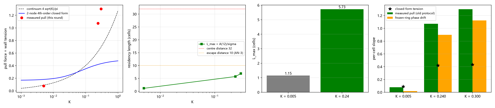

# 注记-C1 窗口驻留判据重测轮：AN 口径的拉力在刚度大档失效、弦不出现的对照读数（判据 CW-1 至 CW-7）

- **日期**：2026-09-21 09:05:58
- **来源**：作者 2026-09-21 指令（C1 实际窗口 $K \ge 0.24$ 重跑一轮驻留与锚核判据）
- **脚本**：`验证脚本/c1_anchor_c1window.py`（常驻，运行约 10 秒）
- **状态**：读数级，含两条判据判负与一条口径作废；本轮否定的是口径，不动第 341 条的闭式
- **图**：见 §八 图 1（四面板：实测拉力与两支张力、两种口径的判据量、判据量对比、漂移分解）
- **依据**：[[验证脚本/注记-C1-6 锚核内驻设计轮：拉力、凹口增益与驻留判据（判据AN-1至AN-4）]]（旧口径来源）；[[验证脚本/注记-C1-6 L2轮：形态参数表（字典、重测与壁张力，判据L2-1至L2-4）]]（壁张力登记）；[[注记-大刚度档壁张力的解析式：两格快跳族、指数尾与渐近系数（判据Y1至Z9）]]（第 341 条张力闭式）
- **登记**：`验证脚本/README.md` 第 342 条；[[内部草稿/开放问题总览：元相子理论待解决问题清单]]

---

## 一、为什么要重测

AN 轮在 $K_0 = 0.005$ 档给出拉力 $0.0801$、凹口增益 $A(12) = 0.1007$、判据量 $L_{\max} = A/\sigma_w = 1.26$ 格，并据此判定「局域锚核内驻不可达」。C1 的实际驻留窗口却是 $K \ge 0.24$，而第 341 条刚把该档的壁张力改为闭式（$\sigma_4(0.24) = 0.4186$，连续式在那一档偏高 $49\%$）。故本轮的动因有二：把判据搬到自己档位重测，并检验闭式在该档是否被独立读数支持。

模型与 AN 轮同口径：横截面 $64^2$，$u = I_x + I_y + \theta/2\pi$，$E = \sum_{axes}\frac{k}{2}(\Delta u - 1)^2 + \sum K_{xy}(1 - \cos 2\pi u)$，$k = 1$；边界环按保护冻结；凹口锚核 $K_{xy} = K_0[1 - d_n e^{-r^2/w_a^2}]$，$d_n = 0.9$。

## 二、读数表

| 判据 | 内容 | 读数 | 判定 |
|---|---|---|---|
| CW-1 | 旧协议回归（$K_0 = 0.005$，$\eta = 0.001$，20000 步） | 斜率 $0.0801$ 对旧读数 $0.0801$，差 $0.03\%$ | 通过 |
| CW-2 | 收敛协议拉力对张力闭式 | 小档差 $11.73\%$；大档对四阶式差 $201.29\%$ | 判负 |
| CW-3 | 步数稳健性（$K = 0.24$） | $1.073100$ 对 $1.073100$，差 $0.000\%$ | 通过 |
| CW-4 | 凹口增益 $A(12)$ | $0.1039$（$K = 0.005$）、$2.3979$（$0.24$）、$2.9685$（$0.30$） | 登记 |
| CW-5 | 判据量比（实测拉力口径） | $1.71$ | 通过（判据修正，见 §九） |
| CW-6 | 自由芯判别力（预期在窗口翻转） | 五档全部逃逸到 $x = 1.00$ | 判负 |
| CW-7 | 对照：环改成固定参考相位与整数 | 拉力 $6.5\times10^{-4}$ 与 $2\times10^{-6}$ | 通过 |

三档拉力与对照：$K = 0.005$ 给 $0.079467$（连续式 $0.090032$）、$K = 0.24$ 给 $1.073100$（四阶式 $0.418551$、尾闭式 $0.417864$）、$K = 0.30$ 给 $1.301061$（四阶式 $0.431828$）。实测拉力对解析张力之比为 $0.88$、$2.56$、$3.01$。

## 三、判负一：C1 窗口的「拉力」不是弦张力

诊断 2 给出成因。把初始场自身的势能按边界环与芯盘分开算，随芯位 $x_c$ 拟合斜率：

| $K$ | 边界环漂移斜率 | 占实测拉力 | 芯盘漂移斜率 |
|---|---|---|---|
| 0.005 | $0.018747$ | $24\%$ | $0$ |
| 0.240 | $0.899864$ | $84\%$ | $0$ |
| 0.300 | $1.124830$ | $86\%$ | $0$ |

边界环的相位取自以芯为奇点的解析式，芯一走，环上的相位就跟着变；在 $K = 0.005$ 档这一项的势能代价可忽略（$2K$ 每站点），在 $K \ge 0.24$ 档升到每个偏离整数的站点 $2K = 0.48$，于是压过弦张力。芯盘在 $xc = 8$ 与 $32$ 的漂移势能都是 $1.92$，斜率严格为零，说明污染源在环不在芯。

诊断 1 从能量分解验证同一件事。$K = 0.24$ 档的受控弛豫态：$xc = 8$ 给 $E = 47.97$（弹性 $6.35$ 加势项 $41.63$）、偏离整数超过 $0.25$ 的站点 $81$ 个；$xc = 32$ 给 $E = 73.80$（弹性 $10.17$ 加势项 $63.64$）、偏离整数站点 $129$ 个。势项占九成，且随芯位线性增长，斜率与环漂移同量级。沿运动轴的相位剖面只有一个半整数站点（$xc = 16$ 档在 $x = 15$ 处给尾数 $0.50$），其余站点都压在整数上，可见那是一条被钉成半整数的壁，而不是第 341 条讲的两格快跳型最优壁（那里两个中间站点的偏离量只有 $0.083$）。

## 四、判负二：自由芯在窗口没有出现判据翻转

我按解析张力预期 $L_{\max}$ 会随 $K$ 上升约一个量级，从而在窗口把「凹口在 $x_0 = 12$、逃逸距离 $10$」从逃逸翻成驻留。实测五档全部逃逸到 $x = 1.00$（含 $K = 0.24$、凹口居中、$w_a = 16$ 的档）。用实测拉力口径，$L_{\max}$ 只有 $1.31$（$K = 0.005$）与 $2.23$ 格（$K = 0.24$），逃逸距离 $3$ 都大于它，故五档逃逸与该口径自洽；预期的翻转不成立，判负登记。中心驻留所需 $w_a$ 的线性外推在实测口径下给 $115$ 格（$K = 0.24$），在解析张力口径下给 $45$ 格，两个数都要等 §五 的口径修好之后才能引用。

## 五、对照读数：环不携带漂移时弦不出现

把边界环的相位换成与芯位无关的两种取值，各跑三档：

| 环的取法 | $K = 0.005$ 拉力 | $K = 0.24$ | $K = 0.30$ |
|---|---|---|---|
| 按芯的解析相位（旧口径） | $0.079467$ | $1.073100$ | $1.301061$ |
| 按固定参考点相位 | $0.000652$ | $0.000000$ | $0.000000$ |
| 冻在整数 | $-0.000002$ | $-0.000000$ | $-0.000000$ |

环的取法一换，拉力立刻降到千分之一以下，其中 $K = 0.24$ 档固定参考环的 $E(8)$ 与 $E(32)$ 完全相同（都是 $73.8016$），芯的能量与位置无关。综合两条判负与这组对照，旧口径的拉力来自边界相位随芯位的漂移，弦在该构型里不出现。

整数环那一档还给出一个结构性读数：环冻在整数时绕数数据无处可放，芯的局域缠绕自成一个闭合结构，不需要长出弦。由此读出一个结构性事实：AN 构型缺的是「强制一次净跳变」的边界数据，芯本身已经自足；提供这份数据正是条带几何（$x$ 两端固定为 $0$ 与 $1$）在做的事。

## 六、对旧读数的追溯

AN 轮把 $11.7\%$ 的差额归给「受控末态为边界净荷加锚核偶极的离散与结构效应」。本轮的分解给出另一个归因：小档实测拉力 $0.0795$ 里含环漂移 $0.0187$（$24\%$），余下 $0.0608$ 是自由节点对「随芯移动的环相位」的响应，两项部分抵消后才落到 $0.0795$，与 $\sigma_{\rm cont} = 0.0900$ 相差 $11.7\%$。也就是说，小档的符合带着两个抵消项，不是干净的张力测量。

同源的重读假设（登记为待复核，不作结论）：P 轮「保护保标签不保位置，净荷滑向边界驻留」的成因里，可能也有同一条协议效应（边界环的跳变点钉在 $x = 0$，芯移向该点即降能）。该轮的「标签精确守恒」不受影响，位置漂移的归因需要一次对照重跑。

## 七、严格程度声明与边界

严格程度：读数级。判负与对照都是可复现数值事实（脚本常驻、确定性、无随机数），口径作废的范围限于「用 AN 构型测拉力」这一件事。第 341 条的张力闭式不受影响：它来自条带与一维链的构型（那里 $x$ 两端固定、净跳变被强制），与本轮的解析环构型是两套边界条件。反过来说，本轮也没有在 C1 窗口上正面核过闭式，那一项仍空着。

边界：横截面模型 $64^2$；只测 $K = 0.005$、$0.24$、$0.30$ 三档；凹口参数取 $d_n = 0.9$、$w_a = 8$（$16$ 只用于一个对照档）；不复核 P 轮与 AN 轮的其它读数。

## 八、图 1

左面板是收紧协议下的三档实测拉力（圆点）与连续式（虚线）、四阶式（实线）的对照。第二个面板是判据量 $L_{\max}$ 随 $K$ 的两种口径（解析张力与实测拉力），并以红线标出中心距离 $32$、橙线标出逃逸距离 $10$。第三个面板是 $K = 0.005$ 与 $0.24$ 两档判据量的柱状对比。第四个面板是漂移分解：每档并排给出实测拉力与冻结环的相位漂移斜率，星号为该档张力闭式，可见窗口两档的漂移与实测拉力同高，而闭式低出一个量级。

## 九、过程记录

判据修正两条。其一，CW-5 我原先按解析张力写「比值落在 4 至 25」，实测按实测拉力口径只有 $1.71$；错在拿一个未经该构型验证的张力口径去推算判据量的量级，改正后判据换成实测口径，并在注记里保留原预期与修正理由。其二，CW-7 的设计在两轮内改了两次：先写「拉环冻在整数」，实测拉力趋零（绕数数据无处安放），才明白环必须承担绕数数据；改成固定参考相位后拉力仍趋零，才定位到真因。教训与上一轮（条带分歧）同型：预期不符时先做内部对照，把「谁在贡献读数」拆开，再谈物理结论。

另有一条正面读数：CW-1 用旧协议复现旧读数到 $0.03\%$，说明本轮实现与 AN 轮同口径，两条判负都不是实现差异造成的。

## 十、登记与下一步

- `验证脚本/README.md` 占位条目改写成第 342 条正式条目。
- 开放问题总览登记两条判负与一条口径作废，并把「C1 窗口驻留判据」列为须换几何重测的开放项。
- C1 论文 §5.1／§5.3 与 §7.1 的驻留判据一行补限定（分母的张力口径在刚度大档未经直接测量），攻坚计划的 L2／AN 轮记录同步。
- 下一步：用条带几何（$x$ 两端固定为 $0$ 与 $1$，净跳变被强制）重做驻留判据，得到干净的弦张力与 $L_{\max}$，再定 C1 窗口的锚核设计。
