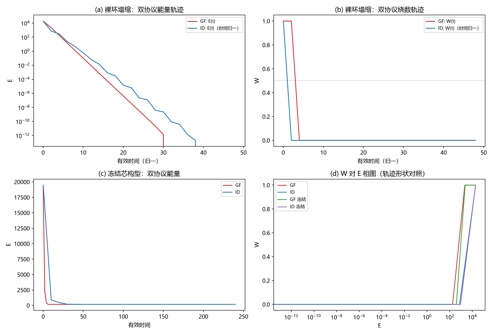

# 注记-C1-1边界与协议的最小验证：开放边界吸收与双协议一致

- **日期**：2026-09-16 03:36:45
- **对应脚本**：`验证脚本/minimal_verification_c1_protocols.py`（判据 14 项，确定性，无随机数，运行约 90 秒；图存 `images/c1_protocols.png`，见 §一 图 1）
- **依据**：[[三维复合位错攻坚计划：形态、驻留与宽度窗口]] §二（C1-1 任务）；[[注记-涡旋初始化与横截面绕数测量装置的最小验证：切平面零读数的根因]]（C1-0 装置；其登记的 C1-1 输入问题：带真空渐近的单环构造）；[[注记-环的裁决实验：裸模型无亚稳与绕数承载层问题]]；两层分工的定案表述见 [[从绕数困境到复合位错粒子：电荷载体问题的完整解决]] §结论（守卫归波、承载归粒）与 [[从复合位错到爱因斯坦场方程：粒子机制现状综合与攻坚纲领]]
- **定位**：C1 计划 C1-1（边界与协议确立）的判据与产物。把「开放边界（吸收真空）」与「双协议（梯度流 + 惯性阻尼）」立成公共资产，供 C1-2 起的形态枚举与驻留判定复用；并解决 C1-0 登记的输入问题（渐近真空单环构造）。
- **状态**：判据 14 项全部通过（14/14）。中途修正判据两处（B3 的能量口径与封闭性假设、P3 的绝对容差改收敛性判据），修正过程记入第六节。

---

## 一、判据与结果

| 判据 | 内容 | 通过条件 | 实测 |
|---|---|---|---|
| G0 | 梯度有限差分校核 | 最大误差 < 1e-5 | 1.09e-08 |
| G1 | 标准环初态自检（$R_c = 4$、$5$，两格面） | 读数 $+1$ | 全为 $+1.0000$ |
| P1a | 裸环双协议归属（GF / ID） | 均塌缩（$\lvert W\rvert < 0.1$、$E < 10^{-5}$） | 均达真空（$W = 0$、$E = 0$） |
| P1b | 丢失时刻能量占比差 | < 0.10 | $0.0092$ 对 $0.0378$，差 $0.0286$ |
| B1 | 塌缩末态无边界残迹 | 全盒 $\max\lvert\varphi\rvert < 10^{-2}$ | $3.2\times10^{-13}$（$R_c = 4$）、$1.1\times10^{-6}$（$R_c = 6$） |
| B2 | 绕数丢失定位（体区） | 距边界 $\ge 5$ 格 | 23 格（中心区） |
| B3 | $\gamma = 0.2$ 包络无回升；$\gamma = 0$ 局域脉冲守恒 | < 2%；< 1% | 0%；0.17% |
| L1 | 渐近真空环读数 | $+1$ | $+1.0000$ 双格面 |
| L2 | 渐近真空环盒边界 | < 0.01 | $5.96\times10^{-11}$ |
| L3 | 渐近真空环边界交换 | < 1% | $0.270$%（对照标准环 $+8.24$%） |
| B4 | 尺寸无关（$N = 32$） | 与 $N = 48$ 一致塌缩 | $W = 0$、$E = 0$ |
| P2 | 冻结芯双协议末态 | $\lvert\Delta W\rvert \le 0.02$；相对 $\Delta E \le 2\%$ | $0$；$0.763\%$ |
| P3a | 步长收敛（$W$） | $\le 0.02$ | $0.0000$ |
| P3b | 步长收敛（$E$） | $r_2 < r_1$ 且 $r_1$ 相对 $\le 1\%$ | $r_2/r_1 = 0.193$，$r_1$ 相对 $0.599\%$ |

## 二、模型与协议约定

模型取 kink3d A 部分（与 C1-0、环裁决实验同族）：

$$H = \frac{J_0}{2}\sum_{\text{bonds}}(1 - \cos\Delta\varphi) + \kappa\sum_{\text{sites}}(1 - \cos\varphi)$$

$J_0 = 1$、$\kappa = 0.6$、格距 $1$，相位差取最小像。开放边界的实现为盒外一圈取真空 $\varphi = 0$（垫片），能量只统计盒内键与格点。基准构型为标准环 $\varphi = \operatorname{mi}(\arctan2(z, \rho - R_c))$，$R_c = 4$、$N = 48$（半格偏移坐标，与 C1-0 一致）。

两个协议。GF（梯度流，过阻尼极限）：$\varphi \leftarrow \varphi - \eta\,\partial H/\partial\varphi$，$\eta = 0.02$。ID（惯性阻尼，元相子摆的惯性波动力学，梯度流为其过阻尼极限）：Velocity-Verlet 加阻尼 $v \leftarrow (v + \frac{dt}{2}(a + a_1))/(1 + \gamma\,dt)$，$dt = 0.1$、$\gamma = 0.2$。两协议时间单位不同（$\eta t$ 与 $dt\,t$），跨协议比较一律取无量纲量。

冻结代理：$w_{\text{pin}} = 1.0$ 的管状区（到芯圆距离 $< 1$ 格，88 个格点）每步强制重置为初值，作为 C1-4 锚核（无限深振幅锁定极限）的抽象替身。

## 三、主要读数解读

**双协议一致，丢失过程同构。** 裸环在两种协议下都塌缩到真空（$W = 0$、$E = 0$），能量轨迹形状一致（先大幅降能、后丢绕数）。丢失时刻的能量占比 $E(t_{\text{lost}})/E_0$ 为 $0.0092$（GF）与 $0.0378$（ID），无量纲差 $0.0286$。协议差异（惯性动能、时间单位）不改变终态归属与事件顺序。

**绕数丢失发生在体区，边界不参与。** 丢失前后帧的最大变化点位于格点中心区（距六边界 23 格），前 5 变化点同值同域。开放边界不构成绕数泄漏通道，丢失是体相滑移的物理事件。

**开放边界的能量交换双向，量级由初态匹配度决定。** 非局域初态（标准环，边界相位非零）在 $\gamma = 0$ 下 600 步的系统总能量变化为 $+8.24\%$：垫片与系统的耦合可以向两个方向交换能量。该读数不属协议缺陷，是「吸收真空」实现方式的定量内容：盒外真空垫片等效于外部固定场。

**渐近真空构造把边界交换降一个量级以上。** 引入窗函数局域化构造 $\varphi_L = \operatorname{mi}(\arctan2(z, \rho - R_c)\exp(-d^2/2\sigma_L^2))$，其中 $d$ 为到芯圆距离、$\sigma_L = 3$ 格。

读数：绕数保持 $+1.0000$、盒边界 $\max\lvert\varphi\rvert = 5.96\times10^{-11}$、初态能量 $466.7$（标准环 $19579.2$，低约 42 倍）、$\gamma = 0$ 的边界交换降到 $0.270\%$。C1-0 登记的输入问题由此解决，C1-2 起的形态枚举以该构造为基准。

**冻结芯下的经典层结局：通量线不驻留（承载层读数）。** 管状冻结芯下 GF 与 ID 的末态完全一致（$W$ 归零、$E = 173.30$ 对 $174.63$、相对差 $0.763\%$），全盒涡量扫描给出 56 个超阈 plaquette（正 28 / 负 28），净绕数为零。两层含义。其一，协议等价判据在非平凡末态上成立。其二，经典层（相位场）内芯钉扎不能维持通量线的驻留，流失经由体相滑移，与纯相位载体失败边界及环裁决实验同向。

层级须写明，避免误读：按体系定案的两层分工（守卫归波、承载归粒），绕数守卫不在经典能量层，非定域拓扑荷（超选择扇区 + 弦算符非局域性 + 先验纠缠载体）负责「谁禁止它丢失」；经典层通量线衰变是排除法实验的既有结论（垒型与局域运动学保护被排除，保护指向非局域结构层），本读数是该结论的一次复现。

对 C1-4 的输入在承载层：锚核筛选的目标为驻留形态的能量、尺寸与宽度（$E(R)$ 稳定点、$R^*$）；荷的判决属量子层判据（Q4/Q5），经典层实验不裁决荷。冻结代理只修改动力学、不引入能量项；实体锚核与三元组哈密顿量（C1-6）待测。

**步长收敛接近二阶。** ID 的 $dt$ 从 $0.1$ 降到 $0.05$、$0.025$，终态能量差 $r_1 = 1.05$、$r_2 = 0.20$，比值 $r_2/r_1 = 0.193$（一阶为 0.5、二阶为 0.25）。

## 四、严格程度声明

全部读数为格点最小模型的确定性数值（$J_0 = 1$、$\kappa = 0.6$、格距 $1$、开放边界垫片，$N = 48$ 或 $32$）。绕数读数取整数值，数值残差不超过 $10^{-12}$。协议等价为模型内判据级。B3 的 $0.17\%$ 为 Verlet 的有界振荡幅度，非累积漂移；$\gamma = 0$ 的边界交换读数量级依赖初态配置，属读数不属判据。

## 五、边界声明

本注记验证：边界协议（垫片）的健康性（无锁定、无体区伪影、能量交换可定量）与两个协议在同一模型上的等价性（归属、事件顺序、末态），并提供渐近真空单环构造。本注记不验证：连续极限与格距外推、三维复合位错的实体锚核与驻留机制（C1-4）、宽度窗口（C1-5）、三元组哈密顿量（C1-6）、荷的守恒判决（守卫层，见 [[绕数超选择：先验纠缠作为电荷保护层]]、[[注记-纠缠侧承载：绕数 = 非定域关系通量的量子保护探路]] 与 C1 计划 §八）。冻结芯读数的效力限于「无限深钉扎」这一动力学修改本身，层级为经典层承载读数，不构成对荷存亡的判决。

## 六、过程记录（判据修正两处与一处措辞更正）

其一，B3 初版把「$\gamma = 0$ 的能量守恒」写成势能 $H$ 的漂移判据（< 1%），首跑读数 95%，判定失败。核查后确认两层问题：势能在无阻尼振荡中本就大幅波动，且开放边界的垫片是外部固定场，系统总能量与垫片交换而非守恒。修正为「局域匹配脉冲 200 步的总能量（势 + 动）漂移 < 1%」与「非局域初态的能量交换作读数报告」，复跑 0.17% 通过。教训：判据的封闭性假设须先与实际边界实现核对，守恒量要写全（势加动），并与交换对象区分。

其二，P3 初版判据为绝对容差（$\lvert\Delta E\rvert \le 10^{-3}$），首跑读数 1.05 判定失败。核查后确认 0.6% 是长时弛豫的离散化残差，属二阶收敛的正常量级，绝对容差对跨 $dt$ 的比较不适用。修正为收敛性判据（$r_2 < r_1$ 且 $r_1$ 相对 $\le 1\%$）并加 $dt = 0.025$ 一档，复跑 $r_2/r_1 = 0.193$ 通过。教训：跨离散参数的终态比较用收敛比与相对量，不用绝对容差。

措辞更正一处：B3 的边界交换读数初版文字把「系统总能量变化」误作「垫片吸收」，符号方向相反（实测为能量增加 8.24%）。修正为中性表述（双向交换，符号由初态配置决定）。
