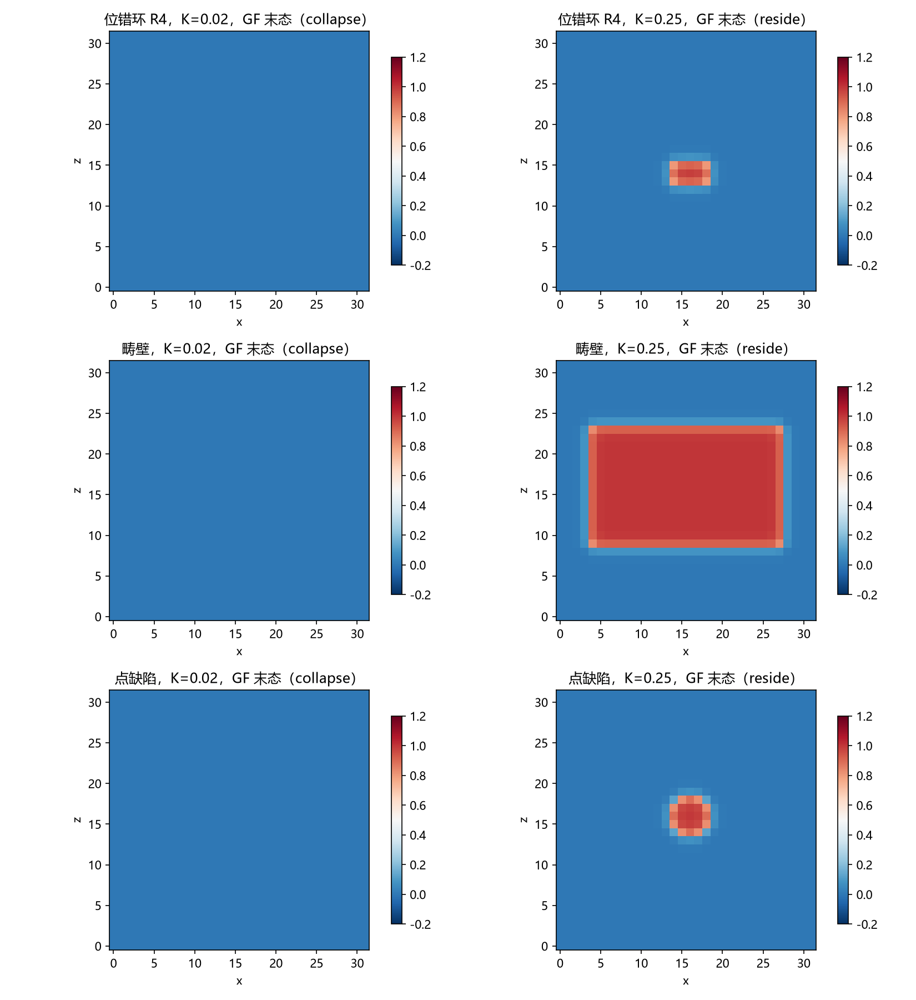

# 注记-C1-2形态枚举的最小验证：位错环、畴壁与点的存在性与稳定性

- **日期**：2026-09-16 03:55:42
- **对应脚本**：`验证脚本/minimal_verification_c1_morphology.py`（判据 G0/J1-J3 与读数 J4，确定性，无随机数，运行约 30 秒；图存 `images/c1_morphology.png`，见 §一 图 1）
- **依据**：[[三维复合位错攻坚计划：形态、驻留与宽度窗口]] §二（C1-2 任务）；[[从复合位错到爱因斯坦场方程：粒子机制现状综合与攻坚纲领]] §五（第一站的协议要点：法线轴平方弹性、三类形态、双协议）；[[注记-弹性身份裁决：紧致cos与螺旋平方弹性下的位错窗口]]（一维对照）；[[注记-C1-1边界与协议的最小验证：开放边界吸收与双协议一致]]（协议与层级纪律）
- **定位**：C1 计划 C1-2（形态枚举）的判据与产物。在体系裁定的键弹性原始形式（法线轴高度差，非紧致平方型）上，对位错环、畴壁、点三类形态做存在性与稳定性判定，给出形态表与驻留能量读数，为 C1-3（Derrick 复查）与 C1-5（宽度窗口）提供输入。
- **状态**：判据 4 项全部通过（G0/J1/J2/J3）。中途修正判据两处、修复实现问题一处（ID 的边界速度同步），过程记入第六节。
- **2026-09-16 更正**：宽度标度换算一处（原文用 $\sqrt{k/K}$ 的系数 1，正确标度 $\ell^* \approx 0.29/\sqrt{K}$；落窗对应 $K \le 0.023$），依据 [[注记-C1-4锚核筛选的最小验证：格点内锁定的驻留窗口、宽度核对与窗口互斥]] 的 A2/A3 判据。

---

## 一、判据与结果

| 判据 | 内容 | 通过条件 | 实测 |
|---|---|---|---|
| G0 | 构造合法（三形态） | E0 有限、peak >= 0.6、ext >= 50 | 环 R4：0.817/95；壁：1.000/8640；点：0.993/93 |
| J1 | K = 0.02（宽位错）双协议全塌缩 | 六格全 collapse | 环 14.6/25.6/40.2 与壁 491.2、点 22.8 全部降至 0 或 0.027 |
| J2 | K = 0.25（窄位错）GF 形态表 | R3 塌、R4/R5 驻、壁驻、点驻 | 环 111.3 降至 0；环 192.6 降至 37.8；环 299.1 降至 72.7；壁 2603.6 降至 1069.7；点 102.3 降至 45.2 |
| J3 | K = 0.25 的 ID 协议敏感模式 | 环与点脱钉塌缩、壁驻留 | 环 192.6 降至 0.005；点 102.3 降至 0.005；壁 2603.6 降至 1038.2 |
| J4 | 驻留能量比读数 | 打印 | 环 R4 0.196、环 R5 0.243、壁 0.411、点 0.441 |

形态表（fate：collapse 塌缩 / reside 驻留；GF 为梯度流，ID 为惯性阻尼）：

| 形态 | K = 0.02 GF / ID | K = 0.25 GF / ID |
|---|---|---|
| 位错环 R3 | collapse / （未测） | collapse / （未测） |
| 位错环 R4 | collapse / collapse | reside / collapse |
| 位错环 R5 | collapse / （未测） | reside / （未测） |
| 畴壁 | collapse / collapse | reside / reside |
| 点 | collapse / collapse | reside / collapse |

## 二、模型与构造约定

模型为平方型非紧致弹性（与一维弹性身份实验同族）：

$$E = \frac{k}{2}\sum_{\text{bonds}}(\Delta u - 1)^2 + K\sum_{\text{sites}}(1 - \cos 2\pi u)$$

$k = 1$、$N = 32$，背景真空 $u_0 = i + j + k$（三方向均匀缠绕，每键一层），边界钉 $u|_{\partial} = u_0$（额外层封闭在盒内，即缠绕守恒环境）。位错宽度标度 $\ell^* \approx 0.29/\sqrt{K}$（三维与一维准平衡实测互证，见 C1-4）：$K = 0.02$ 给 $\ell^* \approx 2.0$ 格（落窗下界），$K = 0.25$ 给 $\ell^* \lesssim 1$ 格（窄位错区，格点截断）。

三类形态由"多出层的区域 $\Omega$"定义（过渡面即膜/壁）。位错环：$\Omega$ = 下半球（$z<0$、$d<R_c$），膜为 $z=0$ 圆盘，位错线为赤道环；畴壁：$\Omega$ = z 向平板（横向收进侧壁 3 格），两个平行界面；点：$\Omega$ = 中心球。读数取 peak（$\max(u-u_0)$）、ext（$(u-u_0)>0.5$ 的格点数）与 $E$；fate 分类：collapse（peak 或 ext 降至初值 15% 以下）、reside（peak >= 70% 初值、ext > 30% 初值、末段能量漂移 < 1%）、partial（其余）。

## 三、主要读数解读

**连续极限侧（K = 0.02）全塌缩。** 宽位错区里三类形态在两种协议下都塌缩或收缩至真空：环（三个半径）$E$ 降至 0、壁 $9600$ 步降至 $0.000$、点降至 $0.000$。与 C1-1 的涡旋环塌缩、环裁决实验的定论在同侧：**连续极限的承载层没有驻留形态**。

**窄位错区（K = 0.25）出现格点钉扎驻留。** GF 下环 R4/R5、壁与点全部给出有限能量驻留形态（驻留比 $0.196$ 至 $0.441$），末段漂移为零、扰动回同态：**Peierls 型格点势垒把形态钉住**。这是 C1 判据"存在有限能量驻留形态"在最小模型内的第一次正面读数。

**钉扎是势垒层亚稳，对协议敏感。** ID（惯性阻尼）下环与点脱钉塌缩（$E$ 降至 $0.005$），壁保持驻留（$1038$）。读法：过阻尼流停在势垒内，惯性动能越垒而过；壁因界面平直、驱动收缩的力小，两协议一致。**经典层的驻留不构成硬保护**，与 C1-1 的口径修正同一层级纪律（守卫归波、承载归粒；荷的判决不在经典层）。

**尺寸依赖。** 环 $R_c = 3$ 即使在 $K = 0.25$ 也塌缩，$R_c = 4, 5$ 驻留：钉扎的尺寸效应（小环的线能收益压过钉扎势垒），与"格点钉扎在整数格上量化"的图像一致，供 C1-3 做 $E(R)$ 标度律复查。

**与宽度窗口的间距（2026-09-16 更正）。** 按实测标度 $\ell^* \approx 0.29/\sqrt{K}$，落窗（$\ell^* \ge 2$）要求 $K \le 0.023$，而驻留要求 $K \ge 0.24$（见 C1-4）：**两个窗口在格点内锁定机制下互斥、相差约十倍，交集为空**（C1-4 的 A3 判定）。把两者接起来需要另加机制（体项或 Hopf），属 C1-4 后续轮次的衔接问题。

## 四、严格程度声明

全部读数为格点最小模型的确定性数值（$k = 1$、$N = 32$、边界钉背景、$K \in \{0.02, 0.25\}$）。fate 分类为模型内判据级；驻留比与漂移为读数。双协议对照与 C1-1 同族（GF $\eta = 0.01$；ID $dt = 0.1$、$\gamma = 0.2$）。

## 五、边界声明

本注记验证：三类形态在平方型模型中的存在性（构造合法、能量有限）与稳定性分类（两种协议、两档 $K$），并给出格点钉扎驻留的首次正面读数。本注记不验证：连续极限与格距外推（钉扎是格点效应，其连续极限行为未定）；真实参数区的 $K$ 值；荷（绕数）的守恒判决（守卫归非定域层，同 C1-1 层级纪律）；壁的横向尺寸效应（横向固定为盒截面）。边界钉背景是"缠绕守恒环境"的实现，开放与自由边界下的同类判定未做。

## 六、过程记录（一处修复与两处判据修正）

**其一，ID 的边界速度同步（实现修复）。** 初版 ID 在边界钉 u 后未清零边界格点的速度，边界 $\max|v| \approx 11$ 持续污染全场，三形态收敛到与初态无关的同一伪影态（$K = 0.02$ 至 $180.758$、$K = 0.25$ 至 $1.553$）。物理上边界格点属外部固定体（既不演化也不携带动能），修复为每步钉 u 后同步 $v|_{\partial} = 0$，读数随即自洽。教训：强制 Dirichlet 重置的边界在惯性协议下必须同步清速度，否则"与初态无关的同一终态"是伪影信号。

**其二，判据修正（K = 0.25 的预期）。** 初版预期"三形态在双协议下全部驻留"（基于单协议预跑），实测为"GF 驻留、ID 脱钉（环与点）、壁两协议一致"。修正为协议敏感模式并记录：格点钉扎是势垒层亚稳，惯性协议可越垒，与"经典层不承担保护"的层级纪律一致。

**其三，判据修正（半径无关的预期）。** 初版预期"环的命运与 $R_c$ 无关"，实测为尺寸依赖（R3 塌、R4/R5 驻）。修正为"钉扎的尺寸依赖"读数，供 C1-3 的 $E(R)$ 复查。
