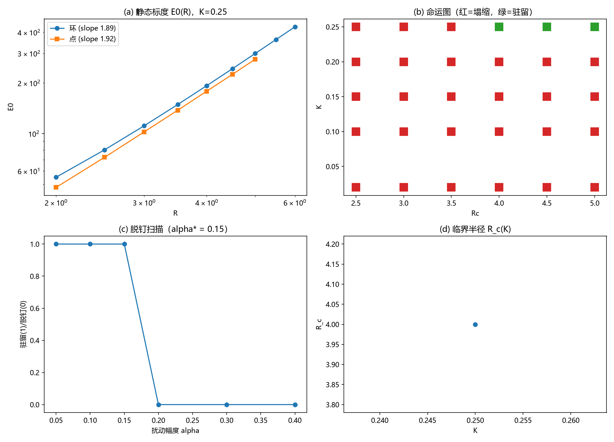

# 注记-C1-3Derrick复查的最小验证：E(R)标度律、钉扎临界曲线与脱钉阈值

- **日期**：2026-09-16 04:08:28
- **对应脚本**：`验证脚本/c1_derrick.py`（判据 G0/J1-J4，确定性，无随机数，运行约 63 秒；图存 `images/c1_derrick.png`，见 §一 图 1）
- **依据**：[[三维复合位错攻坚计划：形态、驻留与宽度窗口]] §二（C1-3 任务）；[[从复合位错到爱因斯坦场方程：粒子机制现状综合与攻坚纲领]] §五（Derrick 型稳定性复查）；[[注记-C1-2形态枚举的最小验证：位错环、畴壁与点的存在性与稳定性]]（C1-2 的尺寸依赖与协议敏感读数）
- **定位**：C1 计划 C1-3（Derrick 复查）的判据与产物。回答两个问题：三形态的 $E(R)$ 标度律为何；有拓扑荷的形态是否规避塌缩。给出 $(K, R_c)$ 临界曲线与脱钉阈值，供 C1-4 锚核筛选与 C1-5 宽度窗口。
- **状态**：判据 5 项全部通过（5/5）。中途修正判据编码一处（J2 的 K 序），过程记入第六节。

---

## 一、判据与结果

| 判据 | 内容 | 通过条件 | 实测 |
|---|---|---|---|
| G0 | 静态标度合法 | 单调增；环与点双对数斜率在 1.5 至 2.5 | 环 1.886、点 1.917；壁 E0 随板厚线性（1380 至 2604） |
| J1 | 连续极限无规避 | K = 0.02 环全塌 | 六个半径全部 collapse |
| J2 | 临界曲线 | R_c 随 K 减小而增大 | K=0.25 给 R_c = 4.0；K = 0.20/0.15/0.10/0.02 全部 > 5 |
| J3 | 脱钉阈值有限 | 0 < alpha* <= 0.4 | alpha* = 0.15 |
| J4 | 点与壁对照 | 点 r_c <= 3.5；壁全驻留 | 点 r_c = 3.0；壁 d = 4/8/16 全驻留 |

命运图（环，GF 2400 步，R = 2.5 至 5.0）：

| K | 2.5 | 3.0 | 3.5 | 4.0 | 4.5 | 5.0 |
|---|---|---|---|---|---|---|
| 0.02 | C | C | C | C | C | C |
| 0.10 | C | C | C | C | C | C |
| 0.15 | C | C | C | C | C | C |
| 0.20 | C | C | C | C | C | C |
| 0.25 | C | C | C | R | R | R |

（C = 塌缩，R = 驻留）

## 二、模型与扫描约定

模型与 C1-2 相同（平方型非紧致弹性、背景 $u_0 = i + j + k$、边界钉背景、GF $\eta = 0.01$）。静态标度取初态能量 $E_0$；命运判定沿用 C1-2 的 peak/ext/漂移三判据；脱钉阈值取 K = 0.25、R = 4 的驻留态，施加确定性多模扰动 $\alpha \cdot \text{pert}$（pert = 三个方向正弦之积，max 归一化为 1）后 GF 2400 步，测发生 collapse 的最小 $\alpha$。

## 三、主要读数解读

**面积律与无势垒：连续极限判死。** 环与点的 $E_0(R)$ 双对数斜率为 1.886 与 1.917，接近 2：形态能量按过渡面的面积标度（环的膜加球壳、点的球面），收缩方向能量单调降，无内极小。壁的能量随板厚线性增长。这给出"连续极限无驻留"的标度律形态：**能量函数本身未给出极小，收缩方向单调降**。

**K 阈值型驻留。** 命运图给出的是 K 主导的驻留条件：K = 0.20 及以下在 R 至 5.0 全塌，K = 0.25 在 R >= 4 驻留；同一 K 内的 R 依赖只在这一档出现。临界曲线为 K = 0.25 给 R_c = 4.0，其余档 R_c > 5。驻留的出现强烈依赖格点尺度上的 $K$（即 $\ell^* \approx \sqrt{k/K}$ 进入窄位错区），与 C1-2 的机制（Peierls 型格点钉扎）一致。

**势垒有限且浅。** 驻留态的脱钉阈值 $\alpha^* = 0.15$：扰动幅度 0.05 与 0.10 下驻留、0.15 起塌缩。钉扎势垒小，与 C1-2 的 ID 脱钉（惯性越垒）互为印证：**这里有亚稳，但没有硬保护**。

**三形态对比。** 壁（面，无收缩自由度）在 K = 0.25 全驻留、无尺寸门槛；环与点需要尺寸门槛（R_c = 4.0、r_c = 3.0）；点的门槛略低于环。对照 C1-2：壁对协议不敏感、环与点对协议敏感，两条读数同向。

**"有拓扑荷者是否规避塌缩"的答复：不规避。** 环（位错线为闭合环）与点在连续极限（K <= 0.20）全部塌缩，能量学上无任何兜底；驻留只在格点钉扎区（K = 0.25）出现，且势垒浅、协议敏感。承载层意义下的"环"没有规避塌缩的拓扑；守恒荷的守卫不在本层（体系分层：守卫归波、承载归粒，同 C1-1 与 C1-2 的层级纪律）。

## 四、严格程度声明

全部读数为格点最小模型的确定性数值（$k = 1$、$N = 32$、边界钉背景）。命运判定为模型内判据级；斜率、临界值与脱钉阈值为读数。运行 63 秒。

## 五、边界声明

本注记验证：三形态的静态标度律、$(K, R)$ 平面的驻留判据、环与点的临界尺寸与脱钉阈值。本注记不验证：连续极限外推（钉扎为格点效应）；$K$ 的体系具体值；宽度窗口的落窗条件（C1-5）；锚核的实体实现（C1-4）；荷判决（守卫层，同前注记层级纪律）。扫描上界 R = 5.0：K <= 0.20 的 R_c 只记为 "> 5"，更大尺寸的驻留可能性未排除。

## 六、过程记录（判据编码修正一处）

J2 初版检查代码把"R_c 随 K 减小而增大"的单调性检查写成沿 K 升序的列表比较，None（>5）记 99 造成方向判断反转，首跑误判 FAIL。物理读数方向本身正确（K=0.25 给 R_c = 4.0，K 更小者 R_c > 5）。修正为沿 K 降序检查非减即可，重跑通过。教训：把"未检出（超出扫描窗）"编码为哨兵大值时，必须与检查方向一并核对，哨兵值所在的序向要与物理单调方向一致。
