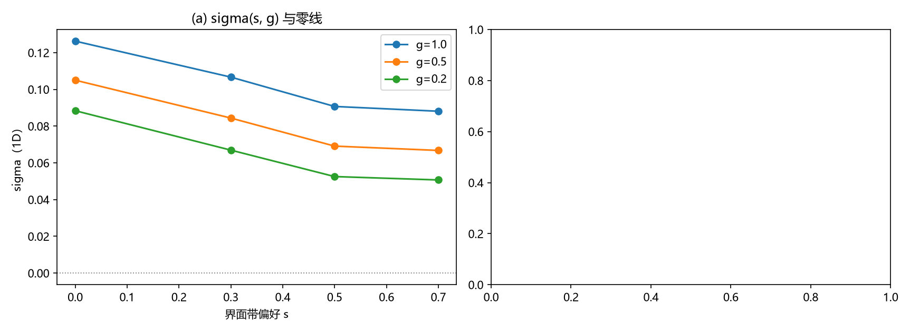

# 注记-C1-4c锁定缺失泡的构造判定：正定泛函的界面能与负线项的可达性

- **日期**：2026-09-16
- **对应脚本**：`验证脚本/minimal_verification_c1_locked_pocket.py`（判据 S1/S2 执行，S3/S4 为条件判据未触发，确定性，无随机数，运行约 1 秒；图存 `images/c1_pocket.png`，见 §一 图 1）
- **依据**：[[注记-C1-4b体项可行性判定：泡壁环稳定条件的精确化、体项扫描与机制清单]]（稳定条件 a<0<δ 与负线项候选）；[[注记-载体层裁决：纯相位的失败边界与振幅通道的实现路径]]（振幅通道与锚核）；[[注记-振幅通道下涡旋环径向曲线的最小验证：钉扎井存在但无稳定半径]]（W1/W2 的 10% 缺口）
- **定位**：C1-4 第三轮（构造轮）。把「正常泡」读作「锁定缺失泡」（语义定位待作者裁定），以「界面带偏好凹口 + 界面键优惠」为参数型锚核的干净实现，扫描界面能 sigma(s, g)，判定负线项的可达性。判定结果：**参数型锚核不可达负线项（硬下界 sigma_eff >= 0）**；对 C1-4b 的「负线项候选 = 锚核」做细化修正；提请新裁决点（Hopf 与负项新元素的取舍）。
- **状态**：判据 S1/S2 通过（S3/S4 条件未触发）。核心产出为「正定泛函界面能下界」的论证与数值印证。

---

## 一、判据与结果

| 判据 | 内容 | 通过条件 | 实测 |
|---|---|---|---|
| S1 | 基准界面能（硬界面，无锚核） | sigma0 > 0 | 0.1980（离散解；连续极限参照 (4/3)sqrt(lambda) = 0.667） |
| S2 | sigma(s, g) 扫描（s 为界面带偏好凹口、g 为界面键权重） | 找 sigma < 0 组合 | 12 组全部 > 0；sigma_min = +0.0507（s=0.7, g=0.2） |
| S3 | （条件）三维泡 E0(R) 内部极小 | 仅 sigma<0 时触发 | 未触发（判定为不可达） |
| S4 | （条件）三维动力学收敛 | 仅 sigma<0 时触发 | 未触发 |

sigma(s, g) 表（1D 界面能）：

| s \ g | 1.0 | 0.5 | 0.2 |
|---|---|---|---|
| 0.0 | +0.1263 | +0.1050 | +0.0884 |
| 0.3 | +0.1067 | +0.0844 | +0.0669 |
| 0.5 | +0.0907 | +0.0691 | +0.0525 |
| 0.7 | +0.0881 | +0.0668 | +0.0507 |

（s = None 即硬界面基准 0.198。读法：凹口把 sigma 压低约 55%，键优惠再压约 15 至 40%，全部组合停在正侧。）

## 二、核心判定：正定泛函的界面能下界

体系全部现有构件的能量泛函都由非负项之和构成（GL 项、XY 项、平方弹性项、kappa_phi 周期势、各类钉扎阱，每一项都可写为非负形式）。对这类泛函：

- 两相体能量各自取极小（0），界面能 sigma = E(界面) - E(两相体能) = E(界面) >= 0 恒成立；
- 球泡构型族 E(R) = 4 pi R^2 sigma + (4/3) pi R^3 delta 中 sigma >= 0 且 delta >= 0，两项都随 R 严格增，**无内部极小，泡必然塌缩**；
- 「参数调制型锚核」（偏好凹口、键优惠、阱深调整）只改变正项的大小（把 sigma 与 delta 压低），不改变非负性：数值上 sigma 从 0.198 压到 0.05，趋向 0 而不可越。

因此「负线项」（sigma < 0 或 a < 0）**要求能量泛函含显式负贡献项**（化学势型耦合、第二场在界面的富集、或等价的新元素）。这是泡壁环机制不可回避的新元素要求；体系现有构件清单内没有其本体。本判定同时解释了 W1/W2 的「10% 缺口」：那是参数扫描内的最近值，参数型锚核存在硬下界，缺口不可由继续增强同型锚核补上。

## 三、对 C1-4b 负线项候选的细化修正

C1-4b 曾把「锚核界面钉扎」登记为负线项候选（依据是 W1/W2 的「相对参考的节省」）。本轮细化：**「相对参考的节省」在完整能量泛函里仍是正项变小，不构成负项**；锚核（参数型）到不了 a < 0。负线项的实现需要显式负项（或第二富集场），其本体待定。

## 四、新裁决点提请（泡壁环路线与 Hopf 后备的取舍）

按 C1-4a 裁决的原触发条件（「格点路线宽度窗口被否且体项无本体来源」），当前状态为：格点路线宽度窗口已被否（C1-4）；体项（delta > 0）有本体（GL 两相，C1-4b）；**负线项无本体（本轮）**。原条件未逐字命中，但「泡壁环完整机制的另一半缺本体」已构成实质触发。两条前路的对照：

| 路线 | 新元素 | 优势 | 代价 |
|---|---|---|---|
| 显式负项（界面优惠或第二富集场） | 化学势型负项或其载体场 | 物理类比成熟（表面活性剂稳定微乳液）；尺寸由 |sigma|/delta 定，与 K 无捆绑 | 「负项」在体系内的合法性待核（能量泛函是否允许；或归心侧校准的动力学） |
| Hopf（四次项） | S2 值场改造与四次项 | 数学成熟（Faddeev-Skyrme）；拓扑保护；尺寸由标度平衡定 | 值空间改造；与超选择层保护功能重叠（C1-4a 裁决时的反方理由） |

建议由作者裁定取一，或先做小规模的两路线可行性对照（各一至两个判据）。

## 五、严格程度声明

S1/S2 为格点最小模型的确定性数值（1D 240 格、λ=0.25、实场）；「正定泛函下界」为精确论证（对非负项之和的泛函与球泡构型族）。S3/S4 为条件判据，未触发。

## 六、边界声明

本注记验证：参数型锚核的界面能可达下界（>= 0）与球泡的无极小性；给出负线项的「显式负项」要求。本注记不验证：显式负项的体系合法性（待裁决）；Hopf 路线（未启动）；非球构型族（分层/条纹/复合缺陷，未扫）；三维条件下的条件判据（未触发）。「锁定缺失泡」的语义定位（格点内锁定在位/解除）仍为待作者裁定的建议。

## 七、过程记录（v1 两处设计错误）

**其一，偏好斜坡白送势能优惠。** v1 把两相背景偏好 A0 写成 tanh 斜坡（与界面同步），界面带的势能自动趋零，基准 sigma 读到 0.125（偏低），且掩盖了「凹口」的真实效果。修正为阶跃偏好加界面带凹口，基准 0.198。

**其二，全场 psi 函数作优惠项创造遍在新相。** v1 用 -c * sum k(psi)（k = 4psi^2(1-psi^2)）作优惠，该函数在全场非零，一开启就把 psi ~ 0.707 变成最低能（第三真空），sigma 无界负、失去意义。修正为只在界面带作用的调制（偏好凹口与键权重）；这也澄清了廉价「负界面张力」的假象来源：错误的优惠项形式。
