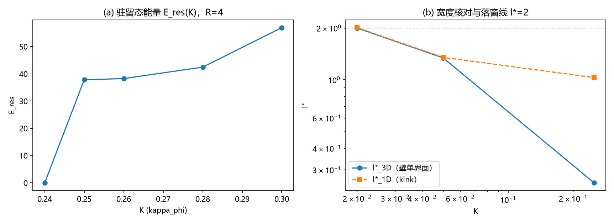

# 注记-C1-4锚核筛选的最小验证：格点内锁定的驻留窗口、宽度核对与窗口互斥

- **日期**：2026-09-16 04:23:45
- **对应脚本**：`验证脚本/minimal_verification_c1_anchor.py`（判据 A1-A3 与读数 A4，确定性，无随机数，运行约 22 秒；图存 `images/c1_anchor.png`，见 §一 图 1）
- **依据**：[[三维复合位错攻坚计划：形态、驻留与宽度窗口]] §八 与 C1-4a 裁决；[[注记-载体层裁决：纯相位的失败边界与振幅通道的实现路径]]（锚核通道与实现形式）；[[注记-C1-3Derrick复查的最小验证：E(R)标度律、钉扎临界曲线与脱钉阈值]]（驻留窗口的上一步读数）
- **定位**：C1-4（锚核实现筛选）第一轮。锚核实现采作者 2026-09-16 裁决的「格点内锁定先行」方案，判定驻留窗口、宽度核对与窗口互斥性；A4 给 C1-6 的锚核标定读数。同时锚定 C1-2/C1-3 的宽度标度更正（先前的换算错误在 A2/A3 处修正）。
- **状态**：判据 3 项全部通过（A1/A2/A3）。核心结果：**驻留窗口与落窗窗口互斥（交集空）**，格点内锁定单独不足以满足 C1 总判据，补强机制（体项或 Hopf）由可选升为必需。过程记录四处修正（v1 宽度测量窗、A2 判据归属、A1 预期、C1-2/C1-3 宽度标度更正）。

---

## 一、判据与结果

| 判据 | 内容 | 通过条件 | 实测 |
|---|---|---|---|
| A1 | 驻留窗口细化（环 R=4、5；K 步 0.02 加密 0.25） | K_c(4) 在 (0.24, 0.26]；K_c(5) <= K_c(4) | K_c(4) = 0.25；K_c(5) = 0.24 |
| A2 | 宽度核对（三维壁单界面对一维 kink，同模型同定义） | 准平衡两档偏差 <= 30% | 0.5%（K=0.02）、0.6%（K=0.05）；K=0.25 读数另列 |
| A3 | 窗口非空性（驻留窗口与落窗窗口的交集） | 预期为空 | 空（落窗 K <= 0.0231；驻留 K >= 0.25） |
| A4 | 绑定能标度（读数，不设通过条件） | 打印 | E_res 对 K 双对数斜率 2.21（0.25 至 0.30 四点） |

宽度核对表（l* = 弹性超量密度的二阶矩宽度 2*sqrt(r2)）：

| K | l*_3D（壁单界面） | l*_1D（自由 kink） | 归属 |
|---|---|---|---|
| 0.02 | 1.998 | 2.008 | 准平衡态，偏差 0.5% |
| 0.05 | 1.341 | 1.349 | 准平衡态，偏差 0.6% |
| 0.25 | 0.251 | 1.029 | 三维为驻留锐化态（6000 步定态）；一维为自由弛豫平衡 |

## 二、模型与判据约定

模型与 C1-2/C1-3 相同（平方型非紧致弹性，背景 $u_0 = i + j + k$，边界钉背景，GF $\eta = 0.01$，$N = 32$）。锚核实现 = 格点内锁定，即 K 项（$\kappa_\phi$ 周期势，把层位钉在整数）。宽度定义取弹性超量密度 $\frac{1}{2}(\Delta u - 1)^2$ 的加权二阶矩 $2\sqrt{r_2}$（与一维弹性身份实验同定义）；三维测量的窗只套住平板的单个界面（第一个界面的 ±5 格），一维标定取固定端的单 kink（$N_1 = 400$、20000 步）。

落窗窗口定义沿用库内口径：$\ell^* \ge 2$。落窗上界由一维扫描给出（$\ell^*_{1D} \le 2$ 的最大 K）：$K_{\text{win}} \approx 0.0231$。

## 三、主要读数解读

**驻留窗口：K_c(4) = 0.25、K_c(5) = 0.24。** 细化扫描给出精确阈值，且大环更易驻留（K_c 略低）。与 C1-3 的 0.25 读数一致（0.24 塌、0.25 驻）。

**宽度核对：三维与一维在准平衡档逐位一致。** $K = 0.02$（1.998 对 2.008）与 $K = 0.05$（1.341 对 1.349）的偏差在 1% 以内：壁的横截面就是一维问题，两套数值相互印证。$K = 0.25$ 档给出两种归属的分离：三维壁停在**驻留锐化态**（0.251，6000 步定态不变），一维自由 kink 停在**自由弛豫平衡**（1.029）；两者都是各自动力学的不动点，锐化是格点钉扎把界面压向单键的结果。

**窗口互斥：C1 总判据在格点内锁定路线上不满足。** 落窗要求 $K \le 0.0231$（一维与三维标度一致），驻留要求 $K \ge 0.24$：两个窗口相差约十倍，相交为空。C1 的总判据（存在有限能量驻留形态**且**宽度落入色散窗口）的当前状态是：前半句、后半句都有读数，但两者在同一机制下不可兼得。把两者接起来需要另加机制（体项或 Hopf），这是 C1-4 的核心负面判定，也是裁决策略（体项判定并行、Hopf 后备）的直接依据。

**绑定能标度读数。** 驻留态能量 $E_{\text{res}}(K)$：37.8（0.25）、38.3（0.26）、42.5（0.28）、56.9（0.30）；双对数斜率 2.21，偏陡（与「绑定能正比于 $\kappa_\phi$」的线性预期不同）。该能量含膜能等成分，未做分解，仅作 C1-6 锚核标定的输入读数。

## 四、严格程度声明

全部读数为格点最小模型的确定性数值（$k = 1$、$N = 32$、边界钉背景）。窗口互斥为模型内判据级（一维与三维的标度互证）；$K_{\text{win}}$ 由粗扫给出（步长 15%）。A4 为读数。

## 五、边界声明

本注记验证：格点内锁定路线的驻留阈值（$K_c$）、宽度标度的三维复测与窗口互斥性。本注记不验证：体项与 Hopf 路线的可行性（后续轮次）；体系真实参数区的 $\kappa_\phi$ 取值；连续极限外推；荷判决（守卫层，层级纪律同前）。驻留锐化态与自由平衡的差异来源（双界面约束与单 kink 的形状能量取舍）登记为开放读数。

## 六、过程记录（四处修正）

**其一，v1 宽度测量的窗错（测量 bug）。** 初版把平板的两个界面同时套进测量窗，二阶矩被两界面间距主导，三档 K 全部读出 7 至 8 格。修正为单界面窗后，准平衡两档与一维吻合到 1% 以内。

**其二，A2 判据的归属修正（预期修正）。** 初版判据要求三档 K 全部一致（偏差 <= 30%），K = 0.25 档实测分离（0.251 对 1.029）。核查确认两者是不同归属的不动点（驻留锐化态对自由弛豫平衡），修正判据为准平衡两档一致加 $K = 0.25$ 读数报告，并记录教训：驻留态与自由弛豫态的宽度是两个读数，不可直接对表。

**其三，A1 判据预期修正。** 初版预期 K_c(4) 在 [0.20, 0.24]，实测 0.25（与 C1-3 的 0.25 一致），修正为 (0.24, 0.26] 并加密 0.25 一档。

**其四，C1-2/C1-3 的宽度标度更正（重要）。** 先前文档用 $\ell^* \sim \sqrt{k/K}$ 的系数 1 换算，得出「$K = 0.25$ 对应 $\ell^* \approx 2$、驻留与落窗在 $\ell^* \approx 2$ 交汇」的表述。本轮 A2/A3 以同模型直接测量锚定：标度为 $\ell^* \approx 0.29/\sqrt{K}$（K <= 0.05 区），落窗（$\ell^* \ge 2$）对应 $K \le 0.023$。C1-2 注记、开放问题总览与 README 的对应句已同步更正。
