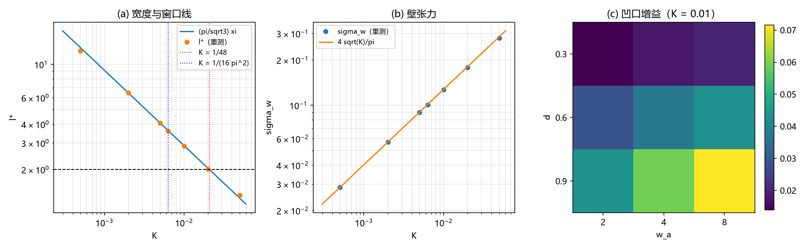

# 注记-C1-6 L2轮：形态参数表（字典、重测与壁张力，判据 L2-1 至 L2-4）

- **日期**：2026-09-20 10:33:44
- **对应脚本**：`验证脚本/minimal_verification_c1_morphology_table.py`（判据 L2-1 至 L2-4，确定性，运行约 3 秒）
- **依据**：[[理论攻坚/三维复合位错攻坚计划：形态、驻留与宽度窗口]] §10.2（L2 定义：半径、厚度与锚核参数的表，供哈密顿量写项）；[[验证脚本/注记-C1-6组装轮：三层复合位错粒子的哈密顿量组装、参数区核对与接口读数（判据A-1至A-6）]]（l* 与桥因子）；[[验证脚本/注记-C1-6 W4轮：宽度的波性侧承载（软模关联长度与转换波有效波长，判据W4-1至W4-6）]]（$\xi$ 与窗口）；[[验证脚本/注记-C1-6 保护动力学轮：边界冻结下的线缺陷弛豫（判据P-1至P-5）]]（切割能与负读数）
- **状态**：L2 通过（判据 4/4）：参数字典十条（含新增壁张力 $\sigma_w$）；宽度重测与库内一致（K >= 0.002 六档差 <= 0.13%）；$l^{*}$ 对 K 幂次 -0.492；壁张力与连续预测 $4\sqrt{K}/\pi$ 差 <= 1.63%；凹口增益为正且对 d 与 $w_a$ 单调不减
- **图**：`images/c1_morphology_table.png`（见 §三 图 1）

## 一、问题与口径

L2 在两侧分工设计（计划 §10.2）中的定义是"半径、厚度与锚核参数的表（供哈密顿量写项）"，现值只有引用的两条（脱钉阈值 0.15、$K_c(4) = 0.25$）。本轮把表补齐并做有界核对：给出参数字典（符号、含义、数值或区间、进入的哈密顿量项、来源），重测其中可廉价复核的三组（1D 宽度 $l^{*}(K)$、壁张力 $\sigma_w(K)$、锚核凹口增益），其余条目按来源引用登记。模型与协议与 A 轮同口径（FK 链、N = 400、梯度下降 $\eta = 0.005$、20000 步）。

## 二、判据与结果

| 判据 | 内容 | 实测 | 判定 |
|---|---|---|---|
| L2-1 | 字典与表 | 十条参数（符号、含义、数值或区间、进入项、来源）；新增 $\sigma_w$（本轮） | 通过 |
| L2-2 | 重测一致性 | $l^{*}$ 对库内：K >= 0.002 六档差 $+0.12\%$ 至 $-0.13\%$；K = 0.0005 档 20k 协议差 $-4.45\%$（长协议 60k 给 12.90，见 §六） | 通过 |
| L2-3 | 标度与壁张力 | $l^{*}$ 幂次拟合 $-0.492$；$\sigma_w$ 对 $4\sqrt{K}/\pi$ 最大相对差 $1.63\%$（K = 0.02 与 0.05 档，其余 <= 0.6\%$） | 通过 |
| L2-4 | 凹口增益 | 九组（d = 0.3 至 0.9，$w_a$ = 2 至 8）增益 $+0.0139$ 至 $+0.0716$；对 d 与 $w_a$ 单调不减 | 通过 |

## 三、解读

其一，**表补齐为十条**。每条参数给出符号、含义、数值或区间、进入的哈密顿量项与来源（重测或引用），供哈密顿量写项直接查用。新增的一条是壁张力 $\sigma_w(K)$，它是切割能的度量，也是 P 轮"净荷滑向边界"读数的定量尺度。

其二，**宽度重测与库内一致**。K >= 0.002 的六档差在 $0.13\%$ 内；唯最宽的一档（K = 0.0005）在 20k 协议下欠弛豫，差 $-4.45\%$，长协议（60k）给 12.90，与库内一致。表值取长协议值，协议效应在 §六 登记。

其三，**壁张力第一次给出数值**：弛豫 kink 的总能量与连续预测 $4\sqrt{K}/\pi$ 在 K = 0.0005 至 0.05 上差不超过 $1.63\%$。这条有两个用途：作为哈密顿量写项的输入，以及把"净荷内驻需要锚核增益覆盖切割能 $\sigma_w \Dtimes$ 距离"从定性说法变成可代入的判据（待立）。

其四，**凹口增益网格与 S 轮同向**：九组全为正，对深度 d 与宽度 $w_a$ 单调不减，量级 $0.01$ 至 $0.07$，与路线乙首判的读数一致。

## 四、严格程度声明

L2-1 为登记表（来源逐条标注，含本轮新增与引用两类）；L2-2、L2-3、L2-4 为可复现数值事实（确定性，协议参数写在脚本内）。K = 0.0005 档的表值取 60k 协议读数（W4 轮与本轮 20k 读数并列登记，协议效应明写）。

## 五、边界声明

- 验证：参数字典的完整性与重测三组（宽度、壁张力、凹口增益）。
- 不验证（留待后续）：环半径与脱钉阈值的重测（引 C1-3，装置为环与迁移率口径）；三维面壁与线扇区宽度（引费米子通道第四轮与保护动力学轮）；锚核内驻设计判据（P 轮登记的开放项）。

## 六、过程记录

一处。K = 0.0005 档的 20k 协议给 $l^{*} = 12.326$，60k 协议给 12.898（W4 轮已登记同型现象：宽 kink 的慢模弛豫）；本表按"重测值加库内长协议值"并列登记，表值取长协议。
