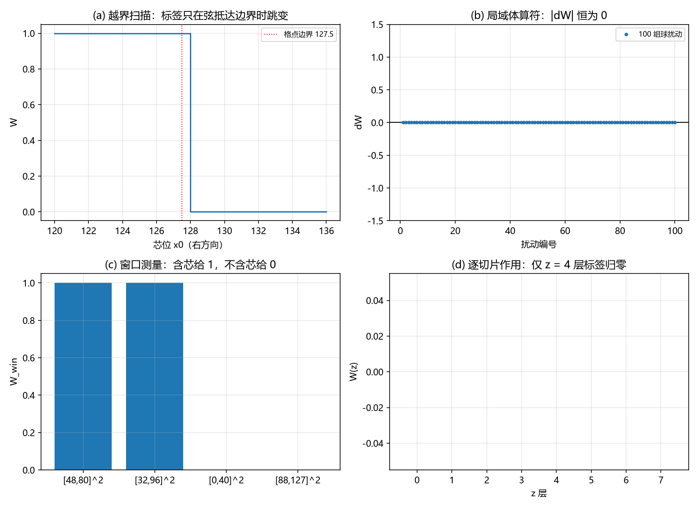

# 注记-C1-6 W1W2 三维版：保护结构在三维线缺陷构型上的复核（判据 W1-1 至 W1-4、W2-1 至 W2-3）

- **日期**：2026-09-20 10:12:56
- **对应脚本**：`验证脚本/c1_w12_3d.py`（判据 W1-1 至 W1-4、W2-1 至 W2-3，确定性，随机种子固定，运行约 3 秒）
- **依据**：[[验证脚本/注记-C1保护层可搬用性判定：弦算符结构与到边界的弦（判据V-1至V-4）]]（二维最小模型：边界性、局域不变性、到边界的弦）；[[验证脚本/注记-C1-6三维版：线缺陷扇区的绕数衰减与保护层前提（判据B-1至B-5）]]（三维线缺陷构型与无保护时的衰减读数）；[[理论攻坚/三维复合位错攻坚计划：形态、驻留与宽度窗口]] §10.3（W1、W2 行的三维版待做项）
- **状态**：W1 与 W2 的三维版通过（判据 7/7）：三维线缺陷构型上，绕数的边界性逐切片到机器精度；窗口测量按 C1-0 口径给 1 与 0 两档；$100$ 组局域体扰动与九档裕度扫描不动标签（精确为零）；芯的轨迹只在越界列（$x_0 = N = 128$）跳变 $1 \to 0$，反向同位置无迟滞；只在 $z = 4$ 层越界时只有该层归零。波性侧判据组 W1 至 W4 至此全部有判
- **图**：`images/c1_w12_3d.png`（见 §三 图 1）

## 一、问题与口径

计划 §10.3 的 W1（扇区分解）与 W2（弦形跨扇区算符）已在二维最小模型上通过（判据 V-1 至 V-4），留下两项"三维构型上的同组判据待做"。本轮把同组判据搬到 C1-6 三维版（B 轮）的线缺陷构型上：横截面 $128^2$，$u = u_0 + \theta/2\pi$，$u_0 = IX + IY$（均匀缠绕背景），$\theta = \operatorname{atan2}(y - y_0, x - x_0)$；线缺陷为二维涡旋沿 $z$ 向延伸（$N_z = 8$ 层，层间独立）。绕数按 mod 1 的环绕差之和定义（plaquette 口径），与 B 轮、V 轮同口径。

本判据只做结构读数，不含弛豫。B 轮已给出无保护时拓扑荷衰减的动力学读数，本轮的互补项是保护结构在三维构型上的成立性。

## 二、判据与结果

| 判据 | 内容 | 实测 | 判定 |
|---|---|---|---|
| W1-1 | 逐切片边界性 | 面积求和与边界回路求和：中心芯差 $0$、偏心芯差 $2.66\times10^{-15}$；全层 $W = 1$；取整误差 $0$ | 通过 |
| W1-2 | 窗口测量（C1-0 口径） | 含芯窗口给 $+1$（$[48,80]^2$ 与 $[32,96]^2$）；不含芯窗口给 $0$（$[0,40]^2$ 与 $[88,127]^2$）；偏心芯同型 | 通过 |
| W1-3 | 局域体算符不改扇区 | $100$ 组三维球扰动（$r = 4$ 至 $10$）：$\vert\Delta W\vert$ 最大 $0$；裕度扫描九档（$d > r$）全为 $0$ | 通过 |
| W1-4 | 扇区内重分布 | 插入涡旋对：$\Delta W = 0$ 精确；非零 plaquette 计数 $1 \to 5$（对贡献 $+2$ 与 $-2$，净零） | 通过 |
| W2-1 | 局域轨迹不改标签 | 内部路径 $8$ 点（距边界 $\ge 8$ 格）：$W$ 恒为 $1$ | 通过 |
| W2-2 | 弦抵达边界才改标签 | 四路径（右、上、对角、折线）越界跳变 $1 \to 0$，过界位置均为 $x_0$（或 $y_0$、$t$）$= N = 128$；反向 $0 \to 1$ 同位置、无迟滞 | 通过 |
| W2-3 | 逐切片作用 | 只在 $z = 4$ 层越界：$W(z)$ 给 $[1,1,1,1,0,1,1,1]$ | 通过 |

## 三、解读

其一，**绕数的边界性在三维构型上逐切片成立**。面积求和与边界回路求和逐位一致（偏心芯差 $2.66\times10^{-15}$，舍入底噪），全层读数恒为 $1$；窗口测量按 C1-0 口径给出干净的两档：含芯给 $1$、不含芯给 $0$（W1-1、W1-2）。扇区标签因此是逐切片可测的整数，这正是电荷路线"态空间按绕数分扇区"在三维构型上的对应。

其二，**扇区内部可以很不一样，标签只有一个整数**。插入涡旋对让局部 plaquette 密度从 $1$ 格升到 $5$ 格（对贡献 $+2$ 与 $-2$，净零），标签不动（W1-4）；$100$ 组三维球扰动与九档裕度扫描也都不动（W1-3）。局域体算符改不动扇区，在三维构型上精确成立。

其三，**改标签的唯一通道是芯的轨迹触及边界**。内部路径上标签恒为 $1$（W2-1）；四条形状与方向不同的路径（右、上、对角、折线）都在芯越过边界列（$x_0 = N = 128$）时跳变 $1 \to 0$，反向从外入内在同一位置跳回、无迟滞（W2-2）。越界列与 V 轮二维模型的读数同型（V 轮 $N = 64$ 给出越界列 $64$）。

其四，**三维的增量是逐切片**。只在 $z = 4$ 层把芯移出边界，只有该层标签归零，其余七层保持 $1$（W2-3）。三维里"弦"的作用范围决定改变的切片范围，标签住在每个横截面上。

其五，**与结构对照（V-4 的三维版）**。扇区分解（W1-1、W1-2）与弦形跨扇区算符（W2-1 至 W2-3）逐条直接对应；守卫来自先验纠缠一项沿用同一超选择层（本判据不含动力学实现，与 Q4/Q5 同族）；宽度与色散一项已由 W4 轮另建（宽度 = 软模关联长度）。波性侧判据组 W1 至 W4 至此全部有判。

## 四、严格程度声明

W1-1 为离散恒等式（机器精度，$2.66\times10^{-15}$ 为舍入底噪）；W1-2 至 W1-4、W2-1 至 W2-3 为可复现数值事实（确定性，随机种子固定，扰动组与路径点写在脚本内）；W2-2 的过界位置为逐格扫描读数（步长 $1$）。模型、口径与 B 轮、V 轮一致，未引入新假设。

## 五、边界声明

- 验证：三维构型上绕数的边界性、窗口可测性、局域不变性、扇区内重分布、弦到边界的跳变与逐切片作用。
- 不验证（留待后续）：跨扇区通道的动力学实现（量子层，与 Q4/Q5 同族，即"真正冻住扇区"的动力学）；保护的动力学实现下线缺陷弛豫后的宽度读数；三元组哈密顿量的完整形态；G1b 的对接。

## 六、过程记录

三处。其一，W1-4 首版的网格准备把已经是三维的网格再切一刀（$X[:, :, None]$ 多出一轴），广播成 $(128,128,8,8)$，计数行报维度错；改用二维网格加轴后通过。其二，定向自查确认边界回路求和与 plaquette 求和同向（V 轮口径）；面积求和与边界回路求和在全部读数上一致。其三，对角扫描首版止于 $t = 72$（远离边界，读数为全 $1$，不构成越界判据），延伸到 $t = 132$ 后给出与右、上同型的越界跳变。
