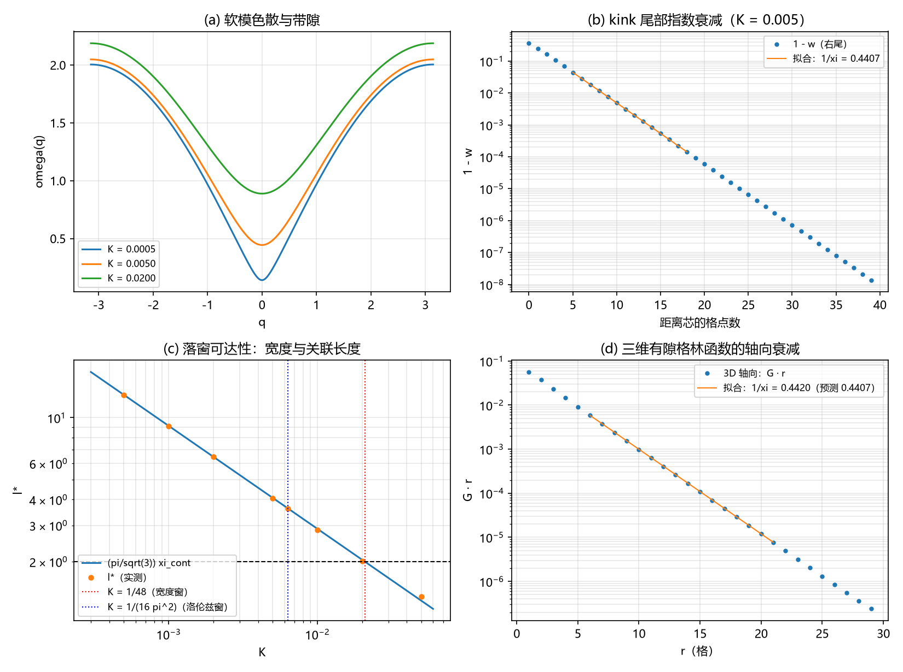

# 注记-C1-6 W4 轮：宽度的波性侧承载（软模关联长度与转换波有效波长，判据 W4-1 至 W4-6）

- **日期**：2026-09-20 09:55:25
- **对应脚本**：`验证脚本/c1_w4_wave_side_width.py`（判据 W4-1 至 W4-6，确定性，无随机数，运行约 7 秒）
- **依据**：[[验证脚本/注记-C1-6组装轮：三层复合位错粒子的哈密顿量组装、参数区核对与接口读数（判据A-1至A-6）]]（两层宽度定义与桥因子读数）；[[验证脚本/注记-C1路线乙首判：软模承载宽度的能量竞争（判据S-1至S-4）]]（软模承担宽度、凹口承担增益的既有判定）；[[验证脚本/注记-费米子通道第三轮：宽度窗口与洛伦兹窗口的交叉核对（H1至H4）]]（洛伦兹窗口 $K \le 0.00633$）；[[理论攻坚/三维复合位错攻坚计划：形态、驻留与宽度窗口]] §10.3 与 §10.4（W4 判据口径）
- **状态**：W4 通过（判据 6/6）。宽度由波性侧软模的关联长度承载：$\xi = 1/(2\pi\sqrt{K})$（$\kappa_e = 1$）；kink 尾部衰减长度与 $\xi$ 逐档一致（$0.23\%$ 内）；解析桥因子 $l^{*}/\xi = \pi/\sqrt{3} = 1.8138$，实测 $1.7845$ 至 $1.8121$；落窗区 $K \le 1/48 = 0.02083$，与洛伦兹窗口 $K \le 1/(16\pi^2)$ 联立给 $\xi = 2.0000$、$l^{*} = 3.6276$；三维带隙与轴向、径向衰减率与一维一致（$0.4\%$ 内）
- **图**：`images/c1_w4_wave_side_width.png`（见 §三 图 1）

## 一、问题与口径

C1-6 的落窗条件原先挂在粒性侧的驻留态宽度上。两条粒性侧路线（格点内锁定、软体加局域凹口）在三维判负，失效模式是面积律：壁能量正比面积，凹口增益正比脚面积。攻坚计划 §10.4 据此重立口径：粒性侧只给载体的形态参数，宽度由波性侧的有效宽度机制承担。候选机制两条：转换波的有效波长、软模的关联长度。

本轮的判据形态是「给定载体参数与波性侧机制参数，是否存在参数区使 $l^{*} \ge 2$」。模型与既有读数同口径：FK 链 $E = \sum \tfrac{1}{2}\kappa_e(\Delta u - 1)^2 + \sum K(1 - \cos 2\pi u)$，$\kappa_e = 1$，背景取均匀缠绕 $u_n = n$，位错为局域多缠一圈的 kink（$w = u - n$ 从 $0$ 到 $1$）。

软模是缠绕背景上的相位涨落模，色散 $\omega^2(q) = \kappa_e \cdot 4\sin^2(q/2) + (2\pi)^2 K$，带隙 $m = 2\pi\sqrt{K}$，关联长度 $\xi = 1/m$。数值宽度沿用组装轮定义：$l^{*} = 2\sqrt{r_2}$，$r_2$ 为弹性超量密度 $\tfrac{1}{2}(\Delta u - 1)^2$ 的二阶矩。解析桥因子由连续 sech 剖面的二阶矩给出：$l^{*}/\xi = \pi/\sqrt{3}$。

## 二、判据与结果

| 判据 | 内容 | 实测 | 判定 |
|---|---|---|---|
| W4-1 | 软模色散与带隙；有隙格林函数衰减率 | 平面波偏差 $2.47\times10^{-14}$；带隙恒等偏差 $0$；衰减率 $0.44071$ 与 $0.61842$，对离散预测 $-0.00\%$ 与 $+0.00\%$ | 通过 |
| W4-2 | kink 尾部衰减长度 = $\xi$ | 七档右尾相对差 $-0.23\%$ 至 $+0.11\%$，左尾同幅 | 通过 |
| W4-3 | 宽度恒等式 $l^{*} = (\pi/\sqrt{3})\xi$ | $K \le 0.02$ 七档相对差 $-0.09\%$ 至 $-1.61\%$；实测桥因子 $1.7845$ 至 $1.8121$ | 通过 |
| W4-4 | 转换波两读数 | 零模包络衰减率对预测 $-0.11\%$ 与 $+0.01\%$；$\lambda_{\mathrm{gap}}/\xi = 2\pi$ 恒等 | 通过 |
| W4-5 | 落窗可达性与联立 | $l^{*} \ge 2$ 等价 $K \le 1/48 = 0.02083$；联立洛伦兹窗给 $\xi = 2.0000$、$l^{*} = 3.6276$ | 通过 |
| W4-6 | 三维可用性 | 3D 带隙偏差 $0$；轴向衰减率 $+0.28\%$ 与 $+0.37\%$；径向对轴向 $-0.43\%$ 与 $-0.26\%$ | 通过 |

## 三、解读

其一，**宽度与关联长度的恒等有三路读数**。平面波谱与解析式逐点一致；有隙格林函数的衰减率与离散预测 $m_{\mathrm{d}} = 2\operatorname{asinh}(\pi\sqrt{K})$ 逐位一致（十五点拟合）；kink 尾部在七档 $K$ 上与 $\xi$ 一致到 $0.23\%$ 内。宽度由此读作波性侧软模的关联长度，粒性侧只保留载体形态参数。

其二，**桥因子从数值常量升级为解析值**。连续 sech 剖面的二阶矩给出 $l^{*}/\xi = \pi/\sqrt{3} = 1.8138$；本轮实测 $1.7845$ 至 $1.8121$，与库内读数 $1.785$ 至 $1.813$ 逐位相容，此前登记的 $1.803$ 是采样均值。$K = 0.05$ 档的 $+4.48\%$ 偏离属定义域外（$l^{*}$ 饱和），与组装轮 A-6 的登记一致。

其三，**两条候选机制汇合为同一对象**。转换波在位错上是平移模：束缚读数为零模包络，其衰减率等于 $m_{\mathrm{d}}$；传播读数为带边波长，$\lambda_{\mathrm{gap}} = 1/\sqrt{K} = 2\pi\xi$。有效波长与关联长度只差 $2\pi$ 的换算因子，宽度尺度只有一个 $\xi$。

其四，**落窗可达性成立，窗口算术收紧**。$l^{*} \ge 2$ 等价于 $K \le 1/48$；与洛伦兹窗口联立（$K \le 1/(16\pi^2)$，即 $\xi \ge 2$ 格）给 $l^{*} \ge 3.63$。洛伦兹窗更紧约 $3.3$ 倍，与 H 轮的 $3.25$ 倍读数一致；交集非空、单参数、无精细调节。载体参数（凹口深度与宽度）只让 $l^{*}$ 略增（S 轮 $36/36$ 组），不改变可达性。

其五，**机制在三维无维度障碍**。3D 带隙与一维同值；轴向与径向的衰减率与一维预测差在 $0.4\%$ 内。此前三维判负的失效模式是粒性侧的面积律竞争，本机制的宽度是谱量，不涉及面积竞争。线扇区自身的驻留仍以保护层就位为前提（归 W1/W2 三维版）。

其六，**与既有读数对接**。宽度表逐项复现：

| $K$ | 0.0005 | 0.001 | 0.002 | 0.005 | 0.00633 | 0.01 | 0.02 | 0.05 |
|---|---|---|---|---|---|---|---|---|
| $l^{*}$（60k 协议） | 12.90 | 9.12 | 6.44 | 4.061 | 3.604 | 2.856 | 2.008 | 1.349 |

该表与组装轮、路线乙首判逐位一致（$K = 0.005$ 处 $4.0612$ 对 $4.061$）。

## 四、严格程度声明

W4-1a 与 W4-1b 为构造性核对（前者对平面波逐点比对，后者为定义恒等式）；W4-1c、W4-2、W4-3、W4-4、W4-6 为可复现数值事实（确定性，协议参数写在脚本内）；W4-5 为解析算术加实测边界核对。

解析桥因子 $\pi/\sqrt{3}$ 为连续极限值；离散剖面实测系统偏低，幅度随 $K$ 增大（$K = 0.02$ 处 $-1.61\%$），属离散效应，未做外推。模型、口径与两层宽度定义全部沿用既有读数，未引入新假设。

**口径限定（2026-10-20 补，判据第725号）**：本轮结论「宽度由波性侧软模的关联长度承载」是在粒性侧格点内锁定路线上得到的。判据第 725 号在振幅通道上测得管壁厚度对相干长度的幂次为 $-0.286$，落在纯恢复尺度 $-0.5$ 与纯几何宽度 $0$ 之间，说明振幅通道的管壁厚度由锚核几何宽度与相干长度共同决定。两读数并列，本轮读数不改。

## 五、边界声明

- 验证：软模谱与关联长度；宽度恒等式与解析桥因子；转换波两读数；落窗参数区与联立窗口；三维软模扇区的维度无关性。
- 不验证（留待后续）：保护层就位后的线扇区驻留与宽度复核（W1/W2 三维版）；三元组哈密顿量的完整形态；分段 (c) 第四环与 G1b 的对接；强场。参数区是 1D 链加 3D 软模扇区的读数，不含 3D 线缺陷的完整动力学。

## 六、过程记录

三处。其一，W4-1a 首版用 $e^{iqn}$ 直接生成相位，最大偏差 $9.6\times10^{-12}$（大相位舍入）；改用精确格点相位（$kn \bmod 101$）后降到 $2.47\times10^{-14}$，并连带修正解析式的变量引用一处。

其二，$K = 0.0005$ 档的 $20\,\mathrm{k}$ 与 $60\,\mathrm{k}$ 协议差 $4.6\%$（$12.33$ 对 $12.90$），$K \ge 0.002$ 全部逐位一致；宽 kink 的慢模弛豫需要更长协议，$60\,\mathrm{k}$ 值与库内 $12.90$ 一致，宽度表取 $60\,\mathrm{k}$ 值。

其三，钉扎口径下最软模的本征值为小幅负值（$-7.4\times10^{-7}$ 与 $-3.2\times10^{-4}$），与 [[验证脚本/注记-缺陷动力学线 D-7（最小实现半）：孤子扇区的最小量子化、离散钉扎读数与三维形式（判据Q1至Q6）]] 的负号登记同款；本判据只用其包络衰减率，不涉及稳定性结论。
