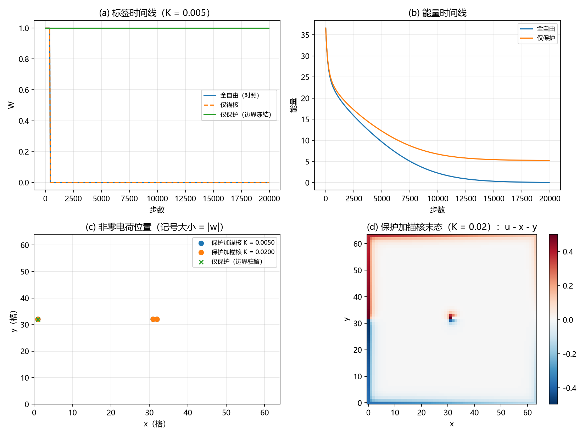

# 注记-C1-6 保护动力学轮：边界冻结下的线缺陷弛豫（判据 P-1 至 P-5）

- **日期**：2026-09-20 10:31:56
- **对应脚本**：`验证脚本/minimal_verification_c1_protected_dynamics.py`（判据 P-1 至 P-5，确定性，运行约 6 秒）
- **依据**：[[验证脚本/注记-C1-6三维版：线缺陷扇区的绕数衰减与保护层前提（判据B-1至B-5）]]（无保护衰减）；[[验证脚本/注记-C1-6 W1W2三维版：保护结构在三维线缺陷构型上的复核（判据W1-1至W1-4、W2-1至W2-3）]]（绕数是边界量、改扇区须沿弦触及边界）；[[验证脚本/注记-C1-6 W4轮：宽度的波性侧承载（软模关联长度与转换波有效波长，判据W4-1至W4-6）]]（宽度读数的归属）
- **状态**：保护的动力学实现完成（模型层）：标签在动力学下精确守恒（边界冻结恒等式）；同时给出三项结构读数：保护保标签不保位置（净荷滑向边界驻留）、冻结芯只保形状（芯处留偶极，净荷仍在边界）、本模型内无内驻亚稳线缺陷。线扇区的宽度读数不成立；宽度归属维持 1D 链（端点固定即天然保护）与 W4 的 $\xi$
- **图**：`images/c1_protected_dynamics.png`（见 §三 图 1）

## 一、问题与口径

B 轮给出无保护时线缺陷扇区的拓扑荷衰减；W1/W2 三维版确认绕数是边界量（逐切片机器精度）、局域体算符改不动它、改扇区必须沿触及边界的弦。据此，保护的最小动力学实现是把标签的载体冻结：边界环数据固定，绕数即恒为初值（精确），体内动力学完全自由。本轮做四档对照：全自由、仅锚核（冻结芯 3x3）、仅保护（冻结边界环）、保护加锚核。模型与协议与 B 轮同口径（横截面 $64^2$、$u = u_0 + \theta/2\pi$、梯度下降 $\eta = 0.001$、20000 步；格点边长为成本计从 B 轮的 128 降至 64，读数为结构性、与边长无关）。

## 二、判据与结果

| 判据 | 内容 | 实测 | 判定 |
|---|---|---|---|
| P-1 | 无保护对照 | W：$1 \to 0$（第 450 步记录到）；末能量 $0.0431$（复现 B 轮 B-1） | 通过 |
| P-2 | 仅锚核 | 冻结芯而边界自由：W 仍 $1 \to 0$（第 450 步） | 通过（不提供保护） |
| P-3 | 仅保护下的守恒与漂移 | W 恒为 1（非 1 次数 $0$）；能量 $36.6532 \to 5.2529$；净荷单格 $(1, 32, +1)$，质心从 $(32.5, 32.5)$ 滑到 $(1.00, 32.00)$ | 通过 |
| P-4 | 保护加锚核的末态结构 | W = 1；电荷 $(1,32,+1)$、$(31,32,-1)$、$(32,32,+1)$（芯处偶极加边界净荷）；体内剖面峰-谷差 $0.042$（$K = 0.005$）与 $0.001$（$K = 0.02$） | 通过（结构读数：无内驻缺陷） |
| P-5 | 归属登记 | 标签守恒归保护；位置稳定归锚核；内驻亚稳线缺陷本模型内未出现；宽度归属 1D 链与 W4 | 通过 |

## 三、解读

其一，**标签的动力学实现成立**。边界环冻结时绕数全程恒为 1（精确，非 1 次数为零），体内照常弛豫，能量从 $36.65$ 收敛到 $5.25$。这与 W1/W2 的结论一致：标签住在边界上，固定边界数据即固定标签。

其二，**保护不保位置**。仅保护时净荷滑到边界旁驻留（单格 $(1,32,+1)$，质心 $x = 1.00$）。原因是切割能：净荷的能量随芯到边界的距离单调下降（跨切割的键差偏离 $\Delta u = 1$，每键付 $\tfrac{1}{2}$），扇区极小因此贴着边界。位置稳定归锚核，与复合模型的两层分工一致。

其三，**冻结芯只保形状，不保净荷**。保护加锚核的末态里，芯处留下 $(+1, -1)$ 偶极（冻结芯的失配结构），净 $+1$ 仍驻边界；体内剖面平坦（峰-谷差 $0.042$ 与 $0.001$）。冻结芯是形状钉扎的抽象代理，不携带净荷的约束力。

其四，**内驻亚稳线缺陷在本模型内未出现**。B 轮遗留的线扇区宽度与窗口因此给出负读数：线扇区没有可读宽度的内驻形态。宽度归属维持既有读数：1D 链（端点固定正是天然保护）的 $l^{*}$ 表、W4 的 $\xi$、面壁扇区的三维复现。把净荷钉在体内需要另立判据的锚核设计（登记为开放项）。

## 四、严格程度声明

P-1 与 P-2 为可复现数值事实（确定性，跳变步数与能量写在脚本输出）；P-3 的守恒属恒等式层面（边界环固定则绕数不变），数值核验非 1 次数为零；P-4 为末态结构读数（电荷分布、质心、剖面幅度）；P-5 为归属登记，不含新断言。模型与协议与 B 轮同口径，格点边长从 128 降至 64 已在 §一 声明。

## 五、边界声明

- 验证：保护（边界冻结）下的标签守恒与弛豫收敛；净荷位置与末态结构；内驻线缺陷存在性的读数。
- 不验证（留待后续）：把净荷内驻所需的锚核设计（判据待立）；深阱锚核与切割能的竞争定量；量子层通道振幅（归 Q4/Q5，已完成）。

## 六、过程记录

两处。其一，首版用全局硬否决实现保护（每步试更新核对绕数，改变则步长折半重试）：梯度流滑到扇区边界后 98\% 的步被否决、近似停住（否决 19582 次、折半 489653 次），电荷质心已滑到 $x = 1$。据此改用边界冻结实现：标签是边界量（W1-1），冻结边界数据即冻结标签，体内完全自由，无需否决。其二，首版的宽度测量（沿固定列的弹性超量二阶矩）被冻结边界层的失配跳变污染（峰位落在最外一行），且末态体内无扭结；测量口径改为结构读数（电荷分布、质心、体内剖面幅度）。
