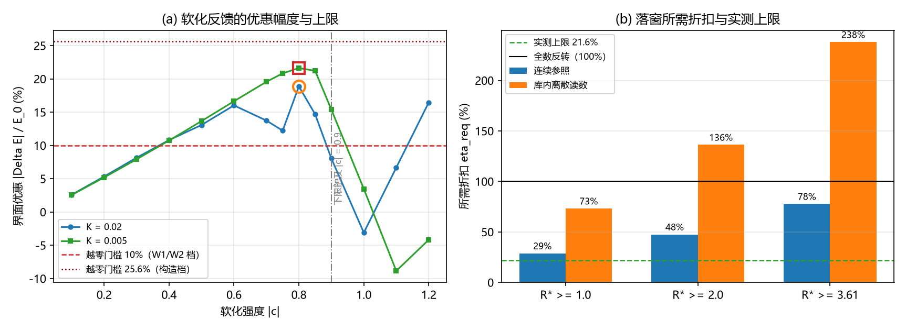

# 注记-C1窗口算术：软化反馈的强度上限与所需驻留半径的定量对接

## 元数据

- **日期**：2026-09-19 09:08:57
- **对应脚本**：`验证脚本/minimal_verification_c1_softening_window.py`（判据 U-1 至 U-3，确定性，无随机数，运行约 15 秒；图存 `images/c1_softening_window.png`，见 §四 图 1）
- **依据**：[[验证脚本/注记-键能反馈的界面效应：反感分支、软化分支与刚度下限（L1至L4）]]；[[验证脚本/注记-C1-4b体项可行性判定：泡壁环稳定条件的精确化、体项扫描与机制清单]]；[[验证脚本/注记-C1-4c锁定缺失泡的构造判定：正定泛函的界面能与负线项的可达性]]；[[内部草稿/注记-载体层裁决：纯相位的失败边界与振幅通道的实现路径]]（W1/W2 的 $10\%$ 缺口读数）；[[理论攻坚/三维复合位错攻坚计划：形态、驻留与宽度窗口]]（C1-5 落窗线 $\ell^{*} \ge 2$）；[[验证脚本/注记-费米子通道第三轮：宽度窗口与洛伦兹窗口的交叉核对（H1至H4）]]（洛伦兹窗口 $\ell^{*} \ge 3.61$）
- **定位**：补完 L 系列 §三 留下的窗口算术，把软化幅度对越零与落窗两个门槛做定量对接；C1 负线项来源判据的补充材料；不改动基准文件。
- **状态**：判据 U-1 至 U-3 执行完毕。三组读数：软化折扣的可达上确界 $21.622\%$（$K = 0.005$，$c = -0.8$），L 系列报出的 $8.2\%$ 系粗采样缺口；刚度下限首次触及于 $c = -0.9$，与结构式 $(1 - \mathrm{floor}) / s_{\max}$ 逐位一致；落窗 $12$ 档全部不达（缺口 $1.3$ 至 $11.7$ 倍），最优越零情形的 $R^{*}$ 只有 $0.18$ 至 $0.62$ 格。

## 一、判据与结果

| 判据 | 内容 | 通过条件 | 实测 | 判定 |
| --- | --- | --- | --- | --- |
| U-1 | 软化折扣上确界与结构边界 | 上确界为细扫值，边界与结构式一致 | $\eta_{\max} = 21.622\%$（$c = -0.8$）；下限首次触及 $c = -0.9$，结构预测 $-0.900$ | 通过（边界逐位命中，上确界较 L 系列上修） |
| U-2 | 越零条件 $\eta > \varepsilon$ | 加法合成下 $\eta_{\max} > \varepsilon$ | W1/W2 残差档 $21.6\% > 10.0\%$（裕量 $2.16$ 倍）；构造档 $21.6\% < 25.6\%$（缺口 $1.18$ 倍） | 加法档一过一否；乘法一律否 |
| U-3 | 落窗条件 $\eta \ge \varepsilon + R^{*}_{\mathrm{req}} \delta / \sigma_0$ | 所需 $\eta$ 不超过实测上限 | $12$ 档全部不达（缺口 $1.3$ 至 $11.7$ 倍） | 落窗不成立 |

## 二、强度上限：细扫修正、结构边界与稳定性

**细扫把上确界从 $8.2\%$ 修正到 $21.622\%$。** L 系列的软化分支只扫了 $c = -0.1 / -0.3 / -1.0$ 三点，报出的 $-2.6\%$ 至 $-8.2\%$ 是采样缺口。本判据把 $c$ 细扫到步长 $0.05$，折扣随 $|c|$ 单调增，在 $c = -0.8$ 取到 $21.622\%$（$K = 0.005$），再深一步（$-0.85$）为 $21.215\%$，构成一条折扣脊。

| $c$ | $\Delta E / E_0$（$K = 0.02$） | $\Delta E / E_0$（$K = 0.005$） | $\ell^{*}$（$K = 0.005$） |
| --- | --- | --- | --- |
| 0 | 基准 | 基准 | $4.061$ |
| -0.1 | $-2.590\%$ | $-2.553\%$ | $3.954$ |
| -0.2 | $-5.328\%$ | $-5.187\%$ | $3.835$ |
| -0.3 | $-8.153\%$ | $-7.912\%$ | $3.702$ |
| -0.4 | $-10.798\%$ | $-10.733\%$ | $3.551$ |
| -0.5 | $-13.066\%$ | $-13.651\%$ | $3.374$ |
| -0.6 | $-16.014\%$ | $-16.639\%$ | $3.156$ |
| -0.7 | $-13.733\%$ | $-19.560\%$ | $2.866$ |
| -0.75 | $-12.222\%$ | $-20.827\%$ | $2.672$ |
| -0.8 | $-18.873\%$ | $-21.622\%$ | $2.417$ |
| -0.85 | $-14.683\%$ | $-21.215\%$ | $2.091$ |
| -0.9 | $-8.044\%$ | $-15.387\%$ | $1.563$ |
| -1.0 | $+3.111\%$ | $-3.470\%$ | $0.998$ |

**结构边界逐位命中。** 本模型记录在位移侧的平台值为 $s = 1$（位移整格），故刚度下限首次触及的条件是 $|c| = 1 - \mathrm{floor} = 0.9$；实测首次触及在 $c = -0.9$，与预测一致。越过边界后读数恶化：$c = -1.0$ 时 $K = 0.02$ 翻回 $+3.111\%$，壁半径缩到 $0.263$ 格。

**降低下限不提高上限。** 把 floor 从 $0.1$ 降到 $0.05$，前沿移到 $c = -0.95$，读数翻正（$+4.6\%$、$+4.1\%$）；降到 $0.02$，前沿 $c = -0.98$ 翻得更高（$+17.9\%$、$+46.4\%$）。上限由剖面完整性设定，不受下限值调节；脊后壁剖面塌缩，对象已非原壁。

**折扣与宽度同向收窄。** 软化在给优惠的同时把壁收窄：$K = 0.02$ 的壁本来就在落窗线上（$\ell^{*} = 2.008$），$c = -0.1$ 即降到 $1.951$，折扣脊处只剩 $1.167$；$K = 0.005$ 在折扣脊上仍有 $\ell^{*} = 2.417$，出基本窗（$\ell^{*} = 2$）约在 $|c| \approx 0.86$，出洛伦兹窗（$3.61$）约在 $|c| \approx 0.36$。

**$K = 0.02$ 的前沿列有噪声。** $|c| \ge 0.6$ 起该列的 $\ell^{*}$ 非单调（$1.363 \to 0.946 \to 0.790 \to 1.167$），读数波动；判定以平滑的 $K = 0.005$ 列为准，$K = 0.02$ 列只作边界复核。

## 三、窗口算术：越零与落窗的定量对接

环构型取 C1-4b 的形式 $E(R) = 2\pi R\,a + \pi R^2\,\delta$，稳定半径 $R^{*} = |a| / \delta$（需 $a < 0 < \delta$）。线项取最有利的加法合成（锚核残差与软化折扣在同一线张力尺度上相减）：

$$a = \sigma_0\,(\varepsilon - \eta), \qquad R^{*} = \frac{\sigma_0}{\delta}\,(\eta - \varepsilon).$$

越零要求 $\eta > \varepsilon$；落窗 $R^{*} \ge R^{*}_{\mathrm{req}}$ 等价于

$$\eta \ge \varepsilon + R^{*}_{\mathrm{req}}\,\frac{\delta}{\sigma_0}.$$

**越零：最有利一档成立，其余不成立。** 取加法合成，W1/W2 残差档（$\varepsilon = 0.100$）所需折扣 $10.0\%$ 低于实测上限 $21.6\%$，裕量 $2.16$ 倍；构造档（$\varepsilon = 0.256$）所需 $25.6\%$ 仍差 $1.18$ 倍。若改取乘法合成（软化只压缩残余正项，$a = \sigma_0\,\varepsilon\,(1 - \eta)$），对 $\eta < 1$ 恒正，越零一律不成立。真实合成须由统一的「锚核 + 反馈」构型判定，见边界声明。（2026-09-19 续判：统一构型已判，合成实测为近乘法（相对协同 $1.1$ 至 $1.3$），加法读数被排除；且正定性使总节省率不可能超过 $1$，越零两档合一为不成立，见 [[验证脚本/注记-C1统一构型：锚核与反馈的合成规则判定与越零判死]]。）

**落窗：$12$ 档全部不达。** 取 $\delta = 0.1250$（$\lambda / 2$），$\sigma_0$ 用两种口径：连续参照 $0.6667$（$(4/3)\sqrt{\lambda}$）与库内离散读数 $0.198$（C1-4c S1）；本脚本离散复算 $0.7021$ 支持连续参照。

| $\varepsilon$ | $R^{*}_{\mathrm{req}}$ | 所需 $\eta$（连续参照，$\delta/\sigma_0 = 0.1875$） | 所需 $\eta$（库内离散，$\delta/\sigma_0 = 0.6313$） |
| --- | --- | --- | --- |
| 0.100 | 1.00 | $28.7\%$（缺口 $1.3$ 倍） | $73.1\%$（缺口 $3.4$ 倍） |
| 0.100 | 2.00 | $47.5\%$（缺口 $2.2$ 倍） | $136.3\%$（缺口 $6.3$ 倍） |
| 0.100 | 3.61 | $77.7\%$（缺口 $3.6$ 倍） | $237.9\%$（缺口 $11.0$ 倍） |
| 0.256 | 1.00 | $44.4\%$（缺口 $2.1$ 倍） | $88.7\%$（缺口 $4.1$ 倍） |
| 0.256 | 2.00 | $63.1\%$（缺口 $2.9$ 倍） | $151.9\%$（缺口 $7.0$ 倍） |
| 0.256 | 3.61 | $93.3\%$（缺口 $4.3$ 倍） | $253.5\%$（缺口 $11.7$ 倍） |

表中超过 $100\%$ 的行表示即使把裸线张力全数反转（$\eta = 1$）仍不够，落窗需要负项量级超过裸线张力本身。

**最优越零情形的半径也在亚格点量级。** 取最有利组合（W1/W2 残差加折扣脊），$|a| / \sigma_0 = 0.216 - 0.100 = 0.116$，得 $R^{*} = 0.62$ 格（连续口径）或 $0.18$ 格（库内离散口径）。落窗线要 $2$ 格，洛伦兹窗口要 $3.61$ 格：即便越零成立，环的半径也不到基本落窗线的三分之一。

**结论。** 软化通道的定位由「候选负线项」收紧为「把残差压小一档的辅助折扣」：最有利口径下它把 $10\%$ 的残差压到负侧（$a / \sigma_0 = -0.116$），把 $R^{*}$ 从零推到亚格点半径；落窗所需的 $28.7\%$ 至 $253.5\%$ 折扣远超上限 $21.6\%$。窗口算术到此补完：越零问题已由统一构型判死（2026-09-19，见 [[验证脚本/注记-C1统一构型：锚核与反馈的合成规则判定与越零判死]]），落窗问题在该通道上是否定的。

## 四、图

## 五、严格程度声明

U-1 为确定性数值（一维链，与 L 系列同求解器与迭代预算，无随机数）；结构边界 $(1 - \mathrm{floor}) / s_{\max}$ 为精确条件，与实测逐位一致。U-2 与 U-3 为算式对接：环公式取 C1-4b 既有形式，残差两档取 W1/W2 与 C1-4c 的既有读数，$\delta / \sigma_0$ 取构造轮参数与两种口径，合成口径为假设（加法取乐观界）。跨模型口径：软化折扣测自 u 场 kink，环路线的线张力属构造轮模型，两者同尺度相加为最有利假设，未由同一动力学验证。

## 六、边界声明

本注记验证：软化折扣的细扫上确界与结构边界、越零与落窗两个门槛在该算术下的对接结果。本注记不验证：统一「锚核 + 反馈」构型的合成规则（2026-09-19 已续判，见 [[验证脚本/注记-C1统一构型：锚核与反馈的合成规则判定与越零判死]]）；显式负项、Hopf、心侧校准三条路线的取舍；二维与三维环的直接数值（环公式为解析算术）；GL 相位差 $\delta$ 的物理选定与近简并调节空间；洛伦兹窗口 $3.61$ 的换算口径本身（引用费米子第三轮）。$\eta$ 以裸壁能 $E_0$ 为基，$\varepsilon$ 以各来源模型自身的线张力为基，两种基的混用已在上文逐处标注。

## 七、过程记录

其一，粗采样假象：L 系列三点扫描把上限读成 $8.2\%$，细扫（含 $0.05$ 加密点）把上确界移到 $21.6\%$；原「上限撞刚度下限」的定性修正为「上限由剖面完整性设定」。其二，$K = 0.02$ 前沿列非单调，判定改用 $K = 0.005$ 平滑列。其三，下限敏感性一段为执行中追加，原设想「降低下限可提高上限」被读数判负，写入正文。其四，脚本初版的结构式写作 $1 - \mathrm{floor} \cdot s_{\max}$，复核时改为 $(1 - \mathrm{floor}) / s_{\max}$；$s_{\max} = 1$ 时两式同值，读数不受影响。

## 八、登记衔接

其一，`验证脚本/README.md` 第 180 条（本材料）。其二，[[内部草稿/开放问题总览：元相子理论待解决问题清单]] 的 C1 登记块补记本轮（窗口算术）。其三，[[验证脚本/注记-键能反馈的界面效应：反感分支、软化分支与刚度下限（L1至L4）]] 的 §三 与状态行补指针与幅度订正。其四，本注记供 C1 三路线裁决作补充材料。其五，本注记不改动基准文件。
