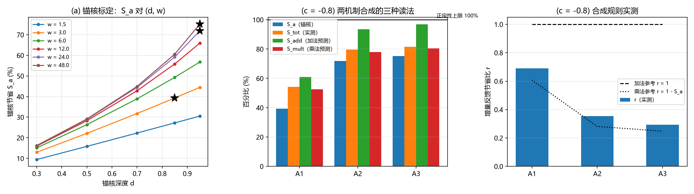

# 注记-C1统一构型：锚核与反馈的合成规则判定与越零判死

## 元数据

- **日期**：2026-09-19 21:27:27
- **对应脚本**：`验证脚本/minimal_verification_c1_anchor_feedback_unified.py`（判据 AF-1 至 AF-4，确定性，无随机数，运行约 20 秒；图存 `images/c1_unified_composition.png`，见 §五 图 1）
- **依据**：[[验证脚本/注记-C1窗口算术：软化反馈的强度上限与所需驻留半径的定量对接]]（越零两档的合成读法与登记项）；[[验证脚本/注记-键能反馈的界面效应：反感分支、软化分支与刚度下限（L1至L4）]]（反馈口径与折扣脊）；[[验证脚本/注记-C1-4b体项可行性判定：泡壁环稳定条件的精确化、体项扫描与机制清单]]（线项 $a = \sigma_{\text{壁}} + \mu_{\text{芯}}$ 与 $10\%$ 缺口）；[[验证脚本/注记-C1-4c锁定缺失泡的构造判定：正定泛函的界面能与负线项的可达性]]（正定泛函硬下界）；[[内部草稿/注记-载体层裁决：纯相位的失败边界与振幅通道的实现路径]]（锚核的钉扎阱语言）
- **定位**：补上窗口算术注记登记的收尾项（统一「锚核 + 反馈」构型，判死合成规则与越零）；C1 负线项来源判据的收束材料；不改动基准文件。
- **状态**：判据 AF-1 至 AF-4 执行完毕。结论三项：其一，越零判死（结构性）：统一构型仍属正定泛函（$K_i \ge 0$、$\kappa_e \ge 0.1$），真空 $E = 0$，故线项 $a \ge 0$ 恒成立，加法读法所需的「总节省率超过 $1$」被排除。其二，合成规则实测为近乘法：增量反馈节省比 $r$ 贴近 $1 - S_a$，带 $1.1$ 至 $1.3$ 的相对协同；加法读数（$r = 1$）被实测排除。其三，本构型类的最小残差 $a / \sigma_0 = 17.96\%$（网格最大总节省 $82.04\%$）。

## 一、判据与结果

| 判据 | 内容 | 通过条件 | 实测 | 判定 |
| --- | --- | --- | --- | --- |
| AF-1 | 锚核标定（$S_a$ 对 $d, w$） | 给可达范围与三档拾取 | $S_a$ 从 $9.4\%$（$w = 1.5$，$d = 0.3$）到 $76.6\%$（$w = 96$，$d = 0.95$）；凹口把壁展宽（$\ell^{*}$ 至 $15.6$） | 完成 |
| AF-2 | 反馈基准 $\eta(c)$（$d = 0$） | 复验 L 系列口径 | $5.187\%$、$10.733\%$、$16.639\%$、$21.622\%$（$c = -0.2$ 至 $-0.8$） | 逐位一致 |
| AF-3 | 统一网格与合成规则 | 判定加法或乘法 | $r = 0.69$ 至 $0.73$（A1）、$0.34$ 至 $0.39$（A2）、$0.28$ 至 $0.32$（A3）；乘法参考 $1 - S_a = 0.61 / 0.28 / 0.25$ | 近乘法（相对协同 $1.1$ 至 $1.3$），加法排除 |
| AF-4 | 越零判死 | $S_{\mathrm{tot}}$ 能否超过 $1$ | 网格最大 $82.04\%$；结构性 $a \ge 0$ | 判死：越零不可能 |

## 二、锚核标定与反馈基准

锚核取偏好凹口（$K$ 局域压低），单独开启时给出 $S_a(d, w)$ 的全表。凹口越深越宽，节省越大；代价是壁被展宽。

| $w$ | $d = 0.3$ | $0.5$ | $0.7$ | $0.85$ | $0.95$ |
| --- | --- | --- | --- | --- | --- |
| 1.5 | $9.4\%$ | $15.8\%$ | $22.3\%$ | $27.2\%$ | $30.5\%$ |
| 3.0 | $13.0\%$ | $22.1\%$ | $31.8\%$ | $39.3\%$ | $44.5\%$ |
| 6.0 | $15.1\%$ | $26.4\%$ | $38.9\%$ | $49.3\%$ | $56.8\%$ |
| 12.0 | $15.9\%$ | $28.3\%$ | $42.8\%$ | $55.8\%$ | $65.9\%$ |
| 24.0 | $16.2\%$ | $28.9\%$ | $44.4\%$ | $59.2\%$ | $71.9\%$ |
| 48.0 | $16.2\%$ | $29.1\%$ | $44.9\%$ | $60.6\%$ | $75.2\%$ |
| 96.0（仅 $d = 0.95$） | | | | | $76.6\%$ |

拾取三档（供统一网格用）：A1（$d = 0.85$，$w = 3.0$，$S_a = 39.3\%$，$\ell^{*} = 5.61$）、A2（$d = 0.95$，$w = 24.0$，$S_a = 71.9\%$，$\ell^{*} = 12.72$）、A3（$d = 0.95$，$w = 48.0$，$S_a = 75.2\%$，$\ell^{*} = 14.75$）。

本族锚核的上确界约 $76.6\%$（$w = 96$），W1/W2 档的 $90\%$ 节省（$10\%$ 缺口）在本族不可达；该档数字只作外推对照。反馈基准复验与 L 系列逐位一致（$\eta = 5.187\%$ 至 $21.622\%$）。

## 三、统一网格：合成规则的实测

比值定义：$r = [E(d, 0) - E(d, c)] / [E(0, 0) - E(0, c)]$，即增量反馈节省对裸壁反馈节省之比。加法合成给 $r = 1$，乘法合成给 $r = 1 - S_a$。

| 配置 | $c = -0.4$：$S_{\mathrm{tot}}$ / $S_{\mathrm{add}}$ / $S_{\mathrm{mult}}$ / $r$ | $c = -0.8$ | $c = -0.85$ |
| --- | --- | --- | --- |
| A1 | $47.1\%$ / $50.1\%$ / $45.8\%$ / $0.726$ | $54.2\%$ / $60.9\%$ / $52.4\%$ / $0.690$ | $54.9\%$ / $60.5\%$ / $52.2\%$ / $0.733$ |
| A2 | $75.5\%$ / $82.6\%$ / $74.9\%$ / $0.336$ | $79.5\%$ / $93.5\%$ / $78.0\%$ / $0.353$ | $80.1\%$ / $93.1\%$ / $77.9\%$ / $0.386$ |
| A3 | $78.2\%$ / $85.9\%$ / $77.9\%$ / $0.275$ | $81.6\%$ / $96.8\%$ / $80.6\%$ / $0.294$ | $82.0\%$ / $96.4\%$ / $80.5\%$ / $0.322$ |

三档读数一致指向近乘法：$r$ 贴近 $1 - S_a$，并带一个正协同（$r / (1 - S_a)$ 约 $1.1$ 至 $1.3$）。加法读数被实测排除：A3 在 $c = -0.8$ 处，加法预测 $96.8\%$ 对实测 $81.6\%$，差 $15.2$ 个百分点。锚核把可被反馈吃掉的应变能先收走，反馈只能作用于剩余部分。

$K = 0.02$ 对照复现同一规则：（$d = 0.85$，$w = 3$）$S_a = 49.1\%$，$c = -0.8$ 时 $S_{\mathrm{tot}} = 59.9\%$（协同 $0.98$）；（$d = 0.95$，$w = 12$）$S_a = 71.7\%$，$S_{\mathrm{tot}} = 78.4\%$（协同 $1.10$）。

## 四、越零判死

结构性判死先于数值：$K_i \ge 0$（$d \le 1$）与 $\kappa_e \ge 0.1\kappa$ 使能量逐点非负，真空取 $E = 0$，故任何构型的线项 $a = E \ge 0$。越零要求总节省率超过 $1$，与该恒等式直接冲突，任何锚核类型与任何反馈强度都救不回。

外推到 W1/W2 档：设 $S_a = 0.90$，加法读法给 $1.116 > 1$，被结构性排除；按实测规则（近乘法加协同 $1.2$）给 $S_{\mathrm{tot}} \approx 0.93$，残差约 $7\%$，仍为正。本构型类的实测前沿更保守：网格最小残差 $a / \sigma_0 = 17.96\%$。

对窗口算术注记 U-2 的修订：越零两档合一为不成立（加法档被结构性排除，乘法档本就不过零）。软化反馈的定位据此最终锁定为辅助折扣（把残差压小一档），**不能充当负线项**；C1 负线项的出口回到显式负项、Hopf 与心侧校准三路线。

## 五、图

## 六、严格程度与边界

结构性结论（$E \ge 0$ 与 $a \ge 0$）为精确论证，不依赖锚核类型与网格。网格为同口径确定性数值（一维链、与 L 系列同求解器与迭代预算，无随机数）。凹口型锚核为本族代表；键优惠、阱深调整等其他锚核类型的协同因子可能不同，正定性上限不受影响。本构型类不是 W1/W2 振幅通道锚核的复刻，$90\%$ 档在本族不可达，故 W1/W2 档数字只作外推对照。本注记不验证：显式负项、Hopf、心侧校准三路线；三维环的直接数值；凹口族以外锚核类型的协同因子。

## 七、过程记录

其一，拾取规则（$S_a$ 最近 $0.40$、$0.70$ 与最大值）在脚本内固定，复跑一致。其二，$w = 96$ 探针为家族上确界加测。其三，$K = 0.02$ 对照复现近乘法（协同 $0.98$ 与 $1.10$）。其四，本判据的判据代号避开已占用的 V 系列（张量桥判据 V），取 AF（锚核 + 反馈）。

## 八、登记衔接

其一，`验证脚本/README.md` 第 181 条（本材料）。其二，[[内部草稿/开放问题总览：元相子理论待解决问题清单]] 的 C1 登记块补记本轮。其三，[[验证脚本/注记-C1窗口算术：软化反馈的强度上限与所需驻留半径的定量对接]] 的 §三 两处与边界声明补订正指针。其四，本注记供 C1 三路线裁决作收束材料。其五，配套通俗说明 [[内部草稿/注记-C1统一构型判定的通俗说明：两道折扣叠不出负数]]，科普一节并入 [[科普文章/地毯上的一道褶子：元相子理论中的位错]]；其六，本注记不改动基准文件。
