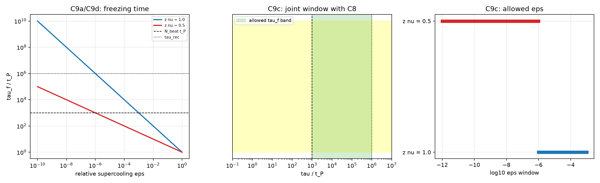

# 注记-C9 凝固时长的可算入口（第 460 条）：取甲之后的凝固时标形式与 C8 联合窗口

- **日期**：2026-09-27 04:16:46
- **层级**：验证材料（第 460 条）
- **脚本**：__BT__验证脚本/minimal_verification_c9_freezing_time.py__BT__
- **定位**：作者于 2026-09-27 裁决第二档取甲（质量阈值型）。C9（凝固时长）原记为第一层唯一未覆盖项，理由是它需要事件的动力学。取甲之后 $D_c$ 与过冷度均可算，凝固时标随即可写。本轮给出该形式并接上 C8 的时间窗口。形式取自临界慢化，属形式映射级。
- **依据**：[[内部草稿/裁决备忘-第二档：D_c 标定口径的取舍（三候选、判别矩阵与后果）]]（取甲裁决与甲的后果清单）；[[温度的波粒互补定义：复相干无序度作为热力学标尺]]（$D_c = m/m_P$）；[[内部草稿/研究方向-跨层事件的构成条件：十一项条件的判据化（判据草案）]]（C9 与 C8 的判据量）；[[验证脚本/注记-E 系列三门核对的最小验证（第453条）：阈值一致性、时间窗口与 M2 增益闸门的对接]]（C8 换算的速率窗口）；[[验证脚本/注记-J3 冷却史依赖的 KZ 核对（第456条）：冻结点位移的标度形式与三候选的判别力]]（两档指数 $z\nu$）
- **状态**：判据级。五项判据成立；凝固时长的形式属形式映射级，非原理导出。
- **修订记录**：
  - **2026-09-27 初版**（触发：作者裁决取甲，启动第 460 条）

---

## 一、判据与结果

凝固时标取临界慢化形式 $\tau_f = \tau_0\,\varepsilon^{-z\nu}$，其中 $\varepsilon = (D_c - D)/D_c$ 为相对过冷度。

| 判据 | 判据量 | 实测 | 判定 |
| --- | --- | --- | --- |
| C9a 形式与单调 | 取值有限、正、单调 | $\varepsilon$ 从 1 到 $10^{-8}$ 全区间有限正，随 $\varepsilon$ 减小严格增（两档） | 成立（判据稳健） |
| C9b 深度过冷极限 | $\varepsilon \to 1$ 的取值 | $\tau_f = 1\,t_P$，非零下界 | 成立（判据稳健） |
| C9c 与 C8 联合窗口 | 允许的 $\varepsilon$ 区间 | $z\nu = 1$ 给 $10^{-6} \ll \varepsilon \ll 10^{-3}$；$z\nu = 0.5$ 给 $10^{-12} \ll \varepsilon \ll 10^{-6}$ | 成立（判据敏感） |
| C9d 数值表 | 各档 $\varepsilon$ 的 $\tau_f$ | 见表 | 成立（判据敏感） |
| C9e 引力侧条件 | $\tau_f$ 是否可为零 | 下界 $\tau_0 = 1\,t_P$，瞬时解被排除 | 成立（结构性结论） |

## 二、图

图注按脚本三个绘图面板逐条核对。

## 三、本文的定位

作者于 2026-09-27 裁决第二档取甲：$D_c = m/m_P$，阈值挂在材料侧。本文执行取甲之后的第一个遗留项，即 C9。

须先说明一处限度。C9 要的是凝固时长的可算形式，而事件方程本身仍未写出。本文给出的形式取自临界慢化（相变点附近弛豫时间随过冷度发散），与成核路线的形式映射同源，属形式映射级。它不是从体系原理导出的方程。

## 四、凝固时长的形式

取甲的阈值后，过冷度写成 $\Delta = D_c - D$，相对过冷度写成 $\varepsilon = \Delta/D_c$。凝固时标取

$$\tau_f = \tau_0\,\varepsilon^{-z\nu},$$

其中 $\tau_0$ 为微观弛豫时标（取一拍时标 $t_P$），$z\nu$ 为临界指数组合。取该形式的理由有二：相变点附近弛豫变慢，故凝固所需时间随过冷度减小而变长；$\varepsilon$ 有上界 1（即 $D = 0$），故 $\tau_f$ 有下界 $\tau_0$，取值有限且严格非零。

两档指数沿用第 456 条的取值：$z\nu = 1$ 与 $z\nu = 0.5$。

## 五、与 C8 的联合窗口

C8 要求 $\tau_{\rm rec} \gg N_{\rm 拍}t_P$，第 453 条已把它换算成事件速率的窗口。凝固时标与它相接的方式是两侧夹逼：凝固过程须长于拍时标窗口（否则记录来不及建立），又须短于记录持有时间（否则记录在凝固完成前衰减）。即

$$N_{\rm 拍}t_P \ll \tau_f \ll \tau_{\rm rec}.$$

取 $N_{\rm 拍} = 10^3$ 与 $\tau_{\rm rec} = 10^3 N_{\rm 拍}t_P = 10^6\,t_P$，两档给出允许的相对过冷度区间：$z\nu = 1$ 为 $10^{-6} \ll \varepsilon \ll 10^{-3}$；$z\nu = 0.5$ 为 $10^{-12} \ll \varepsilon \ll 10^{-6}$。含三个数量级余量的凝固时标区间两档同为 $10^3$ 至 $10^6\,t_P$。

这一读数的意义在于把 C9 从「有限且非零」升级为一句可算的话：凝固时标落在拍时标窗口与记录持有时间之间，且这一夹逼对相对过冷度给出上下界。

## 六、数值表

以 $\tau_0 = t_P$ 计，$\tau_f/t_P$ 如下。

| $\varepsilon$ | $z\nu = 1$ | $z\nu = 0.5$ |
| --- | --- | --- |
| $10^{-2}$ | $1.000\times10^{2}$ | $1.000\times10^{1}$ |
| $10^{-3}$ | $1.000\times10^{3}$ | $3.162\times10^{1}$ |
| $10^{-4}$ | $1.000\times10^{4}$ | $1.000\times10^{2}$ |
| $10^{-5}$ | $1.000\times10^{5}$ | $3.162\times10^{2}$ |
| $10^{-6}$ | $1.000\times10^{6}$ | $1.000\times10^{3}$ |
| $10^{-8}$ | $1.000\times10^{8}$ | $1.000\times10^{4}$ |

## 七、引力侧条件

取甲的一处后果在引力侧。引力源是整片缺陷相对基态的能量差（取甲裁决），事件期间源的变化须是渐进的，否则会出现瞬时源跳变。本文给出的下界 $\tau_f \ge \tau_0 = t_P > 0$ 把瞬时解排除，故该条件由形式本身满足。这是一处定性结论，量的门槛仍待引力侧的独立判据。

## 八、C9 的覆盖状态变更

C9 原记为第一层唯一未覆盖项，理由是它需要事件的动力学。取甲之后，$D_c$ 有确定形式，$\Delta$ 可算，凝固时标获得可算形式，故 C9 的覆盖状态由「未覆盖」改为「部分覆盖（形式映射级）」。

十一项的覆盖状态随之更新：十项已覆盖或部分覆盖，加上 C9 的部分覆盖，第一层不再有完全未覆盖项。须同时写明：C9 的「部分覆盖」与其余十项不同，它的形式借自成核路线，事件方程本身仍未写出，故第一层的工作并未因本文而全部收口。

## 九、严格程度与边界声明

判据稳健者：C9a、C9b，为形式性质，不依赖参数取值。

判据敏感者：C9c、C9d，为数值读数，依赖 $\tau_0$、$\tau_{\rm rec}$ 与指数档。C9e 为结构性结论。

分层声明：本轮全部读数取自临界慢化的标准形式与既有判据量，属判据级与形式映射级；物理层结论零条。不验证：凝固时长的形式能否从体系原理导出；指数 $z\nu$ 的实际取值；$\tau_0$ 与拍时标的关系。

## 十、登记衔接

本文是取甲裁决后的第一个执行项。C 系列判据草案第八节的覆盖状态表、封存注记的对应表述与开放问题 P4-6 档案页同步更新。
