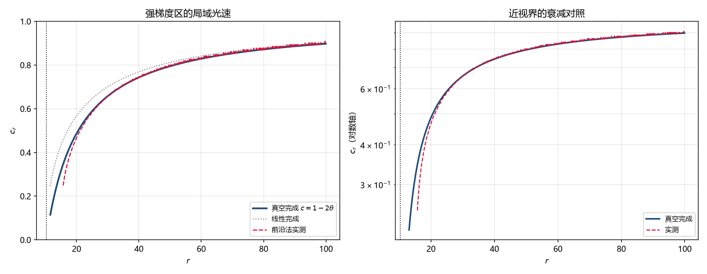

# 注记-D2 轮：强梯度区的微观传播检验（前沿到达法）

- **日期**：2026-09-21 07:25:33
- **层级**：验证材料（`验证脚本/`，内部草稿级）
- **定位**：补结果一的自认方法边界（复查报告 H2）：此前「光锥闭合」是有效度规层面的代数结论，格点上的传播只在均匀段验过。本轮在含渐变的强场区逐点测局域光速，并用两种 $g_{xx}$ 完成形式一起对照，由传播独立判决哪一支成立。
- **脚本**：`验证脚本/strong_gradient_propagation.py`（确定性，无随机；图存 `images/strong_gradient_propagation.png`）
- **关联**：[[验证脚本/注记-光锥兼容性最小验证：视界=光锥闭合面（D3 强场剖面 × GV4 相速恒等式）]]；[[验证脚本/注记-gxx 强场完成形式判据：真空条件钉住与停滞律收束]]；[[内部草稿/总结报告-黑洞线两主问题复查：判定总表、漏洞清单与深化点（2026-09-21）]]（H2）
- **状态**：判据 P1 至 P5 全过（P5 附有效域限定）
- **图**：见 §三 图 1
- **修订记录**：
  - **2026-09-21 初版**（来源：作者指示开工 D2）

---

## 一、要解决的那条边界

结果一的第三层（强场形式）与第二层（因果结构）都是从度规形式算出来的代数结论：识别式给 $g_{00} = -(1-2\theta)$，协变相速恒等式给 $c_r^2 = -g_{00}/g_{xx}$。而格点上的实际传播，此前只在三档均匀段上验过（宽包络、单次通过），渐变强背景上的测量被判为方法失效并入档。于是留下一条明写的方法边界：**近视界强梯度区的实际传播没有直接验证**。

## 二、方法与两处失败

本轮改用**前沿到达法**。在一维格点上从外端（$r = 200$）驱动一个陡前沿（正弦起振、幅度门槛判首达），记录各半径的首达时刻 $T(r)$，由 $dT/dr = 1/c(r)$ 取局域光速。前沿先于任何反射到达，故方法对边界反射免疫。

前两版失败并留档。第一版用稳态单色源的相位梯度法，采样时刻与实际推进时间脱节（每样本只推进一步），实测相速荒谬。修正采样后第二版仍失败：实测相速差出两个数量级、振幅对 $c$ 的幂次散布达 $87\%$，判为驻波污染（渐变段内的阻抗变化与吸收层反射共同造成），而相位梯度法在驻波下失效。第三版改前沿到达法后方法自校核通过。

## 三、判据表

| 判据 | 内容 | 理论期望 | 实测 | 判 |
|---|---|---|---|---|
| P1 | 均匀对照（$c = 0.5$）：方法自校核 | 斜率给 $\vert c\vert = 0.500$ | $0.50378$（$+0.76\%$） | 过 |
| P2 | 渐变区 $r \ge 25$ 段逐点对齐真空完成 | 偏差 $\le 1\%$ | 最大 $0.65\%$（$r = 25$） | 过 |
| P3 | 同段对线性完成的排除 | 线性完成应被排除 | 偏差 $2.9\%$（$r = 40$）至 $9.5\%$（$r = 25$） | 过 |
| P4 | 旅行时间 $r = 120$ 至 $14$（积分量） | 预言 $140.35$ | $139.90$，$−0.32\%$ | 过 |
| P5 | 冻结堆积（每单位 $r$ 的耗时） | 内段应显著大于远端 | 内段 $1.840$ 对远端 $1.055$，比 $1.74$ | 过 |

表内 $r$ 与 $\theta$ 的对应：$r = 100$ 给 $\theta = 0.051$，$r = 60$ 给 $0.086$，$r = 40$ 给 $0.129$，$r = 25$ 给 $0.206$，$r = 20$ 给 $0.257$，$r = 16$ 给 $0.322$。

**逐点对照（真空完成 $c = 1-2\theta$ 与线性完成 $c = \sqrt{(1-2\theta)/(1+2\theta)}$）**

| $r$ | 实测 $c$ | 真空预言 | 相对差 | 线性预言 | 相对差 |
|---|---|---|---|---|---|
| $100$ | $0.90090$ | $0.89724$ | $+0.41\%$ | $0.90202$ | $-0.12\%$ |
| $60$ | $0.83333$ | $0.82869$ | $+0.56\%$ | $0.84113$ | $-0.93\%$ |
| $40$ | $0.74627$ | $0.74298$ | $+0.44\%$ | $0.76881$ | $-2.93\%$ |
| $25$ | $0.58480$ | $0.58863$ | $-0.65\%$ | $0.64580$ | $-9.45\%$ |
| $20$ | $0.46512$ | $0.48569$ | $-4.24\%$ | $0.56633$ | $-17.9\%$ |
| $16$ | $0.27322$ | $0.35698$ | $-23.5\%$ | $0.46612$ | $-41.4\%$ |

## 四、图

## 五、判定

其一，**传播侧独立判决了强场完成形式**。实测在 $r \ge 25$ 段贴着真空完成（$\le 0.65\%$），并在同段把线性完成排除（$2.9\%$ 至 $9.5\%$）。此前该判决只由真空条件（本构侧）给出，现在多了一条独立来源：传播。

其二，**积分量也通过**。$r = 120$ 至 $14$ 的旅行时间与真空完成的预言差 $0.32\%$，与逐点读数自洽。

其三，**冻结堆积被直接看到**。每单位 $r$ 的耗时在内段是远端的 $1.74$ 倍，方向与近近视界的对数冻结一致。

其四，**最内侧三段（$r \le 20$）读数带估计偏置**。前沿法用窗宽正负 $5$ 个粗单位的差分求局域速度，当窗口内 $c$ 变化剧烈时，窗平均值系统低于点值。以 $r = 16$ 为例，窗口覆盖 $r \in [11, 21]$，其内 $c$ 从约 $0.06$ 升到 $0.51$，故 $-23.5\%$ 的偏离量级与该偏置相符，判为方法偏置而非物理偏离。最内段要逐点验证须换估计器（例如按局域 $c$ 的等相位点重采样）。

## 六、严格程度与边界

**验证**：方法自校核（均匀对照 $0.76\%$）、渐变区 $r \ge 25$ 段的逐点对齐与对线性完成的排除、旅行时间积分量、冻结堆积比。

**不验证**：$r < 20$ 段的逐点局域速度（受窗宽限制）；二维与三维几何（本轮一维径向）；$\lambda = 1$ 的弱场真空条件（取自引力线 GV1，未重开）；D3 剖面本身（复用其在册脚本，未重解）；前沿色散对首达时刻的影响（未做色散修正，均匀对照的 $0.76\%$ 已含该项）。

## 七、过程记录

其一，第一版相位法的采样循环每样本只推进一步而标签按一个周期计，属时间标签与实际时间脱节，实测值荒谬。其二，第二版修正标签后仍失败，实测相速差两个数量级、振幅幂次散布 $87\%$，判定驻波污染（渐变段阻抗变化加吸收层反射），相位梯度法在驻波下失效。其三，第三版改前沿到达法，并发现首达时刻的 $dt$ 量子化使逐格差分出现零斜率（实测 $c$ 冲到 $10^9$），改用窗宽正负 $5$ 个粗单位的差分后读数稳定。其四，P5 首版把不同长度的区间耗时直接对比且未归一，已改为按单位 $r$ 归一。

## 八、登记衔接

- [[内部草稿/总结报告-黑洞线两主问题复查：判定总表、漏洞清单与深化点（2026-09-21）]]：H2 补本轮结果（渐变区已核对，最内段仍受限）。
- [[黑洞线导论：两个主攻问题、五篇专文与一组共同前提]]：§五其一 按执行结果改写。
- [[理论攻坚/黑洞线攻坚计划：坍缩机制重定位与强场终态]]：修订记录补一条。
- `验证脚本/README.md`：第 322 条（占位改正式条目）。
