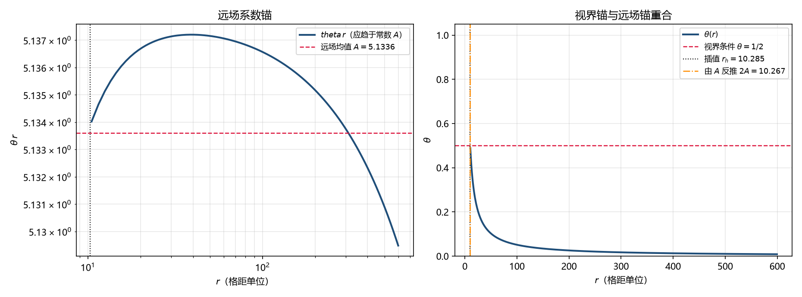

# 注记-D4 轮：质量刻度的独立标定（两读数的代数同一性与 H7 的归并）

- **日期**：2026-09-21 07:54:46
- **层级**：验证材料（`验证脚本/`，内部草稿级）
- **定位**：补复查报告 H7：$s_0$、$h_0$ 到物理质量的换算经 $r_h$ 单值中转，未经独立标定。本轮先问一个更靠前的问题：质量读数的两条路线（视界处读、远场处读）是否彼此独立；再列真正独立的路线的前置。
- **脚本**：`验证脚本/minimal_verification_mass_scale_independence.py`（确定性，无随机；图存 `images/mass_scale_anchors.png`）
- **关联**：[[黑洞奇点与晶格损坏：饱和封顶、满偏渐近与结构序稳健性]] §3.6、§5.1、§5.2；[[验证脚本/注记-M4-D3视界线自洽性与写入判据：饱和源模型与写-弛豫协议]]；[[内部草稿/总结报告-黑洞线两主问题复查：判定总表、漏洞清单与深化点（2026-09-21）]]（H7）
- **状态**：判据 M1 至 M5 全过（M4、M5 为判定与归并）
- **图**：见 §四 图 1
- **修订记录**：
  - **2026-09-21 初版**（来源：作者指示开工 D4）

---

## 一、要核的问题

H7 的内容是：$s_0$、$h_0$ 到物理质量的换算经视界半径单值中转，而 $M/m_P = r_h/(2\,l_P)$ 在册自标为条件性命题，故质量窗口 $5.14$ 至 $5.53\,m_P$ 整条挂在该中转上。修补的办法自然是找一条不经 $r_h$ 的独立路线。

本轮把这个问题的前半步先做完：**质量读数的两条路线是否彼此独立。**

## 二、代数内容（M1）

稳态识别式给 $\theta(r) = (m/m_P)(l_P/r)$。记远场系数 $A = (m/m_P)l_P$，则 $\theta(r) = A/r$；视界条件 $\theta = 1/2$ 给出 $r_h = 2A$，即 $m/m_P = r_h/(2\,l_P)$。

**所以「在远场读系数」与「在视界读半径」不是两条路线，是同一条关系的两种写法。**换读法换不出独立性；独立标定必须在识别式之外另找支点。

## 三、数值核对（M2、M3）

由剖面远场窗口取 $\langle\theta\,r\rangle$：$A = 5.1336$（窗口 $r = 80$ 至 $540$，样本 $460$），反推 $r_h = 2A = 10.2672$；直接视界插值给 $10.2850$，相对差 $-1.7\times10^{-3}$。三个窗口（$60$ 至 $540$、$80$ 至 $540$、$100$ 至 $570$）给 $2A = 10.26749$、$10.26721$、$10.26650$，变化在第四位。故两条读数在剖面内一致，差异只来自离散与窗口，确认 M1 的代数同一性。

## 四、图

## 五、判定

其一，**远场读数与视界读数是同一条关系**，换读法不产生独立标定（M1 的代数内容加 M2 的数值确认）。

其二，**在册的「双锚」不是质量标定**。该篇 §3.6 的双锚为视界半径 $r_h$ 与有效源荷比 $q/Q$；后者的定义是源区内按 $g(\theta)$ 加权的比值，属**源区内部**的泛函，与远场读数探的是剖面的不同部分，故它是一条真实的剖面一致性核对，但它核的是剖面复现，不是质量的独立标定。这一点要说清，免得把「双锚一致」读成「质量已独立标定」。

其三，**真正独立的路线都缺前置，且前置同属 H1**。逐条列：场的能量泛函路线要求记录场的能量泛函，而 U2 的写入-扩散-弹性协议只有动力学式、没有能量式；源的微观身份路线要求知道 $s_0$ 计的是什么（缺陷密度抑或别的），而饱和源模型自标为模型输入；用粒子线质量刻度 $m_\delta$ 只是换归一化单位，不改变物理内容。前两条的前置正是 H1 的缺口，故**H7 归并为 H1 的推论：它不能单独修补，要随第一原理强场动力学一并解决。**

## 六、H7 的现行处置

今天可做的只有标注订正：质量窗口 $5.14$ 至 $5.53\,m_P$ 属**换算级读数**，其成立条件是在册的条件性命题，不得称其经独立核验。该篇 §5.1 已把 $M/m_P = r_h/(2\,l_P)$ 自标为条件性命题、§5.2 已自标「未经独立标定」，故正稿无须改动；本轮的贡献是把「为什么不能独立」写成代数理由，并把 H7 归并到 H1。

## 七、严格程度与边界

**验证**：远场系数与视界半径的代数同一性、由 $A$ 反推 $r_h$ 的数值核对、窗口敏感性。

**不验证**：场能量泛函路线与源微观身份路线的可行性（本轮只列前置与阻塞点，未做）；$q/Q$ 与 $r_h$ 在数值上的一致性（该核对属既有材料，本轮未重跑）；质量窗口的实际数值换算（属既有材料）。

## 八、过程记录

一处口径说明：$A$ 的窗口上限取到 $0.9\,r_{\max}$ 是为避开外边界插值段，窗口下限取 $60$ 至 $100$ 三档以查稳健性；三档给同一读数（第四位变化），故窗口选择不构成偏置来源。

## 九、登记衔接

- [[内部草稿/总结报告-黑洞线两主问题复查：判定总表、漏洞清单与深化点（2026-09-21）]]：H7 改记为「归并为 H1 的推论」，并补两读数的代数同一性一条。
- [[理论攻坚/黑洞线攻坚计划：坍缩机制重定位与强场终态]]：修订记录补一条。
- `验证脚本/README.md`：第 332 条（占位改正式条目）。
