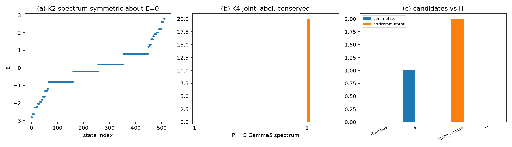

# 注记-D4 区分量的判定（第 495 条）：三个候选全部落空与能量符号为唯一可行区分量

- **日期**：2026-09-29 16:53:18
- **脚本**：`验证脚本/d4_separator.py⟧
- **判据**：K1 至 K4 全部通过（4/4），另附冒烟
- **可逆性等级**：K1 至 K4 判据稳健。K1、K2 为解析恒等与计数；K3、K4 为矩阵对易关系与联合谱枚举，与数值容差无关。
- **类型**：判据级读数，含一项对 D4 状态的关闭与一项自我更正
- **关联**：[[理论攻坚/电子场攻坚计划：复合位错算符的构造与螺旋序真空裁决]]（D4 的降级与本条的关闭）；[[验证脚本/注记-时空扩至2加1维与D4的算符层判定（第494条）：手性分支是Gamma5本征空间而非能量本征态|第 494 条]]（基被本条锁定）；[[验证脚本/注记-两因子张量积结构判据化（第491条）：宇称唯一性、Wilson相容与谱的因子化代价|第 491 条]]（W5 读数）；[[验证脚本/注记-畴壁费米子类比适用性（第488条）：壁位势的连续平移、畴壁的Z2旋量标签与反射联结的绕数读数|第 488 条]]（$\sigma$ 畴壁 $\mathbb{Z}_2$ 旋量标签的出处）；[[内部草稿/裁决请求-第492条运动学写法与Gamma5对易性（依据第494条复算）|裁决请求]]（并行线 $\alpha_i=\gamma^0\gamma^i$ 写法的复算）
- **图**：见 §四 图 1

---

## 摘要

本条判定 D4 所缺的区分量。三个候选全部落空，唯一能把 $\Gamma_5$ 两支分开的守恒量是能量符号。K1 至 K4 全部通过。

**候选逐一判负。** 模态因子 $\sigma_z$ 守恒（$[\sigma_z\otimes I,H]=0$）但与 $\Gamma_5$ 反对易（反对易子 $2.000$），无态可同时为两者本征态，故不能分两支。$\sigma$ 畴壁 $\mathbb{Z}_2$ 标签 $S$ 与 $H_{\rm sp}$ 反对易（$\{S,H_{\rm sp}\}=0$），即 $S$ 把 $H$ 映为 $-H$，非守恒量。二者之积 $P=S\Gamma_5$ 守恒且与 $\Gamma_5$ 对易，但其谱恒为 $+1$，在物理空间上是恒等算符，不携带信息；联合谱只占两个组合且均 $P=+1$。

**唯一可行区分量。** $\{\Gamma_5,H_{\rm sp}\}=0$，$\Gamma_5$ 把 $+E$ 态映为 $-E$（偏差 $1.887\times10^{-15}$）。谱关于 $E=0$ 对称（偏差 $5.107\times10^{-15}$），正负能各 256 重，零模 0。故两支为 $E>0$ 与 $E<0$ 两扇区，由能量符号区分，能量守恒。

**据此 D4 关闭。** D4 的表述「$\pm n$ 为同一算符的两支」在本体系内的确切含义是：两支为粒子扇区与反粒子扇区，由能量符号这一守恒量分开，$\Gamma_5$ 给出两支之间的映射。这与标准 Dirac 图景一致。

## 一、要判什么

第 494 条把 D4 降级为未关闭，理由是 $\Gamma_5$ 的 $\pm1$ 本征空间属 Clifford 代数的恒等事实，缺区分量。本条检验三个候选：模态因子 $\sigma_z$（待裁三的 2 分量）、第 488 条 JP2 判出的 $\sigma$ 畴壁 $\mathbb{Z}_2$ 标签、以及二者之积。

## 二、模型设定

沿用第 494 条的 $2+1$ 维 8 分量结构，**$\gamma$ 基锁定为第 494 条所用**（$\gamma^0=\bigl[\begin{smallmatrix}0&I\\ I&0\end{smallmatrix}\bigr]$，$\gamma^{1,2,3}$ 反对角 Pauli，$\Gamma_5=i\gamma^0\gamma^1\gamma^2\gamma^3$）。冒烟实测 $\gamma$ 签名 $+1,-1,-1,-1$、$\Gamma_5$ 与四个 $\gamma$ 的反对易子全零，与第 494 条一致。

$$H=\kappa\,\sigma_z\otimes I+I\otimes H_{\rm sp},\qquad
H_{\rm sp}=m\,\gamma^0\otimes I-i\,\gamma^1\otimes D_1-i\,\gamma^2\otimes D_2 .$$

$\sigma$ 畴壁的 $\mathbb{Z}_2$ 标签 $S$ 取复结构翻转 $J\to -J$ 在两个 Weyl 分量上的相对符号，$S=\bigl[\begin{smallmatrix}-I&0\\ 0&I\end{smallmatrix}\bigr]$，实测厄米、$S^2=I$。格点 $N=8$，全矩阵 $512\times512$。

## 三、判据与结果

| 判据 | 内容 | 实测 | 判定 |
| --- | --- | --- | --- |
| 冒烟 | 维数、厄米性、$S$、$P$、$\gamma$ 基锁定 | 维数 512，$H$ 厄米偏差 $0.00$，$S$ 厄米偏差与 $S^2-I$ 均 $0.0$，$P$ 厄米偏差与 $P^2-I$ 均 $0.0$，$\gamma$ 签名 $+1,-1,-1,-1$，$\Gamma_5$ 四个反对易子全零 | 通过 |
| K1 | $\Gamma_5$ 与 $H$ 反对易，两支能量反号 | $\{\Gamma_5,H_{\rm sp}\}=0.000\times10^{0}$，映态偏差 $1.887\times10^{-15}$ | 通过 |
| K2 | 谱关于 $E=0$ 对称、两扇区简并度相等、无零模 | 对称偏差 $5.107\times10^{-15}$，正能 256、负能 256、零模 0 | 通过 |
| K3 | 模态因子守恒但与 $\Gamma_5$ 反对易 | $[\sigma_z\otimes I,H]=0.000\times10^{0}$，$\{\sigma_z\otimes I,\Gamma_5\}=2.000\times10^{0}$ | 通过 |
| K4 | 畴壁 $\mathbb{Z}_2$ 标签与其乘积 | $\{S,H_{\rm sp}\}=0.000\times10^{0}$（反对易），$[S,\Gamma_5]=0$（对易），$[P,H]=0$（守恒），$[P,\Gamma_5]=0$，$P$ 谱恒为 $+1$，联合谱 $\{(1,-1):266,\ (1,1):246\}$ | 通过 |

图注按脚本绘图面板逐条核对撰写。作者未能对图像作目视复核，图注描述的是绘图段显式绘制的元素。

## 四、结论

**其一，三个候选区分量全部落空。** 判据要求区分量同时满足守恒（与 $H$ 对易）且能把 $\Gamma_5$ 的两支分开。模态因子 $\sigma_z$ 守恒但与 $\Gamma_5$ 反对易，两者的本征态无法同时存在。$\sigma$ 畴壁标签 $S$ 与 $H$ 反对易，非守恒。乘积 $P=S\Gamma_5$ 守恒且与 $\Gamma_5$ 对易，但谱恒为 $+1$，在物理空间上是恒等算符。

**其二，$S$ 与 $H$ 反对易这一读数否定了「用 $\sigma$ 畴壁标签区分手性」这条路。** 该标签与 $\Gamma_5$ 同属翻转类算符，二者都与 $H$ 反对易。体系内凡是与 $\Gamma_5$ 同类的算符都落在 $H\to -H$ 的那一侧，无法充当守恒区分量。

**其三，唯一区分量是能量符号，两支为粒子扇区与反粒子扇区。** 由 K1，$\Gamma_5$ 把 $+E$ 映为 $-E$；由 K2，谱关于零严格对称、两扇区简并度相等、无零模。能量是守恒量，故该区分量守恒。D4 的「$\pm n$ 为同一算符的两支」在本体系内即指这两个扇区。

**其四，本条关闭 D4，但关闭的方式与第 494 条的降级理由配套。** 第 494 条说缺的是区分量，本条给出该区分量并同时说明为什么不能是 $\sigma_z$ 或 $\sigma$ 畴壁标签。需要注意的边界是：此处的两支是粒子与反粒子的扇区，尚未与弱荷单分支发生联系；后者仍留手征线（P1-26、I-1b、强 CP 步骤 2）。

**其五，对 D3 的次序建议随之解除。** D3（$g=2$）此前被我判为依赖 D4 的区分量；该区分量既已确定（能量符号），D3 的前置不再是阻塞项。$g=2$ 所需的宇称结构（$\{P,\Gamma_a\}=0$、$\{P,\Gamma_5\}=0$、$\{P,W\}=0$）已由第 494 条 U5 备齐。

## 五、严格程度声明与边界声明

**严格层**：$\{\Gamma_5,H_{\rm sp}\}=0$；$\Gamma_5$ 对 $\pm E$ 两支的互换；谱关于 $E=0$ 对称与两扇区简并度相等；$[\sigma_z\otimes I,H]=0$ 与 $\{\sigma_z\otimes I,\Gamma_5\}\ne0$；$\{S,H_{\rm sp}\}=0$；$[S,\Gamma_5]=0$；$[P,H]=0$；$P$ 的谱为 $\{+1\}$。**物理对应假设层**：$S$ 取复结构翻转在两个 Weyl 分量上的相对符号；$c_h=1$、$\kappa=0.3$、$m_0=0.5$、$N=8$。**纲领层**：D4 两支等同粒子与反粒子扇区；$P$ 为恒等算符的读数。

**边界声明**：本条判定 D4 的区分量，不判定 $g=2$，不判定弱荷单分支，不判定质量谱数值，不验证洛伦兹破坏预言。$S$ 的取法是复结构翻转的一种实现，若改取其他实现需重判。不重开第 481 条的 C2 判定，不重开四标签载体裁决，不改动 [[理论总纲]] 基准。第 488、489、491、492、494 五条的已记读数不改。

## 六、过程记录

**教训一，$\gamma$ 基漂移使两处读数同时失真。** 首版误用 $\gamma^0=\operatorname{diag}(I,-I)$，与第 494 条的 $\bigl[\begin{smallmatrix}0&I\\ I&0\end{smallmatrix}\bigr]$ 不同。基不同则 $S$、$\Gamma_5$ 的具体矩阵不同，K4 的 $\{S,H_{\rm sp}\}$ 与 $[S,\Gamma_5]$ 两处读数全错（首版分别为 $1.000$ 与 $0.000$，正确值为 $0.000$ 与 $0.000$）。第三版改回并在冒烟中加入 $\gamma$ 签名与 $\Gamma_5$ 四个反对易子两项锁定，并在脚本注释中写明基被锁定。

**教训二，乘积的厄米性随基的对易结构改变。** 首版取 $M=iS\Gamma_5$，预期其厄米且平方为 $I$。基锁定后 $S$ 与 $\Gamma_5$ 为对易而非反对易，$M$ 转而反厄米（实测厄米偏差 $2.0$、平方偏差 $2.0$）。改取 $P=S\Gamma_5$ 后为厄米对合。

**教训三，结论句须与实测逐项对照后再落。** 首版 K4 的结论写「联合谱占满四个 $(P,\Gamma_5)$ 组合」，实测只占两个且 $P$ 恒为 $+1$。判据的叙述性结论若不与读数核对，会把一个「$P$ 平凡」的结果误报为「$P$ 是联合标签」。

**教训四，二维格点算符本身已是 $n^2\times n^2$。** 首版把 $D_1$、$D_2$ 再与单位阵作一次 Kronecker 积，维度翻倍报错。

## 七、登记衔接

本条登记入 [[理论攻坚/电子场攻坚计划：复合位错算符的构造与螺旋序真空裁决]] 阶段 2 判据 D4：D4 由「未关闭」转为「关闭，区分量为能量符号，两支为粒子与反粒子扇区」。下一轮建议转 D3（$g=2$），其前置已解除。弱荷单分支仍留手征线。
