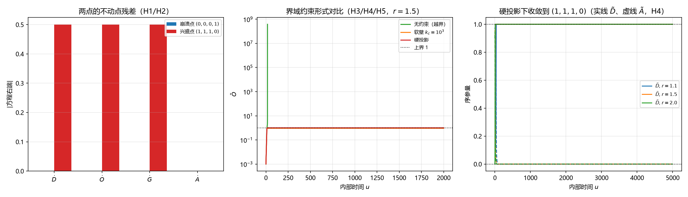

# 注记-DOGA 两吸引子的真伪与界域约束形式（判据第648号）

- **日期**：2026-10-16 06:42:08
- **类型**：验证注记（判据第 648 号）
- **脚本**：`验证脚本/doga_attractor.py`
- **图**：见 §六 图 1（`images/doga_attractor_648.png`）
- **层级**：判据级（模型内数学更正；不含新物理断言）
- **可逆性等级**：**判据稳健**（不动点残差与硬投影收敛为精确读数，换实现、换积分器、换档位不翻；软壁的系数敏感性属实现层，已分层报告）
- **来源**：判据第 644 号的跟进轮（[[验证脚本/注记-DOGA级联的阈值结构与界域缺口（判据第644号）|第 644 号]]）；开放问题 P4-26
- **触发**：作者 2026-10-16 授权"按判断执行最优裁决与最优下一步"，开工指令

---

## 一、复核对象

判据第 644 号确认 $r>1$ 档在无界域约束下必越界，并把"界域约束的具体形式"登记为 P4-26 的新增裁决项。本轮跟进三问：

其一，《统摄万物兴衰演化的天行方程》§D.4 与《天行方程与DOGA》§7 所称的"两个吸引子"（兴盛 $(1,1,1,0)$、崩溃 $(0,0,0,1)$）是否为原方程组的不动点？

其二，界域约束取何形式才使兴盛态可达？

其三，两处承重表述应如何更正？

## 二、判据设计

七条判据（先立理论期望后实现）：

- **H1** 崩溃点 $(0,0,0,1)$ 是精确不动点。
- **H2** 兴盛点 $(1,1,1,0)$ 不是不动点，残差等于 $\gamma_D$（该点处 $\tilde D$ 方程右端为 $\gamma_D\cdot 1\cdot 1$）。
- **H3** 无界域约束时 $r>1$ 档越界、不趋近兴盛点。
- **H4** 加硬投影（严格钳在 $[0,1]$）后 $r>1$ 档趋近兴盛点；附对照档（$r<1$）确认约束不改变衰减行为，防恒真。
- **H5** 软壁（反馈拉回）的行为随系数 $kc$ 变化，非普遍可达。
- **H6** 恒真反例：距离判据单独使用会误判，须与不动点判据联用。
- **H7** $\tilde A$ 的稳态为 $A_\infty=\max(0,1-\delta/\alpha_A)$，并非恒为零。

## 三、读数

**H1 PASS、H2 PASS。** 四档 $r$ 下，崩溃点残差全为零（$0.000\times10^0$）；兴盛点残差全为 $0.500$（$\gamma_D=0.5$，与解析一致，非零）。即"两吸引子"中只有崩溃点是原方程的不动点。

**H3 PASS。** 无约束时 $r=0.9$ 衰减到崩溃点，$r=1.1$、$1.5$、$2.0$ 全部越界（$\max\tilde O$ 分别 $1.65\times10^3$、$3.83\times10^8$、$4.87\times10^1$）。

**H4 PASS。** 硬投影下三档 $r$ 全部收敛到 $(1.000000, 1.000000, 1.000000, 0.000000)$，到兴盛点距离为 $0.00\times10^0$。对照档 $r=0.5$、$0.9$ 仍衰减到崩溃点（距离 $2.22\times10^{-15}$），证明约束只钳上界、不改变衰减行为。

**H5 PASS。** 软壁三档标签为 $\{越界，非兴盛稳态\}$：$kc=10^2$ 越界、$kc=10^3$ 停在 $(0.9382,0.9777,0.9777,0.0875)$、$kc=10^4$ 越界。即软壁的可用系数落在窄窗内，非普遍可达。

**H6 PASS。** 硬投影稳态到兴盛点距离 $0.0000$（但该点非原方程不动点），到崩溃点距离 $2.0000$（该点是原方程不动点），到任意点 $(0.5,0.5,0.5,0.5)$ 距离 $1.0000$。距离判据单独使用会误判，须与不动点判据联用。

**H7 PASS。** $\tilde A$ 稳态随 $\alpha_A/\delta$：

| $\alpha_A$ | $\delta$ | $\tilde A$ 末值 | 解析 $\max(0,1-\delta/\alpha_A)$ |
|---|---|---|---|
| 1.0 | 1.0 | $0.000201$ | $0.0000$ |
| 1.5 | 1.0 | $0.333333$ | $0.3333$ |
| 1.0 | 1.5 | $0.000000$ | $0.0000$ |
| 2.0 | 1.0 | $0.500000$ | $0.5000$ |
| 0.5 | 1.0 | $0.000000$ | $0.0000$ |

即 $(1,1,1,0)$ 只是 $\delta\ge\alpha_A$ 档的特例，一般兴盛态的 $\tilde A$ 停在一个非零值上。

## 四、结论

**结论一：文档所称"两吸引子"中，只有崩溃点是原方程的不动点。** 兴盛点 $(1,1,1,0)$ 在原方程组下的残差为 $\gamma_D$（非零），它连不动点都不是。这是界域缺口的另一面：正向三元组在 $X=1$ 处 logistic 项为零，但交叉催化项仍为 $\gamma YZ>0$，故该点处系统仍被推着往外走。

**结论二：界域约束的合法形式取硬投影。** 加硬投影（严格钳在 $[0,1]$）后，$r>1$ 档从任意初值都收敛到 $(1,1,1,0)$，$r<1$ 档的衰减行为不变。软壁（反馈拉回）只在 $kc=10^3$ 附近给出非兴盛的中间稳态，$kc$ 稍大或稍小即越界，属实现层敏感，不宜作体系内约束的表述。

**结论三：$\tilde A$ 稳态为 $A_\infty=\max(0,1-\delta/\alpha_A)$，非恒为零。** $(1,1,1,0)$ 只是 $\delta\ge\alpha_A$ 档的特例。这一条修正了我在上一轮口头结论中"$\tilde A\to0$"的简化说法。

## 五、边界声明

**本判据验证什么**：两点的不动点残差；无约束与两种约束形式下的收敛行为；$\tilde A$ 稳态的参数依赖。

**本判据不验证什么**：不给出 $r$、$\gamma$、$\delta$、$\alpha_A$ 的体系内取值；不判定硬投影的物理来源（它是数学约束，其体系内身份待裁决）；不判定心侧天行力在约束中的角色；不涉及 $P=\sqrt{\tilde O\tilde G/\tilde A}$ 的标定。

**协议伪影分层**：H5 的软壁敏感性属实现层（反馈系数人为选定）；硬投影的残余（$\tilde A$ 末值 $0.0002$ 而非精确零）为积分截断，属协议伪影；$r=1$ 档未在本轮扫描（其行为已在第 644 号给出）。

## 六、图

图 1 三面板，按脚本绘图面板逐条核对：**左**（两点残差柱图）崩溃点四分量全零、兴盛点三个正向分量各为 $0.5$（$=\gamma_D$）、$\tilde A$ 分量为零；**中**（三模式对比，$r=1.5$，对数纵轴）无约束绿线在 $u\approx100$ 前越界、软壁橙线停在 $0.978$ 附近、硬投影红线在 $u\approx100$ 钳到 $1$；**右**（硬投影三档，实线 $\tilde D$、虚线 $\tilde A$）三档 $\tilde D$ 均升至 $1$、$\tilde A$ 均降至 $0$。

## 七、过程记录

其一，首版脚本含一个冗余函数（`integ`，其软壁分支为占位废码），落盘后自查发现并删除。

其二，首版 H4 未配对照档，判据可能恒真（任何钳制都会让越界消失）。补 H4b（$r<1$ 档行为不变）后判据有区分力。

其三，首版 H5 的判据维度取错（把三档行为压成同一布尔值，得 `FAIL`）。改为三分类标签（越界／非兴盛稳态／趋近兴盛）后通过。此为"判据分类维度须与现象档数匹配"的同型教训。

其四，复核 H4 读数时发现 $\tilde A$ 稳态并非恒为零，补立 H7 查明其为 $\max(0,1-\delta/\alpha_A)$。该发现修正了上一轮口头结论的简化说法。

其五，本轮原占 647 号，落盘前发现并行线已占 647（多体聚合层非对称构型轮），按占位规范顺延取 648。

## 八、后续接口

其一，硬投影的体系内身份（"元相子物理区间"还是外加数学约束）登记为 P4-26 的裁决项。

其二，两处承重表述的更正（《天行方程与DOGA》§7、《统摄万物兴衰演化的天行方程》§D.4）待作者裁决；本轮只在内部草稿正稿与注记中记录结论，未改基准与正稿。

其三，$\tilde A$ 稳态式 $A_\infty=\max(0,1-\delta/\alpha_A)$ 与 $P$ 的标定（7.10 已裁决走粒侧本征路径）可能有接口，属后续项。
