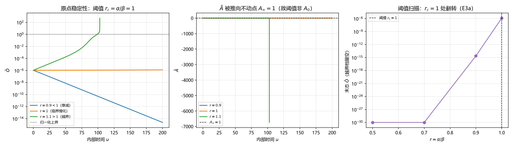

# 注记-DOGA 原点稳定性复核与级联阈值条件化（判据第642号）

- **日期**：2026-10-16 05:40:12
- **类型**：验证注记（判据第 642 号）
- **脚本**：`验证脚本/doga_origin_stability.py`
- **图**：见 §六 图 1（`images/doga_origin_stability_642.png`）
- **层级**：判据级（模型内数学更正；不含新物理断言）
- **可逆性等级**：**判据稳健**（结论为线性化分析加阈值关系，换实现、换积分器、换档位不翻；唯 r=1 临界档的分类依赖二阶分析，属已知边界）
- **来源**：开放问题 P4-26（DOGA 级联启动叙述的裁决请求，2026-09-07 登记）；库内诊断见 [[内部草稿/注记-温度定义：相位无序度的能量化标度]] §7.9 发现一；正稿 [[内部草稿/从混沌到兴盛：大爆炸作为天行力校准的相变]] §1.3、§2.1
- **触发**：作者 2026-10-16 就 P4-26 三选一征求意见，复核时发现库内诊断有数学错误，作者同意后立判据轮

---

## 一、复核对象

库内诊断（2026-09-07，登记为 P4-26）称：四序参量耦合方程组在原点 $(\tilde D,\tilde O,\tilde G)=(0,0,0)$ 处"交叉项 $\gamma YZ$ 与 logistic 项 $\alpha X(1-X)$ 在原点皆为零，**无线性增长通道**"，故即使 $\tilde D$ 被种子激活、$\tilde A$ 由 $0.9$ 降到 $0.5$，$\tilde O$、$\tilde G$ 仍钉在原点，正稿 §2.1"级联启动"叙述不成立。

正稿 §1.3 据此立"零动力不动点定理"，并称"种子必要性从哲学断言变成了不动点定理"。该定理在全库承重（下游《存活因子S的朗道-齐纳路线》§4 以其为 KZ 前提否证依据之一）。

本轮复核该诊断的数学内容，判"无线性增长通道"是否成立。

## 二、模型与判据设计

模型取 [[统摄万物兴衰演化的天行方程]] 附件 D 的完整方程组，四序参量 $\tilde D,\tilde O,\tilde G,\tilde A$，含 logistic 自限项、异化抑制项、正向交叉催化项、异化生成项与异化清除项。参数取探索脚本原档（$\alpha=\beta=1$、$\gamma=0.5$、$\delta=1$、$\tilde A_0=0.9$），并做多档扫描。

五条判据（先立理论期望后实现）：

- **E1 不变集**：$\tilde O=\tilde G=0$ 精确初值下二者全程机器零。这是原诊断"钉在原点"的读数来源。
- **E2 线性化通道**：$d\tilde O/du$ 在原点对 $\tilde O$ 的偏导为 $\lambda_O=\alpha_O-\beta_O\tilde A$。该通道存在且一般非零，是"无线性增长通道"的反例检验。
- **E3 渐近阈值**：$\tilde A$ 方程在正向三元组为零处为 $d\tilde A/du=\alpha_A\tilde A(1-\tilde A)$，稳定不动点 $A_\infty=1$。阈值因此落在 $r:=\alpha_X/\beta_X$ 与 $1$ 的比较上，与 $\tilde A_0$ 无关。
- **E4 恒真反例**：把判据写成"精确零初值下 $\tilde O$ 保持零"，对任何参数都 PASS，属构造恒真；换非零微扰后必须能区分。
- **E5 界域伪影**：方程不保 $[0,1]$，自发档读数是否越界，决定该读数能否作物理用。

容差从误差预算推导，不设数（冒烟检查的容差取 logistic 截断项 $2\tilde O_0$；E3c 的容差取 $10\times\delta\tilde D/\alpha_A$）。

## 三、读数

**E1（不变集）PASS。** 精确零初值下 $\tilde O$、$\tilde G$ 末值恒为 $0.000\times10^0$。原诊断的读数复现无误，但它只说明"精确零是方程组的不变集"（当 $\tilde O=\tilde G=0$ 时两项方程右端每一项都含 $\tilde O$ 或 $\tilde G$ 因子，导数恒零），说明不了邻域无增长通道。

**E2（线性通道）PASS。** 冻结 $\tilde A$ 隔离，短时对数斜率实测对解析 $\lambda_O=\alpha_O-\beta_O\tilde A$：

| $\alpha_O$ | $\beta_O$ | $\tilde A$ | 解析 $\lambda_O$ | 实测 | 相对差 |
|---|---|---|---|---|---|
| 1.0 | 1.0 | 0.90 | $+0.100000$ | $+0.100000$ | $2.14\times10^{-7}$ |
| 1.5 | 1.0 | 0.90 | $+0.600000$ | $+0.600000$ | $3.50\times10^{-8}$ |
| 0.5 | 1.0 | 0.90 | $-0.400000$ | $-0.400000$ | $5.47\times10^{-8}$ |
| 1.0 | 1.0 | 0.99 | $+0.010000$ | $+0.010000$ | $2.14\times10^{-6}$ |
| 2.0 | 1.0 | 0.50 | $+1.500000$ | $+1.500000$ | $1.37\times10^{-8}$ |

线性通道明确存在且数值等于解析值。"无线性增长通道"为错。

**E3（渐近阈值）PASS。** 三部分。其一，阈值定位在 $r_c=1$（八档扫描，$r<1$ 衰减到零、$r=1$ 临界慢化保持量级、$r>1$ 越界），逐档成立。其二，阈值与 $\tilde A_0$ 无关（$\tilde A_0=0.5/0.9/0.99$ 三档在 $r=0.9$ 与 $1.1$ 两侧结果一致）。其三，$A_\infty$ 数值确认：$r=0.5$ 档 $\tilde A$ 从 $0.9$ 涨到 $0.9999910327$，与解析 $A_\infty=1$ 的偏差 $8.97\times10^{-6}$ 由 $\tilde D$ 项抑制给出（预算 $\delta\tilde D/\alpha_A=4.1\times10^{-5}$，实测在 10 倍预算内）。

**E4（恒真反例）PASS。** 错误判据（精确零初值）在 $r=0.5/1.0/2.0$ 三档同给 PASS，无区分力；正确判据在同三档分别判稳定、临界、不稳定，两侧相反。

**E5（界域伪影）PASS。** $r=1.1$ 档 $\tilde O$ 涨至 $5.06\times10^2$（远超上界 1）、$\tilde A$ 跌至 $-6.74\times10^3$（跌破下界 0），积分越界截断。故自发"级联"读数为发散伪影。

## 四、结论

**库内诊断"原点无线性增长通道、动力学无法自启"不成立。** 正确判据为：

$\tilde A$ 方程在正向三元组为零处把 $\tilde A$ 推向不动点 $A_\infty=1$，故 $\tilde O$、$\tilde G$ 的渐近线性增长率为 $\lambda_X\to\beta_X(r-1)$，$r:=\alpha_X/\beta_X$。阈值是 $r_c=1$：

- $r<1$：原点渐近稳定，$\tilde O$、$\tilde G$ 被压回零，级联**需要**种子注入；
- $r>1$：原点不稳定，级联**自发**发生，不需要种子；
- $r=1$：临界慢化，一阶项消失，需二阶分析。

探索脚本原参数取 $\alpha=\beta=1$，即 $r=1$，恰落在**临界档**。这解释了原脚本的现象：在临界档下 $\tilde O$ 既不增长也不明显衰减（长窗内保持 $10^{-6}$ 量级），从精确零出发自然读出"钉在原点"。但这个读数属临界档的边际行为，不是"原点无增长通道"。

附带更正：自发档（$r>1$）下的"级联"读数实为越界发散（$\tilde O\to10^2$ 以上、$\tilde A$ 转负），与 7.9 的发现二、发现三（$\tilde A\to0$ 发散、序参量超界）同源，根子在方程组不保归一化界域。该读数不能作兴盛螺旋的证据。

## 五、边界声明

**本判据验证什么**：附件 D 完整方程组在原点附近的局部稳定性结构；"无线性增长通道"这一措辞的对错；阈值 $r_c=1$ 与 $\tilde A_0$ 无关；界域不保导致自发档读数为发散。

**本判据不验证什么**：不判定 $\alpha_X/\beta_X$ 在体系内的实际取值（库内从未给出该参数比，它是本条留给后续的决断量）；不判定哪一档（$r<1$ 还是 $r>1$）是物理档；不判定正稿级联叙述最终应取何种措辞（属表述裁决）；不判定下游《存活因子S的朗道-齐纳路线》KZ 否证结论是否幸存（该结论另有两条独立依据，需另判）；不涉及心侧天行力本身的地位（本判据只判物侧方程组的数学结构）。

**协议伪影分层**：临界档（$r=1$）的分类依赖二阶分析，本判据只给"保持量级"的粗分类；$r>1$ 档的"越界"读数含积分器截断伪影（截断阈值 $10^{12}$），报告为越界而非给具体发散值。

## 六、图

图 1 三面板，按脚本绘图面板逐条核对：**左**（$\tilde O$ 轨迹，对数纵轴）三档分明：$r=0.9<1$ 单调衰减、$r=1$ 临界保持量级、$r=1.1>1$ 先缓增后越界，点线与虚线为归一化上界；**中**（$\tilde A$ 轨迹）显示 $\tilde A$ 从 $0.9$ 被推向不动点 $A_\infty=1$（虚线），$r=1.1$ 档在越界处跳崖至负值（截断伪影）；**右**（阈值扫描）末态 $\tilde O$ 对 $r$，在 $r_c=1$（虚线）处由 $10^{-30}$ 量级跃至 $10^{-6}$ 量级，越界档留空。

## 七、过程记录

其一，首版判据把阈值写成 $\tilde A_0=0.9$（沿用库内诊断的 $\tilde A$ 下降图像），E3 三档 FAIL。诊断扫 $T$ 与 $\tilde A$ 轨迹后发现 $\tilde A$ 并不停在 $0.9$，而是被 $\tilde A$ 方程推向 $A_\infty=1$，故阈值应取 $r_c=1$。此为"期望式写错由读数抓出"的同型教训（对照第 603、606 条）。

其二，首版冒烟断言容差设 $10^{-9}$，实际偏差为 logistic 截断项 $10^{-6}$，判据 FAIL。按误差预算改容差为 $2\tilde O_0$ 后通过。教训：容差须从被测量的解析截断项推导，不可凭设（对照本仓数值实验纪律第三条）。

其三，E3c 首版容差设 $10^{-6}$，实测偏差 $8.97\times10^{-6}$ FAIL。识别偏差来源为 $\tilde D$ 项抑制（$1-A_\infty=\delta\tilde D/\alpha_A$），改按该预算取 10 倍后通过。三处修正均属"判据设计错"，不是结论翻，已在读数中如实保留。

## 八、后续接口

其一，$\alpha_X/\beta_X$ 的体系内取值登记为 P4-26 的决断量，它决定"种子必要性"是否成立。

其二，正稿 §1.3"零动力不动点定理"的表述需更正（"无增长通道、无法自启"改为"原点为不变集，稳定性由 $r_c=1$ 决定"），§2.1 级联叙述条件化，承重句"种子必要性从哲学断言变成不动点定理"降为参数档条件。属表述变更，待作者裁决。

其三，下游《存活因子S的朗道-齐纳路线》§4 的引用需复核。

其四，7.9 发现二、发现三（界域问题）与本条 E5 同源，可并入同轮登记。
