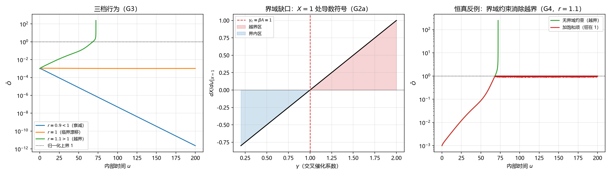

# 注记-DOGA 级联的阈值结构与界域缺口（判据第644号）

- **日期**：2026-10-16 06:05:41
- **类型**：验证注记（判据第 644 号）
- **脚本**：`验证脚本/doga_boundary_gap.py`
- **图**：见 §六 图 1（`images/doga_boundary_gap_644.png`）
- **层级**：判据级（模型内数学更正；不含新物理断言）
- **可逆性等级**：**判据稳健**（结论为线性化与阈值关系，换实现、换积分器、换档位不翻；$r=1$ 档的长窗行为含时间尺度依赖，属已知边界）
- **来源**：判据第 642 号的跟进轮（[[验证脚本/注记-DOGA原点稳定性复核与级联阈值条件化（判据第642号）|第 642 号]]）；开放问题 P4-26
- **触发**：作者 2026-10-16 授权"按判断执行最优裁决与最优下一步"

---

## 一、复核对象

判据第 642 号确认原点稳定性由 $r:=\alpha_X/\beta_X$ 与 $1$ 的比较决定，并把参数比登记为决断量。本轮跟进两问：

其一，体系若要"非零序参量"（即兴盛态，而非衰减到混沌），对 $r$ 有何要求？

其二，附件 D 设计原则 1 明文称"由 Logistic 自限项保证所有变量在 $(0,1]$ 区间内演化"。该保证是否成立？

## 二、判据设计

四条判据（先立理论期望后实现）：

- **G1 双阈值结构**：$\tilde D$ 方程在 $\tilde O=\tilde G=0$、$\tilde A\to1$ 处的非零平衡为 $\tilde D_\infty=1-1/r_D$，故 $r_D>1$ 是 $\tilde D$ 非零的必要条件；$\tilde O,\tilde G$ 的线性率在冻结 $\tilde A=0.9$ 时为 $r-0.9$。附件 D 原则 2（结构对称性）称 $D,O,G$ 为地位等价的正向三元组，故取 $r_D=r_O=r_G=r$。
- **G2 越界机制**：在 $X=1$ 处 logistic 项 $\alpha X(1-X)=0$，故 $dX/du|_{X=1}=\gamma YZ-\beta A$。阈值 $\gamma_c=\beta A$；$\gamma>\gamma_c$ 时交叉项压过抑制，$X$ 越界。
- **G3 三档行为**：$r<1$ 衰减、$r=1$ 临界、$r>1$ 越界。
- **G4 恒真反例**：加界域饱和项（$X>1$ 时强反馈钳制）后越界消失，证明越界来自界域约束缺失而非数值方法。

## 三、读数

**G1（双阈值结构）PASS。** $r\le1$ 三档 $\tilde D$ 全部衰减到零（$r=0.5$ 档 $4.13\times10^{-48}$、$r=0.9$ 档 $2.29\times10^{-13}$、$r=1$ 档 $1.11\times10^{-4}$）。$\tilde O$ 的冻结 $\tilde A=0.9$ 线性率实测对解析 $r-0.9$：

| $r$ | 实测 $\lambda$ | 解析 $r-0.9$ | 判定 |
|---|---|---|---|
| 0.5 | $-0.400000$ | $-0.400000$ | 衰减 |
| 0.9 | $0.000000$ | $0.000000$ | 恰在阈值 |
| 1.1 | $+0.200000$ | $+0.200000$ | 增长 |

$r=0.9$ 档恰给出零，即阈值精确落在 $\tilde A$ 当前值上，与第 642 号的阈值图景一致。

**G2（越界机制）PASS。** $X=1$ 处导数随 $\gamma$：$\gamma=0.5$ 给 $-0.500$、$\gamma=1.0$ 给 $0.000$、$\gamma=1.1$ 给 $+0.100$、$\gamma=2.0$ 给 $+1.000$。阈值精确为 $\gamma_c=\beta A=1$。完整积分下（$\gamma=0.5$ 即低于该阈值）$r>1$ 档仍越界（$r=1.1$ 给 $\max\tilde O=2.46\times10^2$、$r=1.5$ 给 $2.95\times10^8$），机制是 $\tilde O$、$\tilde G$ 同步增长后交叉项被放大（量级 $\gamma X^2$），最终压过 logistic 的 $-\alpha X(X-1)$。

**G3（三档行为）PASS。** $r=0.9$ 衰减到 $10^{-12}$ 以下、$r=1$ 缓慢漂移（保持 $1.05\times10^{-3}$ 量级）、$r=1.1$ 越界。长窗扫描给 $r=1$ 档的时间尺度：$T=200$ 界内（$\max\tilde O=1.10\times10^{-3}$）、$T=1000$ 界内（$8.77\times10^{-3}$）、$T=5000$ 越界（$3.04\times10^6$）。即临界档并不稳定，它在缓慢漂移之后、于足够长的窗口内仍然越界。

**G4（恒真反例）PASS。** $r=1.1$ 档无约束时 $\max\tilde O=2.46\times10^2$，加饱和项后钳在 $1.000129$；$r=1.5$ 档由 $2.95\times10^8$ 钳到 $1.000146$。越界确实来自界域约束缺失。

## 四、结论

**体系要非零序参量（兴盛态）须 $r>1$，但 $r>1$ 档在现有方程下必越界。** 两者由同一套方程给出，构成一个内禀张力：方程要么让系统衰减到混沌（$r\le1$），要么让它越界发散（$r>1$），不存在"既非零又不越界"的稳定兴盛态。

**真缺口是界域约束，不是参数比。** 附件 D 设计原则 1 明文声称 logistic 自限项保证变量在 $(0,1]$ 内演化，该保证在交叉催化项存在时不成立（$\gamma$ 超过 $\beta A$ 即失效）。这解释了 7.9 的发现二（$\tilde A\to0$ 时 $P$ 发散）、发现三（序参量超出 $[0,1]$）与判据第 642 号 E5（越界），三处同源，根子都在这一个缺口。

**对 P4-26 的后果**：级联问题（"$\tilde O$、$\tilde G$ 能否离开原点"）已由第 642 号解决（阈值 $r_c=1$）；本轮进一步指出，级联一旦发生（$r>1$），现有方程给不出有界兴盛态。故 P4-26 的完整结论形态是两层：离开原点的条件是 $r>1$；到达有界兴盛态的条件尚未满足，缺的是界域约束。原三选项（A 加种子前提／B 保留为极限情形／C 另指机制）与第 642 号的阈值条件化均不足以承载这一层，需新增界域约束项（属方程修订，交作者裁决）。

## 五、边界声明

**本判据验证什么**：附件 D 完整方程组的双阈值结构（$r_D>1$ 给 $\tilde D$ 非零、$r_X>1$ 给 $\tilde O,\tilde G$ 增长）；$X=1$ 处越界条件 $\gamma_c=\beta A$；三档行为；界域缺口的存在与来源。

**本判据不验证什么**：不给出 $r$ 与 $\gamma$ 的体系内取值（属参数标定，库内无来源）；不判定界域约束应取何种具体形式（属方程修订，待作者裁决）；不判定心侧天行力在界域约束中的角色；不涉及 $P=\sqrt{\tilde O\tilde G/\tilde A}$ 的标定（7.10 已裁决走粒侧本征路径）。

**协议伪影分层**：G4 的钳制为软壁（$k=10^4$），残余过冲 $1.3\times10^{-4}$ 属协议伪影；$r=1$ 档长窗越界含时间尺度依赖，报告为"缓慢漂移后在长窗越界"而非即时不稳定。

## 六、图

图 1 三面板，按脚本绘图面板逐条核对：**左**（三档 $\tilde O$ 轨迹，对数纵轴）$r=0.9$ 单调衰减、$r=1$ 保持量级缓慢漂移、$r=1.1$ 越界，点线为归一化上界；**中**（$X=1$ 处导数对 $\gamma$）直线过零于 $\gamma_c=1$（虚线），右侧红区为越界区、左侧蓝区为界内区；**右**（恒真反例，$r=1.1$）绿线为无界域约束的越界轨迹、红线为加饱和项后钳在 $1$。

## 七、过程记录

其一，首版冒烟检查初值写错（取 $\tilde O=0.5$ 却按 $\tilde O=1$ 的解析式核对），断言 FAIL，修正初值为 $(1,1,1,1)$ 后通过。

其二，首版 G1b 期望式在 $r=0.9$ 档判错：该档冻结 $\tilde A=0.9$ 时 $r-\tilde A=0$，恰在阈值，我原按"正/负"二分故 FAIL。改为三档（负/零/正）并如实报"恰在阈值"后通过。

其三，首版 G4 的钳制系数取 $10$ 太小，压不住交叉项（$\max\tilde O$ 仍为 $253$），判 FAIL；提高到 $10^4$ 后钳制生效（$1.000129$）。此修正属判据实现参数，已在协议伪影分层中登记残余过冲。

其四，本轮原占 643 号，落盘前发现并行线已交付 643（多体聚合层阶段三），按占位规范顺延取 644。

## 八、后续接口

其一，界域约束的形式（属方程修订）登记为 P4-26 的新增裁决项，与"$r$ 的取值"并列。

其二，若体系最终取 $r>1$ 且补界域约束，则"兴盛态有界"与"原点不稳定"可同时成立，级联叙述在补约束后恢复。

其三，7.9 发现二、三与第 642 号 E5 可并入本轮同一登记（同源缺口）。
