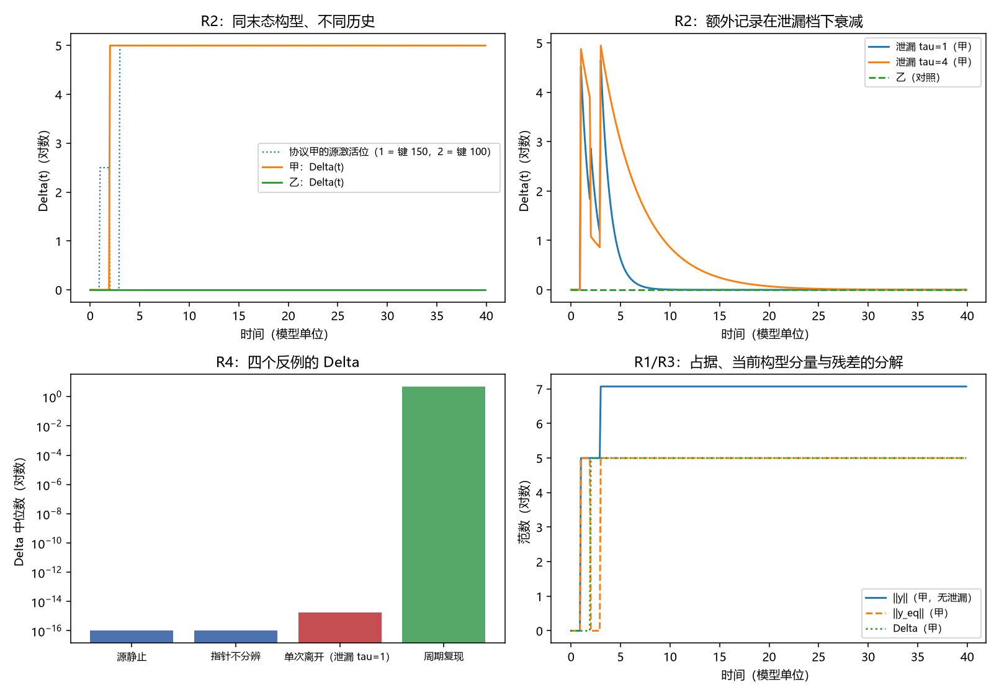

# 注记-Delta 场侧实现的最小验证：寄存器占据的当前构型分量与历史残差

- **日期**：2026-09-24 04:56:52
- **层级**：验证注记（对应 `验证脚本/delta_field_side.py`，`验证脚本/README.md` 第 389 条）
- **可逆性等级**：判据稳健（差值恰等于写入深度，属构造性结论；四反例逐档一致，偏差为零）
- **图**：见 §三 图 1
- **定位**：执行 [[研究方向-Delta 的场侧实现：寄存器占据的当前构型分量与历史残差（判据草案）]] 的判据 R1 至 R7，完成 [[记录的判据：可分性、独立分量与持有时间]] §8（1）的场侧定义部分。
- **依据**：[[研究方向-Delta 的场侧实现：寄存器占据的当前构型分量与历史残差（判据草案）]]；[[注记-探测器物侧构造的最小验证：三件输入的指认、单通道反证与双通道判据]]（三件指认）；[[记录的判据：可分性、独立分量与持有时间]]（§2.2 一般定义、§8（1））；[[注记-记录判据的最小验证：独立性的定义域、反例与判据级表述]]（四个反例）
- **关联**：[[开放问题总览：元相子理论待解决问题清单]]（测量塌缩的元相子机制、退相干独立几何推导）
- **状态**：模型内判据级。本注记给定义与判别，不重开寄存器算符与判据篇的推导。

---

## 一、寄存器语言下的定义

读出量取记录寄存器占据 $y$，当前构型分量取"把源在当前时刻的构型固定、令寄存器弛豫到位"所得的占据 $y^{\text{eq}}(t)$，历史残差取

$$\Delta(t) = \lVert y(t) - y^{\text{eq}}(t)\rVert_2.$$

判别取一对协议：末态构型相同、历史不同。协议甲在 $t \in [1, 2)$ 访问键 $150$，其后停在键 $100$；协议乙全程只在键 $100$。$t \ge 3$ 之后两条的键滑分布逐位相同。

## 二、判据结果

| 判据 | 判据量 | 实测 | 期望 | 结论 |
| --- | --- | --- | --- | --- |
| R1 分解自洽 | 分解恒等式的最大相对偏差 | $0$ | $10^{-12}$ | 通过 |
| R2 同构型判别 | 两协议末态 $y^{\text{eq}}$ 的逐位差 | $0$ | $0$ | 通过 |
| R2 差值 | 无泄漏档 $\Delta$ 末值之差（甲减乙） | $5.0000$ | $G = 5$ | 通过 |
| R2 泄漏对照 | 泄漏档（$\tau = 1$）$\Delta$ 末值之差 | $1.78\times10^{-15}$ | 读数 | 读数 |
| R4 四反例 | 四档 $\Delta$ 与期望一致的档数 | $4$ | $4$ | 通过 |

四反例逐档：源静止 $0$；指针不分辨 $0$；周期复现的复现相 $5.0000$；泄漏档末值 $1.78\times10^{-15}$。

## 三、图 1

四面板与脚本绘图面板逐条对应：左上与右上为 R2 的两种呈现，左下为 R4，右下为 R1 与 R3。

## 四、读数分解

判别成立且差值为整数记录量。两条协议的末态键滑分布逐位相同，故 $y^{\text{eq}}$ 的逐位差为零；无泄漏持有档下甲的残差为 $5.0000$、乙为零，差值恰等于写入深度 $G$，即甲多持有的那处记录。泄漏档（$\tau = 1$）下该额外记录随弛豫衰减，$t = 40$ 时残差之差降到 $1.78\times10^{-15}$，与记录判据轮的泄漏读数同量级。

四反例复现与既有轮次一致。源静止与指针不分辨两档残差为零；周期复现档在源回到原位时残差仍为 $5.0000$；泄漏档在源移开后衰减到零。四档与记录判据轮的读数逐档相符，说明阈值读出语言下的 $\Delta$ 与寄存器语言下的 $\Delta$ 是同一个量。

## 五、结论与 §8（1）的收口

本注记给出 $\Delta$ 的寄存器定义与判别，两件事由此确定。其一，$y^{\text{eq}}$ 只依赖当前构型，可由当前构型单独算出；$\Delta$ 依赖历史，同末态构型的两条协议给出不同残差。其二，两套语言（阈值读出与寄存器占据）给出同一个量，接口处的读数逐档相符。

据此 [[记录的判据：可分性、独立分量与持有时间]] §8（1）的定义部分可以收口：偏离的场侧对象由探测器物侧构造轮给出（第 387 条），偏离的场侧定义由本注记给出（本条）。仍开放的余项是写入耦合的上界来源与三维推广，前者是双通道判据的锐化项，后者会在层格定义确定后自然明确。

## 六、严格程度声明

| 结论 | 档位 |
| --- | --- |
| 分解自洽（R1） | 恒等式级（偏差为零） |
| 同构型判别的差值与读数（R2） | 模型内判据级（差值等于写入深度，逐位核对） |
| 分量分工（R3） | 构造性读数 |
| 四反例复现（R4） | 模型内判据级，逐档核对 |
| 与漏检的接口（R5） | 读数级衔接（引第 383、385 条） |
| 与判据篇一般定义的口径（R6） | 逐字相容（读数级） |

## 七、边界声明

**验证什么**：寄存器语言下当前构型分量与历史残差的定义；同末态构型不同历史的判别与差值；四个反例的复现；与漏检集结论的接口。

**不验证什么**：寄存器算符的推导（引用机制篇）；写入耦合的上界来源；三维与复合体上的层格定义；退相干速率的绝对值。本注记不改动 [[理论总纲/子理论索引]] 与任何基准文档。

## 八、过程记录

脚本首版留有一行构造性判断的死代码（写成恒真的条件表达式），已删除；落盘后检查该字段零残留。教训：把"构造性成立"写成代码时容易留下恒真分支，收尾须扫一遍。
