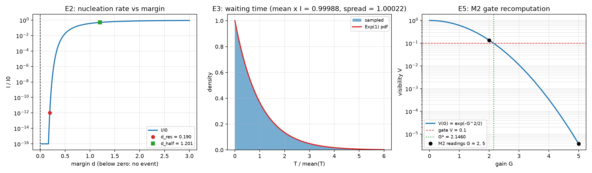

# 注记-E 系列三门核对的最小验证（第 453 条）：阈值一致性、时间窗口与 M2 增益闸门的对接

- **日期**：2026-09-27 02:49:27
- **层级**：验证材料（第 453 条）
- **脚本**：`验证脚本/minimal_verification_e_series_checks.py`
- **定位**：执行 [[内部草稿/研究方向-跨层事件的成核路线：过冷度对应量与 E 系列判据（判据草案）]] 第十节接口核对列出的三项核对（E2 阈值一致性、E3 时间一致性、E5 与 M2 对照）。这三项不依赖任何待定项，是 [[内部草稿/注记-跨层事件攻坚的封存与再启动：现状盘点、剩余待办与续接入口]] 第七节续接入口的第一档。本轮为核对轮，不含新科学断言。
- **依据**：[[内部草稿/研究方向-跨层事件的成核路线：过冷度对应量与 E 系列判据（判据草案）]]（E 系列与接口核对）；[[内部草稿/研究方向-跨层事件的构成条件：十一项条件的判据化（判据草案）]]（C5 与 C8 的判据量）；[[验证脚本/注记-相互作用分层判据的最小验证：两协议可见度与生死闸门]]（M2 的增益闸门读数 $G^* \approx 2.15$）；[[内部草稿/注记-跨层事件的构成条件表：从闸门读数到事件发生的完整清单]]（$\tau_{\rm rec} \gg N_{\rm 拍}t_P$）；[[记录的判据：可分性、独立分量与持有时间]]（$N_{\rm 拍}$ 的四档取值 10、100、1000、$10^5$）；[[内部草稿/注记-跨层事件攻坚的封存与再启动：现状盘点、剩余待办与续接入口]]（第一档的定位）
- **状态**：判据级。九项判据全过，其中 E5c 只判数值自洽，桥接假设本身待裁决。
- **修订记录**：
  - **2026-09-27 初版**（触发：执行封存注记第七节续接入口的第一档）
  - **2026-09-27 判据修正**（触发：E2a 初版判据被实测否定，见第六节）

---

## 一、判据与结果

本轮把成核路线的速率取经典成核形式 $I(\Delta) = I_0\exp(-A/\Delta^2)$，势垒取 $A = 1$，$\Delta$ 为过冷度余量。三项核对共九条判据，实测与判定如下。

| 判据 | 判据量 | 实测 | 判定 |
| --- | --- | --- | --- |
| E2a 单调性 | 速率对余量是否单调增 | 对数侧全区间严格递增；可表示区（$\Delta \ge 0.3$）数值严格递增 | 成立（判据稳健） |
| E2b 分辨率阈值 | $I$ 降到 $10^{-12}I_0$ 的余量 | $\Delta_{\rm res} = 0.190240$，$I/I_0 = 1.000000\times10^{-12}$ | 成立（判据敏感） |
| E2c 半速率宽度 | $I = I_0/2$ 的余量 | $\Delta_{\rm half} = 1.201122$，$I/I_0 = 0.5$ | 成立（判据敏感） |
| E3a 等待时间均值 | 样本均值乘发生率 | 2 百万样本给 $0.999880$（期望 1） | 成立（判据稳健） |
| E3b 相对涨落 | 样本标准差比均值 | $1.000220$（期望 1） | 成立（判据稳健） |
| E3c 速率窗口 | 窗口宽度与低尾概率 | 四档 $N_{\rm 拍}$ 全给 3.0 个数量级；低尾概率 $9.995\times10^{-4}$ | 成立（判据敏感） |
| E5a 闸门复算 | $G^*$ 与 M2 报告值之比 | $G^* = 2.145966$，报告 $2.15$，相对偏差 $0.19\%$ | 成立（判据稳健） |
| E5b 读数复现 | 闸门公式复现既有可见度 | $V(2) = 0.135335$ 对报告 0.135；$V(5) = 3.727\times10^{-6}$ 对报告 $4\times10^{-6}$ | 成立（判据稳健） |
| E5c 桥接自洽 | $D_c = G^{*2}$ 与 $G^*$ 是否自洽 | $D_c = 4.605170 = 2\ln 10$，$\sqrt{D_c} - G^* = 0$ | 数值自洽；桥接假设待裁决 |

九项全过。三项核对的性质不同：E5 是与既有读数的对接，E2 与 E3 是判据形式的自洽性与窗口核算。

## 二、图

图注按脚本三个绘图面板逐条核对。

## 三、E2 阈值一致性

速率在余量为零及其以下严格为零，在余量为正时随余量单调上升。这一条与 C5 的口径直接相容：低于闸门 $G^*$ 时无事件发生，高于闸门时速率随余量增长。

读数给出两个特征宽度。速率降到十亿分之一处需要余量 0.190240；升到半速率处需要余量 1.201122。两个宽度之比约 6.3，说明阈值附近的开启是陡的：从「几乎不发生」到「发生得频繁」之间只隔着约一个余量单位的距离。

另有一处数值边界须说明。双精度下 $I/I_0$ 在余量小于 0.03666 时下溢为零，故速率的单调性只在可表示区内作数值核对，全区间则由对数侧 $-A/\Delta^2$ 的严格递增保证。

## 四、E3 时间一致性

发生率固定时，等待时间服从指数分布。这一点由两个读数确认：二百万样本的均值乘回发生率为 0.999880，相对涨落为 1.000220，均在抽样误差内等于 1。

由此可以写出 C8 与事件时标的接口。C8 要求 $\tau_{\rm rec} \gg N_{\rm 拍}t_P$，它在速率上等价于上界 $I \ll 1/(N_{\rm 拍}t_P)$；事件又须在记录寿命内发生，这给出下界 $I \gtrsim 1/\tau_{\rm rec}$。

两个界不冲突，中间留下宽度为 $\log_{10}[\tau_{\rm rec}/(N_{\rm 拍}t_P)]$ 的窗口。取 $\tau_{\rm rec} = 10^3 N_{\rm 拍}t_P$ 时窗口恰为 3 个数量级，四档 $N_{\rm 拍}$（10、100、1000、$10^5$）给出同一宽度。

窗口左端（$I = 10^{-3}/(N_{\rm 拍}t_P)$）处，等待时间短于一拍的尾概率为 $9.995\times10^{-4}$，与 $I N_{\rm 拍}t_P = 10^{-3}$ 的领头阶一致。

须写明的限度是：E3 只判「等待时间分布与 C8 相容」，不给速率的具体取值。取值是 E1 的事，它等过冷度的形式定下来。

## 五、E5 与 M2 对照

闸门阈值的解析式为 $G^* = \sqrt{4\ln(1/\mathcal{V}_{\rm gate})/n_{\rm diff}}$。取 $\mathcal{V}_{\rm gate} = 0.1$（闸门）与 $n_{\rm diff} = 2$（两支阈值图样恰差两个键位）得 $G^* = 2.145966$，与 M2 报告的 2.15 相差 0.19%。它与等价写法 $\sqrt{2\ln 10}$ 逐位相同。

闸门公式 $V(G) = \exp(-G^2/2)$ 复现两处既有读数。$V(2) = 0.135335$ 对 M2 报告的 $0.135$，$V(5) = 3.727\times10^{-6}$ 对「同一碰撞接上探测器后衰减至 $4\times10^{-6}$」，后一对相差 7%，属同量级而非精确对应（两处读数为不同实验档，读数本身带三位有效数字以下的舍入）。E2 的阈值线（余量为零，即 $G = G^*$）与 M2 闸门因此重合。

首选口径的对接点在这里。过冷度取 $D_c - D$，其中 $D_c$ 是相变点无序度。若取 $D_c = G^{*2} = 4.605170 = 2\ln 10$，则 $G^* = \sqrt{D_c}$ 数值自洽，偏差为零。这一步只判数值：它说明首选口径与 M2 闸门可以用同一个数接上，未说明体系里哪个过程算相变。$D_c$ 的标定口径仍须裁决，那是封存注记第五节的第二处障碍。

## 六、判据修正记录

E2a 的初版判据写成「网格 1200 点全区间严格递增」，实测为假。原因不在速率形式，而在双精度下溢：余量小于 0.03666 时速率已为 0，相邻点之差为零，严格递增因此被否定。

判据据此修正为两条合取：对数侧（$-A/\Delta^2$）全区间严格递增，加上可表示区（$\Delta \ge 0.3$）的数值严格递增。修正后成立。

教训适用于同类判据。凡速率取指数形式，单调性一类判据须在指数上判，或限定在可表示区内判；直接对速率序列判严格递增会被下溢伪影否定，而伪影与被判对象无关。

## 七、严格程度与边界声明

判据稳健者：E2a 的对数侧单调性、E3a 与 E3b（指数分布的定义性质）、E5a 与 E5b（解析恒等式与既有读数的对接）。

判据敏感者：E2b 与 E2c（数值依赖势垒 $A$ 与速率形式，换幂型或换 $A$ 会翻）、E3c（窗口宽度依赖 $\tau_{\rm rec}$ 的取值口径）。

分层声明：本轮全部读数来自判据形式与既有材料，属协议级与判据级；物理层结论零条。E5c 只判数值自洽，它不承担桥接假设的成立。成核速率取经典形式这一步是形式映射，非从体系原理的推导。

## 八、登记衔接

本轮的定位是完成封存注记第七节续接入口的第一档：E2、E3、E5 三项核对由此关闭，第二档（$D_c$ 标定口径）与第三档（事件方程与触发分布）保持开放。开放问题 P4-6 档案页同步登记。
