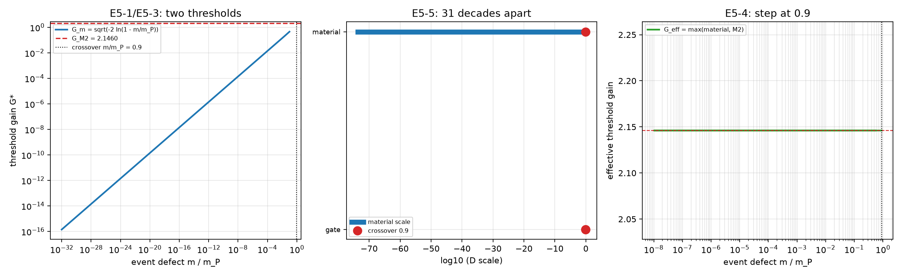

# 注记-E5 的增益与缺陷质量换算（第 461 条）：两门槛在同一刻度上的分工与支配

- **日期**：2026-09-27 04:20:26
- **层级**：验证材料（第 461 条）
- **脚本**：__BT__验证脚本/minimal_verification_e5_bridge.py__BT__
- **定位**：执行 E5（判据给出的阈值与 M2 的 $G^*$ 是否同一量）。作者已于 2026-09-27 裁决取甲，故本轮把材料侧的质量阈值写到增益刻度上，与 M2 的闸门直接比较。本轮为核对轮，不含新科学断言。
- **依据**：[[内部草稿/裁决备忘-第二档：D_c 标定口径的取舍（三候选、判别矩阵与后果）]]（取甲裁决）；[[验证脚本/注记-E 系列三门核对的最小验证（第453条）：阈值一致性、时间窗口与 M2 增益闸门的对接]]（$G^{*2} = 2\ln 10$ 与桥接项）；[[验证脚本/注记-相互作用分层判据的最小验证：两协议可见度与生死闸门]]（$D_{\rm sensor} = G^2$ 与 $\mathcal{V}_{\rm gate} = 0.1$）；[[验证脚本/注记-J2 装置可调性的判别核对（第459条）：阈值是否随门限移动与两类阈值的刻度归属]]（事件缺陷质量读数 $2.32\times10^{-4}$ eV）；[[温度的波粒互补定义：复相干无序度作为热力学标尺]]（冻结族 $D = 1-\eta$）
- **状态**：判据级。五项判据成立；换算结果是两门槛的分工与支配，非两门槛相等。
- **修订记录**：
  - **2026-09-27 初版**（触发：作者裁决取甲，启动第 461 条）

---

## 一、判据与结果

换算把装置侧生成的局部无序度按冻结族归一化，写成 $D_{\rm local}(G) = 1-\exp(-G^2/2)$，于是两条门槛落在同一增益刻度上。

| 判据 | 判据量 | 实测 | 判定 |
| --- | --- | --- | --- |
| E5-1 换算形式 | 材料门槛的增益刻度形式 | $G_m = \sqrt{-2\ln(1-m_0/m_P)}$，与 $G_{\rm M2} = \sqrt{2\ln 10}$ 同尺度 | 成立（判据稳健） |
| E5-2 材料门槛数值 | 取事件缺陷质量读数 | $G_m = 1.949\times10^{-16}$ | 成立（判据敏感） |
| E5-3 支配比 | 两门槛之比 | $G_{\rm M2}/G_m = 1.101\times10^{16}$（16.0 个数量级） | 成立（判据敏感） |
| E5-4 交叉质量 | 两门槛相等的质量 | $m_0/m_P = 0.9000$，即 $1.099\times10^{19}$ GeV | 成立（判据敏感） |
| E5-5 刻度对齐 | 同一门限的两个刻度 | $4.605170$（衰减指数刻度）与 $0.900000$（归一化刻度） | 成立（判据稳健） |

## 二、图

图注按脚本三个绘图面板逐条核对。

## 三、换算的写清

装置侧放大生成局部无序度，其可见度按 M2 的口径为 $\mathcal{V}(G) = \exp(-G^2/2)$。按冻结族关系 $D = 1-\eta$，归一化无序度为 $D_{\rm local}(G) = 1-\mathcal{V}(G) = 1-\exp(-G^2/2)$。

甲要求事件的发生条件为 $D_{\rm local} > D_c = m_0/m_P$，其中 $m_0$ 为事件缺陷质量。反解即得材料门槛的增益刻度形式

$$G_m = \sqrt{-2\ln\!\left(1 - \frac{m_0}{m_P}\right)}.$$

M2 的闸门门槛为 $\mathcal{V} < 0.1$，即

$$G_{\rm M2} = \sqrt{2\ln 10} = 2.145966.$$

两者同刻度，因此可比。有效门槛取两者的大者：$G_{\rm eff} = \max\{G_m,\,G_{\rm M2}\}$。

## 四、数值与支配关系

取第 459 条的事件缺陷质量读数 $m_0/m_P = D_0 = 1.9\times10^{-32}$，得 $G_m = 1.949\times10^{-16}$。该处 $1-m_0/m_P$ 在双精度下等于 1，故取首项展开 $G_m \approx \sqrt{2m_0/m_P}$，展开误差在 $10^{-32}$ 量级，不影响读数。

两门槛之比 $G_{\rm M2}/G_m = 1.101\times10^{16}$，即装置门槛比材料门槛高 16.0 个数量级。换到归一化无序度刻度上，两者相距 31.7 个数量级（0.9 对 $1.9\times10^{-32}$）。

交叉质量由两门槛相等给出：$1-\exp(-G_{\rm M2}^2/2) = 0.9$，故 $m_0/m_P = 0.9$，即 $1.099\times10^{19}$ GeV。该值约为 0.90 个普朗克质量，高于已知粒子质量约二十个数量级。

## 五、结论：分工与支配

E5 原问「判据给出的阈值与 M2 的 $G^*$ 是否同一量」，本轮给出的回答是一处分工。

材料门槛与装置门槛不是同一个量，它们在一次事件里各管一段。材料门槛管「能否激发」：甲要求 $D_{\rm local} > m_0/m_P$，对现实装置来说这一条要求极低（$G > 1.9\times10^{-16}$ 即可）。装置门槛管「能否定案成记录」：M2 要求 $G > 2.146$。

两者叠加后的有效门槛由大者给出，故在已知质量范围内一律由装置门槛支配，材料门槛只当前置的宽松条件。E5 的「一致」由此获得精确含义：装置门槛是有效门槛，材料门槛不移动它。第 453 条 E5c 记的桥接 $D_c = G^{*2} = 4.605170$ 与其归一化刻度读数 $0.9$ 的一致性也由此落实。

一处可检验形态须写明：只有当事件缺陷质量接近 $0.9\,m_P$ 时，材料门槛才开始支配。该质量在现实中不可及，故两门槛结构在当前实验条件下无法区分，本轮结论属判据级。

## 六、严格程度与边界声明

判据稳健者：E5-1、E5-5，为形式性质与刻度换算，不依赖参数取值。

判据敏感者：E5-2、E5-3、E5-4，为数值读数，依赖事件缺陷质量读数（$D_0$ 属数量级）与闸门取值（0.1 为 M2 的协议约定）。

分层声明：本轮全部读数取自 M2 的可见度口径、冻结族关系与既有质量读数，属判据级；物理层结论零条。不验证：$D_{\rm local} = 1-\exp(-G^2/2)$ 这一归一化选择能否从体系原理导出；事件缺陷质量的确定值；放大链的多级结构对 $D_{\rm local}(G)$ 的修正。

## 七、过程记录

两处数值细节在实现中修正，均与物理无关，属双精度限制。其一，取 $m_0/m_P = 1.9\times10^{-32}$ 时 $1-m_0/m_P$ 在双精度下等于 1，直接代入 $G_m$ 的收敛式会给出零，故改用首项展开 $G_m \approx \sqrt{2m_0/m_P}$（误差在 $10^{-32}$ 量级）。其二，同一原因使 $1-\exp(-G_m^2/2)$ 归零，归一化无序度同样改用首项展开。

绘图侧另修正一处越界：有效门槛面板的网格原取自 $m_0/m_P = 1$，该点使 $\ln(1-x)$ 发散，改为从 $10^{-8}$ 取到 0.9。

## 八、登记衔接

本轮完成 E5。E 系列至此只剩 E1（速率形式）与 E4 的机制侧，两项都等事件方程本身。开放问题 P4-6 档案页、E 判据草案第二与第十节、裁决备忘第五节、封存注记同步更新。
