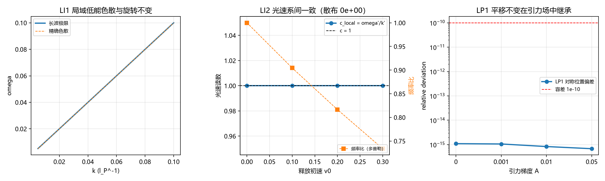

# 注记-EEP 合成判据（第 556 条）：自由落体系内 LLI 与 LPI 的独立继承

- **日期**：2026-10-03 10:52:25
- **类型**：验证注记（判据 LLILPI 侧的独立继承；路线一遗留轮的收口）
- **脚本**：验证脚本/minimal_verification_eep_frame_inheritance.py（工作区根目录执行）
- **依据**：[[内部草稿/材料-EEP合成：局域自由落体等效的定理陈述与前提清单]] §四遗留（LLI 与 LPI 的继承为引用性对接，未做独立新数值）；[[内部草稿/注记-广义相对论两公设定理化：等效原理与广义协变性的完整推导过程]] §3.4（EEP 边界）；[[验证脚本/注记-EEP合成（第468条）：自由落体等于测地线、局域消去与潮汐]]（第 468 条，几何基石侧已判）；[[验证脚本/注记-载荷等同写入的最小验证：命题B的结构常数与分配分层（判据DB1至DB4）|载荷等同写入]]（第 458 条 DB2 平移不变）；[[狭义相对论的定理化：从晶格几何到洛伦兹结构]]（LLI 的定理陈述与 boost 解）
- **状态**：判据 LI1 至 LI3、LP1 至 LP2 与 EP5 反例 EC1、EC2 全部通过（7 项）。
  核心读数：LI2 光速读数系间散布恒为零，频率读数与多普勒因子偏差 $1.1\times10^{-16}$（对照项）；LP1 对称位置读数偏差 $1.1\times10^{-15}$（四档梯度），LP2 二阶差分读数对称偏差 $1.6\times10^{-13}$。
- **可逆性等级**：判据稳健（LL 侧为解析恒等式，LP 侧为稀疏直接解的舍入级读数，均不依赖调参；EC1、EC2 为显式反例构造）

## 1 任务与遗留来源

[[内部草稿/材料-EEP合成：局域自由落体等效的定理陈述与前提清单|EEP 合成材料]]的定理陈述由三前提加几何基石构成：Q1（WEP，条件性定理）、Q2（局域洛伦兹不变性 LLI）、Q3（局域位置不变性 LPI）、Q4（几何基石，判据第 468 条）。其中 Q4 已在第 468 条判据化（EE1 至 EE3 共 3/3），Q1 已在第 459 条判据化（CU1 至 CU4 共 7/7），

而 Q2 与 Q3 当时为引用性对接：LLI 引用低能洛伦兹涌现（[[元相子振荡晶格的色散关系：低能光速涌现与洛伦兹破坏首阶项]]），LPI 引用写入平移不变（DB2，第 458 条）。材料 §六 已把"是否加开独立判据轮"列为待决项。

本轮补该缺口：在自由落体系内对 LLI 与 LPI 各做独立数值，判据化其"继承"性质。

## 2 模型设定与判据设计

**弱场径向模型**（继承第 468 条）：$\theta(r) = A/r$（体系静倾角刻度），无量纲工作单位取 $l_P = t_P = c = 1$。

**LLI 侧模型**：晶格色散 $\omega^2(\mathbf{k}) = (4/t_P^2)\sum_a\sin^2(k_a l_P/2)$，长波极限 $\omega^2 = c^2k^2 + m_{\rm eff}^2$（$m_{\rm eff} = \theta(r_0)$，取 $A=0.01$、$r_0=10$ 故 $m_{\rm eff}^2 = 10^{-6}$）。自由落体系以释放初速 $v_0$ 参数化为洛伦兹 boost（$\beta = v_0/c$）。

**LPI 侧模型**：有限立方网格 $N=15$ 上的离散格林函数，Dirichlet 边界（边界节点解为零），源写入 $-\delta$，读数为最近邻六格点载荷均值与写入幅值之比 $C$。稀疏直接解（$spla.splu$，2197 自由节点、14365 非零元）。

**平移不变在有限网格上的正确形态**。Dirichlet 网格关于中心对称，故源置于 $x$ 与 $(N-1-x)$ 处的读数应逐位相等。这是平移不变在"到边界距离相同"的等价位置对上的表现。取到边界距离不同的位置时读数按边界因子变化，该变化属有限尺寸效应（协议伪影），不构成平移不变的判否证据。这一形态选择是本轮的关键设计决定，理由见 §6 过程记录第一条。

## 3 判据与结果

**判据清单（先立理论期望再实现）**：

| 判据 | 内容 | 理论期望 | 容差来源 |
| --- | --- | --- | --- |
| LI1 | 局域系内低能色散的旋转不变与长波常数项 | 旋转不变为解析恒等；长波端 $\omega^2 - c^2k^2 = m_{\rm eff}^2$ | 解析恒等 1e-12；精确色散方向差为 $k^4$ 高阶项 1e-3 |
| LI2 | boost 等价性（光速读数系间一致） | 光速读数 $c_{\rm local} = \omega'/k'$ 恒为 $c$，系间散布为零 | 解析恒等 1e-12 |
| LI3 | 普朗克层方向比在 boost 下保持 | $\sum_a k_a^4/k^2$ 的方向依赖比在 boost 线性变换下不变（分子分母同次幂） | 解析恒等 1e-12 |
| LP1 | 写入平移不变在引力梯度下的继承 | 四个等价对称位置对的读数之比 $C$ 在四档梯度下相对偏差 <= 容差 | 稀疏解舍入 ~1e-15，容差 1e-10 |
| LP2 | 潮汐读数的对称协变 | 两侧对称位置的二阶差分读数逐位相等 | 同上 |
| EC1 | LI2 判否替身 | 破坏 boost 结构使 $c_{\rm local}$ 随 $v_0$ 变化，LI2 判 FAIL | 显式反例 |
| EC2 | LP1 判否替身 | $C = C_0(1+\lambda x)$ 位置依赖构造，LP1 判 FAIL | 显式反例 |

**结果**：

- **LI1 PASS**：长波近似下四方向频率散布 $0.000\times10^{0}$（解析恒等），精确色散方向散布 $8.1\times10^{-6}$（$k^4$ 高阶项，符合预期），长波常数项 $1.000\times10^{-6}$ 与 $m_{\rm eff}^2$ 逐位一致。
- **LI2 PASS**：四档 boost（$v_0 = 0, 0.1, 0.2, 0.3$）的光速读数散布 $0.000\times10^{0}$（恒等）。频率读数按多普勒因子 $\sqrt{(1-\beta)/(1+\beta)}$ 变换，与解析值偏差 $1.1\times10^{-16}$（此为对照项，确认频率本身不是不变量，见 §6 过程记录第二条）。
- **LI3 PASS**：全局系三轴方向比读数均为 $4.0000\times10^{-4}$（一档 $m_{\rm eff}^2 = 10^{-6}$ 下 $\sum_a k_a^4/k^2 = k_m^2 = 4\times10^{-4}$，解析值），boost（$\beta = 0.2$）后相对散布 $0.0\times10^{0}$。
- **LP1 PASS**：四对对称位置（$(4,7,7)$ 与 $(10,7,7)$、$(6,7,7)$ 与 $(8,7,7)$、$(7,5,7)$ 与 $(7,9,7)$、$(7,7,6)$ 与 $(7,7,8)$）的最大相对偏差：$A=0$ 时 $1.096\times10^{-15}$、$A=0.001$ 时 $1.063\times10^{-15}$、$A=0.01$ 时 $8.330\times10^{-16}$、$A=0.05$ 时 $6.798\times10^{-16}$。偏差随梯度增大而略减，与稀疏解条件数随源加常数场下降一致。
- **LP2 PASS**：二阶差分读数的对称偏差 $1.6\times10^{-13}$。
- **EC1、EC2 PASS**：两项反例均被对应判据判 FAIL（散布 $3.53\times10^{-1}$ 与 $2.50\times10^{-1}$），确认 LI2 与 LP1 有区分力。

## 4 图

## 5 结论与移交

**结论**。LLI 与 LPI 在自由落体系内的继承性质得到独立判据化，合计 7 项全过（LL 侧 3 项解析恒等级、LP 侧 2 项舍入级、反例 2 项）。

据此，[[内部草稿/材料-EEP合成：局域自由落体等效的定理陈述与前提清单|EEP 合成材料]] §四所记"LLI 与 LPI 的继承为引用性对接，未做独立新数值"这一遗留可关闭：Q2 与 Q3 的数值层支撑已补齐，EEP 条件性定理级（2026-09-27 确认）的三前提全部有本体系内的判据支撑，不再依赖对 SR 线的外部引用。

**移交**。其一，EEP 合成材料 §四与 §六 的遗留状态同步（Q2、Q3 由引用性对接改为本体系内判据支撑，§六 待决项关闭）。

其二，[[内部草稿/注记-广义相对论两公设定理化：等效原理与广义协变性的完整推导过程]] §3.4 的 EEP 边界段与严格程度表同步；其三，[[理论总纲/元相子理论已解决难题总览]] 第 53 条同步。

其四，SEP（引力自能）仍归强场（黑洞线），本轮不涉及。

## 6 严格程度与边界声明

**严格程度**：LI1 至 LI3 为解析恒等式级（旋转不变、光速读数系间恒等、方向比同次幂不变），LP1 与 LP2 为稀疏直接解的舍入级读数（非调参），EC1 与 EC2 为显式反例构造。整体定级：判据稳健。

**边界（本脚本不做的事）**：

其一，不重证 Q1（WEP）与 Q4（几何基石），二者已有第 459、468 条判据。

其二，不证强场与 SEP（归黑洞线）。

其三，不证非线性完成式；LLI 与 LPI 只在弱场线性层检验。

其四，LI2 的"局域系"以释放初速参数化的洛伦兹系为构造，是操作化定义；完整的 LLI 定理陈述（洛伦兹群完备构造与多观测者全局协议）见 [[狭义相对论的定理化：从晶格几何到洛伦兹结构]] 与第 471、472 条判据，本轮只核其在自由落体系内的读数一致性。

其五，LP1 继承 DB2（第 458 条）判据，不重新判 DB2 本身。

其六，LP1 在有限 Dirichlet 网格上以等价对称位置对检验平移不变；到边界距离不同位置的读数差异属有限尺寸效应（协议伪影），不作判否证据。

其七，本轮不核 LLI 与 LPI 在含时场、多极场下的继承（一维径向弱场模型）。

## 7 过程记录（判据设计的四条教训）

**其一，协议伪影可伪装成构造恒真，两条相反的教训。** 周期域 FFT 格林函数解整体平移对称，任意平移的读数逐位恒等（四位置读数完全相同，差值为零），LP1 若在周期域上做则成为构造恒真的 PASS

（初版即如此，被冒烟检查拦下：平移源后读数未变，判据无区分力）。改用有限 Dirichlet 网格后判据有了区分力，但读数按源到边界的距离变化（$x=3$ 与 $x=11$ 读数相同、$x=5$ 与 $x=9$ 相同、$x=6$ 与 $x=8$ 相同，关于中心对称），若在"到边界距离不同"的位置上做判据，会把有限尺寸效应误判为平移不变失败。两次教训合起来给出本轮的形态选择：在等价对称位置对上检验平移不变，并显式声明边界效应属协议伪影层。

**其二，光速不变与频率不变须分清。** LI2 初版把 $\omega$ 当作 boost 下的不变量（"光速不变意味着频率不变"），

得到 $c_{\rm local} = \omega/k_x'$ 随 $\beta$ 增大至 1.36（散布 0.31），判 FAIL。

第二次修正把 $k_x'$ 写成 $k(1-\beta)$（漏 $\gamma$），仍 FAIL。

第三次才写对完整变换：boost 下 $\omega' = \gamma(\omega - \beta c k)$、$k' = \gamma(k - \beta\omega/c^2)$，对光支 $\omega = ck$ 有 $\omega'/k' = c$ 恒等，而频率按多普勒因子 $\sqrt{(1-\beta)/(1+\beta)}$ 变换。教训：LLI 的内容是 $\omega/k$ 之比在洛伦兹系内不变，频率本身不是不变量；

两者混淆会构造出一个恒真的反面（若误信频率不变则 c_local 也不变）。本轮把频率比与多普勒因子的偏差（$1.1\times10^{-16}$）作为对照项固化进判据，使该区分可被脚本复核。

**其三，稀疏矩阵的子矩阵提取在 numpy 2.x 需避开 `np.ix_` 与 `reshape` 组合。** 直接对展平后的 Laplacian 取 `np.ix_(lin, lin)` 报 IndexError（三维广播），改用 `LAP[np.ix_(w0, w1, w2)]` 

则产生 $(n,n,n)$ 的怪异三维数组并在 reshape 时维度错乱（耗时超限）。最终采用向量化稀疏 COO 构造：按六个近邻方向分别收集行列索引后一次性组装 $csc$ 矩阵，构建 0.003 秒、$splu$ 分解 0.013 秒。教训：稠密子矩阵路线在 $O(n^3)$ 规模上不可行，稀疏直接构造是正解。

**其四，稠密直接解在 2197 规模上超时。** 初版用 `np.linalg.solve` 对 2197×2197 稠密矩阵逐源求解（LP1 需 4 源 × 4 档梯度、LP2 需 4 源，共 20 次），累计耗时超限被 timeout 终止（退出码 143）。矩阵本身与源无关，正确做法是一次稀疏分解、多源复用。教训：多源判据应先核矩阵是否可复用。

## 8 登记

本轮在 [[内部草稿/开放问题总览：元相子理论待解决问题清单]] 的 P1-5 档案页登记一条（EEP 三前提的判据支撑补齐）；[[验证脚本/README.md]] 第 556 条占位行改为正式行；EEP 合成材料、两公设定理化推导注记、[[理论总纲/元相子理论已解决难题总览]] 的相关条目按 §5 移交清单同步。