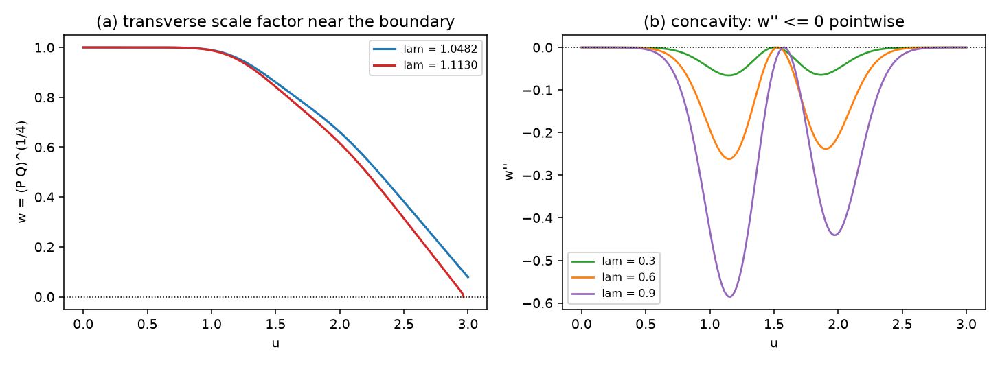

# 注记-G1b 第三十轮：边界条件的解析约化：横向尺度因子、凹性与零点判据（判据 R1 至 R6）

- **日期**：2026-09-22 01:48:26
- **对应脚本**：`验证脚本/minimal_verification_g1b_boundary_reduction.py`（判据 R1 至 R6，确定性，运行约 9 秒）
- **依据**：[[验证脚本/注记-G1b第二十九轮：归一化口径钉死：边界机制与不变量Λ（判据G29-1至G29-6）]]（边界机制的数值定位与不变量口径）；[[验证脚本/注记-G1b第二十五轮：四次幂地板的解析导出：pp-波精确方程、二阶复现与四阶修正（判据G25-1至G25-6）]]（精确真空方程）；[[验证脚本/注记-引力线收口轮：剖面族边界扫描与θ口径核对（判据PF1至PF5）]]（基线读数与族扫描）
- **状态**：第三十轮完成（判据 6/6）。第 29 轮登记的"解析值未得"由本轮结清：边界取得解析刻画（代数恒等式、单方程、初值闭式、凹性与零点判据）；一般剖面的通用闭式不可期，不变量表保持数值报表口径。图见 §二 图 1。

## 一、问题与口径

完成式的横向度量分量为 $P = 1 + A + B$ 与 $Q = 1 - A + B$，其中 $A = \lambda\hat A(u)$ 是写定的剖面，$B$ 由精确真空条件解出。第 29 轮查明域边界就是这两个分量过零，但只有数值读数与九档内外对照。本轮把该机制化为解析形式。

口径三条。其一，零初条件约定取 $B(0) = B'(0) = 0$，与收口轮同口径。其二，剖面在 $u = 0$ 处不必为零（高斯族给出 $a(0) \ne 0$），初值按一般式给出。其三，凡"到零"的读数都注明探测水平：边界位置由两条独立轨道各自定位，二者之差属探测层差。

## 二、判据与结果

| 判据 | 内容 | 实测 | 判定 |
|---|---|---|---|
| R1 | 代数恒等式 | 三档剖面四式：$B = r-1$、$P = r+a$、$Q = r-a$、$a = w^2\sinh(M/2)$，$r = \sqrt{a^2+w^4}$；最大残差 $4.4\times10^{-16}$ | 通过 |
| R2 | 约化方程 | $w'' + (M')^2w/16 = 0$ 的解与 $(PQ)^{1/4}$ 逐点一致：$7.2\times10^{-15}$、$2.3\times10^{-15}$、$2.9\times10^{-15}$ | 通过 |
| R3 | 初值闭式 | $w(0) = ((1+B_0)^2-a_0^2)^{1/4}$，$w'(0) = (B'(0)(1+B_0)-a_0a'(0))/(2w(0)^3)$；偏差至 $2.8\times10^{-17}$ | 通过 |
| R4 | 凹性 | $\max w'' = -5.8\times10^{-7}$（$w=0.354$、$\lambda=1.0$）与 $-2.8\times10^{-8}$（$w=1.0$）；各向同性档恒零 | 通过 |
| R5 | 边界同一 | 度量分量口径 $\lambda_* = 1.080599$（复现收口轮 $1.0806$）；$\lambda = 1.113$ 档两轨道：度量分量最小处 $u = 2.9875$（读数至 $10^{-16}$），$w$ 最小处 $u = 2.9600$（$w_{\min} = 10^{-2}$，探测层），位置差 $2.75\times10^{-2}$ | 通过 |
| R6 | 可解子族与登记 | 常数 $M$ 子族（$a = cw^2$、$w$ 线性）：代数残差 $5.6\times10^{-17}$、约化方程残差 $5.7\times10^{-11}$；一般剖面无通用闭式，登记 | 通过 |

## 三、解读

其一，**代数恒等式把 $B$ 消掉**。由 $w^4 = PQ$ 与 $2a = P - Q$ 直接得 $P = r+a$、$Q = r-a$ 与 $r = 1+B$，其中 $r = \sqrt{a^2+w^4}$。三式在解上恒成立（残差 $4.4\times10^{-16}$），$B$ 由此降为 $(a, w)$ 的代数组合。

其二，**约化方程是单个标量方程**。把精确条件 $(\ln P)'' + (\ln Q)'' + \frac12[((\ln P)')^2 + ((\ln Q)')^2] = 0$ 用 $L = \ln(PQ)$ 与 $M = \ln(P/Q)$ 改写，再代入 $L = 4\ln w$，得 $w'' + (M')^2w/16 = 0$；消去 $M$ 后为 $w'' = -(a'-2aw'/w)^2w/(4(w^4+a^2))$。两种口径的 $w$ 逐点一致到 $7.2\times10^{-15}$。

其三，**$w$ 逐点凹，边界是它的第一个零点**。右端系数非正，故 $w'' \le 0$，等号仅在 $a/w^2$ 为常数时成立（常数 $M$ 子族）。高斯族给 $a(0)a'(0) \ge 0$，故 $w'(0) \le 0$；配合凹性，$w$ 单调不增，域边界就是它的首个零点。

其四，**过零与度量分量过零是同一事件**。由 $P = r+a$ 与 $Q = r-a$，$P = 0$ 或 $Q = 0$ 当且仅当 $w = 0$。数值上两条独立轨道（$B$ 系与 $w$ 系）各自定位到的边界位置只差 $2.75\times10^{-2}$，即探测层差。第 29 轮的九档内外对照由此获得解析解释。

其五，**解析值的地位**。一般剖面含任意指定函数 $a(u)$，$\lambda_*$ 是它的非线性泛函（首个零点的阈值），通用闭式不可期。代数上最简的常数 $M$ 子族（$w$ 线性、$a \propto w^2$）与零初条件不相容，给不出 $\lambda_*$ 的闭式。故报数维持不变量 $\Lambda_* = \lambda_*\max\vert\hat A\vert$ 的数值表，解析一条改记为刻画一条。

## 四、严格程度声明

R1 为解析恒等式加机器核对（四式逐点）；R2 为解析恒等式加机器核对（两条独立积分的逐点比较）；R3 为解析式加机器核对；R4 为结构判定（右端非正）加逐点数值符号；R5 为可复现数值（两条轨道，位置读数与探测水平并列）；R6 为解析子族加登记。

## 五、边界声明

- 验证：边界条件的代数等价形式、单方程约化、初值闭式、凹性与零点判据、常数 $M$ 子族。
- 不验证（登记）：一般剖面的闭式与族曲线极值的解析值（本轮给出"通用闭式不可期"的结构判断）；零初条件以外的一般初值；强场端与三维嵌入。
- 一条口径：R5 的位置差来自两条轨道各自的终止判据（度量轨到过零，$w$ 轨到 $w \approx 10^{-2}$），物理上是同一事件。

## 六、过程记录

三处修正。其一，初值分母：$w' = (P'Q+PQ')/(4(PQ)^{3/4})$ 在 $u = 0$ 处的分母是 $w(0)^3$，首版误用 $r_0^3$，在 $a(0) \ne 0$ 的档上暴露（偏差 $4.4\times10^{-3}$）。其二，R6 的方程项是 $(M')^2$，首版误用 $M^2$；正确的 $(M')^2$ 在常数 $M$ 子族上恒为零，误写项不为零，错误由残差 $3.3\times10^{-2}$ 暴露。其三，R5 中两套右端函数的解包顺序写反，两条轨道的角色互换，修正后读数与解析预期一致。教训：判据实现里凡两套相似对象并列处，加一条区分性自查读数。
