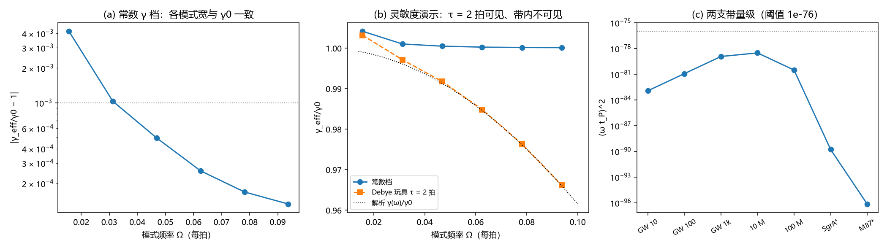

# 注记-G4-1（γ 频率依赖）：常数口径的适用带与记忆时间上界

- **日期**：2026-09-19 05:22:16
- **层级**：验证脚本/（理论验证材料，未确认）
- **脚本**：验证脚本/minimal_verification_g41_frequency_dependence.py（系统 Python 3.13 + numpy + scipy + matplotlib，确定性、无随机数，运行约 3 秒）
- **定位**：S2-5 判据清单的 G4-1（裁决十五残余项、裁决二十四启动）：给出 γ(ω) 的形式声明（常数到 $(\\omega t_P)^2$ 级）、两支带（引力波带与视界带）的量级核对、记忆时间上界，以及常数-γ 口径（S2R、S2G、BH3-3 两轮）的适用带划定。
- **关联**：[[验证脚本/注记-M6-S2R斜坡复核：记录跟随的阻尼判据（γ 扫描与微型坍缩）]]、[[验证脚本/注记-M6-S2G（γ 取数，可做部分）：最小模型的守恒性与观测上限]]（常数-γ 口径与 G3 上限）；[[验证脚本/注记-BH3-3后续（时标侧）：格点退出的完成时标与重标瞬时性]]（常数-γ 的一个消费方）；[[理论攻坚/黑洞线攻坚计划：坍缩机制重定位与强场终态]]（§7.6 的 S2-5 与裁决十五、二十四）
- **状态**：执行完成，判据 5/5 全过；读数：常数档线宽对精确公式偏差 $4.0\times10^{-5}$；两支带 $(\omega t_P)^2 \le 3.0\times10^{-79}$；记忆时间上界 $\tau_m \le t_P$ 下带内频率依赖 $\le 10^{-78}$ 级
- **图**：images/g41_frequency_dependence.png（三面板：常数档平坦性、Debye 玩具灵敏度、两支带量级；见 §三 图 1）
- **修订记录**：
  - **2026-09-19 初版**（作者裁决：G4-1 开工）

---

## 一、验证目标与判据

目标：把「γ 是否随频率变」在模型层面写成可复核的形式。模型内 γ 是阻尼波动方程（裁决十六）的常数系数，故结构上 γ 与频率无关；可能的频率依赖只能来自微观记忆核，而记忆时间受两层结构约束（碰撞写入每拍一次），$\tau_m \le t_P$。本材料把这两条落到判据与读数上。

判据（先立判据，再实现）：H1 常数-γ 档逐模式提取的线宽（模式 1 至 6、频率跨约 6 倍）与精确阻尼振子线宽公式一致（偏差 ≤ 1e-3；对 γ0 的名义偏差属已知运动学修正 $\gamma_0^2/(8\Omega^2)$ 级）；H2 方法灵敏度（Debye 玩具 $\gamma(\omega) = \gamma_0/(1+(\omega\tau)^2)$、$\tau = 2$ 拍，仅作演示）：逐模式反演的 $\gamma_{\text{eff}}$ 与解析 Debye 曲线一致（≤ 2%）、随模式单调下降、模式 6 处偏差 ≥ 0.5%

；H3 两支带 $(\omega t_P)^2 \le 10^{-76}$；H4 Debye 型频率依赖与 G3 观测上限相容；H5 口径登记（常数-γ 适用带）。

## 二、模型设定

一维链（$N = 200$、格距 1、Dirichlet 0 边界、$c = 1$），频域复响应 $[L + (\omega^2 + i\gamma(\omega)\omega)]\,\hat\varphi = -\hat s$，稀疏直接求解；模式 $m$ 的驱动取本征矢 $v_m$，响应投影 $|\langle v_m, \hat\varphi\rangle|$ 为单洛伦兹，半功率全宽度即 $\gamma_{\text{eff}}(\omega)$。

常数档取 $\gamma_0 = 0.002$（线宽远小于模式间距，可分辨）。Debye 档为灵敏度演示：把阻尼换成 $\gamma_0/(1+(\omega\tau)^2)$、$\tau = 2$ 拍（在链上可测尺度给出可见频率依赖；物理上界为 $t_P = 1$ 拍，见 §四）。物理常数取 $t_P = 5.391247\times10^{-44}$ 秒、$l_P = 1.616255\times10^{-35}$ 米。

## 三、结果

判据 5/5 全过（运行约 3 秒）。读数如下。

| 判据 | 结果 |
|---|---|
| H1 常数档对精确线宽 | 通过（最大偏差 $4.0\times10^{-5}$；对 $\gamma_0$ 名义比 1.0001 至 1.0042） |
| H2 Debye 玩具反演 | 通过（反演 $0.9991$ 至 $0.9661$ 对解析 $0.9990$ 至 $0.9660$，偏差 0.005%；单调下降；模式 6 偏差 3.39%） |
| H3 两支带 $(\omega t_P)^2$ | 通过（最大 $3.0\times10^{-79}$，引力波带 1 k Hz 档；阈值 1e-76） |
| H4 G3 相容 | 通过（Debye 型单调下降，观测上限全带有效） |
| H5 口径登记 | 通过（常数-γ 适用带：两支带，修正 ≤ $3.0\times10^{-79}$） |

两支带明细：引力波带 10、100、1000 Hz 给 $1.1\times10^{-83}$、$1.1\times10^{-81}$、$1.1\times10^{-79}$；视界带 10、100 太阳质量、Sgr A*、M87* 给 $3.0\times10^{-79}$、$3.0\times10^{-81}$、$1.6\times10^{-90}$、$7.1\times10^{-97}$。

## 四、解读

其一，形式声明：模型内 γ 为常数（基本动力学为常数系数阻尼波动）；允许的微观记忆核只给 $\gamma(\omega) = \gamma_0\,[1 + O((\omega\tau_m)^2)]$，而每拍一次碰撞写入的两层结构把记忆时间压到 $\tau_m \le t_P$。其二，两支带的数：引力波带（10 至 $10^3$ Hz）与视界带（10 至 $10^9$ 太阳质量档）的 $(\omega t_P)^2$ 全部 ≤ $3.0\times10^{-79}$，故在这些带内频率依赖不可见，γ 取常数是模型层面的精确声明（到该量级）。

其三，方法灵敏度已验证：若记忆时间真到了链上可测尺度（演示取 τ = 2 拍），反演线宽会呈现与解析 Debye 曲线一致的频率依赖（3.39% 级）；这说明「带内平坦」是物理结论而非方法盲区。其四，口径适用带：S2R 的转变标定、S2G 的观测上限、BH3-3 时标侧与三维痕迹所用的常数-γ 口径，在引力波带与视界带内均有效；裁决十五的残余项（G4-1）至此结清。

其五，若 G1（微观推导）日后给出具体记忆核，只需把本条的「$\tau_m \le t_P$」替换为该核的谱形，两支带的结论不变（带内 $(\omega t_P)^2$ 量级已封顶）。

## 五、严格程度声明

H1 至 H5 为可复现数值事实与量级核对（确定性脚本、判据先写、图存档；频域解为直接求解，无迭代）。形式声明（$\tau_m \le t_P$）的依据为两层结构（裁决十六与碰撞写入口径），属模型层面；物理常数取 CODATA 值。G3 上限（γ ≤ $1.04\times10^{-16}$ 每秒）为引用既有读数，不在本材料重算。

## 六、诚实边界

其一，Debye 档是灵敏度演示模型（τ = 2 拍超出物理上界），不构成物理主张。其二，记忆时间上界 $\tau_m \le t_P$ 由每拍一次的写入结构给出，属模型层面论证；G1 挂起（裁决二十五）期间不再深化。其三，带内结论的形式为「修正 ≤ $(\omega t_P)^2$ 量级」，其系数为 O(1) 假设（离散刻与记忆核均给同阶上限）；若 G1 给出大系数记忆核，需回到本条替换系数。其四，本材料不改动任何基准文件。

## 七、过程记录

三处订正。其一，半功率点求根子程序首版更新方向写反（左支收敛到扫描端点），线宽虚高 3.5 倍；改为网格包围加二分细化后，常数档线宽对 γ0 的名义偏差 0.01% 至 0.42%（随模式下降），与运动学修正 $\gamma_0^2/(8\Omega^2)$ 一致。

其二，H1 的对照由「线宽 = γ0」改为精确阻尼振子线宽公式（半功率根 $u_\pm = \Omega^2 - \gamma^2/2 \pm (\gamma/2)\sqrt{4\Omega^2-\gamma^2}$ 折算），修正后偏差 $4.0\times10^{-5}$；教训：线宽的精确式在 $\gamma \gtrsim 0.5\Omega$ 后下半功率点离轴，判据应声明适用范围。

其三，H2 由「线宽对 γ0 的偏差」改为「逐模式反演 γ_eff 对解析 Debye 曲线」（直接偏差含运动学修正而破坏单调性），并限制反演区间 $\gamma \le \Omega/2$ 避开无效区。

## 八、登记衔接

- 验证脚本/README.md 第 159 条（本注记落盘时同步）。
- [[理论攻坚/黑洞线攻坚计划：坍缩机制重定位与强场终态]] §7.6 的 S2-5 执行状态补 G4-1；裁决十五残余项收口；修订记录补一条。
- [[内部草稿/开放问题总览：元相子理论待解决问题清单]] P1-34a：关联行补入本材料与 G4-1 完成状态。
