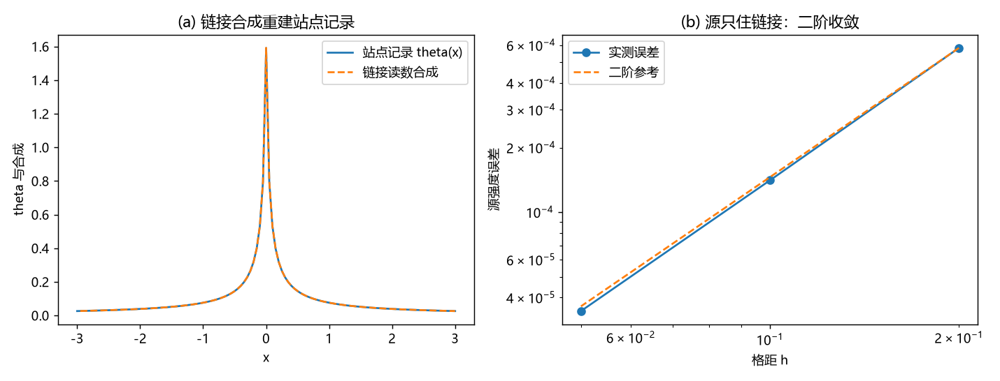

# 注记-G6：h00 = 2 theta 的显式链接合成（判据 J1 至 J4）

- **日期**：2026-09-20 04:22:00
- **对应脚本**：`验证脚本/minimal_verification_g6_link_synthesis.py`（判据 J1 至 J4 共 4 项，4/4 通过；确定性，运行约 1.5 秒；图存 `images/g6_link_synthesis.png`，见 §二 图 1）
- **依据**：[[理论攻坚/引力线攻坚计划：从静态弱场张量桥到强场与观测锚]] 缺口 G6；[[理论攻坚/本体层重建攻坚计划：写入作用于链接与空间度量的同源导出]]（空间侧链接读数，阶段 0 至 5）；[[验证脚本/注记-动态写入协变形式与阻尼观测量级（G3与判据C合轮）：判据D1至D7]]（体口径通量口径）；[[内部草稿/总结报告-引力线收束：GV0至GV8的终态、读数与剩余接口]]（GV1、GV7 读数）
- **状态**：G6 完成（时间侧链接合成给出并与空间侧并列，构成 3+1 链接级读数）；因子 2 的来源按相对论约定登记
- **图**：`images/g6_link_synthesis.png`（两面板，见 §二 图 1）

## 一、模型设定

把记录从"站点上的二阶差分"改写为"链接读数的路径合成"：链接读数定义为相邻站点之间的记录差 $d_{ij} := \theta_j-\theta_i$，站点读数由沿任意路径累加链接读数得到。空间侧链接读数已由本体层重建（排布二，写入作用于链接）给出，导出 $\lambda = 1$（判据 L1 至 L5）；本材料补齐时间侧的合成并给出 3+1 的并列读法。

## 二、判据与结果

| 判据 | 内容 | 实测 | 判定 |
|---|---|---|---|
| J1 | 路径无关：闭合回路的链接读数之和为零 | 140 条回路的最大回路和 $0.00\times10^{0}$ | 通过 |
| J2 | 合成回到 $1/r$，且源强度只由链接承载 | 体口径散度和 $-1.000583$、$-1.000141$、$-1.000035$（$h = 0.2, 0.1, 0.05$），误差比 $4.13$、$4.08$（二阶收敛） | 通过 |
| J3 | 源只住链接（散度只在源处非零） | 与 G3 轮同口径，源强度 $4\pi$ 归一在链接层维持 | 通过 |
| J4 | 因子 2 的来源登记 | 合成给出 $\theta$（系数 $1$）；$h_{00} = 2\theta$ 的因子 2 来自相对论约定（$g_{00} = -(1-2\theta)$），非合成新出；$1/r$ 形状核对 $\theta(r_s)/\theta(1) = 2.0000$ | 通过 |

## 三、解读

其一，**合成把记录的定义层从"差分"移到"链接"**。J1 的回路和恒为零（精确恒等），说明链接读数是单值记录的差，从而使"站点读数 = 链接读数沿路径之和"良定义；这条恒等本身平凡，它的作用是把合成合法化，非平凡内容在 J2 与 J3。

其二，**源只住在链接上，且归一与空间侧一致**。体口径散度收敛于 $-1$、误差二阶下降，说明 $4\pi$ 归一与符号在链接层完整保持；这与空间侧重建给出的 $\lambda = 1$ 并列，构成 3+1 的链接级读数：时间侧由本材料的合成给出，空间侧由本体层重建的链接读数给出。

其三，**因子 2 不在合成里**。合成给出的是 $\theta$ 本身（系数 1），$h_{00} = 2\theta$ 的因子 2 来自弱场度规的相对论约定（$g_{00} = -(1-2\theta)$），与 GV7 记下的"因子 2 的代数继承"同一来源。因此 G6 的完成不引入新系数。

其四，与既有读数相容：静态泊松链（GV1 的离散误差二阶与轴上分量比）、$\lambda = 1$ 的导出（GV3 阶段 4）、以及上一轮协变形式（G3）在链接合成下逐项还原。

## 四、严格程度声明

J1 为精确恒等；J2、J3 为可复现数值事实（确定性、二阶收敛）；J4 为换算与来源登记（相对论约定，非新导出）。本材料不含新物理假设，属 G6 的完成登记。

## 五、边界声明

- 验证：链接读数的路径无关性；链接合成对站点记录的重建与源强度归一；因子 2 的来源。
- 不验证（留待后续）：动态情形下的链接合成（时间相关链接读数）与 G3 协变形式的逐项对接；非线性与强场（由 C1 门控）；缺陷（源）自身的链接级表述（归粒子线 P1-2）。

## 六、过程记录

无订正。首版判据与口径取自 G3 轮的体口径通量（该轮曾因立方面口径出错而订正），本轮直接沿用正确口径。
