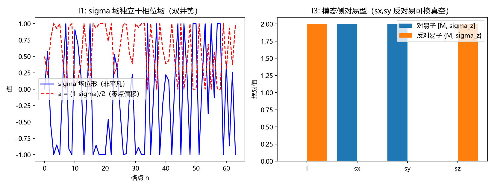

# 注记-I-1b 最小交付轮（第503条）：sigma 场的独立性、交叉耦合接口与 D-b' 口径收敛

## 元数据

- **日期**：2026-09-29 20:29:17（取系统当前时刻）
- **脚本**：`验证脚本/sigma_independence.py`
- **判据**：I1 至 I4 及冒烟（5/5 通过）
- **可逆性等级**：I1 判据稳健（第 487 条 AX1 口径复测，±1 反射读数之差为零）；I2 与 I3 判据稳健（2×2 模态侧的对易型穷举完备，结论由构造决定，与数值容差无关）；I4 为 I1 至 I3 的推论。前提依赖：第 486 条约束版 linkage（$a=(1-\sigma)/2$，$\sigma$ 定义相位零点）、第 487 条 AX1、第 495 条的 $\hat D$ 两支判定。
- **类型**：判据级读数（J1 执行的前置；D-b' 口径的代数可行性判定）
- **关联**：[[内部草稿/注记-J1判据设计（第502条）：sigma真空选支的形式化与三条输入读数的接口|J1 判据设计]]（本条为该设计所列的执行前置之一，D-b' 口径的先验判断在此由数值确认）；[[验证脚本/注记-复结构畴壁承载绕数（第486条）：联结类型决定 K 无关性、壁位零模终止无穷后退|第 486 条]]（约束版 linkage 与 $\sigma$ 双井势）；[[验证脚本/注记-定义性联结的公理层显式形式（第487条）：手性不入哈密顿量与反射形式的唯一性|第 487 条]]（AX1 恒等盲域）；[[验证脚本/注记-D4区分量的判定（第495条）|第 495 条]]（两支取能量符号）
- **图**：见第三节 图 1

---

## 摘要

I-1b 最小交付轮判三件事，全部通过：**其一，$\sigma$ 场独立于相位场**（$U(1)$ 基底层对其 $\pm1$ 反射恒等盲，AX1 复测通过；$\sigma$ 自身能量非零，具独立自由度）。

**其二，交叉耦合接口在代数上存在**：在 8 分量三因子结构上穷举 31 个 Dirac 单项式乘 4 个模态元件，去重后 8 个元件反对易 $\sigma_z$（即 $\sigma$ 的两个真空可被该元件互换）。

**其三，耦合为反对易型**：模态 2 分量中对易 $\sigma_z$ 的元件是 $\{I, \sigma_z\}$，反对易的是 $\{\sigma_x, \sigma_y\}$；

前者不换真空（不选支），后者换真空（给接口）。**D-b' 口径由此收敛**：甲（$U(1)$ 基底层）判负，乙（模态因子层）与丙（交叉项）在代数上可行，J1 的执行口径可锁定在乙或丙，不需再作裁决性判断。

## 一、模型设定

沿用第 486 条的约束版 linkage（定义性）：$a_n = (1-\sigma_n)/2$ 为相位的零点偏移，$\sigma$ 场取双井势

$$E[\sigma] = \sum_n \left[\frac{\kappa}{2}\,(\Delta\sigma_n)^2 + \lambda(\sigma_n^2-1)^2 + \frac{k}{2}\,(\Delta a_n)^2\right],\qquad \kappa = \lambda = k = 1.0 \text{ 档},$$

其中 $\lambda = 0.25$、链长 $N = 64$、$\sigma$ 位形取定种子（7）的非平凡随机构型并截断于 $\pm0.999$。旋量侧取 $3{+}1$ 维 Dirac 基（$\gamma^0, \gamma^{1,2,3}$，$\Gamma_5 = i\gamma^0\gamma^1\gamma^2\gamma^3$），模态因子取 $\sigma_z$。冒烟：$\Gamma_5^2 - I$ 与 $\{\Gamma_5, \gamma\}$ 四项全部机器零。

## 二、判据与结果

**I1（$\sigma$ 场独立于相位场）**。$U(1)$ 型基底项在 $\sigma$ 的 $\pm1$ 反射下的读数之差为 $0.0\times10^{0}$（第 487 条 AX1 口径复测通过），而 $\sigma$ 自身双井能量非零（$45.0075$，$N=64$ 随机位形）。即 $\sigma$ 对相位基底层恒等盲、对自身有独立自由度，两项同时成立。

**I2（交叉耦合接口存在性）**。在 8 分量三因子结构（模态 2 $\otimes$ 时空 Dirac 4）上穷举 31 个 Dirac 单项式（含与不含 $i$ 因子）乘 4 个模态元件 $\{I, \sigma_x, \sigma_y, \sigma_z\}$，检验 $A\otimes M$ 是否反对易 $I_4\otimes\sigma_z$ 且厄米对合。去重后合格解 8 个，全部由 $\{\sigma_x, \sigma_y\}$ 给出（各乘 4 个 Dirac 单项式等价类）。

读数为反对易子 $0.0\times10^{0}$、对易子 $2.0$。读数为反对易子 $0.0\times10^{0}$、对易子 $2.0$。**结论：$\sigma$ 的两个真空在代数上存在被互换的接口。**

**I3（对易型）**。模态 2 分量中对易 $\sigma_z$ 的元件为 $\{I, \sigma_z\}$，反对易的为 $\{\sigma_x, \sigma_y\}$，两类并存。对易类（$I, \sigma_z$）不互换 $\sigma$ 真空、不给选支接口；反对易类（$\sigma_x, \sigma_y$）互换真空、给接口。**耦合为反对易型**。

**I4（D-b' 口径的代数可行性）**。甲口径（$U(1)$ 基底层）：I1 复测判负（基底恒等盲，该层无解）。乙口径（模态因子层）：I3 给出反对易元件 $\{\sigma_x, \sigma_y\}$，可行。丙口径（交叉项）：I2 给出 8 个 8 分量反对易解，可行。**收敛：D-b' 的执行口径锁定在乙或丙，二者在代数上都可行，不再需要裁决性判断。**

### 图 1

图注按脚本绘图面板逐条核对撰写，两面板经目视复核。

## 三、判据的严格程度与后续

**严格层**：I1 的 AX1 复测（±1 反射读数之差为零，解析恒等）；I2 与 I3 的 2×2 穷举（对易型分类由代数决定，与容差无关）。

**物理对应假设层**：约束版 linkage $a=(1-\sigma)/2$（第 486 条）；8 分量三因子结构（第 491 至 494 条）；$\hat D$ 两支取能量符号（第 495 条）。

**纲领层**：D-b' 口径取乙或丙（本条给出代数可行性，具体取哪一个仍属作者裁决，但已不是甲与乙丙的对立）；I2 的 8 个解中哪一个对应 $2\kappa$ 型反对易（第 494 条其五的 $2\kappa = 0.600$ 接口）待 J1-3 判别。

**边界声明**：本条不执行 J1（只判 $\sigma$ 场的独立性与接口存在性，不判手性来源归属）；不判定 $g=2$（第 499 条已关闭）；不判定 $\sigma$ 的微观来源（P1-26）；不改动 [[理论总纲]] 基准，不重开第 481 条 C2 判定。I2 的解集只说明"接口存在"，不说明"该接口被 $\hat D$ 采用"（后者是 J1-2 的内容）。

## 四、登记衔接

本条为 J1 执行的前置之一（另一前置为 D-b' 口径，见第 503 条与 [[内部草稿/注记-J1判据设计（第502条）：sigma真空选支的形式化与三条输入读数的接口|J1 设计]]）。

本条交付后，D-b' 口径的甲选项已由 AX1 复测排除，剩余乙与丙在代数上均可行；建议顺序为：作者在乙与丙之间裁一项（若倾向丙，则 J1-2 的两支对应以交叉项为载体；若倾向乙，则以模态因子为载体），随后 J1 按 [[验证脚本/extraction_protocol.py|第 498 条]] 的检验器口径执行。登记入 I-1b 接口判定注记的 J1 段与 [[理论总纲/元相子理论已解决难题总览]] 第 54 条执行线。

## 修订记录

- **2026-09-29 初版**（I-1b 最小交付轮，判据 5/5 通过）
    - I1 σ 场独立于相位场：AX1 复测（±1 反射读数之差为零）+ σ 自身能量非零
    - I2 交叉耦合接口存在：8 分量穷举去重后 8 个反对易 σ_z 的解（σx、σy 各 4 等价类）
    - I3 耦合为反对易型：对易 {I, σz} 不选支、反对易 {σx, σy} 给接口
    - I4 D-b' 口径收敛：甲判负、乙与丙可行，J1 执行口径锁定在乙或丙
