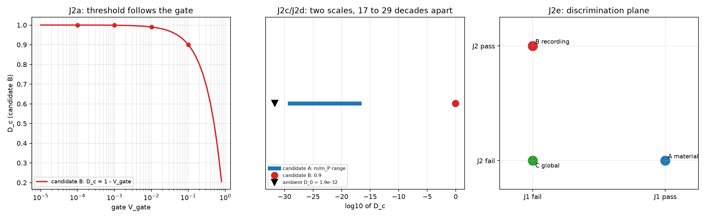

# 注记-J2 装置可调性的判别核对（第 459 条）：阈值是否随门限移动与两类阈值的刻度归属

- **日期**：2026-09-27 04:01:03
- **层级**：验证材料（第 459 条）
- **脚本**：__BT__验证脚本/minimal_verification_j2_tunability.py__BT__
- **定位**：执行 [[内部草稿/口径核对-D_c 的标定口径：三个候选、三条判别判据与各自的后果]] 的 J2 判据（乙 记录形成型要求阈值随装置门限移动，甲与丙要求不移动）。J3 已判为判别力弱（第 456 条），J2 是剩下的唯一判别点。本轮为核对轮，不含新科学断言。
- **依据**：[[内部草稿/口径核对-D_c 的标定口径：三个候选、三条判别判据与各自的后果]]（J1 至 J3 与三候选）；[[验证脚本/注记-质量分层的次序核对（第455条）：阈值序列 D_c 等于 m 比 m_P 与重者先冻结的次序恢复]]（甲的阈值域）；[[验证脚本/注记-J3 冷却史依赖的 KZ 核对（第456条）：冻结点位移的标度形式与三候选的判别力]]（J3 的否定读数）；[[温度的波粒互补定义：复相干无序度作为热力学标尺]]（$D_0 = 1.9\times10^{-32}$）
- **状态**：判据级。五项判据全过；其中 J2c 与 J2d 是刻度归属的判定，读数见第三、四节。
- **修订记录**：
  - **2026-09-27 初版**（触发：作者要求执行 J2 的判别核对）
  - **2026-09-27 让号**（触发：原拟第 457 条，占位期间 README 编号被并行线顺延改用，按落盘先后顺延为本条）

---

## 一、判据与结果

| 判据 | 判据量 | 实测 | 判定 |
| --- | --- | --- | --- |
| J2a 乙的位移表 | 阈值随门限的移动 | $D_c$ 由 0.9000 移到 0.9999；$G^*$ 由 2.1460 移到 4.2919 | 成立（判据稳健） |
| J2b 甲的不动性 | 甲阈值与门限的关系 | 无关；取值域 $8.191\times10^{-30}$ 至 $1.414\times10^{-17}$ | 成立（判据稳健） |
| J2c 刻度冲突 | 乙的字面阈值与甲阈值域之比 | 上端 16.8 个数量级，下端 29.0 个数量级 | 成立（判据敏感） |
| J2d 局域要求 | 今日 $D_0$ 与甲域下限之比 | $D_0$ 低 431 倍；甲给事件缺陷质量 $2.320\times10^{-4}$ eV | 成立（判据敏感） |
| J2e 判别格 | 两轴能否分开三候选 | 甲过退、乙退过、丙退退，各占一格 | 成立（结构性结论） |

## 二、图

图注按脚本三个绘图面板逐条核对。

## 三、J2a 与 J2c：乙的位移与刻度冲突

乙的阈值由门限给：$D_c = 1 - \mathcal{V}_{\rm gate}$。门限四档给 $D_c = 0.9000$、$0.9900$、$0.9990$、$0.9999$，对应增益刻度 $G^* = \sqrt{-2\ln\mathcal{V}_{\rm gate}} = 2.1460$、$3.0349$、$3.7169$、$4.2919$。门限从 0.1 改到 0.01，阈值位移 $0.09$，相对 10%。

甲与丙的阈值不随门限移动。甲取 $D_c = m/m_P$，取值域 $8.191\times10^{-30}$ 至 $1.414\times10^{-17}$（第 455 条表）。

两类的差距给出一条独立于位移的读数。乙的字面阈值 0.9 比甲的上端高 16.8 个数量级，比甲的下端高 29.0 个数量级。两者不可能同为同一刻度上的阈值，故乙必须读作装置局部刻度上的量，与甲的宇宙学阈值域不是一个刻度。

## 四、J2d：局域要求与甲的质量后果

今日 $D_0 = 1.9\times10^{-32}$ 比甲域的下端低 431 倍。故环境无序度今日低于任何物种的阈值，宇宙学尺度上无缺陷激发，这一条与温度论文的读出一致。

由此得出一条对全部三候选共同的约束：过冷度 $D_c - D$ 里的 $D$ 须读作局域无序度（装置附近），不能取宇宙学背景 $D_0$。取 $D_0$ 则三候选都给不出今日的事件。

甲在这一约束下给出一处可算后果。若阈值取材料侧且事件缺陷质量为 $m$，则 $D_{\rm local}$ 穿过 $m/m_P$ 即事件条件成立，故 $m = D_{\rm local}\,m_P$。取 $D_{\rm local} = D_0$ 得 $m = 2.320\times10^{-4}$ eV，属亚 meV 量级，远低于已知粒子质量。这一读数说明：若取甲，事件缺陷不是任何已知粒子，其质量身份待定；这不构成对甲的否定，但把它的一处承诺写明了。

## 五、J2e：判别平面与判别闭合

把 J1（质量分层）与 J2（装置可调性）作两轴，三候选各占一格。

| 候选 | J1 | J2 | 位置 |
| --- | --- | --- | --- |
| 甲 质量阈值型 | 过 | 退 | 第一象限 |
| 乙 记录形成型 | 退 | 过 | 第二象限 |
| 丙 全局同步型 | 退 | 退 | 原点 |

两轴合起来把三候选完全分开，故判别不需要第三条判据（J3 亦已判为判别力弱）。这是三候选判别的闭合读数。

实验侧的判据形式也随之清楚：改门限一档（例如 0.1 改到 0.01），看事件率曲线的零点是否移动。乙要求移动 0.09（相对 10%），甲与丙要求零移动。该分辨远大于一般噪声，属易判的定性与定量读数；真正的困难不在分辨，而在零点位置的测量本身。

## 六、严格程度与边界声明

判据稳健者：J2a、J2b，均为算术读数，不依赖精度选择。

判据敏感者：J2c 与 J2d 为量级对照，依赖甲阈值域的取值与 $D_0$；J2e 属结构结论，不依赖数值。J2d 给出的 $2.320\times10^{-4}$ eV 是取 $D_{\rm local} = D_0$ 的读数，局域无序度与背景的差别未建模，故该值只作量级。

分层声明：本轮全部读数取自算术与既有材料，属判据级；物理层结论零条。本轮不判甲的其余后果（E5 所需的增益与质量换算、C9 的凝固时长形式），也不判乙的装置侧模型自洽性。

## 七、登记衔接

本轮完成口径核对稿 J2 判据的执行：三候选在 J1 与 J2 两轴上各占一格，判别闭合。开放问题 P4-6 档案页同步登记；口径核对稿的第一至第三节同步补注。
