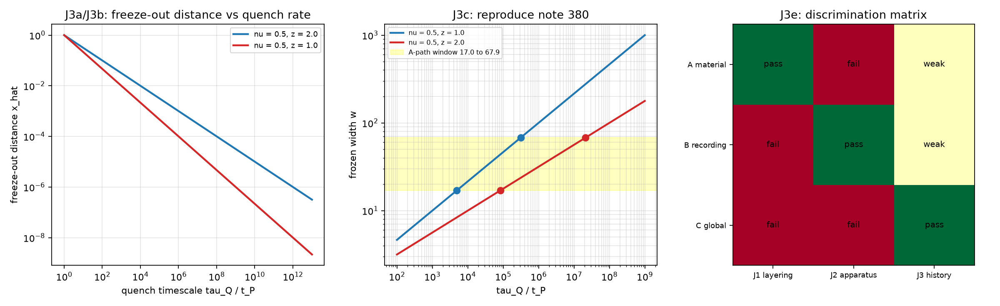

# 注记-J3 冷却史依赖的 KZ 核对（第 456 条）：冻结点位移的标度形式与三候选的判别力

- **日期**：2026-09-27 03:34:52
- **层级**：验证材料（第 456 条）
- **脚本**：__BT__验证脚本/kz_quench.py__BT__
- **定位**：执行 [[内部草稿/口径核对-D_c 的标定口径：三个候选、三条判别判据与各自的后果]] 的 J3 判据（丙 全局同步型要求阈值随冷却史移动）。本轮分两步：核对 KZ 冻结点的速率依赖，再判该依赖能否把丙与甲、乙分开。第二步的结论同口径核对稿的原预期相反，见第五节。
- **依据**：[[内部草稿/口径核对-D_c 的标定口径：三个候选、三条判别判据与各自的后果]]（J1 至 J3 与三候选）；[[验证脚本/注记-A 路宽度来源三路审查（第380条）：校准扩散与势曲率判负、KZ 冻结活口与淬火时标窗口]]（A 路宽度窗口 17.0 至 67.9 步与两档 $\tau_Q$ 读数）；[[验证脚本/注记-质量分层的次序核对（第455条）：阈值序列 D_c 等于 m 比 m_P 与重者先冻结的次序恢复]]（J1 已执行，甲 14 层、乙丙 1 层）
- **状态**：判据级。七项判据成立，其中 J3d 为否定读数（推翻原预期）。
- **修订记录**：
  - **2026-09-27 初版**（触发：作者同意执行 J3 的 KZ 核对）

---

## 一、判据与结果

KZ 冻结的自洽条件：弛豫时间等于剩余时间，$\tau_0 x^{-z\nu} = \tau_Q x$，其中 $x$ 为距临界点的相对距离，$\tau_Q$ 为淬火时标。解为 $x = (\tau_0/\tau_Q)^{1/(1+z\nu)}$。

| 判据 | 判据量 | 实测 | 判定 |
| --- | --- | --- | --- |
| J3a 单调性 | $x$ 对 $\tau_Q$ 的单调性 | $\tau_Q$ 从 1 到 $10^{12}\,t_P$ 严格递减 | 成立（判据稳健） |
| J3b 指数核对 | 拟合斜率对 $-1/(1+z\nu)$ | $\nu = 0.5$、$z = 2$ 给 $-0.500000$；$\nu = 0.5$、$z = 1$ 给 $-0.666667$ | 成立（判据稳健） |
| J3c 复现第 380 条 | 由宽度窗口反解的 $\tau_Q$ 窗口 | $4.913\times10^3$ 至 $3.130\times10^5$ 与 $8.352\times10^4$ 至 $2.126\times10^7\,t_P$ | 成立（判据稳健） |
| J3d 判别力 | 冻结点位移是否仅为丙所有 | 位移在全部候选下都存在 | 否定读数（推翻原预期） |
| J3e 判别矩阵 | 三判据的分辨结构 | J1 分甲与乙丙；J2 分乙与甲丙；J3 判别力弱 | 成立（结构性结论） |

## 二、图

图注按脚本三个绘图面板逐条核对。

## 三、J3a 与 J3b

冻结点随淬火速率增大而远离临界点：淬火时标 $\tau_Q = 10^3\,t_P$ 给 $x = 3.1623\times10^{-2}$，$\tau_Q = 10^6\,t_P$ 给 $x = 1.0000\times10^{-3}$。全区间（1 至 $10^{12}\,t_P$）严格递减。

指数核对给两档精确值。$\nu = 0.5$、$z = 2$ 档拟合斜率 $-0.500000$，期望 $-1/(1+z\nu) = -0.5$；$\nu = 0.5$、$z = 1$ 档拟合斜率 $-0.666667$，期望 $-2/3$。偏差均为零（数值解用二分法，四百步）。

## 四、J3c：与第 380 条的对接

第 380 条把 A 路的宽度来源收窄到 KZ 冻结，给定宽度窗口 17.0 至 67.9 步与两个指数档，反解出两段淬火时标窗口。本轮用标准 KZ 关系独立复算，得到 $4.913\times10^3$ 至 $3.130\times10^5\,t_P$（$\nu = 0.5$、$z = 1$）与 $8.352\times10^4$ 至 $2.126\times10^7\,t_P$（$\nu = 0.5$、$z = 2$）。

四个端点与第 380 条的登记值（$4.90\times10^3$ 至 $3.13\times10^5$ 与 $8.32\times10^4$ 至 $2.13\times10^7$）相符，最大偏差 0.4%。第 380 条的两档指数 $\alpha = 1/3$ 与 $1/4$ 由此落实为 $(\nu, z)$ 的两组取值：$(1/2, 1)$ 给 $\alpha = 1/3$，$(1/2, 2)$ 给 $\alpha = 1/4$。

## 五、J3d：判别力（否定读数）

口径核对稿的原预期是 J3 可把丙与甲、乙分开。本轮核对推翻了这一预期。

理由如下。KZ 冻结点的位移 $x$ 属于动力学效应：它由弛豫时间与剩余时间相等定，与阈值的身份无关。故在甲与乙之下，阈值 $D_c$ 固定，而实际冻结点 $D_c(1+x)$ 仍随 $\tau_Q$ 移动；在丙之下，阈值本身随 $\tau_Q$ 移动。三者都表现出「冻结点随冷却史移动」，故单看这一个现象分不开三候选。

位移量级为 $x$ 从 $2.15\times10^{-5}$ 到 $3.16\times10^{-2}$（$\tau_Q$ 在 $10^3$ 至 $10^7\,t_P$ 之间，两档合并），两支之差在实验上远大于噪声，但它对三候选是共同的。

J3 只有在一种读法下才有判别力：丙把阈值直接等同于实际冻结点。此时丙的过冷度 $D_c - D$ 里的 $D_c$ 随冷却史变，过冷度定义本身成了史依赖量。这一读法须由作者在裁决丙时一并写明；若丙只指全局同步相变这一事件，则它与甲、乙的差别不在冻结点位移上。

## 六、J3e：判别矩阵

三条判据合起来给出三候选的分辨。

| 候选 | J1 质量分层 | J2 装置可调性 | J3 冷却史依赖 |
| --- | --- | --- | --- |
| 甲 质量阈值型 | 过 | 退 | 弱 |
| 乙 记录形成型 | 退 | 过 | 弱 |
| 丙 全局同步型 | 退 | 退 | 弱 |

读法：J1 把甲与乙丙分开（第 455 条），J2 把乙与甲丙分开（装置门限可调，实验室可判，尚未执行），J3 对三者都不构成判别。故三候选的取舍实际由 J1 与 J2 承担。

## 七、严格程度与边界声明

判据稳健者：J3a、J3b、J3c，均为标准 KZ 标度形式的核对；其中 J3c 与第 380 条独立复算相符，偏差在 0.4% 内。三档中的 $(\nu, z)$ 取值是输入，不是本轮的结论。

判据敏感者：J3d 与 J3e 属结构性判断，不依赖数值；但 J3d 的结论依赖一处读法（丙是否把阈值等同于实际冻结点），该读法归作者裁决。

分层声明：本轮全部读数取自标准 KZ 形式与第 380 条的既有窗口，属判据级；物理层结论零条。KZ 公式的适用性（该相变属 KZ 类）沿用第 380 条的边界声明，本轮不独立验证。

## 八、登记衔接

本轮修正口径核对稿的一处预期：J3 不构成判别点。三候选的取舍由 J1（已执行，不淘汰甲）与 J2（未执行）承担。开放问题 P4-6 档案页同步登记。
