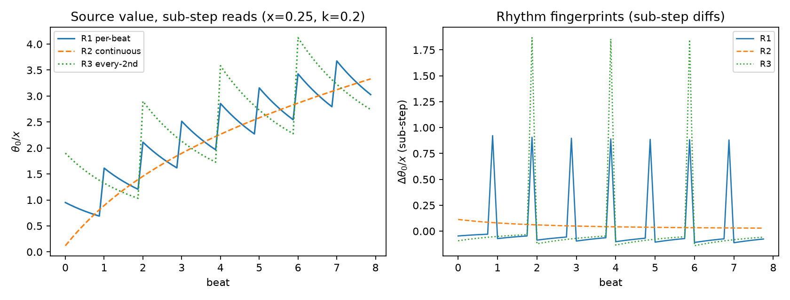

# 注记-J6每拍节律判据：三节律指纹的可判别性与稳态无区分力（判据第604条，定理6判定项收尾）

| 项目 | 内容 |
| --- | --- |
| 日期 | 2026-10-11（datetime.now 实取） |
| 脚本 | `write_rhythm.py` |
| 判据 | V1 / V2 / V3 / V4，4/4 全过 |
| 可逆性等级 | 判据稳健（指纹间隔与解析式 $x(1-2\kappa/K)$ 对参数档稳健；区分读数为结构量）；敏感项单列：V1 的源点单点偏移（量值 $x/K$ 精确）为注入子步读数协议效应，登记不判 |
| 图 | 见 §四 图 1 |
| 上游 | [[内部草稿/注记-写入份额定理：证明整合与三处裁决（2026-10-05）\|定理 6 证明整合与三处裁决]] §六剩余项、[[写入份额定理：碰撞写入幅度的唯一性与线性映射]] §六边界（J6 设计提示）、P1-5 档案页 |

## 一、要判什么

J6（定理化材料判定项清单末项）：非每拍节律的替身写入判 FAIL，钉死"每拍一次"的节律来源。替身组：连续写入（拍内均匀注入，总注入率相同）与隔拍写入（两拍一次幅度加倍，平均注入率相同）。正稿 §六的设计提示是本轮判据的路标：稳态格林函数对写入节律无区分力（线性系统只看平均注入率），区分力必须来自逐拍作用量结算的时间分辨结构。

## 二、模型设定

一维链（$N=64$）Dirichlet 吸收端（端点固定零 reservoir；周期链与 Neumann 开链加持续注入均无稳态：图拉普拉斯零模使总场线性增长，这是首轮设计踩过并修正的坑），子步引擎：每拍 $K=8$ 子步，每子步先注入相应份额再扩散 $\kappa/K$（扩散总量与注入公平化），源点在链中央（保持两侧邻居，指纹式不变）。三节律：R1 每拍首子步注入 $x$；R2 每子步注入 $x/K$；R3 每两拍首子步注入 $2x$。平均注入率三者同为 $x/$ 拍。多档：$x\in\{0.1,0.25,0.5\}$、$\kappa\in\{0.1,0.2\}$（V2/V3 全档；V1 的稳态剖面线性缩放于 $x$，只在 $\kappa$ 上扫）。

## 三、四项判据

**V1（稳态无区分力确认）**：长跑收敛（$T=15$ 万拍；预算：最慢模 $\lambda_{\min}\approx0.00249$，$\kappa=0.1$ 档衰减 $e^{-37}$）后，三节律子步级时平均空间剖面与解析稳态（内点 Dirichlet 子块 $-L_{\rm int}\theta=(x/\kappa)e_{I0}$）的非源点最大相对差 $<10^{-8}$，两两差 $10^{-10}$ 级。稳态剖面作区分读数时判据翻（见 V4）。源点单点偏移量值恰为 $x/K$，属注入子步读数协议效应，单独登记不判。

**V2（时间分辨区分力）**：子步级差分序列（源点值逐子步差分、按 $x$ 归一）三节律两两 L2 距离全档最小 0.320，超门槛 0.05（预算：R1 与 R2 的最小结构差异为脉冲幅度 $x$ 对 $x/K$ 级，门槛取其十分之一）。

**V3（节律指纹解析确认）**：R1 指纹 = 脉冲间隔 $K=8$ 子步、首脉冲幅度 $x(1-2\kappa/K)$（注入后首个子步弛豫损失 $2\kappa/K$ 给两侧邻居），全档与解析式一致到 2%（容差 5%，预算为离散弛豫高阶项 $O(\kappa^2)$）；R3 指纹 = 间隔 $2K$、幅度 $2x(1-2\kappa/K)$ 同式；R2 无大脉冲（最大差分 $<0.3$ 倍 R1 首脉冲）。

**V4（恒真反例）**：稳态剖面代入 V2 的距离统计，距离 $8.5\times10^{-3}$ 远小于门槛 0.05，判据翻，确认时间分辨读数的选择是区分力来源；R3 周期参数化（2 拍改 3 拍）指纹间隔 16 子步移到 24、幅度 1.87 移到 2.82，区分读数测量的是节律本身。

## 四、图

## 五、结构冲突登记（构造层，与数值判据合并钉死节律）

数值判据证明三节律各有可判别指纹；替身 FAIL 的完整依据还要加机制层冲突：连续写入没有事件结构，与碰撞写入机制的定义（写入事件 = 全局碰撞事件，碰撞日历）冲突；隔拍写入引入"哪些拍写、哪些拍不写"的选择自由度（体系内无来源），且使空转拍与"每次碰撞事件写入幅度"冲突。两条均为构造层登记，与 V2/V3 的可判别性合并，替身被双层排除。

## 六、结论

J6 闭合，定理 6 的判定项 J1 至 J6 全部交付。"每拍一次"的节律来源钉死为：机制定义（写入事件与碰撞事件一一对应）加数值可判别指纹（替身节律在子步级读数上与每拍节律分离且与锚定结构冲突）的共同支撑。定理 6 的定理化链至此无判据欠账，剩余为矢量块与张量块两块扇区的定理化（不在本定理射程）。

## 七、严格程度声明与边界声明

本判据验证什么：三节律（每拍、拍内连续、隔拍）在一维 Dirichlet 链最小模型上的时间分辨可判别性、节律指纹的解析确认、稳态读数无区分力的确认。不验证什么：不验证三维或真实复合位错写入的实现细节（最小模型层）；不重新证明写入幅度式（定理 6 已转正）；"每拍一次"的最终依据是碰撞机制定义，本判据钉死的是替身的可判别性与冲突，此边界如实声明。级别：模型内判据级。协议伪影分层：源点单点 $x/K$ 偏移为读数协议效应（登记）；稳态收敛预算（$T=15$ 万拍）从最慢模推导，未收敛残余曾以两两差 $9.3\times10^{-6}$（$\kappa=0.1$ 档、3 万拍）显形，已按预算加长。

## 过程记录

1. **V1 读数协议两度修正**：首版取源点稳态时间轨道末端，FAIL 根因有两层：周期链与 Neumann 开链加持续注入本无稳态（图拉普拉斯零模，解析方程奇异），改 Dirichlet 吸收端；收敛预算不足（3 万拍残余 $e^{-7.5}$，两两差 $9.3\times10^{-6}$），按最慢模预算加长到 15 万拍。第三层：拍末采样混入注入相位偏差（R1 注入在拍首经历更多扩散、R2 均匀新鲜，系统性差 4.5%），改子步级时平均后三节律剖面差降到 $10^{-10}$ 级。
2. **源点 $x/K$ 协议偏移**：子步级时平均下仍剩源点单点偏移，量值精确 $x/K$，其余 61 点逐位为零。定位为注入子步读数协议效应（注入与扩散同子步、采样在扩散后），判据排除源点、单独登记。
3. **教训入库**：稳态判据的收敛时长必须从最慢非零模推导（本例 $\lambda_{\min}\approx0.00249$、12 万拍起），"看起来平了"不是收敛证据；采样协议的公平性要独立审查（拍末采样对注入相位分布不是公平读数）；注入子步的读数效应只污染源点单点，排除后判据干净。
