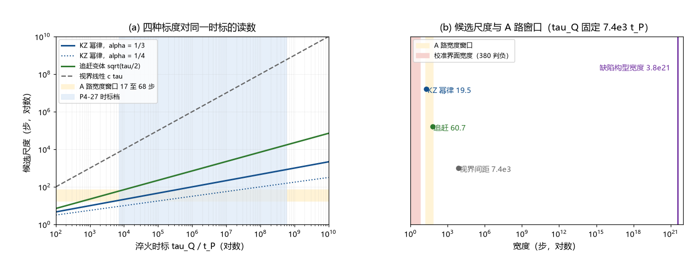

# 注记-KZ 适用性判定（第381条）：临界冻结不适用、注入-接缝机制与畴尺度候选

- **日期**：2026-09-24 03:41:13
- **类型**：判定轮（A 路宽度来源的门控判定）
- **脚本**：`验证脚本/minimal_verification_kz_applicability.py`（第 381 条）
- **图**：见 §3 图 1（`images/kz_applicability.png`）
- **依据**：[[从混沌到兴盛：大爆炸作为天行力校准的相变]]（零动力不动点与种子注入）；[[束缚振荡动力学的物侧闭合：完美弹性定理、交错基态与校准通道]] §三（交错无吸引性、反相由创生规则写入）；[[粒子与时空的同生：凝固波前的缺陷形成机制]] §3.3（接缝必然性、Kibble 因果论证）；[[验证脚本/注记-A 路宽度来源三路审查（第380条）：校准扩散与势曲率判负、KZ 冻结活口与淬火时标窗口]]（A 路窗口与校准上界）；[[内部草稿/注记-Kibble机制：标准内容、体系内对接与适用性审查]]（Zurek 前提清单与本判定的对照）
- **状态**：判定完成。标准 KZ 临界冻结不适用；机制换轨为注入-接缝；畴尺度候选给出读数，其物理身份待下一轮

## 1 判据与设定

第 380 条把 A 路的活口压到「KZ 冻结关联」，并移交两件输入（KZ 指数与淬火时标）。本轮先做门控：KZ 的临界冻结机制在本体系的相变图像里是否适用。判据 V1 至 V4：V1 清点 KZ 的三条前提（材料判定）；V2 对照体系的实际相变机制；V3 重算候选畴尺度（含本轮构造的一个变体）；V4 把候选与 A 路窗口对照。

## 2 结果

V1（前提清点）：三条前提全不成立。其一，连续相变的临界点：零动力不动点定理给出原点处所有项系数为零，物侧动力学完全静止，离开原点唯一机制是种子注入（《从混沌到兴盛》§1.3、§2.1），这与扫过临界点的图像不符。其二，临界减速：原点给出的是完全静止，比「弛豫时间幂律发散」更强也更异类；校准通道的线性化谱 $\kappa k^2$ 无任何临界谱结构。其三，无序态被吸引到有序：交错基态无吸引性（数值判定：一般初值 180 次碰撞对相锁值 120 次，末段仍带同向畴），反相由创生规则写入、由校准维持。

V2（机制对照）：体系的实际机制是种子注入 + 多核独立成核 + 波前以 $c$ 扩张 + 相遇接缝凝固（《粒子与时空的同生》§3.3，多核成案 2026-09-08）。分层：Kibble 因果论证适用（体系定案）；Zurek 淬火标度律的标准形式不适用。由此浮出一个概念区分：上述机制给出的是接缝间距（畴尺度），A 路的 $w$ 是波前过渡区宽度（前沿扫过交叉区的时间）。在标准 KZ 里两者同为一尺度 $\xi_{\rm freeze}$，在无临界减速的体系里分离，这一分离是本轮的核心读数。

V3（候选畴尺度重算）：三个候选对同一 $\tau_Q = 7.38\times10^3\,t_P$ 给出 19.47 步（KZ 幂律，$\alpha = 1/3$）、60.76 步（追赶变体 $L = \sqrt{\tau_Q/(2t_P)}$，本轮构造，假设 $\kappa$ 从 0 线性增长）、$7.38\times10^3$ 步（视界线性 $c\tau_Q$，Kibble 间距读出），跨度 379 倍。A 路窗口的反解：$\tau_Q$ 需求分别为 $[4.90\times10^3, 3.13\times10^5]$、$[577, 9230]$、$[17.0, 67.9]\,t_P$。

V4（窗口对照）：校准界面宽度 $\le 6.28$ 步（第 380 条判负）落在窗口外；KZ 幂律（19.5 步）居窗口内、贴近下端；追赶变体（60.8 步）在窗口内；视界间距（$7.4\times10^3$ 步）超窗口两个数量级；缺陷构型宽度 $3.80\times10^{21}\,l_P$ 对应 $\Delta = 6.685\times10^{-11}\,E_P = 8.16\times10^{17}$ eV，远离窗口。

## 3 图

## 4 结论与判句移交

标准 KZ 临界冻结判不适用，三条前提无一成立。体系的相变图像（注入-接缝）把「尺度」拆成两件：接缝间距（畴尺度）与波前过渡宽度。第 380 条的活口因此需要换轨：若 A 路继续存活，其 $w$ 必须对应畴尺度；过渡宽度一侧已被第 380 条封死（$\le 2\pi$ 步）。

窗口读数：在 $\tau_Q = 7.38\times10^3\,t_P$（P4-27 下端）处，KZ 幂律给 19.5 步（窗口内贴近下端），追赶变体给 60.8 步（窗口内），两者都落在计数式的可行侧。

判句移交：下一轮判定 LZ 的 $t_{\rm sweep}$ 的物理身份，即它是波前过渡区宽度（则宽度封死、A 路出局）还是畴尺度（则 A 路沿畴标度存活）。判别依据：A 路要求 $w \ge 17$ 步，而过渡宽度上界为 6.28 步，两个读法在数值上已分开。

## 5 严格程度与边界声明

严格程度：V1、V2 为材料判定（清点既有定理与读数，判据级）；V3 的 KZ 幂律与视界线性为引用，追赶变体为本轮构造的最小变体（模型设定级，假设 $\kappa$ 线性淬火与模式衰减判据）；V4 为算术对照。

边界：不重算第 380 条；不建立相变模型；追赶变体的假设（$\kappa$ 从 0 线性增长）需物理审查（κ 在相变前是否为零）；缺陷构型宽度与波前宽度的对应关系未建立，只作对照；《粒子与时空的同生》与《有质量粒子的形成》中对 Zurek 机制的引用需要附记，建议登记后由作者裁决。

## 6 过程记录

触发：第 380 条把 A 路活口压到 KZ 冻结后，本线按计划先做门控判定。侦察中发现三条反证（零动力不动点、交错无吸引性、写入型有序化）均已在体系材料中定案，判定不依赖新计算。副产品两条：其一，「间距与宽度分离」的概念区分；其二，追赶变体（本轮构造）给出 60.8 步的读数，需物理审查后再用。附带核对：并行线的 [[内部草稿/注记-Kibble机制：标准内容、体系内对接与适用性审查]] 把 Zurek 前提列为三条并判两条未交代，本判定对其中两条给出结论（不成立），两材料互补。
