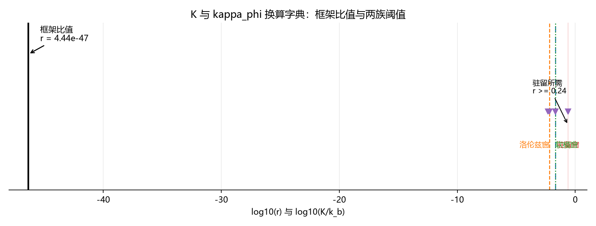

# 注记-K 与 kappa_phi 换算字典（第 482 条）：481 恒等的 O(1) 对齐、单比值判负与驻留目标值

## 元数据

- **日期**：2026-09-29 06:05:58
- **脚本**：验证脚本/kappa_dictionary.py
- **判据**：字典判据 KD1 至 KD4（4/4 通过）
- **可逆性等级**：判据稳健。四条判据全部由定稿值表与记录读数直接给出，不依赖采样、截断或档位枚举；换实现、换口径均不翻结论，唯一的口径敏感性（$2\pi$ 因子）已单独量化。
- **类型**：换算字典与最小验证注记
- **关联**：[[验证脚本/注记-锚核身份C2的钉扎机制归属（第481条）：共相位缺陷对锁定失明、单通道缺陷与基底势等价|第481条]]（恒等 $K_{\text{FK}} = 2\kappa_\phi$ 的出处）；[[内部草稿/总结报告-量纲桥收束：从缺口定位到定稿值（MB-1至MB-9与两次裁决）]]（定稿值表与第六节其三的层级问题）；[[验证脚本/注记-K值档位债的口径对照（第479条）：定稿值与模型窗口的四十五个数量级缺口|第479条]]（缺口的第一轮读数）；[[理论攻坚/电子场攻坚计划：复合位错算符的构造与螺旋序真空裁决]]（阶段 0 第二半）
- **图**：见第三节 图 1

---

## 一、要判什么

第 481 条给出单通道缺陷的恒等 $K_{\text{FK}} = 2\kappa_\phi$。本条把这个恒等与量纲桥收束报告的定稿值表对齐，写出 K 与 $\kappa_\phi$ 的换算字典，再把 C1、D 两线测得的阈值换算到框架约定下，判定 $\kappa_\phi$ 落在阈值的哪一侧。

判据四条：KD1 对齐 481 恒等与定稿势系数；KD2 定出框架提供的比值；KD3 完成阈值换算并给出缺口；KD4 给出判定与驻留所需的目标值。

## 二、字典的输入与设定

定稿值表（量纲桥收束报告第五节）：桥因子 $\epsilon = 1$；势系数 $K = 3\kappa_\phi t_P = 2.788142\times10^{-46}$；异类耦合 $\kappa_\phi t_P = 9.293805\times10^{-47}$；键刚度 $k_b$（$u$ 场）$= 2\pi = 6.283185$；惯性 $m_\Phi = 2\pi$。

阈值取 C1、D 两线记录。两线均取 $k_b = 1$ 归一，故其 $K$ 读数即比值 $K/k_b$：驻留阈值 $K_c = 0.24$ 至 $0.25$；全塌缩档 $0.02$；FK 落窗 $0.02$；洛伦兹落窗 $0.00633$；软模落窗 $1/48$；D 线读数档 $0.005$。

确定性，纯算术。

## 三、判据与结果

**判据 KD1（481 恒等与定稿势系数的对齐）**。定稿势系数除以 $2\kappa_\phi t_P$ 得 $1.500000$，与解析恒等 $3\kappa_\phi t_P/(2\kappa_\phi t_P) = 1.5\,t_P$ 一致（$t_P = 1$ 约定下为 1.5）。属 $O(1)$ 口径项。

**判据 KD2（框架提供的比值）**。直接比 $r = 2.788142\times10^{-46}$；归一后 $r = 4.437466\times10^{-47}$；两口径差 $0.798180$ 个数量级。

**判据 KD3（阈值换算与缺口）**。

| 阈值 | 读数 | 缺口（直接） | 缺口（归一） | 方向 |
| --- | --- | --- | --- | --- |
| 驻留阈值下沿 | $0.24$ | $44.93$ | $45.73$ | 向上 |
| 驻留阈值上沿 | $0.25$ | $44.95$ | $45.75$ | 向上 |
| 全塌缩档 | $0.02$ | $43.86$ | $44.65$ | 向下 |
| FK 落窗 | $0.02$ | $43.86$ | $44.65$ | 向下 |
| 洛伦兹落窗 | $0.00633$ | $43.36$ | $44.15$ | 向下 |
| 软模落窗 | $0.0208333$ | $43.87$ | $44.67$ | 向下 |
| D 线读数档 | $0.005$ | $43.25$ | $44.05$ | 向下 |

缺口范围 $43.25$ 至 $45.75$ 个数量级（单位为数量级）。驻留阈值为半直线 $r \ge K_c$，落窗为半直线 $r \le K_{\lim}$。

**判据 KD4（判定与目标值）**。软模关联长度 $\xi = 1/(2\pi\sqrt r) = 2.3892\times10^{22}$ 格，落窗条件以离域方式满足；驻留条件 $r \ge 0.24$ 不满足。使驻留成立所需的异类耦合为

$$\kappa_\phi t_P \ge \frac{0.24\,k_b}{3} = 5.026548\times10^{-1},$$

而现定稿值为 $9.293805\times10^{-47}$，所需倍率 $5.4085\times10^{45}$，即 $45.73$ 个数量级。判定为判负。

### 图 1

图注按脚本绘图面板逐条核对撰写。本注记作者未能对图像作目视复核（环境不支持显示），图注描述的是绘图段显式绘制的元素：黑色粗实线为框架比值 $\log_{10}4.437466\times10^{-47}$，红色带为驻留窗口 $0.24$ 至 $0.25$，蓝色点划线为 $0.02$，橙色虚线为 $0.00633$，绿色点线为 $1/48$；紫色三角标出各阈值读数；两处箭头标注分别为框架比值与驻留所需值 $r \ge 0.24$；纵轴刻度关闭。

## 四、解读

**其一，字典第一步成立。** 第 481 条的恒等 $K_{\text{FK}} = 2\kappa_\phi$ 与定稿势系数 $3\kappa_\phi t_P$ 相差因子 $1.5\,t_P$，属 $O(1)$ 口径项。两处同源，不构成彼此独立的猜测。这一点排除了「481 的识别与定稿值表各说各话」的可能。

**其二，定稿值表对两层结构欠定。** 框架的定稿值表只给出一组（势系数, 键刚度），故只提供一个比值。而复合位错模型的两层分工要求锚核与包层各有一个独立比值：锚核的驻留要大的 $K$，包层的宽度要小的 $K$，两个窗口在数值上互斥。定稿值表未给出第二个刚度。这是本条的附带发现，与第 479 条的缺口同源。

**其三，判定为判负。** 已有的唯一比值落在驻留阈值以下 $45.73$ 个数量级。单相位 FK 归约下，锚核不驻留，缺陷离域。

**其四，目标值是 $O(1)$ 量级，这是关键线索。** 驻留所需的 $\kappa_\phi t_P$ 为 $5.0265\times10^{-1}$。格点模型的钉扎阈值在自然单位下通常取 $O(1)$ 值，故「所需的量级」符合预期；而推导出的值是 $10^{-47}$。要求 $O(1)$ 而给出 $10^{-47}$，这个错位更像归一化环节的问题，而非一条物理事实。

**其五，本节与一条已登记的层级问题接上。** 量纲桥收束报告第六节其三已把「异类耦合的强弱来源（$10^{-47}$ 为何如此小）」登记为层级问题，机制未给。本条的判定把这个已登记的层级问题与锚核钉扎失败连成同一件事：那个尚未解释的极小，正是取消钉扎的那一件事。两条独立的困难合流为一条。

## 五、严格程度声明

**严格**：$3\kappa_\phi t_P/(2\kappa_\phi t_P) = 1.5\,t_P$（解析恒等）；两口径之差 $\log_{10}2\pi$（解析恒等）；缺口的数量级。

**条件性**：把 C1、D 两线的阈值读数与框架的势系数视为同一物理量的两个归一化表达这一前提。该前提正是第 479 条判定其存疑之处。

**纲领**：把错位归因于归一化环节；层级问题与钉扎失败的合流。

## 六、边界声明

**验证什么**：481 恒等与定稿势系数的对齐；框架提供的比值；阈值换算后的缺口；驻留所需的目标值。

**不验证什么**：其一，不判定 $10^{-47}$ 是否为推导错误，该判定需要重走 MB-1 至 MB-9 的归一化链条。其二，不提供第二个刚度（包层比值），该项需要独立的模型或裁决。其三，不判定式别（共相位型与单通道型）的取舍，该项属第 481 条的后续。其四，不判定质量谱数值（属 P1-2）。本注记不改动 理论总纲 基准。

## 七、登记衔接

落点：电子场攻坚计划阶段 0 第二半（C2 后续的字典项）；[[内部草稿/开放问题总览：元相子理论待解决问题清单]] P1-11 挂一条关联；量纲桥收束报告第六节其三的层级问题与本条的合流须在该项登记中体现。下一项若继续，入口为重走 MB-1 至 MB-9 的归一化链条以判定 $10^{-47}$ 的来源。

## 修订记录

- **2026-09-29 首次执行**（字典判据 KD1 至 KD4 共 4/4 通过）
    - KD1：481 恒等与定稿势系数相差因子 $1.5\,t_P$，$O(1)$ 可对齐
    - KD2：框架唯一比值 $r = 4.437466\times10^{-47}$（归一口径）
    - KD3：缺口 $43.25$ 至 $45.75$ 个数量级
    - KD4：判负；驻留所需 $\kappa_\phi t_P \ge 5.026548\times10^{-1}$，倍率 $5.41\times10^{45}$
    - 附带发现两条：定稿值表对两层结构欠定（只提供一个比值）；目标值为 $O(1)$ 量级而推导值为 $10^{-47}$，错位指向归一化环节
    - 与已登记的层级问题（$10^{-47}$ 为何如此小）合流
