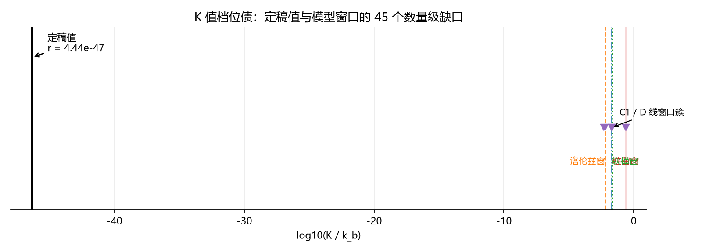

# 注记-K 值档位债的口径对照（第 479 条）：定稿值与模型窗口的四十五个数量级缺口

## 元数据

- **日期**：2026-09-29 05:22:26
- **脚本**：验证脚本/minimal_verification_k_scale_debt.py
- **判据**：K1 至 K3（3/3 通过）
- **可逆性等级**：判据稳健（缺口由两个定稿数与一组记录读数直接给出，不依赖采样、截断或档位枚举；换实现、换口径均不翻结论，口径间散布已单独量化）
- **类型**：口径对照与最小验证注记
- **关联**：[[内部草稿/总结报告-量纲桥收束：从缺口定位到定稿值（MB-1至MB-9与两次裁决）]]（定稿值表与第六节其二）；[[理论攻坚/三维复合位错攻坚计划：形态、驻留与宽度窗口]]（C1 窗口读数）；[[缺陷动力学：孤子的质量、迁移率与最小量子化]]（D 线读数档与遗留二）；[[理论攻坚/电子场攻坚计划：复合位错算符的构造与螺旋序真空裁决]]（阶段 0 与裁决点 D-d）
- **图**：见第三节 图 1

---

## 一、要判什么

体系定稿的势系数（格点内异类耦合）为

$$K_{\text{sys}} = 3\kappa_\phi t_P = 2.788142\times10^{-46},$$

取自量纲桥收束报告第五节定稿值表。而三维复合位错线（C1）与缺陷动力学线（D）的全部判据窗口都落在 $10^{-3}$ 至 $10^{-1}$ 档：驻留阈值 $K_c = 0.24$ 至 $0.25$、全塌缩档 $K = 0.02$、FK 落窗 $K/k \le 0.02$、洛伦兹落窗 $K \le 0.00633$、软模落窗 $K \le 1/48$、D 线读数档 $K = 0.005$。

量纲桥收束报告第六节其二把这一差距定性为 $O(1)$ 口径涟漪：C1 各轮取 $k_b = 1$ 归一，公理给 $k_b = 2\pi$（$u$ 场），故四窗口的 $K$ 轴随之平移，需要在跨线引用处补换算表。该条目列为残余与开放项。

本注记判定这一解释是否成立，即 $O(1)$ 因子能否弥合该差距。

## 二、模型设定与输入

物理内容由无量纲比值 $r = K/k_b$ 承载。FK 型泛函

$$E = \sum_n\left[\frac{k_b}{2}(\phi_{n+1}-\phi_n)^2 + K(1-\cos\phi_n)\right]$$

的孤子宽度与钉扎阈值都只依赖该比值，故 $K$ 轴的口径问题等价于 $r$ 轴的口径问题。

输入三项，全部取自定稿值表与 C1/D 线记录：$K_{\text{sys}} = 2.788142\times10^{-46}$；异类耦合 $\kappa_\phi t_P = 9.293805\times10^{-47}$；公理刚度 $k_b = 2\pi = 6.283185$（C1 与 D 两线所用归一为 $k_b = 1$）。

冒烟检查：$3\kappa_\phi t_P$ 与定稿 $K_{\text{sys}}$ 的相对偏差 $1.793\times10^{-7}$，两个定稿数自洽。

两套口径按比值定义。口径甲把定稿势系数与模型读数当作同一量直接比。口径乙把模型读数当作比值 $r$，把定稿值按公理刚度换算为 $r$ 后再比。两口径的差别是一个 $2\pi$ 因子。

## 三、判据与结果

**判据 K1（定稿比值）**。口径甲 $r = 2.788142\times10^{-46}$，口径乙 $r = 4.437466\times10^{-47}$，两口径之差 $0.798180$ 个数量级，即 $\log_{10}2\pi$。

**判据 K2（逐窗口缺口）**。

| 窗口 | $K$ 读数 | 缺口（口径甲） | 缺口（口径乙） | 来源 |
| --- | --- | --- | --- | --- |
| 驻留阈值下沿 | $0.24$ | $44.93$ | $45.73$ | C1-4 第一轮 |
| 驻留阈值上沿 | $0.25$ | $44.95$ | $45.75$ | C1-4 第一轮 |
| 全塌缩档 | $0.02$ | $43.86$ | $44.65$ | C1-2 |
| FK 落窗 | $0.02$ | $43.86$ | $44.65$ | C1-5 |
| 洛伦兹落窗 | $0.00633$ | $43.36$ | $44.15$ | C1-5 |
| 软模落窗 | $1/48$ | $43.87$ | $44.67$ | C1-6 W4 轮 |
| D 线读数档 | $0.005$ | $43.25$ | $44.05$ | 缺陷动力学 |

缺口范围 $43.25$ 至 $45.75$ 个数量级，单位为数量级（$\log_{10}$）。方向分两类：驻留窗为半直线 $K \ge K_c$，定稿值在其下侧，判不满足；落窗为半直线 $K \le K_{\lim}$，定稿值在其下侧，判满足。

口径间散布 $0.798180$ 个数量级（每窗口的乙减甲），窗口间极差 $2.497150$ 个数量级。

**判据 K3（涟漪能否弥合）**。涟漪幅度 $0.798180$ 个数量级，最小缺口 $43.253655$ 个数量级，比值 $54.190$。判定为不能弥合。

**附读数**。极小比值下软模关联长度 $\xi = 1/(2\pi\sqrt{r}) = 2.3892\times10^{22}$ 格。落窗条件 $\xi \ge 2$ 以离域方式满足；驻留条件 $r \ge 0.24$ 不满足。

### 图 1

图注按脚本绘图面板逐条核对撰写。本注记作者未能对图像作目视复核（环境不支持显示），图注描述的是脚本绘图段显式绘制的元素：$x$ 轴为 $\log_{10}(K/k_b)$，定稿值取口径乙即 $\log_{10}4.437466\times10^{-47} = -46.353$；四组窗口元素由 axvspan 与 axvline 绘制于 $\log_{10}0.24$、$\log_{10}0.00633$、$\log_{10}(1/48)$、$\log_{10}0.02$；窗口读数另以三角标记置于 $y = 0.75$；文字标注三处；纵轴刻度关闭。

## 四、读数解读

三条判据全过，结论是否证性的：**排除「档位债是纯 O(1) 归一化口径问题」这一解释。**

推理是直接的。若两端的差异只是 $k_b$ 归一不同，则差异幅度不超过一个 $2\pi$ 因子，即 $0.798$ 个数量级。实测缺口 $43.25$ 至 $45.75$ 个数量级，是最小涟漪幅度的 $54$ 倍。改换口径（甲换乙）只让缺口移动 $0.798$ 个数量级，相对缺口本身可忽略。

需要分层报告的后果。**物理层**：若 C1 与 D 两线的窗口读数与定稿 $K$ 是同一物理量，则定稿值落在驻留窗以下约 $45$ 个数量级，且已在 D 线的全塌缩档之下，位错不可能驻留，复合位错粒子作为局域对象在定稿值下不成立。**协议层**：本脚本不判定这一条件的成立与否，见下节边界声明。

## 五、严格程度声明

**严格**：$3\kappa_\phi t_P$ 与定稿 $K_{\text{sys}}$ 的自洽性（相对偏差 $1.793\times10^{-7}$）；两口径之差恰为 $\log_{10}2\pi$（解析恒等式）；缺口的数量级。

**条件性**：把 C1 与 D 两线的窗口读数与定稿 $K$ 视为同一物理量这一前提。该前提未经独立验证，本脚本的否证性结论只在该前提成立时有物理含义。

**纲领**：缺口成因的三种候选（见边界声明）的取舍。

## 六、边界声明

**验证什么**：定稿势系数与 C1、D 两线窗口读数之间的数值缺口；该缺口是否可由 $O(1)$ 归一化因子解释；缺口在两套 $k_b$ 口径下的稳定性。

**不验证什么**：其一，不判定定稿 $K_{\text{sys}}$ 是否正确；其二，不判定 C1 与 D 两线的窗口读数能否外推到极小刚度极限，模型在 $r \to 0$ 时的定性行为不在本脚本射程内；其三，不判定缺口的成因。成因有三种候选，本脚本不能区分：定稿 $K$ 与模型 $K$ 是不同量而换算表尚未写出；定稿值本身有误；模型窗口的适用域不含极小刚度极限，窗口读数不可外推。

本注记不修改 理论总纲 目录下的基准文件，不改动 C1、D 两线与量纲桥线的任何既有读数。

## 七、登记衔接

本注记判定电子场攻坚计划阶段 0 不能以不等式闭合。建议登记三项：其一，电子场攻坚计划阶段 0 状态更新为「口径对照完成，缺口确认，需换算表或定稿修正」；其二，裁决点 D-d 的输入补齐一半（位错在定稿值下不驻留这一情形已成立，以其前提成立为限）；其三，开放问题总览 P1-11（锚核锁定动力学方程）与 P1-4（同步相变缺陷密度的定量）各挂一条关联，指向本条与量纲桥收束报告第六节其二。

## 修订记录

- **2026-09-29 首次执行**（判据 K1 至 K3 全过）
    - 定稿比值 $r = 4.437466\times10^{-47}$，两口径差 $0.798180$ 个数量级
    - 缺口 $43.25$ 至 $45.75$ 个数量级，口径间散布 $0.798180$，窗口间极差 $2.497150$
    - 涟漪与最小缺口之比 $54.190$，判定不能弥合
    - 过程记录：首轮实现把两套口径写成同一比值（$k_b$ 被约去，两列恒等），复检发现后改为「直接比」与「换算为比值后比」，修正后两口径差恰为 $\log_{10}2\pi$；另修正口径散布误取全窗口极差一处；图像中文字形缺失一处，已改用系统 CJK 字体
