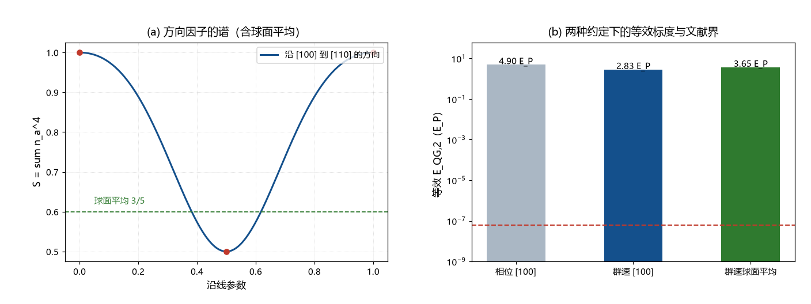

# 注记-LIV 约定线（第373条）：相位与群速度的因子、球面平均与 SME 记号对应

- **日期**：2026-09-24 03:09:59
- **类型**：判据执行轮（色散论文 §10 遗留之「与 SME 系数变换律的映射」的可得部分）
- **脚本**：`验证脚本/liv_conventions.py`（第 373 条）
- **图**：见 §2 图 1（`images/liv_conventions.png`）
- **依据**：[[元相子振荡晶格的色散关系：低能光速涌现与洛伦兹破坏首阶项]]；[[验证脚本/注记-SME 对接（第370条）：d=6 立方系数的等效归一、boost 量级与三通道对照]]；arXiv:2402.06009（LHAASO 二次界）
- **状态**：完成。因子与球面平均两项修正已同步至第 370 条、README、总览与辩论两稿

## 1 任务与判据

四项。N1：澄清相位速度与群速度的偏离关系（时延比较要用哪一个）。N2：给出方向因子的球面平均与立方谐波分解，说明文献里按各向同性给出的界对的是哪一支。N3：给出 SME 记号下的对应结构（张量、收缩、两种参数化）。N4：按修正后的约定重算时延与对界余量。

## 2 结果：因子 3

格点色散写为 $\omega = k[1 - (S/24)(k/E_P)^2]$，$S = \sum_a n_a^4$。相位速度偏离为 $(S/24)(E/E_P)^2$；群速度偏离为它的 $3$ 倍，即 $(S/8)(E/E_P)^2$。时延比较（伽马暴计时）用的是群速度，故第 370 条的延迟表按因子 $3$ 修正。

| 方向 | $S$ | 等效 $E_{QG,2}$（相位） | 等效 $E_{QG,2}$（群速度） |
| --- | --- | --- | --- |
| $[100]$ | $1$ | $4.899\,E_P$ | $2.828\,E_P$ |
| $[110]$ | $0.5$ | $6.928\,E_P$ | $4.000\,E_P$ |
| $[111]$ | $1/3$ | $8.485\,E_P$ | $4.899\,E_P$ |
| 球面平均 | $0.6$ | $6.325\,E_P$ | $3.651\,E_P$ |

## 3 球面平均与立方谐波

$\sum_a n_a^4$ 的球面平均为 $3/5$；偏离为立方谐波，最大偏离量 $+66.7\%$（$[100]$）与 $-44.4\%$（$[111]$）。文献中按各向同性给出的界，对的是平均值那一支；逐方向比较时应注明方向，或将本框架的方向因子乘上相应的界。

> **2026-10-18 更正（判据第 679 号）**：本节时延读数整体偏大 $100$ 倍，根因同第 370 号（$640$ Mpc 的光行时误写为 $6.59\times10^{16}$ s，应为 $6.59\times10^{14}$ s）。修正值：$13$ TeV 为 $9.3\times10^{-17}$ 秒（$[100]$）、$1$ Gpc 上 $10^{20}$ eV 为 $8.6\times10^{-3}$ 秒。因子 $3$、球面平均 $3/5$、方向比 $6:3:2$ 与对界余量（$7.7$ 至 $7.9$ 个数量级）均不受影响。见 [[验证脚本/注记-高能段洛伦兹破坏的实验对照补齐与延迟表的百倍偏差（判据第679号）|第 679 号]]。

## 4 修正后的时延与余量

群速度口径、距离 $640$ Mpc：$13$ TeV 为 $9.3\times10^{-17}$ 秒（$[100]$）、$4.7\times10^{-17}$（$[110]$）、$3.1\times10^{-17}$（$[111]$）；$10^{20}$ eV 为 $5.5\times10^{-3}$、$2.8\times10^{-3}$、$1.8\times10^{-3}$ 秒；$1$ Gpc 上为 $8.6\times10^{-3}$、$4.3\times10^{-3}$、$2.9\times10^{-3}$ 秒（2026-10-18 更正：原值偏大 $100$ 倍，见本节上方更正注）。与 LHAASO 二次界 $6\times10^{-8}E_{Pl}$ 相比，余量为 $4.7\times10^7$ 倍（群速度 $[100]$）至 $8.2\times10^7$ 倍（相位 $[100]$），即 $7.7$ 至 $7.9$ 个数量级。

## 5 SME 记号的对应结构

框架侧：纯空间四阶张量 $T^{abcd} = \sum_e (e_e)^a(e_e)^b(e_e)^c(e_e)^d$，收缩 $S = T^{abcd}n_a n_b n_c n_d$。对应的有效场论形态是 $d = 6$（四阶动量）偶宇称算符，其色散修正为 $\delta\omega/\omega = -(1/24)(E/E_P)^2 S$；两个通行的参数化分别是相位口径 $E_{QG,2} = E_P\sqrt{24/S}$ 与时延口径 $E_{QG,2} = E_P\sqrt{8/S}$。观测者 boost 下的分量结构（三类分量与 $O(\beta)$ 混合项）见第 370 条 §5。

余项：与 SME 系数 $k_F^{(6)}$ 的逐条命名表（同一张量在 SME 指标结构下的显式分量清单）仍待写出；该表属命名与对照工作，不改变本注记与第 370 条的任何读数。

## 6 结论与登记

§10 遗留「与 SME 系数变换律的映射」的可得部分由此闭合：张量结构、归一（两种约定）、球面平均、boost 变换与文献界对照五项齐备；仅余逐条命名表。修正项（因子 $3$ 与球面平均）已同步第 370 条、README 第 370 条、开放问题总览与辩论两稿。

## 7 严格程度与边界声明

严格程度：因子关系、球面平均与等效标度为算术（判据级）；SME 对应为结构对应（判据级）；逐条命名表未写（形式化待办）。边界：不改动色散论文正文；文献界沿用第 370 条已核到摘要级的数值（arXiv:2402.06009）。

## 8 过程记录

触发：执行「最优下一步」时，先做 SME 记号对应的准备工作，过程中发现第 370 条把相位偏离直接当成了时延口径。核对确认群速度偏离为其 $3$ 倍（$\omega = k - (S/24)k^3$，$v_g = 1 - (S/8)k^2$），遂一并修正五处引用。教训：涉及 LIV 的任何数值比较，先写明相位口径还是群速度口径。
