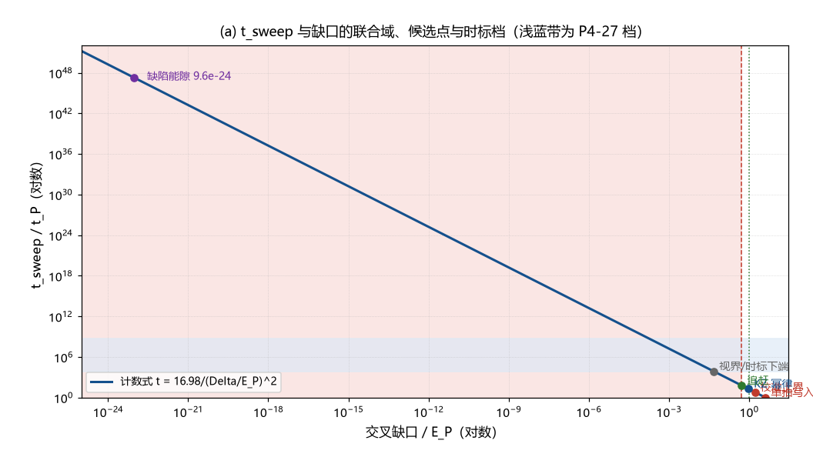

# 注记-LZ 的 t_sweep 物理身份判定（第382条）：缺口硬约束、快过程排除与缺口归约

- **日期**：2026-09-24 03:49:26
- **类型**：判定轮（A 路活口的分岔判定）
- **脚本**：`验证脚本/minimal_verification_tsweep_identity.py`（第 382 条）
- **图**：见 §3 图 1（`images/tsweep_identity.png`）
- **依据**：[[验证脚本/注记-A 路判句（第361条）：缺口与扫速的计数形式]]（计数式 16.98）；[[验证脚本/注记-A 路宽度来源三路审查（第380条）：校准扩散与势曲率判负、KZ 冻结活口与淬火时标窗口]]；[[验证脚本/注记-KZ 适用性判定（第381条）：临界冻结不适用、注入-接缝机制与畴尺度候选]]；[[内部草稿/注记-Kibble机制：标准内容、体系内对接与适用性审查]]（Kibble/Zurek 前提清单）；[[内部草稿/从混沌到兴盛：大爆炸作为天行力校准的相变]]（零动力不动点）
- **状态**：判定完成。缺口硬约束与快过程排除成立；t_sweep 数值归于「相变时空结构」缺口

## 1 判据与设定

第 381 条把 A 路的活口压到「t_sweep 的物理身份」。本轮判定四件事：T1 t_sweep 与缺口 $\Delta$ 的联合域及 t_sweep 下限；T2 两个快过程候选的排除；T3「$\Delta$ = 缺陷能隙」读法的排除；T4 候选清单与相变时标档的对照。输入为计数式 $t_{\rm sweep} = 16.98/(\Delta/E_P)^2$（$t_P$ 单位）与体系登记常数，全部为确定性算术。

## 2 结果

T1（联合域与下限）：计数式把两个未知量绑成一条曲线。$\Delta$ 的紫外截断给 t_sweep 下限：$\Delta = E_P$ 给 $t_{\rm sweep} \ge 17.0\,t_P$，$\Delta = E_P/2$ 给 $\ge 67.9\,t_P$。A 路要求凝固/锁定过程跨 $17$ 至 $68$ 拍以上。

T2（快过程排除）：$t_{\rm sweep} = 1\,t_P$（单拍写入）需 $\Delta = 4.121\,E_P$（超截断 $312\%$）；$t_{\rm sweep} = 2\pi\,t_P$（校准上界对应档）需 $\Delta = 1.644\,E_P$（超截断 $64.4\%$）。两个快过程档均超截断，排除。

T3（缺陷能隙读法的排除）：若 $\Delta$ 取缺陷的锁定能隙 $\sqrt{\kappa_\phi t_P} = 9.6404\times10^{-24}\,E_P$，计数式要求 $t_{\rm sweep} = 1.8272\times10^{47}\,t_P$（$9851$ 秒，$2.74$ 小时），比 P4-27 上界档大 $38.5$ 个数量级、比 W1 档大 $11.4$ 个数量级。所需时标远超全部登记档，排除。

T4（候选清单）：七个候选的配对读数：单拍写入 $(1, 4.121)$、校准上界 $(6.28, 1.644)$、KZ 幂律 $(19.47, 0.934)$、追赶 $(60.76, 0.529)$、视界间距 $(7.38\times10^3, 0.0480)$、相变时标上端 $(5.87\times10^8, 1.70\times10^{-4})$、缺陷固有时间 $(1.83\times10^{47}, 9.64\times10^{-24})$（前项为 $t_P$，后项为 $E_P$）。主群候选在窗口与截断内；视界与时标档在截断内但超窗口；三个档被排除。

## 3 图

## 4 结论与判句移交

结构性论证（前提）：$S$ 的物理归宿是 $\kappa_\phi$（锚核刚度，第 359、360 条），故 A 路的 LZ 描述缺陷核的激发与形成，$t_{\rm sweep}$ 是凝固与锁定过程的时标。

硬结果一（下限）：$t_{\rm sweep} \ge 17.0$ 至 $67.9\,t_P$；单拍写入（$1\,t_P$）与校准上界档（$2\pi\,t_P$）被排除。

硬结果二（缺口的身份）：$\Delta$ 不能是缺陷能隙（$\sqrt{\kappa_\phi t_P} = 9.64\times10^{-24}\,E_P$），否则所需 t_sweep 达 $1.83\times10^{47}\,t_P$，超全部登记档 $11$ 至 $39$ 个数量级。

硬结果三（剩余候选）：满足计数式且缺口在截断内的候选只剩慢过程族（KZ 幂律、追赶、视界与时标档），其共同前提是凝固持续时间显著大于校准固有时间。

归约：慢过程族的时标在体系里没有独立读数，它对应已登记的两个开放缺口之一：[[束缚振荡动力学的物侧闭合：完美弹性定理、交错基态与校准通道]] §八其一「感知-校正链的延迟结构（校准的时间实现细节）未建模」，或 [[粒子与时空的同生：凝固波前的缺陷形成机制]] §五「钉扎动力学与密度定量」。**A 路的最终存亡系于凝固与校准的时间实现，这也是入口份额 $f$（缺陷密度）所依赖的同一缺口。**

判句移交：下一轮给出凝固时间的最小动力学（候选一：校准链的多拍迭代；候选二：相位错配的弛豫；候选三：钉扎捕获时间），算其特征时标并判它是否 $\ge 17$ 至 $68$ 拍。若最小动力学给出一拍量级的凝固时间，A 路判负；若给出 $17$ 拍以上的自然时标，A 路存活并可定 $\Delta$。

## 5 严格程度与边界声明

严格程度：T1 至 T4 为算术（判据级）；缺口的紫外截断沿用纲领性推论（$\omega \le \omega_P/2$）；「$t_{\rm sweep}$ 是缺陷相关过程」为结构性论证（其依据为 $S$ 与 $\kappa_\phi$ 的绑定）。

边界：不重算第 380、381 条；不建立凝固动力学；缺陷能隙取 $\sqrt{\kappa_\phi t_P}$ 为量级口径；时标档的端点半定性以登记原文为准；本轮不判 A 路的最终生死（留给下一轮的最小动力学）。

## 6 过程记录

触发：第 381 条把活口压到 t_sweep 身份后开工。判定中发现两个快过程候选与一个缺陷能隙读法可被算术直接排除，剩余慢过程族与其时标缺口，归约结论是本轮的结构性产出。侦察附带核对：并行线的[[内部草稿/注记-Kibble机制：标准内容、体系内对接与适用性审查]]（2026-09-23）把 Zurek 前提列为三条并判两条未交代，本线第 381 条对其中两条给出结论（不成立），两材料互补。
