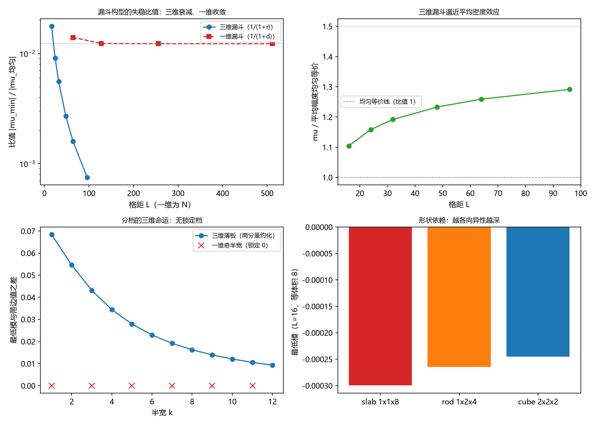

# 注记-M4-D1三维构型读数：耦合失稳的一维读数三维化（漏斗衰减、无锁定分档与平均密度主导）

- **日期**：2026-09-17 05:58:43
- **层级**：验证脚本/（理论验证材料，未确认）
- **脚本**：`验证脚本/m4d1_3d_config.py`（系统 Python 3.13 + numpy 2.4.1 + scipy 1.18.0 + matplotlib 3.11.0，确定性，固定初矢、无随机结果，运行约 60 秒）
- **定位**：M4 强场前置工具的 D1 交付（设计见 [[理论攻坚/黑洞线攻坚计划：坍缩机制重定位与强场终态]] §7.1）：把弱版方向一的一维读数推广到三维构型层，检验存在性门槛、真实构型失稳量级、奇偶分档的三维命运与形状依赖。判据 8 项全过。
- **关联**：[[验证脚本/注记-弱版方向一的最小验证：真实记录构型下的失稳量级与驻波门槛]]（一维基线）；[[验证脚本/注记-奇偶分档的精确形态：带边锁定、显式本征矢与非锁定的匹配条件]]（分档的一维精确形态）；[[内部草稿/总结报告-黑洞线阶段总结：先行批次收官与裁决点全景：2026-09-16]] §三（靶子清单）；开放问题总览 P1-34a
- **状态**：第一轮执行完成，判据 8 项全过。未提交作者裁决。
- **图**：`images/m4d1_3d_config.png`（四面板：漏斗比值对照、均匀等价逼近、分档的三维命运、形状依赖；见 §三 图 1）
- **修订记录**：
  - **2026-09-17 初版**（作者指示：正式执行 D1）
    - 模型定义、解析锚点与八项判据；探路阶段的构造错误与修正见过程记录

---

## 一、验证目标与判据

D1 的任务是把一维构型层的读数（最小失稳覆盖 $w^* = 3$、真实漏斗 $1.40\%$、奇偶分档）推广到三维，回答三件事：门槛是否仍存在、真实构型的失稳量级、分档与形状结构的三维命运。判据（先写期望，再算；编号与计划 §7.1 一致）：

D1-1a 解析锚点：均匀记录（$h$ 处处为 $1$）的三维最低模等于 $6 - \sqrt{37}$（$\le 10^{-10}$）。

D1-1b 约化锚点：薄板（记录只依赖一个坐标）的最低模等于两分量一维链（见 §二）的最低模（$\le 10^{-10}$）。

D1-2a 立方体符号门槛：边长 $1$ 的立方体最低模为正、边长 $2$ 为负；该符号在格距 $12$、$16$、$24$ 上保持。

D1-2b 柱体扫描（报告）：截面 $2\times2$ 与 $3\times3$、长度 $1$ 至 $6$ 的读数。

D1-3a 三维漏斗衰减：$h_n = h_0/(1+r_n)$（$r$ 为最小镜像欧氏距离）的失稳比值随格距单调下降（$16$ 至 $96$）。

D1-3b 平均密度主导：比值 $\mu_{\text{漏斗}}/\mu_{\text{均匀等价}}$ 落在 $1.0$ 至 $1.5$（全部格距），其中均匀等价取平均幅度 $h_0/(1+r)$ 的匀均值。

D1-3c 一维对照（报告）：一维同类漏斗的比值在 $N \ge 256$ 收敛（相邻档变化 $< 1\%$）；三维无此收敛。

D1-4 分档的三维命运：薄板族（半宽 $1$ 至 $12$）无一档锁定带边值（偏离 $> 10^{-6}$）。

D1-5 形状依赖（报告）：等调制体积 $8$ 下薄板、柱体、立方体的读数排序。

D1-6 尺寸稳定性：薄板读数在格距 $32$ 与 $64$ 间的相对变化 $< 1\%$；小形状读数呈 $1/V$ 标度（报告）。

## 二、模型设定

三维推广与一维同源：简单立方格点、周期边界、交错背景 $\theta_n = \pi(i+j+k)$，能量泛函

$$E = J\sum_{\langle nm\rangle}\cos(\theta_n - \theta_m) + \lambda\sum_n (1 - \cos\theta_n)\,h_n ,$$

取 $J = \lambda = 1$。（2026-09-19 裁决十七口径注：$J = \lambda = 1$ 属模型惯例口径，对应 $m_\delta = m_P$ 档，物理上不取；规范口径见 [[验证脚本/注记-M6-字典对账：归一化口径对齐、J 惯性反推与识别项的可推导边界]]。）在交错背景处展开，Hessian 为对角 $6 + (-1)^{i+j+k}h_n$、近邻 $-1$（度数为 $6$）。均匀记录的带边值为 $6 - \sqrt{37}$。

薄板约化：记录只依赖一个坐标时，横向动量把 $(0,0)$ 与 $(\pi,\pi)$ 配对，问题化为两分量一维链

$$(2-\mu)\varphi_i + \Delta\varphi_i + (-1)^i h_i \psi_i = 0,\qquad (10-\mu)\psi_i + \Delta\psi_i + (-1)^i h_i \varphi_i = 0 .$$

一维对照模型与弱版方向一同源：$H_{nn} = 2 + (-1)^n h_n$、近邻 $+1$。

## 三、结果

判据 8 项全过（运行约 60 秒）。要点如下。

其一，解析锚点逐位成立：$L = 32$ 的均匀最低模为 $-0.082762530298$，对 $6 - \sqrt{37}$ 的偏差低于 $10^{-12}$；薄板（半宽 $1$、$3$、$5$）对两分量约化的最大差 $1.3\times10^{-15}$。这同时说明三维代码与约化通路的正确性。

其二，立方体符号门槛存在且尺寸稳健：$\ell = 1$ 给 $+4.69\times10^{-4}$、$+1.97\times10^{-4}$、$+5.82\times10^{-5}$（格距 $12$、$16$、$24$），$\ell = 2$ 给 $-5.78\times10^{-4}$、$-2.45\times10^{-4}$、$-7.29\times10^{-5}$。单格调制使最低模**上升**（稳定化），两格以上成片调制使其下降，与一维的「单点不失稳、成片失稳」同型。

其三，柱体扫描（$L = 16$）：$2\times2$ 截面在全部长度（$1$ 至 $6$）上取负（$-1.41\times10^{-4}$ 至 $-6.96\times10^{-4}$）；$3\times3$ 截面在 $w = 1$ 处仅 $-3.0\times10^{-5}$，$w = 2$ 与 $w = 3$ 呈轻微非单调（$-5.24\times10^{-4}$ 对 $-4.95\times10^{-4}$），属奇数截面下平移奇偶对齐的残余效应，未单列判据。

其四，三维漏斗不收敛且随尺寸衰减：比值从 $L = 16$ 的 $1.7623\%$ 单调降到 $L = 96$ 的 $0.0750\%$；同批一维对照在 $N = 256$ 与 $512$ 间变化 $0.001\%$（收敛值 $1.2250\%$，$N = 64$ 的旧读数 $1.3980\%$ 为尺寸未收敛值）。

其五，三维漏斗逼近「平均密度效应」：比值 $\mu_{\text{漏斗}}/\mu_{\text{均匀等价}}$ 为 $1.104$、$1.159$、$1.192$、$1.233$、$1.259$、$1.291$（$L = 16$ 至 $96$），落在判据带 $1.0$ 至 $1.5$ 内并缓慢上行。即三维漏斗的失稳主要由平均调制幅度决定，轮廓结构只贡献 $10\%$ 至 $30\%$ 的增强。

其六，奇偶分档不进入三维：薄板族（半宽 $1$ 至 $12$）的最低模全部高于带边值，最小偏离 $9.29\times10^{-3}$，无一档锁定；一维奇半宽的精确锁定在三维没有对应物。这与两分量约化一致：横向动量配对已把薄板问题改造成另一个模型。

其七，形状依赖：等调制体积 $8$ 下，薄板 $1\times1\times8$ 给 $-2.99\times10^{-4}$，柱体 $1\times2\times4$ 给 $-2.65\times10^{-4}$，立方体 $2\times2\times2$ 给 $-2.45\times10^{-4}$。越各向异性的形状失稳越深，量级差约 $20\%$。

其八，尺寸行为：薄板读数在 $L = 32$ 与 $64$ 间变化 $0.849\%$（收敛）；立方体 $2^3$ 的读数满足 $\mu \times V$ 近常数（$-0.999$、$-1.003$、$-1.008$、$-1.010$，$L = 12$ 至 $32$），即局部构型的失稳随体积按 $1/V$ 消失。

## 四、解读

其一，维度差异的机制可作如下定性理解：一维链在带边的态密度发散，局部强调制足以把带边模式接住（奇半宽精确锁定、块族门槛有限且与尺寸无关）；三维立方格点在带边的态密度按 $\sqrt{E}$ 消失，局部调制无法钉住有限深度的束缚态，只留下随体积衰减的位移。

其二，由此三维耦合失稳的驱动量是平均调制密度，而非局部峰值：漏斗读数贴着「平均幅度处的均匀带边值」走（增强 $10\%$ 至 $30\%$），且平均幅度随尺寸下降（$\langle h\rangle \approx 2.2/L$），故读数按约 $1/L^2$ 衰减。小形状的 $\mu \times V$ 近常数是该机制的另一种表现。

其三，耦合路线的三维强度因此弱于按一维读数外推的预期：一维的 $1.40\%$（甚至收敛值 $1.23\%$）不能搬到三维；在热力学极限下，真实漏斗构型的耦合失稳量级趋于由平均密度给定的极小值。

其四，对判别点「破坏是否必待满偏」的意义：耦合路线的三维强度弱且对局部构型不敏感，倾向于让饱和路线（读满偏）在时间尺度竞争中占先，与 BH3-5 的饱和主导倾向方向一致。该判断仍属建议性质，最终判别留待 D2 与作者裁决。

## 五、严格程度声明

本材料只用线性谱判据（最低模）；模型为一维玩具模型的三维推广，$J = \lambda = 1$，无时间标定、无非线性饱和、无写入动力学。读数为模型内精确计算（解析锚点逐位核对），判据与容差先行登记；「存在性门槛」只在符号意义上稳定（单格为正、成片为负），量级随体积衰减。

## 六、诚实边界

其一，三维推广的模型选择（简单立方、交错背景、$\lambda$ 的实际值未定）不含真实场的泊松解与写入过程；结果不构成黑洞语境的可观测量。

其二，笛卡尔格点具有方向性，球对称与曲线几何下的读数未知；形状取理想几何（立方体、柱体、薄板），未含粗糙边界。

其三，柱体扫描只取角位放置；奇数截面下平移奇偶对齐会改变读数（$3\times3$ 截面的轻微非单调即此效应），完整对齐扫描未做。

其四，$1/V$ 标度在 $L = 12$ 至 $32$ 上验证（$\mu \times V$ 的散布约 $1.2\%$），更大格距与更小形状的外推未验证。

## 七、过程记录

其一，探路阶段首版三维构造的周期邻居实现有误（按平坦下标加步长会跨块缠绕），表现为均匀带边值偏离解析值（$-0.0894$ 对 $-0.0828$）；修正为逐轴取模的正常邻居后逐位一致。教训：周期边界的邻居索引必须按轴构造，不能按一维下标平移。

其二，漏斗形状先后用过「轴向最小距离」与「最小镜像欧氏距离」两种定义，读数差一个量级；本材料固定为欧氏距离并注明，避免跨材料误比。

其三，D1-4 的预期先立为「是否存在同型锁定」的开放问句，探路显示无一档锁定后，判据改写为「无锁定」的定量形式（偏离 $> 10^{-6}$）。

其四，图注按绘图代码逐面板核对。

## 八、登记衔接

- `验证脚本/README.md` 第 87 条（本注记落盘时同步）。
- [[内部草稿/开放问题总览：元相子理论待解决问题清单]] P1-34a：补注 D1 执行与三维读数。
- [[理论攻坚/黑洞线攻坚计划：坍缩机制重定位与强场终态]] §7.1：执行状态更新为「D1 已执行」。