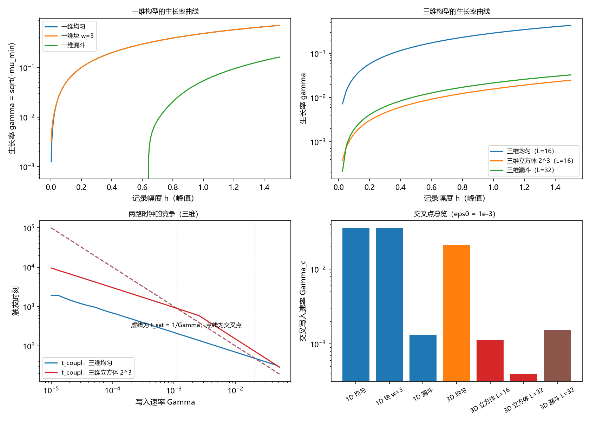

# 注记-M4-D2两路触发的竞争：交叉写入速率与三维退化

- **日期**：2026-09-17 06:18:00
- **层级**：验证脚本/（理论验证材料，未确认）
- **脚本**：`验证脚本/minimal_verification_m4d2_trigger_race.py`（系统 Python 3.13 + numpy 2.4.1 + scipy 1.18.0 + matplotlib 3.11.0，确定性，固定初矢、无随机结果，运行约 57 秒）
- **定位**：M4 强场前置工具的 D2 交付（设计见 [[理论攻坚/黑洞线攻坚计划：坍缩机制重定位与强场终态]] §7.2）：把判别点「破坏是否必待满偏」推成两路时钟的交叉结构，给出交叉写入速率 $\Gamma_c$ 与三维退化读数。判据 6 项全过。
- **关联**：[[验证脚本/注记-M4-D1三维构型读数：耦合失稳的一维读数三维化]]（构型读数与三维退化）；[[内部草稿/注记-BH3-5执行：终态图景与二候选的对应关系、绕数去向与留痕判据]]（饱和主导倾向的来源）；[[内部草稿/总结报告-黑洞线阶段总结：先行批次收官与裁决点全景：2026-09-16]] §三（靶子清单其一）；开放问题总览 P1-34a
- **状态**：第一轮执行完成，判据 6 项全过。未提交作者裁决。
- **图**：`images/m4d2_trigger_race.png`（四面板：一维生长率、三维生长率、两路时钟的竞争、交叉点总览；见 §三 图 1）
- **修订记录**：
  - **2026-09-17 初版**（作者指示：正式执行 D2）
    - 两路时钟定义、六项判据与图；判据实现的三处修正见过程记录

---

## 一、验证目标与判据

判别点回顾：饱和路线要求记录先到满偏（峰值 $h = 1$）再破坏；耦合路线允许在满偏之前由线性失稳触发。本材料把两路的先后推成一个可以算的数字。

两路时钟的定义（最小模型）：写入律取线性斜坡 $h_n(t) = \Gamma t\,h_n^{(0)}$，饱和时钟 $t_{\text{饱}} = 1/\Gamma$；耦合时钟由累计增长给出，$\int_{t_*}^{t}\gamma(s)\,ds = \ln(1/\epsilon_0)$，其中 $\gamma(h) = \sqrt{-\mu_{\min}(h)}$、$\epsilon_0$ 为噪声底。换元到振幅坐标后，耦合先触发的条件与交叉点为

$$\int_0^1\gamma\,dh > \Gamma\ln(1/\epsilon_0)\quad\Longleftrightarrow\quad \Gamma < \Gamma_c = \frac{I}{\ln(1/\epsilon_0)},\qquad I \equiv \int_0^1\gamma\,dh .$$

判据（先写期望，再算）：

D2-1 解析锚点：一维与三维均匀的 $I$ 对闭式一致（相对偏差 $\le 10^{-3}$，含梯形误差）。

D2-2 交叉点结构：数值求解 $t_{\text{耦合}} = t_{\text{饱}}$ 得到的交叉点与 $\Gamma_c = I/\ln(1/\epsilon_0)$ 一致（相对偏差 $\le 10^{-6}$），且两路先后与 $\Gamma$ 对 $\Gamma_c$ 的位置在符号上处处一致。

D2-3 一维构型不敏感：一维均匀、块 $w = 3$、块 $w = 7$ 的 $\Gamma_c$ 两两之差 $< 1\%$。

D2-4 三维退化：三维立方体 $2^3$ 的 $\Gamma_c$ 低于三维均匀的十分之一；$L = 16$ 对 $32$ 的积分比落在 $1/\sqrt{8}$ 的 $\pm 20\%$ 内。

D2-5 噪声底依赖：$\Gamma_c$ 的比值 $r(10^{-6})/r(10^{-2})$ 等于 $\ln(100)/\ln(10^6)$（$\le 10^{-9}$ 相对）。

D2-6 报告：一维与三维漏斗的 $\Gamma_c$；单点构型的无触发；指数写入律变体（一维均匀）。

## 二、模型设定

模型与 D1 同源：一维交错链（$N = 256$，$J = \lambda = 1$，$H_{nn} = 2 + (-1)^n h_n$、近邻 $+1$）与三维简单立方（$L = 16$ 或 $32$，交错背景，Hessian 度数 $6$）。

构型（记录按幅度因子 $a$ 线性放大，$h_n = a\,h_n^{(0)}$）：一维均匀、一维块 $w = 3$、一维块 $w = 7$、一维单点、一维漏斗 $1/(1+d)$；三维均匀、三维立方体 $2^3$、三维漏斗 $1/(1+r)$（$r$ 为最小镜像欧氏距离）。

时钟参数：$\epsilon_0 = 10^{-3}$（$\ln(1/\epsilon_0) = 6.907755$）；饱和阈值 $h = 1$；线性斜坡为默认写入律，指数斜坡（$h_0 = 10^{-6}$）作变体报告。

## 三、结果

判据 6 项全过（运行约 57 秒）。要点如下。

其一，解析锚点逐位成立：一维均匀 $I = 0.246351$ 对闭式（相对偏差 $8.4\times10^{-8}$）；三维均匀 $I = 0.144089$ 对同型闭式（$1.1\times10^{-6}$）。

其二，交叉点结构成立：一维 $\Gamma_c = 3.566293\times10^{-2}$（解析与数值相对差 $7.8\times10^{-16}$）、三维均匀 $2.085900\times10^{-2}$；两路先后与 $\Gamma$ 相对 $\Gamma_c$ 的位置在全部网格点符号一致。

其三，一维构型不敏感：均匀 $3.566293\times10^{-2}$、块 $w = 3$ 给 $3.567000\times10^{-2}$、块 $w = 7$ 给 $3.567001\times10^{-2}$，最大相对差 $0.0199\%$。一维的局部强调制已足够，交叉点由带边物理决定，与构型形状基本无关。

其四，三维退化：立方体 $2^3$（$L = 16$）的 $\Gamma_c = 1.112\times10^{-3}$，为三维均匀的 $5.3\%$；积分从 $L = 16$ 到 $32$ 的比值为 $0.354$，对 $1/\sqrt{8} = 0.3536$ 吻合。局部构型要等到极慢写入才让耦合先到。

其五，噪声底依赖：$\Gamma_c$ 按 $1/\ln(1/\epsilon_0)$ 缩放，$r(10^{-6})/r(10^{-2}) = 0.333333$ 对 $\ln(100)/\ln(10^6)$ 逐位一致，即结论对噪声底只有对数敏感。

其六，报告：单点构型的 $\gamma$ 恒为 $0$（无触发，期望 $0$）；一维漏斗 $\Gamma_c = 1.304\times10^{-3}$；三维漏斗（$L = 32$）$\Gamma_c = 1.530\times10^{-3}$；三维立方体（$L = 32$）$\Gamma_c = 3.939\times10^{-4}$；指数写入律变体（一维均匀）$\Gamma_c = 0.998912$，即交叉点退到自然频率量级（$1$）。

## 四、解读

其一，判别点的形态是交叉而非二元：写入快于 $\Gamma_c$ 时饱和先到（破坏必待满偏），写入慢于 $\Gamma_c$ 时耦合失稳先到（不必待满偏）。$\Gamma_c$ 把两种命运分开，是可与 BH3-4 对接的单一数字。

其二，$\Gamma_c$ 的构型依赖集中在三维：一维各构型的 $\Gamma_c$ 几乎相同（差 $0.02\%$），三维局部构型比三维均匀低一个数量级并随格距继续下降（$\Gamma_c \propto 1/\sqrt{V}$，由 $I$ 的标度给出）。结合 D1 的结论，三维耦合失稳的驱动量是平均调制密度，局部构型只能靠极慢写入取胜。

其三，对 BH3-4 的意义：除非写入速率远小于格点响应频率（一维阈值约 $3.6\times10^{-2}$、三维均匀约 $2.1\times10^{-2}$、三维局部构型约 $10^{-3}$ 至 $10^{-4}$），饱和路线都先到，「必待满偏」成立。这与 BH3-5 的饱和主导倾向方向一致，并把该倾向从定性升级为带数字的交叉结构。结论仍属模型层面，不裁决 BH3-4 本身。

其四，写入律的敏感性：线性斜坡下交叉点由 $\Gamma_c = I/\ln(1/\epsilon_0)$ 给出；指数斜坡下增长积分带 $1/h$ 权重，交叉点抬到自然频率量级（约 $1$）。写入律的选择因此影响结论的强弱，不影响三维与一维的相对位置。

## 五、严格程度声明

本材料只用线性谱判据与线性增长；两路时钟的定义含两个模型假设（写入律、噪声底）。交叉点判据（D2-2）为解析关系与数值求根的一致性核对，符号一致性在 401 个网格点上核验。读数不构成黑洞语境的可观测量。

## 六、诚实边界

其一，写入律（线性斜坡）与噪声底（$\epsilon_0 = 10^{-3}$）为假设，实际写入律未知；结论对 $\epsilon_0$ 只有对数敏感，对写入律的形式敏感（指数斜坡给出完全不同的交叉点）。

其二，耦合时钟的时钟积分只到线性失稳的振幅阈值；非线性饱和、模式耦合与破坏后的动力学未含。

其三，三维读数取固定格距（$L = 16$ 与 $32$）；$\Gamma_c$ 随 $V$ 继续下降，热力学极限值未定。

其四，两路竞争只比较各自到触发的时间，未含触发后的过程时标（格点退出的完成时间）。

## 七、过程记录

其一，交叉点判据的数值实现经三处修正：初版在 $\Gamma$ 网格上用符号翻转找交点，精度受网格限制（$0.3\%$）；改为在 $h_c(\Gamma) = 1$ 上求根后，又发现 $h = 1$ 处插值截断（超出扫描上界的 $\Gamma$ 被压平），把振幅扫描延伸到 $h = 1.5$ 并把扫描网格对准 $h = 1$；最后修正符号一致性的比较方向（耦合先到对应 $h_c < 1$ 与 $\Gamma < \Gamma_c$）。

其二，教训：把「谁先」翻译成求根问题时，扫描上界必须大于判据点，否则插值截断会伪装成根。

其三，图注按绘图代码逐面板核对。

## 八、登记衔接

- `验证脚本/README.md` 第 88 条（本注记落盘时同步）。
- [[内部草稿/开放问题总览：元相子理论待解决问题清单]] P1-34a：补注 D2 执行与交叉点读数。
- [[理论攻坚/黑洞线攻坚计划：坍缩机制重定位与强场终态]] §7.2：执行状态更新为「D2 已执行」。