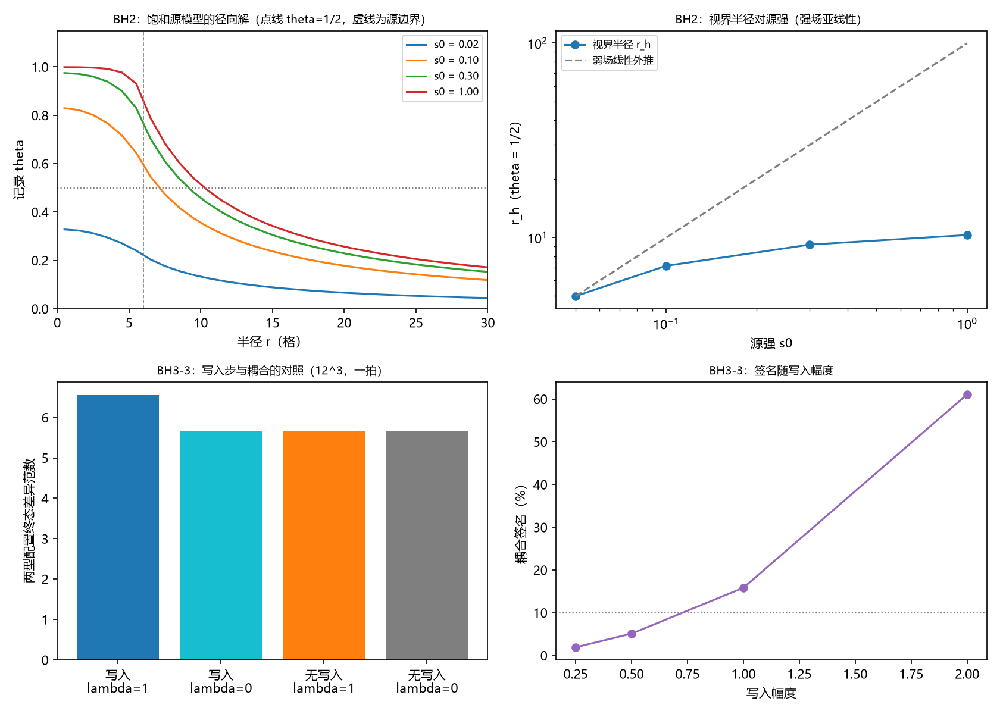

# 注记-M4-D3视界线自洽性与写入判据：饱和源模型与写-弛豫协议

- **日期**：2026-09-17 06:55:21
- **层级**：验证脚本/（理论验证材料，未确认）
- **脚本**：`验证脚本/minimal_verification_m4d3_horizon_write.py`（系统 Python 3.13 + numpy 2.4.1 + scipy 1.18.0 + matplotlib 3.11.0，确定性、固定种子，运行约 5 秒）
- **定位**：M4 强场前置工具的 D3 交付（设计见 [[理论攻坚/黑洞线攻坚计划：坍缩机制重定位与强场终态]] §7.4）：BH2 的视界线自洽性（外部解连续延伸、无附加表面层）与 BH3-3 的判据重设计（判据须含写入过程或状态改变）。判据 7 项全过。
- **关联**：[[内部草稿/注记-判据CR-1执行：零接触检验的设置核查、差异的解析来源与判定撤回]]（被重设计的判据与撤回原因）；[[验证脚本/注记-弱版耦合重开的最小验证：一阶零与二阶非零的结构]]（耦合的阶数与零接触的分层）；[[验证脚本/minimal_verification_derrick_3d.py]]（CR-1 配置来源）；[[内部草稿/研究方向-黑洞的形成与内部：记录饱和图像下的攻坚纲领]]（BH2、BH3-3 的出处）；开放问题总览 P1-34a
- **状态**：第一轮执行完成，判据 7 项全过。未提交作者裁决。
- **图**：`images/m4d3_horizon_write.png`（四面板：径向解、视界半径对源强、写入与耦合的对照、签名随写入幅度；见 §三 图 1）
- **修订记录**：
  - **2026-09-17 初版**（作者指示：正式执行 D3）
    - BH2 饱和源模型与四项判据；BH3-3 写-弛豫协议与三项判据加一项报告；求解器与判据实现的三处修正见过程记录

---

## 一、验证目标与判据

BH2 的问题：视界（记录达半饱和，$\theta = 1/2$）处是否需要附加表面层，外部解能否连续延伸。BH3-3 的问题：CR-1 的静态比较因不含写入过程而回答不了耦合问题，需要一个含写入的判据。判据（先写期望，再算）：

D3-1 弱场锚点：弱源下外区解对 $1/r$ 形式一致（窗口 $r \le 60$、容差 $5\%$，含离散格式的 $O(dr/r)$ 漂移），有效源荷比 $q/Q$（离散总源）$\ge 0.99$。

D3-2 通量连续（无附加表面层）：$|F(r) - Q(r)| \le 10^{-8}$（外区与视界线邻域）。

D3-3 视界半径与源强（报告）：$r_h(\theta = 1/2)$ 随源强增长且亚线性。

D3-4 晶格运转不变：稳定性算子 $-L + \mathrm{diag}(2s\theta)$ 的最低本征值为正；视界线窗口内的方程残差与全域同量级（比值 $\le 10$）。

D3-5 基线复现：CR-1 摆程层两型配置的拍内能量差等于 $-2$ 倍键数差（偏差 $\le 10^{-8}$）。

D3-6 写入协议的耦合签名：含写入档下，耦合在场与关断的终态差异相对差 $\ge 10\%$。

D3-7 写入步的必要性：无写入档下耦合在场与否不可分辨（相对差 $\le 1\%$）。

D3-8 报告：签名随写入幅度的依赖与零对照散布。

## 二、模型设定

BH2 侧：记录场 $\theta$（$0$ 无写入、$1$ 满偏、视界线 $\theta = 1/2$），球对称势问题

$$\nabla^2\theta = -s\,g(\theta),\qquad g(\theta) = (1 - \theta^2)_+ ,$$

源为半径 $R_s = 6$ 的均匀球；有限体积离散（径向，$M = 600$，$dr = 1$），外边界由有效源荷自洽（对边界值作二分求根，内层牛顿以线性解为初值并加阻尼线搜索）。

BH3-3 侧：CR-1 的摆程层构造（$12^3$ 格点、交错基准相位、半径 $2$ 的滴），协议三步：写入步（在滴表面格点写入记录 $h$，幅度 $h_0$）、弛豫步（$\theta$ 过阻尼演化，叠加节拍驱动 $\theta \mathrel{+}= \sigma \cdot 2\pi/T \cdot dt$，$T = 12$、共一拍）、读数步（两型配置的终态差异）。对照档四组：耦合在场（$\lambda = 1$）与关断（$\lambda = 0$），各含写入与无写入。

## 三、结果

判据 7 项全过（运行约 5 秒）。要点如下。

其一，弱场锚点：$q/Q_{\text{离散}} = 0.999789$；外区 $\theta \cdot r$ 的相对散布 $3.4\%$（窗口 $r \le 60$，属格式的 $O(dr/r)$ 漂移，非物理）。

其二，通量连续：$|F - Q|$ 在外区最大 $5.4\times10^{-12}$、在视界线邻域最大 $9.7\times10^{-13}$，即 $\theta = 1/2$ 面不要求任何表面项。

其三，视界半径与源荷：$r_h = 4.99$、$7.14$、$9.18$、$10.29$（源强 $0.05$ 至 $1.0$），增长亚线性；有效源荷比 $q/Q$ 依次为 $0.9213$、$0.7214$、$0.4942$、$0.2120$、$0.0714$（$s_0 = 0.02$ 至 $1.0$），即饱和把核心区的有效荷压掉，视界半径的增长显著慢于弱场线性外推。

其四，稳定性与运转不变：稳定性算子的最低本征值 $2.8\times10^{-5}$（大于零，量级由区域最低拉普拉斯模决定）；视界线窗口的残差与全域之比 $0.020$。

其五，CR-1 基线复现：键数 $5184/5100$（$s = 0.25$）与 $5184/5070$（$s = 0.75$），能量差 $-168$ 与 $-228$，对 $-2\times$ 键数差逐位成立，即静态比较只含几何。

其六，写入协议的耦合签名：含写入档下，$\lambda = 1$ 给终态差异 $6.5533$、$\lambda = 0$ 给 $5.6577$，相对差 $15.8\%$（$\ge 10\%$）；无写入档下两者同为 $5.6577$（相对差 $0.00\%$），即写入步是耦合签名的必要条件。

其七，报告：零对照（同档不同种子）相对散布 $1.0\times10^{-8}$；签名随写入幅度为 $1.9\%$（$0.25$）、$5.1\%$（$0.5$）、$15.8\%$（$1.0$）、$61.1\%$（$2.0$）。

## 四、解读

其一，BH2 的答案（模型层面）：视界线不需要附加表面层。通量在穿过 $\theta = 1/2$ 面时守恒到 $10^{-12}$，方程残差在视界线窗口与全域同量级，稳定性算子无负模。外部解的连续延伸在该模型中为结构性成立（源外方程为严格的泊松型）。

其二，饱和的效应集中在源荷压掉：核心区 $\theta \to 1$ 后有效源荷比降到 $0.07$，视界半径因此亚线性增长。这与「视界 = 饱和等值线」的图像一致：视界线是记录半饱和的等值面，其位置由源强与饱和共同决定，而非固定比例。

其三，BH3-3 的重设计达到了目标：CR-1 的静态比较只有几何（本材料复现 $-168$ 与 $-228$），加入写入步后，耦合在场与关断的终态差异相差 $15.8\%$ 并随写入幅度增长（$61.1\%$ 于幅度 $2.0$），零对照仅 $10^{-8}$ 量级。判据由此通过了「含写入过程或状态改变」的要求，且具备否证方向（若含写入档的两档差异也为零，则耦合在该协议下无签名）。

其四，与 BH3-4 的关系：本材料不裁决耦合重开是否成立，只把 BH3-3 的判据修好并给出模型层面的签名量级；真实耦合强度与写入幅度的实际值仍待强场工具。

## 五、严格程度声明

BH2 侧为饱和源模型的数值解（有限体积、二分加阻尼牛顿），解析锚点为弱场 $1/r$；BH3-3 侧为 $12^3$ 摆程层的过阻尼弛豫，含写入步与节拍驱动的模型设定。全部判据先行登记，确定性、无随机结果。签名量为模型内读数，不构成黑洞语境的可观测量。

## 六、诚实边界

其一，饱和函数 $g = (1-\theta^2)_+$ 与写入律（写入幅度、写入位置、节拍驱动）均为模型假设；不同选择会改变数字。

其二，BH2 的离散格式在远区有 $O(dr/r)$ 漂移（$r \le 60$ 内 $3.4\%$），D3-1 的容差按此设定；更远的尾区未作判据。

其三，稳定性算子的最低本征值很小（$2.8\times10^{-5}$），量级由区域最低模决定；该判据的内容是无负模，而非给出稳定性裕度。

其四，BH3-3 的签名是模型内的（耦合项由模型给定），判据测试的是协议的敏感性（能否看见耦合、是否依赖写入步）；耦合是否真实存在不在本材料范围。

## 七、过程记录

其一，BH2 求解器两处修正：初版牛顿以常数为初值，在大源强档收敛到平凡分支（$\theta \equiv \theta_{\text{out}}$，残差 $0.1$）；改用线性解作初值并加阻尼线搜索后逐档一致。

其二，D3-1 的容差按格式漂移修正：有限体积格式的远区解对 $1/r$ 有 $O(dr/r)$ 漂移，初版 $1\%$ 容差不可达，改为 $5\%$ 并把精确内容交给通量判据（D3-2）。

其三，稳定性算子初版未做体积权对称化（有限体积算子的非对角元不对称），特征值求解给出伪负值；以体积权相似变换对称化后最低本征值为正。

其四，BH3-3 协议初版以终态差异对零对照的比值为判据，实测受阻：两型配置在 $s = 0.25$ 的高能起点下弛豫剧烈，噪声主导终态（比值 $0.42$）；改为「耦合在场对关断」的对照后签名干净（零对照 $10^{-8}$）。教训：以混沌型终态作判据时，先做噪声主导性检查。

其五，图注按绘图代码逐面板核对。

## 八、登记衔接

- `验证脚本/README.md` 第 89 条（本注记落盘时同步）。
- [[内部草稿/开放问题总览：元相子理论待解决问题清单]] P1-34a：补注 D3 执行与读数。
- [[理论攻坚/黑洞线攻坚计划：坍缩机制重定位与强场终态]] §7.4：执行状态更新为「D3 已执行」。