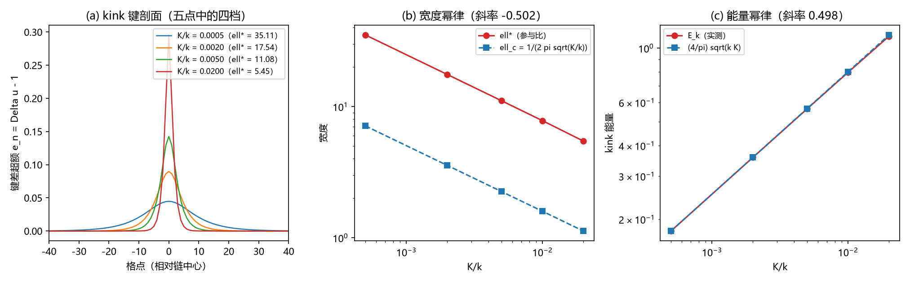

# 注记-M6-S2-1b（路线二）：弹性本构路线的双通道换算桥接与弹性定律核对

- 日期：2026-09-18 23:53:33
- 类型：验证注记（内部草稿）
- 主题：S2-1b 取数路线二执行：非紧致法线轴弹性的双通道系数与公理 4 参数集的桥接核对
- 关联：[[理论攻坚/黑洞线攻坚计划：坍缩机制重定位与强场终态]]（§7.6）、[[验证脚本/注记-M6-S2-1b（路线一）：本构常数比 K-J 的色散路线换算与格点核对]]、[[内部草稿/注记-FK链：从Frenkel-Kontorova模型到元相子时空晶格的一维代理]]、[[验证脚本/注记-弹性身份裁决：紧致cos与螺旋平方弹性下的位错窗口]]、[[验证脚本/注记-复合模型：粒子 = 均匀缠绕背景上的 FK kink 位错与宽度参数区]]、[[内部草稿/开放问题总览：元相子理论待解决问题清单]]（P1-34a）
- 产物：`验证脚本/m6_s21b_elastic.py`（常驻）；图见 §三 图 1
- 严格程度：桥接与色散为机器级；宽度与能量幂律为百分比级；独立性判定为口径结论（报作者裁定）
- 边界：频率层核对属路线一职责，本材料不重做；不验证三维；$\kappa_\phi$ 的物理值仍待 P1-2
- 裁定登记：2026-09-19 作者裁定「口径桥接＋弹性定律核对」，不作独立取数；路线三登记为「可选、不阻塞」（计划 §7.6 与总览 P1-34a 同步）

## 一、任务与判据

路线二的草案口径：从非紧致法线轴弹性的同一参数集（键 = 螺旋高度差平方；圆心/回折约束 = onsite）独立导出 $K/J$，判据为与路线一偏差不超过 $10%$ 且不引入新常数。本材料按此执行，并把「独立」一项做成显式判定。

模型与约定：单位制 $c = l_P = t_P = 1$、$\hbar = 1$；FK 链取 $u$ 单位（$u = \theta/2\pi$），$E = \sum (k/2)(u_{n+1}-u_n-1)^2 + \sum K(1-\cos 2\pi u_n)$，弹簧项对应键弹性（包层），周期势对应锚核锁定（$\kappa_\phi$ 通道）；弱版黑洞线模型取 $\theta$ 单位，$E = J\sum\cos(\Delta\theta) + \lambda\sum(1-\cos\theta)h_n$。

判据四项：S2-1b5（键通道色散闭式对格点本征值，$\le 10^{-12}$）；S2-1b6（kink 宽度幂律斜率 $-0.5\pm3\%$，四点）；S2-1b7（kink 能量幂律斜率 $+0.5\pm3\%$，四点绝对值比对闭式落在 $0.9$ 至 $1.1$）；S2-1b8（桥接恒等式：$J = k/(4\pi^2)$ 二次型对齐、$\lambda = K$ 逐点精确、$K/J$ 三式一致，均 $\le 10^{-12}$；与路线一的关系按实测登记为同源或独立）。

## 二、桥接推导

键通道做二次型对齐。FK 的键能 $(k/2)(\Delta u)^2$ 在 $\Delta\theta = 2\pi\Delta u$ 下成为 $(k/8\pi^2)(\Delta\theta)^2$，与公理 4 键项 $(\hbar K_0/2)(\Delta\theta)^2$ 相等给出 $k = 4\pi^2\hbar K_0$；在黑洞线单位下 $J = k/(4\pi^2) = \hbar K_0$。

onsite 通道做逐点对齐。锚核项的周期变量满足 $2\pi u = \theta$，故 $K(1-\cos 2\pi u) = \lambda(1-\cos\theta)$ 在 $\lambda = K$ 下逐点精确。异类耦合的块本征值为 $\{0,\,3\hbar\kappa_\phi,\,3\hbar\kappa_\phi\}$（三物种两两配对之和），与锚核二次项对齐给出 $K = 3\hbar\kappa_\phi$。

两式合并即路线一的换算恒等式：

$$\frac{K}{J} = \frac{4\pi^2 K}{k} = \frac{3\kappa_\phi}{K_0} = 6\pi\,\kappa_\phi t_P.$$

## 三、结果

判据 4/4 全过（运行约 2 秒）。读数如下。

| 判据 | 读数 |
|---|---|
| S2-1b5 键通道色散 | 闭式 $2k(1-\cos q)$ 对格点本征值最大相对偏差 $1.7\times10^{-15}$；声速平方 = $k = 6.283185$ |
| S2-1b6 宽度幂律 | 四点斜率 $-0.5018$；第五点（$K/k = 0.02$）见离散端偏差 |
| S2-1b7 能量幂律 | 四点斜率 $0.4983$；四点绝对值比 $0.994$ 至 $1.000$（第五点 $0.988$） |
| S2-1b8 桥接恒等式 | $J = k/(4\pi^2)$ 偏差 $0$；$\lambda = K$ 偏差 $0$；异类块偏差 $1.9\times10^{-16}$；$K/J$ 三式最大相对差 $1.2\times10^{-16}$ |

kink 弛豫五点（$N = 400$，缠绕守恒边界，牛顿迭代 2 至 6 步收敛到 $10^{-12}$）：$K/k$ 由 $0.0005$ 至 $0.02$ 时，参与比宽度 $\ell^*$ 由 $35.11$ 降至 $5.46$，能量由 $0.1788$ 升至 $1.1176$；对连续闭式 $(4/\pi)\sqrt{kK}$ 的比由 $0.9997$ 单调降至 $0.9878$（离散修正，随 $K/k$ 增长）。

桥接抽检（$\kappa_\phi = 0.05$）：$k = 2\pi$、$K = 0.15$；$K/J$ 的三种表达式同为 $0.942478$，与路线一注记中同参数示例逐位一致。

## 四、解读

**桥接成立。** FK 链弹性与公理 4 参数集的对应在二次型层面精确：$k = 4\pi^2\hbar K_0$、$K = 3\hbar\kappa_\phi$，换算后 $J = \hbar K_0$、$\lambda = 3\hbar\kappa_\phi$。

FK 链的文献量（kink 宽度幂律、能量幂律、窗口阈值 $K/k \le 0.02$）由此可与黑洞线口径直接互换：宽度窗口映射为 $K/J \le 4\pi^2\times0.02 = 0.7896$，模型惯例 $\lambda/J = 1$ 对应 $K/k = 1/(4\pi^2) = 0.0253$（窗口外缘）。此两条为路线二新增的可用换算。

**独立取数不成立。** 两条通道的系数在路线一与路线二中的物理来源相同（$K_0$ 与 $\kappa_\phi$），桥接只改书写单位，$K/J$ 表达式逐位相同。三式一致的偏差 $0$ 属同源恒等式，不能读作独立途径的交叉验证。草案中路线二的「独立导出」承诺按本材料修正为「换算桥接加弹性定律核对」；是否按此登记报作者裁定。

**对 BH3-4 的后果。** $K/J = 6\pi\kappa_\phi t_P$ 的表达式不变，终审仍归结为 $\kappa_\phi t_P$ 的取数（P1-2，与 S1-3 同上游）。路线二不提供新的数值输入。

**cos 投影降级幅度。** 余弦键与平方键在 $\Delta\theta = 1$ rad 处的能量相对差 $8.1\%$；小角差区两者一致（桥接在此层面精确），大角差区的差异属弹性身份的既有结论（cos 为角度投影，平方型为原始形式）。

## 五、严格程度声明

机器级读数：键通道色散（$1.7\times10^{-15}$）、桥接恒等式四项（$\le 10^{-12}$）。百分比级读数：宽度幂律斜率、能量幂律斜率与绝对值比（离散修正已报告）。解析事实：桥接两式与 $K/J$ 换算链。未验证：频率层（色散论文的能隙与群速度）不重做，属路线一职责；三维；$\kappa_\phi$ 的物理值。本材料不改动基准文件。

## 六、诚实边界

其一，独立性判定为负（与路线一同源），此为本材料最重要的口径结论，按流程报作者裁定；在裁定前，路线二不作为独立读数引用。其二，窗口映射的阈值沿用复合模型注记的口径（$K/k \le 0.02$ 对应 $\ell^* \ge 2$），其余注记中参与比宽度的定义差异未逐一对齐。其三，参与比宽度含约定因子（连续极限 $\ell^*/\ell_c = \pi^2/2 = 4.9348$），故判据只用幂律不用绝对值；表中绝对值仅作趋势报告。其四，$\kappa_\phi t_P$ 的数值仍待上游 P1-2。

## 七、过程记录

其一，首版边界条件写错（取 $u_{N-1} = N-1$），缠绕 $W = u_{N-1}-u_0-(N-1)$ 为零，弛豫出 kink-antikink 对，能量恰为单 kink 的两倍、宽度约 $\pi^2$ 倍。改为缠绕守恒边界 $u_{N-1} = N$ 后读数落位。教训：缠绕类装置的边界条件必须按缠绕定义式核对后再跑。

其二，梯度流对宽 kink 收敛慢（$K/k = 0.0005$ 档 $g_{\max}$ 停在 $1.7\times10^{-5}$）；改为牛顿迭代加回溯（海森矩阵带状，Levenberg 保护），2 至 6 步收敛到 $10^{-12}$，总运行约 2 秒。

其三，图注按脚本绘图面板逐条核对（剖面宽度、两个 log-log 斜率、约定因子标注）后撰写。
