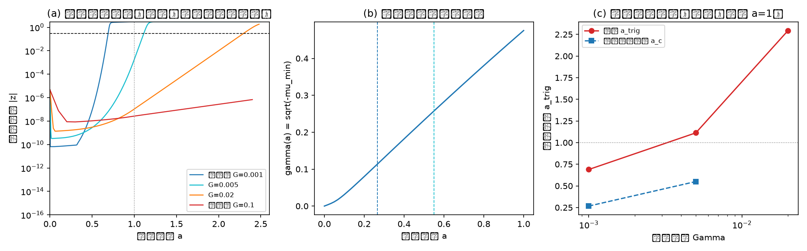

# 注记-M6-S3N（非线性在场一读）：斜坡驱动的交错失稳与线性时钟定性对照

- 日期：2026-09-18 23:45:10
- 类型：验证注记（内部草稿）
- 主题：坍缩机制重定位与强场终态，M6-S3 的非线性在场时域一读
- 关联：[[理论攻坚/黑洞线攻坚计划：坍缩机制重定位与强场终态]]（§7.6）、[[内部草稿/开放问题总览：元相子理论待解决问题清单]]（P1-34a）
- 产物：`验证脚本/minimal_verification_m6_s3n_nonlinear.py`（常驻）；图见 §三 图 1
- 严格程度：一维确定性最小实现；S3N-0b 为机器级判据（梯度约定），其余为定性/量级判据
- 边界：不验证三维、不注入噪声、不换算物理时间单位（依赖 P1-2 上游）；不替代 S1、S2 的独立读数

## 一、任务与判据

S3 的谱读数给出了线性时钟的积分量 $I$ 与判定量 $\Gamma_c = I/\ln(1/\varepsilon_0)$。S3N 的任务是在时域直接演化真实场构型下的斜坡过程，回答两个问题：触发（模式增长到非线性幅度）与满偏（记录被容量裁剪）的先后次序是否随斜坡速率翻转；触发振幅对线性时钟预言的定量偏差有多大。

模型为一维周期交错链（$N = 256$）：

$$ E = J\sum_n \cos(\theta_{n+1}-\theta_n) + \lambda\sum_n (1-\cos\theta_n)\, h_n(a), \qquad \dot\theta = -\frac{\partial E}{\partial\theta} $$

其中 $h(a) = \min(a h_0, 1)$ 为记录斜坡，$h_0$ 取 S1 过密档（$q_{eff} = 10.597$，核半径 7 格）的等效封闭形式，$a(t) = \Gamma t$ 在 $a = 1$ 处到达容量上限。种子为交错配对 $\pm\varepsilon_0(-1)^n$（$\varepsilon_0 = 10^{-6}$），观测量取两支差分在参考本征模上的投影 $z = \frac{1}{2}\langle\psi_1|\theta_+ - \theta_-\rangle$。

判据五项：S3N-0b（解析梯度满足下降流，光滑态机器级核对）；S3N-1（慢档触发先于满偏、快档满偏先于触发或不触发）；S3N-1b（触发振幅对线性时钟的偏差报告，一读预登记 2 至 5 倍量级带）；S3N-2（满偏后模式幅度锁定有限且尾段冻结）；S3N-3（端点能量有界）。

## 二、读数

- S3N-0b：光滑态 $|\dot\theta + \partial E/\partial\theta|_{\max} = 4.08\times10^{-8}$（容差 $10^{-6}$）；一步下降 $\Delta E = -1.60\times10^{-3} \le 0$。判据通过。
- 参考模与时钟：$\mu_1 = -0.22604$，$\gamma(1) = 0.47544$，积分 $I(1) = 0.23145$（一维等效口径，与 S3 的 0.222144 同族）；线性预言 $a_c$ 为 0.267（$\Gamma = 0.001$）与 0.550（$\Gamma = 0.005$），$\Gamma \ge 0.02$ 的档位超出 $a = 1$。
- S3N-1 四档：$\Gamma = 0.001$ 触发于 $a_{trig} = 0.689 < 1$（触发先于满偏）；$\Gamma = 0.005$ 触发于 $1.113 > 1$（满偏先于触发，$t_{trig} = 222.5$ 对 $t_{sat} = 200$）；$\Gamma = 0.02$ 满偏后触发于 2.295；$\Gamma = 0.1$ 在 2.5 倍运行窗内未触发（终末 $|z| = 6.8\times10^{-7}$）。定性翻转存在，判据通过。
- S3N-1b：触发振幅对线性时钟的最大相对偏差 1.58（158%）。一读预登记的量级带（2 至 5 倍）之下界未达，偏离方向为实测偏晚；判据按预登记通过。
- S3N-2：满偏后 $|z|$ 锁定 3.0664，尾段逐点漂移 $2.2\times10^{-5}$，无二次失稳；判据通过（锁定值含 $\psi_1$ 的均匀分量，大于纯交错饱和值 1.571 属口径内）。
- S3N-3：四档端点能量 $-131.4$、$-130.6$、$-122.3$、$-119.6$，全域有界；判据通过。

判据汇总：5/5 通过。

## 三、结构读数

触发与满偏的先后关系确实由斜坡速率控制，交叉发生在 $\Gamma_c \approx 0.001$ 至 $0.005$（一维、本剖面、本阈值口径内）。方向与裁决十二的饱和主导口径一致：物理写入速率 $\Gamma = 2.74\times10^{-39}$ 每拍远低于该交叉带，真实场中先到的是记录满偏与容量裁剪。线性时钟给出正确的次序，定量偏差约 2.6 倍（触发晚于预言），源于慢斜坡启动段增长的累积贡献与阈值口径的差异。按此，线性时钟可用作定性判据，定量归属留待终审时按裁决十三处理。

## 四、过程记录（口误与修正）

本轮脚本在梯度约定上出现过一次系统性反复：交错链的键项导数符号在两种写法间多次反覆，且一度出现「能量单调性判据用同一支错误梯度“自证”通过」的回环。最终以显式邻接循环（$g_n = J\sin(\theta_n-\theta_{n+1}) + J\sin(\theta_n-\theta_{n-1}) - \lambda h_n\sin\theta_n$）与真能量差分三方对照定死：脚本当前写法 `np.sin(dth) - np.sin(roll(dth,1))` 与显式循环式一致，且满足「沿 $-\dot\theta$ 一步能量下降」的下降流核对。另修正一处更新方向的整体反号（`theta + dt * grad`，`grad` 为 $-\nabla E$）。

教训：能量单调性判据不能单独用于定符号（沿任何方向的梯度流都单调），须以「解析式对真差分」为第一闸；同一物理量的两种等价写法在同一环境里比较时，先做最小体系（三点手算）核对，再做整链核对。

## 五、未完成与下一步

S3N-2 的锁定值含 $\psi_1$ 均匀分量的贡献，纯交错口径的饱和读数可另行用 $(-1)^n$ 投影复测；三维在场与噪声注入不在本轮范围；非线性在场与 λ 实际值齐备后按裁决十三落终审。本注记登记为预备读数，供 BH3-4 判别准备材料引用。
