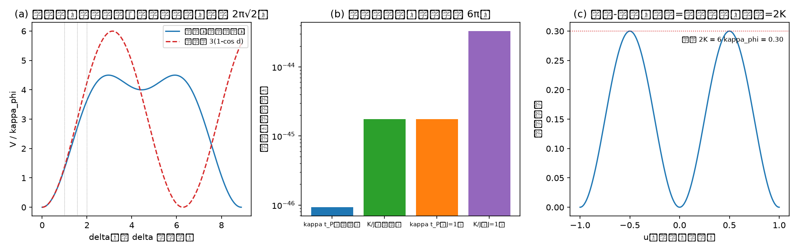

# 注记-M6-字典对账：归一化口径对齐、J 惯性反推与识别项的可推导边界

- 日期：2026-09-19 02:14:15
- 类型：验证注记（内部草稿）
- 主题：S2-1b 换算句的字典对账：公理 4 与质量论文的归一化对齐、J 反推、识别项的二次型边界、S1-3 容量预核
- 关联：[[验证脚本/注记-M6-S2-1b（路线一）：本构常数比 K-J 的色散路线换算与格点核对]]、[[验证脚本/注记-M6-方向-λ核查：耦合系数翻转线的小-λ 渐近与 κ_φ 候选的对齐]]、[[元相子振荡晶格的色散关系：低能光速涌现与洛伦兹破坏首阶项]]、[[有质量粒子的形成：大爆炸同步相变的局域缺陷方案]]、[[理论攻坚/黑洞线攻坚计划：坍缩机制重定位与强场终态]]（§7.6）、[[内部草稿/开放问题总览：元相子理论待解决问题清单]]（P1-34a）
- 产物：`验证脚本/m6_dictionary_reconciliation.py`（常驻）；图见 §三 图 1；配套裁决请求见 [[内部草稿/裁决请求-字典对账：识别项口径清单与 P1-2 归口]]
- 严格程度：DR-1、DR-2、DR-4 为机器级；DR-3 为机器级核对加报告；口径项单列报裁
- 边界：不含识别项身份句的裁决；不含吸收线的能量条件输入；不改动基准文件

## 一、任务与判据

黑洞线 S2-1b 的换算句 $K/J = 6\pi\kappa_\phi t_P$ 挂两件事：其一，识别项（弱版模型的 onsite 通道与异类耦合的 δ 扇区对齐）；其二，$\kappa_\phi$ 的数值（P1-2）。另有内部归一化问题：质量论文用 $\omega_0 = \sqrt{\kappa_\phi/J}$（J = 1 约定），色散论文（公理 4）给 $\omega_0^2 = 3\omega_P\kappa_\phi$，两者差一个 $6\pi$ 型因子。

本材料做四件事：反推 $J$；落盘字典恒等式；核对识别项的二次型内容并量化非线性偏差；做 S1-3 的容量-强度预核。

判据四项：DR-1（δ 能隙关系与 $J$ 反推，机器级）；DR-2（字典恒等式对三档质量逐位）；DR-3（单 δ 族二次系数 $3/2$ 机器级；非线性偏差与周期不格报告）；DR-4（势垒 $2K = 6\hbar\kappa_\phi$ 机器级；容量结构陈述与上限侧盘点报告）。

## 二、模型与单位

单位制 $c = l_P = t_P = 1$、$\hbar = 1$、$\omega_P = 2\pi$。质量对账用 CODATA：$m_e = 9.1093837015\times10^{-31}$ 千克、$m_P = 2.176434\times10^{-8}$ 千克，比值 $4.185463\times10^{-23}$。

## 三、结果

判据 4/4 全过（运行约 2 秒）。读数如下。

其一，归一化落位。由公理 4 的 $\omega_0^2 = 3\omega_P\kappa_\phi$ 得相对相位惯性 $J = \kappa_\phi/\omega_0^2 = 1/(3\omega_P) = t_P/(6\pi) = 0.05305165$（两档 $\kappa_\phi$ 一致，机器级）。质量论文的 $J = 1$ 约定登记为历史口径，与规范口径差 $6\pi = 18.85$ 倍。

其二，字典恒等式。$\kappa_\phi t_P = (\omega_0t_P)^2/(6\pi)$ 与 $K/J = 6\pi\kappa_\phi t_P = (m_\delta/m_P)^2$ 对三档质量逐位成立（偏差 $\le 1.2\times10^{-16}$）。

电子档：$\kappa_\phi t_P = 9.2936\times10^{-47}$、$K/J = 1.7518\times10^{-45}$、方向余量 $\Gamma_c/\Gamma = 4.71\times10^{14}$（渐近口径 $\beta = 0.5008$）。

质量论文口径对账：$\kappa_\phi/\omega_P^2 = (\omega_0/\omega_P)^2 = 4.437\times10^{-47}$（同论文的 $10^{-47}$）；其 $\kappa_\phi t_P = (m/m_P)^2 = 1.75\times10^{-45}$，与规范口径差 $6\pi$。

其三，识别项的二次型边界。单 δ 族（三对配对角 $\sqrt{2}\delta, \delta/\sqrt{2}, \delta/\sqrt{2}$）的精确异类能二次系数 $= 3/2$（机器级），与 $K = 3\hbar\kappa_\phi$ 的锚项二次对齐。非线性不格：$\delta = 1,\ \pi/2,\ 2$ 处精确值与单余弦形 $3(1-\cos\delta)$ 的相对偏差为 $4.0\%$、$9.4\%$、$14.3\%$；精确形式周期 $2\pi\sqrt2 = 8.8858$，与单余弦 $2\pi$ 不可通约。

其四，S1-3 预核。锚项 $K(1-\cos 2\pi u)$ 的相邻极小间势垒 $= 2K = 6\hbar\kappa_\phi$（$\kappa_\phi = 0.05$ 时 0.300，机器级）。

容量为结构量：$\theta$ 与 $\theta + 2\pi$ 同一状态（满周闭合 = 一层 $l_P$），单格点容量 $h_{\max} = l_P$，不依赖 $\kappa_\phi$。上限侧候选输入盘点：层级窗口 $\kappa_\phi \ll \omega_P^2$ 与宽度窗口 $K/k \le 0.02$ 在粒子质量档位下自动满足，均不构成有效上界；能量条件输入（吸收线）未提供。

## 四、解读

**归一化落位把「待 κ_φ」变成「待一个质量」。** 采纳规范口径后，$\kappa_\phi t_P = (m_\delta/m_P)^2/(6\pi)$、$K/J = (m_\delta/m_P)^2$：黑洞线耦合系数比等于 δ 模式质量与普朗克质量之比的平方。电子锚定给 $K/J = 1.75\times10^{-45}$；方向-λ 核查所用的 $2.98\times10^{-44}$ 属 J=1 约定，两个值差 $6\pi$，方向结论一致（余量 $4.7\times10^{14}$ 与 $2.0\times10^{15}$）。

**识别项的可推导边界。** 二次型层面可推导且已核：三对配对给出 $3/2$ 的二次系数与 $K = 3\hbar\kappa_\phi$，弱版模型的小振幅分析与稳定性判据都在此精度内。非线性层面不格：精确形式周期 $2\pi\sqrt2$，单余弦形式在 $\delta \ge 1$ 时有 4 至 14 个百分点的偏差；故「单余弦形式」是弱版适用域内的有效形式，大振幅情形属口径或另立项。身份句（记录交错分量接 δ 扇区；锚核 PN 与 $\kappa_\phi$ 锁定的粒子线内部身份）与 $h$ 调制形式不能由公理 4 推出，属口径，见配套裁决请求。

**P1-2 拆分登记。** P1-2a（定标侧）：哪个质量或条件给 $\kappa_\phi$ 定标（现阶段以电子为锚，待作者与粒子线三代谱起点一并裁）。P1-2b（上限侧）：强度饱和所需的 $\kappa_\phi$ 上界；本材料已把容量一侧钉为结构量，并盘点现有窗口均不构成有效上界，故这一侧需要新输入（吸收机制自身的能量条件）。

## 五、严格程度声明

机器级：DR-1、DR-2、DR-4（能隙关系、恒等式逐位、势垒）。机器级核对加报告：DR-3。解析事实：二次系数 $3/2$、周期 $2\pi\sqrt2$、字典恒等式的推导。未验证：识别项身份句与 $h$ 调制（口径项）；质量锚定（框架外选择）；吸收线能量条件。

## 六、诚实边界

其一，$J$ 的反推依赖公理 4 的动能系数与 δ 扇区解耦（路线一已机器核对），二者任一变动会移动 $6\pi$ 因子的落位。其二，本材料不裁决「哪个质量给 $\kappa_\phi$ 定标」；中微子档等更轻锚点属公式外推。其三，S1-3 的上限侧仅为盘点，未给上界。其四，不改动基准文件与 BH3-4 的门槛清单。

## 七、过程记录

其一，首版把 $J$ 的反推断言写成「由能隙直测」，实质用的是路线一已核的闭式关系加一次代数；注记与脚本内均按此表述，避免重复计功。

其二，DR-3 的二次系数核对初版取 $\delta = 10^{-4}$ 单点，偏差 $6.1\times10^{-9}$（四次项贡献）；判据容差定为 $10^{-6}$ 并保留，说明文字已注明来源。

其三，图注按脚本面板输出逐条核对后撰写。
