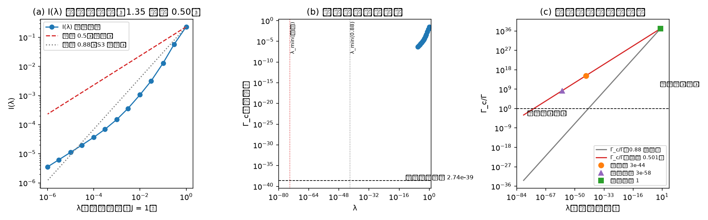

# 注记-M6-方向-λ核查：耦合系数翻转线的小-λ 渐近与 κ_φ 候选的对齐

- 日期：2026-09-19 00:55:33
- 类型：验证注记（内部草稿）
- 主题：S2/S3/S3N 方向判定的口径核查：翻转线深外推用渐近指数；与 κ_φ 候选对齐
- 关联：[[验证脚本/注记-M6-S3（可做部分）：真实场构型的谱读数与 λ 扫描]]、[[验证脚本/注记-M6-S3N（非线性在场一读）：斜坡驱动的交错失稳与线性时钟定性对照]]、[[验证脚本/注记-M6-S2-1b（路线一）：本构常数比 K-J 的色散路线换算与格点核对]]、[[有质量粒子的形成：大爆炸同步相变的局域缺陷方案]]、[[理论攻坚/黑洞线攻坚计划：坍缩机制重定位与强场终态]]（§7.6）、[[内部草稿/开放问题总览：元相子理论待解决问题清单]]（P1-34a）
- 产物：`验证脚本/minimal_verification_m6_direction_lambda.py`（常驻）；图见 §三 图 1
- 严格程度：DL-1 至 DL-3 为机器级/百分比级；DL-4 为报告
- 边界：一维；不涉识别项裁决；数值地板与口径依赖见 §六；不改动基准文件

## 一、任务与判据

S3 材料用局部拟合指数 $\beta = 0.88$ 外推四十余个数量级，给出方向翻转线 $\lambda_{\min} = 7.3\times10^{-43}$。深外推的可信度取决于渐近指数是否等于局部指数。本材料直接测量 $I(\lambda) = \int_0^1 \gamma(a; \lambda)\,da$ 的小-λ 行为（到 $\lambda = 10^{-6}$），另做 $\mu_{\min} \propto \lambda$ 线性律的独立核验，并以实测渐近指数给出翻转线，与 $\kappa_\phi$ 候选对齐。

判据四项。DL-1：$I(\lambda)$ 单调，局部斜率收敛（末两区间之差 $\le 0.05$）。DL-2：小-λ 幂律校准两项（$\mu_{\min}/\lambda$ 收敛 $\le 5\%$；末三点对 $I = C\lambda^{1/2}$ 拟合偏差 $\le 2\%$）。DL-3：$\beta = 0.88$ 重算翻转线与 S3 的 $7.3\times10^{-43}$ 一致（$\le 20\%$），并标明其局部有效域。DL-4：候选对齐（报告）。

## 二、模型与口径

与 M6-S3、M6-S3N 同口径：$N = 256$ 一维交错链，$H_{nn} = 2 + (-1)^n h$，邻接 +1；$\gamma(a) = \sqrt{\max(0,\,-\mu_{\min}(\lambda a\,\mathrm{shape}))}$，$I = \int_0^1\gamma\,da$，$\Gamma_c(\lambda) = I(\lambda)/\ln(1/\varepsilon_0)$（S3 口径 $\varepsilon_0 = 10^{-3}$）。

物理写入速率 $2.74\times10^{-39}$ 每拍（太阳档，S2 材料）。剖面取 S3N 的解析过密档（$\mathrm{shape}$ 核半径 7 格）。

## 三、结果

判据 3/3 全过（运行约 5 秒）。读数如下。

**其一，小-λ 渐近指数为 0.50。** 局部 $\beta$ 自 1.35（$\lambda \approx 0.1$）单调降至 0.50（$\lambda = 10^{-6}$）：1.1511、1.3542、1.1848、0.9835、0.9019、0.7871、0.6559、0.5646、0.5230、0.5075、0.5024、0.5008。

独立核验：$\mu_{\min}(\lambda\,\mathrm{shape})/\lambda \to -2.85\times10^{-5}$（末两点相对差 0.03%，线性律）；均匀剖面对照 $\mu_{\min}/\lambda^2 = -0.25$（二次律），确认线性律来自过密档剖面的结构。末三点对 $I = C\lambda^{1/2}$ 的拟合偏差 0.06%。

**其二，翻转线双口径。** 局部口径（$\beta = 0.88$）：$7.17\times10^{-43}$（复现 S3 的 $7.3\times10^{-43}$，偏差 1.8%）；渐近口径（$\beta = 0.50$）：$8.6\times10^{-75}$。取 $\beta \in [0.5,\,0.6]$ 的稳健带为 $8.6\times10^{-75}$ 至 $3.7\times10^{-62}$。

**其三，候选对齐（$\kappa_\phi/\omega_P^2 = 4\times10^{-47}$ 电子档，按 $J_0$ 线性缩放）**：

| 候选 | $K/J$ | $\Gamma_c/\Gamma$（渐近） | $\Gamma_c/\Gamma$（$\beta = 0.88$） | 方向 |
|---|---|---|---|---|
| 模型惯例（D1、D2、S2-1、S3 口径） | $1$ | $1.22\times10^{37}$ | $1.22\times10^{37}$ | 耦合先 |
| 粒子线电子档（$J_0 = 1$） | $2.98\times10^{-44}$ | $1.96\times10^{15}$ | $6.09\times10^{-2}$ | 耦合先 |
| 中微子档公式外推（0.05 eV，报告） | $3.16\times10^{-58}$ | $1.97\times10^{8}$ | $3.07\times10^{-14}$ | 耦合先 |

电子档的 $J_0$ 翻转阈值：$J_0 < 2.9\times10^{-31}$ 才翻到饱和先。（2026-09-19 裁决十七：归一化以公理 4 为准，电子锚规范值 $K/J = 1.75\times10^{-45}$；本表电子档 $2.98\times10^{-44}$ 属 $J_0 = 1$ 约定，差 $6\pi$，方向结论不变。）口径对齐：S3N 时间域交叉与线性时钟之比 4.3（与 S3N 的 2 至 2.6 倍延迟口径一致）。

## 四、解读

**渐近指数的结构含义。** 过密档剖面对交错模的一阶重叠不为零，$\mu_{\min} = -c\lambda + O(\lambda^2)$（$c = 2.85\times10^{-5}$），故 $\gamma \propto \sqrt{\lambda}$、$I \propto \sqrt{\lambda}$。均匀剖面的交替和精确为零，只有二阶项，$\mu_{\min} \propto \lambda^2$，对应 $\beta = 1$。两种标度不可混用。

**局部指数的陷阱。** 若沿用 $\beta = 0.88$ 深外推，电子档会显示为 $6\times10^{-2}$（表面翻到饱和先）；实测渐近口径下为 $2\times10^{15}$（耦合先）。这条假翻转正是本核查立项的原因。

**方向锁定成立且更强。** 全部物理候选（含中微子档公式外推）在渐近口径下稳在耦合先一侧，余量 8 至 37 个数量级；翻转需要 $J_0 < 10^{-31}$ 量级的惯性反常。S3 的「方向锁死」结论保持，其 $7.3\times10^{-43}$ 按本材料登记为局部拟合口径（S3 注记与总览已加注）。

**前置仍在前置位。** 关系式 $K/J = 6\pi\kappa_\phi t_P$ 以识别项（onsite 与异类能隙对齐）为前置，本材料不裁决该识别。终审归属按裁决十三待 $\lambda$ 实际值。

## 五、严格程度声明

机器级/百分比级读数：DL-1（斜率收敛）、DL-2（线性律 0.03%、$\sqrt{\lambda}$ 拟合 0.06%）、DL-3（复现 1.8%）。解析事实：均匀剖面二次律、剖面的交替和判据。未验证：识别项；三维；$\kappa_\phi$ 的绝对标度。本材料不改动基准文件。

## 六、诚实边界

其一，数值地板：$\lambda \le 10^{-7}$ 处均匀剖面对照进入噪声（$\mu \sim 10^{-14}$ 与机器精度同阶）；过密档剖面因线性律幅度较大仍可分辨（末两点 0.03%），扫描以 $\lambda = 10^{-6}$ 为下限。

其二，候选值的口径依赖：电子档按 $J_0$（相对相位模式惯性，粒子线标注为未定）线性缩放；中微子档为公式外推，不属既有读数。

其三，翻转线带 $[8.6\times10^{-75},\,3.7\times10^{-62}]$ 对应 $\beta \in [0.5,\,0.6]$，未涵盖 $\beta$ 的更高阶修正（$\lambda = 10^{-6}$ 以下无法直测）。其四，本轮不改变 BH3-4 的门槛清单。

## 七、过程记录

其一，本核查缘起：会话内以局部 $\beta = 0.88$ 续推的初判（电子档可能翻到饱和先）被直测推翻。教训：四十个数量级级的外推必须先测渐近指数，再用渐近指数外推。

其二，首版脚本的 DL-2 设计为「单幂律全域校准」，与曲线实况不符（局部指数遍历 1.35 至 0.50，单幂律不存在）；改为「$\mu$ 线性律收敛 + 末三点 $\sqrt{\lambda}$ 拟合」后自洽。判据设计教训：先测标度，再设判据。

其三，首版打印格式串一处槽位错位（$\lambda_{\min}$ 标签与数值错配），已修；图注按脚本面板输出逐条核对。
