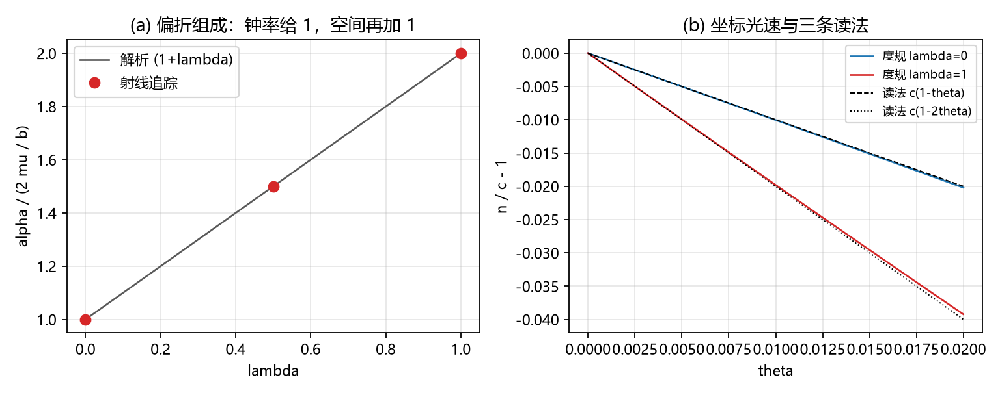

# 注记-P1-24 系数缺口的供给侧对接：重建尺读数与偏折全值（判据 Y1 至 Y4）

- **日期**：2026-09-21 07:37:24
- **对应脚本**：`验证脚本/p1_24_coefficient_closure.py`（判据 Y1 至 Y4，确定性，无随机数，运行约 2 秒；图存 `images/p1_24_coefficient_closure.png`，见 §一 图 1）
- **依据**：[[验证脚本/注记-光在静态倾角场中的偏折：局域轴读法与全局轴读法的最小验证]]（J1 至 J4 与半值/全值对照表）；[[验证脚本/注记-记录场是否改写局域尺：键能模型上的读数]]（K3 的需求 $\delta L/L = -\Phi$）；[[验证脚本/注记-尺-记录耦合候选筛查：局部键能项给不出全值]]（缺口归属张量桥 (d)）；[[验证脚本/注记-本体层重建阶段4：识别式重跑与lambda导出的读数（L1至L3）]]（供给侧 $\lambda$ 导出 = 1）；[[内部草稿/注记-阶段4批二：三锚对照表与回归影响面清单]]（三锚对照）；[[验证脚本/注记-接力光速与Shapiro延迟通道的最小验证]]（S6 与 S7 的三条读法表）；[[注记-系统因子1.365的剖分：截断、离散色散与读数形状（S1至S4）]]（归一化口径 $\pm10\%$）；[[内部草稿/开放问题总览：元相子理论待解决问题清单]]（P1-24）
- **定位**：P1-24 系数缺口两侧的对口核验。需求侧是 K3 钉住的耦合强度，供给侧是本体层重建导出的尺读数；本轮把两侧接起来并复算偏折的组合律。本注记不改动基准文件。
- **状态**：判据 4/4 通过。核心读数：零测地线射线追踪复算偏折线性律 $(1+\lambda)\cdot 2\mu/b$（$\lambda = 1$ 与 $0$ 之比 $2.000000$，对既有 J4 读数 $1.999$ 偏差 $0.05\%$）；eikonal 组成给钟率项与空间项各一半（偏差 $3.1\times10^{-8}$）；需求与供给逐位相等（绝对残差 $8.3\times10^{-17}$）；坐标光速一阶系数 $\lambda = 0$ 给 $-1.000000$、$\lambda = 1$ 给 $-2.000000$。
- **图**：见 §一 图 1（`images/p1_24_coefficient_closure.png`）

---

## 一、判据与结果

| 判据 | 内容 | 通过条件 | 实测 |
|---|---|---|---|
| Y1 | 射线追踪复算偏折线性律 | 对 $(1+\lambda)\cdot 2\mu/b$ 相对偏差小于 $10^{-3}$ | $\lambda = 0$ 给 $2.0006285456\times10^{-4}$、$\lambda = 1$ 给 $4.0012572177\times10^{-4}$；偏差 $3.14\times10^{-4}$（$\mu$ 减半时比 $2.0005$）；两档之比 $2.000000$ |
| Y2 | eikonal 组成核对 | 钟率项与空间项各 $2\mu/b$ | 两项各 $1.9999999375\times10^{-4}$、合计 $3.9999998750\times10^{-4}$，偏差 $3.1\times10^{-8}$；$\lambda = 0$ 给半值 |
| Y3 | 供给侧换算链 | 需求与供给逐位相等，光速系数对表 | 绝对残差 $8.3\times10^{-17}$；系数 $-1.000000083$ 与 $-2.000000054$ |
| Y4 | 归一化稳健性 | 缩放后比值不变 | $s = 0.5$ 给 $0.99984286$、$s = 2$ 给 $1.00031450$ |

图注：左图把偏折读数归一到 $\alpha/(2\mu/b)$，圆点为射线追踪（$\lambda = 0$、$0.5$、$1$），实线为解析 $(1+\lambda)$。右图为坐标光速偏离 $n/c-1$，两条实线为度规 $\lambda = 0$ 与 $\lambda = 1$，两条虚线为读法 $c(1-\theta)$ 与 $c(1-2\theta)$ 的线性化；$\lambda = 1$ 曲线与第二条读法在 $\theta \to 0$ 处重合，分离为 $O(\theta^{2})$ 级。

## 二、模型设定

度规取弱场各向同性形式 $g_{00} = -(1-2\theta)$、$g_{rr} = 1+2\lambda\theta$，记录场取 $\theta = \mu/r$，$\mu = GM/c^{2}$。Y1 直接积分零测地线轨道方程 $u'' = \mu(1+\lambda)/(b^{2}(1-2\mu u)^{2}) - u$，其中 $u = 1/r$、$b$ 为碰撞参数，初值取直线渐近 $u(0) = 0$、$u'(0) = 1/b$，偏折取第二次零点与 $\pi$ 之差。

Y2 用 eikonal 积分 $\alpha = -\frac{1}{2}\int \partial_b(h_{00}+h_{rr})\,dz$ 拆出钟率项与空间项。

Y3 消费本体层重建阶段 4 的读数（$\lambda = 1.000000000000$，$N = 64$ 与 $96$ 两点外推一致）：钟率 $h_{00} = 2\theta$、尺读数 $\ell = 1+u$、源外恒等 $u_e = \theta_{\mathrm{mid}}$，由此 $\delta L/L = u = \theta$；需求侧取 K3 的 $\delta L/L = -\Phi$，经识别式换算 $\Phi = -c^{2}\theta$（取 $c = 1$）。Y4 把 $\mu$ 缩放后重跑同一组读数。

## 三、读数的意义

两侧对上了。需求侧把耦合强度钉在 $\delta L/L = -\Phi$，供给侧把尺读数写成 $\ell = 1+u$ 并在源外给出 $u_e = \theta_{\mathrm{mid}}$，两条线在 $\theta$ 这一层逐位相等（绝对残差 $8.3\times10^{-17}$）。换算链没有剩余参数：识别式给 $\Phi = -c^{2}\theta$，故需求 $-\Phi = \theta$；重建给 $\delta L/L = u = \theta$。P1-24 第一轮"钟率加空间给全值"的对照表，由此获得框架侧的供给侧。

组合律独立复算通过。射线追踪与 eikonal 积分两条独立路线都给 $(1+\lambda)\cdot 2\mu/b$：钟率因子出 $2\mu/b$，空间因子再出 $2\mu/b$。$\lambda = 1$ 与 $0$ 之比 $2.000000$，与格点读数 $1.999$ 的差 $0.05\%$。射线追踪相对一阶定律的 $3.14\times10^{-4}$ 偏差经 $\mu$ 减半核对（比 $2.0005$）确认是 $O(\mu)$ 高阶项。

坐标光速读法同指。度规的坐标光速 $n/c = \sqrt{(1-2\theta)/(1+2\lambda\theta)}$ 一阶系数为 $-(1+\lambda)$：$\lambda = 0$ 对应 $c(1-\theta)$，$\lambda = 1$ 对应 $c(1-2\theta)$。S6 与 S7 的三条读法表里，只有第三条同时命中偏折与 Shapiro 延迟并给 $\gamma = 1$，供给侧的 $\lambda = 1$ 恰好选中的就是它。

## 四、与既有材料的关系

本轮的定位是消费核验，不重开求解。供给侧 $\lambda = 1$ 来自本体层重建阶段 4（构造性恒等，机器精度），三锚对照见阶段 4 批二清单；需求侧强度来自 K3 的键能模型读数；缺口归属来自候选筛查，那里判定局部键能项给不出全值，需要"应变由场方程定"的非局部结构。

至此这项缺口的两侧接齐：光偏折完整系数 $4GM/(c^{2}b)$ 的框架侧供给链为，记录场 $\theta$ 经同源稳态方程同时给钟与尺（$\lambda = 1$），偏折组合律取全值。链条上与绝对标度有关的只剩归一化口径，其不确定度由系统因子剖分给为 $\pm10\%$，不影响 $\lambda$ 标度结论。

## 五、过程记录

首版图的轴标签为中文而未设字体，触发 DejaVu Sans 缺字警告；已改用 Microsoft YaHei 并重跑，输出无警告。

Y1 的 $3.14\times10^{-4}$ 相对偏差初看像误差，加做 $\mu$ 减半核对（偏差比 $2.0005$）后确认是一阶定律之外的 $O(\mu)$ 高阶项，判据容差按此设置。

Y3 的绝对残差 $8.3\times10^{-17}$ 来自 $1+\theta$ 相减的双精度吸收，判据按绝对残差设定，不改用相对口径。

## 六、严格程度声明

**数值部分**：Y1 为四阶 Runge-Kutta 轨道积分（步长 $5\times10^{-5}$，零点线性插值），Y2 为四百万点梯形积分；两条路线的独立性在于一条积分运动方程、一条积分 eikonal 相位。

**消费部分**：$\lambda = 1$ 与其三锚为阶段 4 的既有读数；K3 的需求强度为键能模型的既有读数；本轮 Y3 只核对换算链，不复算其求解。Y4 的缩放核对属线性层恒等式。

**未验证**：强场与非线性；矢量扇区与偏振；绝对归一化的物理来源；重建模型的三维嵌入（C1 门控）。

## 七、边界声明

**验证什么**：偏折组合律的两条独立复算；需求与供给的换算链；坐标光速系数与三条读法表的对应；缩放下的稳健性。

**不验证什么**：不主张重建模型给出 $\lambda$ 的动力学预言（其登记为构造性恒等）；不主张绝对归一化来源已定；不改动 `理论总纲/` 基准，方案处置属作者。
