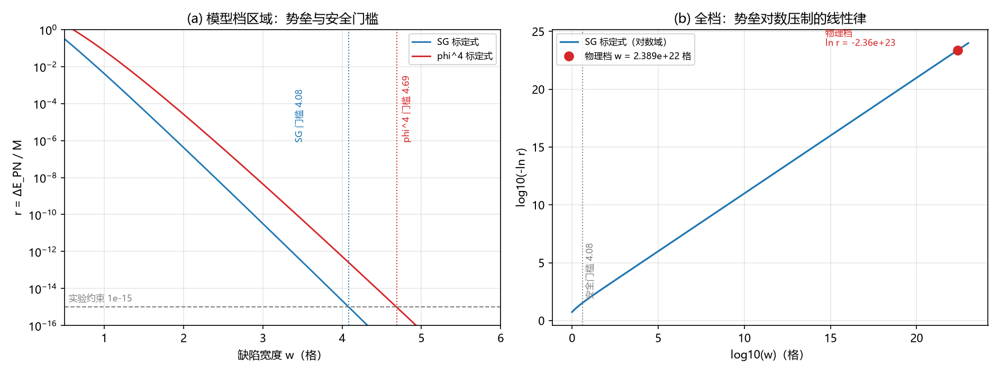

# 注记-P1-40 物理档评估轮：定稿档宽度恒等式与 PN 势垒的指数压制（判据第 622 号）

- **日期**：2026-10-12 04:25:09
- **脚本**：`验证脚本/minimal_verification_physical_scale_pn.py`
- **判据**：K1 至 K8 全部通过（10 项读数），含一条新恒等式
- **可逆性等级**：判据稳健。恒等式为代数化简（CODATA 核验相对差 $0$）；压制结论由指数律给出，口径变体（$k_b$ 归一、宽度约定、锚极端带）均不翻结论。
- **类型**：判据级读数（含新解析恒等式识别；P1-40 物理档评估）
- **关联**：[[验证脚本/注记-内部壁PN势垒轮：现行机制下P1-40的重估（判据第616号）|第 616 号]]（势垒标定律与安全门槛）；[[验证脚本/注记-K值档位债的口径对照（第479条）：定稿值与模型窗口的四十五个数量级缺口|第 479 条]]（登记值出处，其附读数 $\xi = 2.3892\times10^{22}$ 格）；[[内部草稿/总结报告-量纲桥收束：从缺口定位到定稿值（MB-1至MB-9与两次裁决）|量纲桥收束报告]]（M6 字典链与 M-E 锚）；[[内部草稿/开放问题总览：元相子理论待解决问题清单]] P1-40
- **图**：见 §四 图 1

---

## 一、要判什么

P1-40（钉扎-洛伦兹张力）的全部读数历来在模型档（$K \approx 0.005$），与定稿档 $K = 2.788142\times10^{-46}$ 相差 43 至 46 个数量级（第 479 条档位债）。第 616 号给出 PN 势垒的宽度标定律 $r \sim e^{-\pi^2 w}$ 与安全门槛（$\phi^4$ 口径 $w \ge 4.69$）。

第 479 条的附读数"定稿档软模关联长度 $\xi = 2.3892\times10^{22}$ 格"当时未被识别解析身份。本轮的任务是把定稿档的宽度算准，代入第 616 号的标定律，判定物理档下的势垒量级。

## 二、恒等式的推导

代入三条已裁决的体系关系。M6 字典链给 $\kappa_\phi t_P = (m_\delta/m_P)^2/(6\pi)$；M-E 锚（2026-09-22 作者裁决）给 $m_\delta = m_e$（缺口模式即电子）；MB-8/MB-9 给势系数 $K = 3\kappa_\phi t_P$ 与公理刚度 $k_b = 2\pi$（$u$ 场）；关联长度为 $\xi = \frac{1}{2\pi}\sqrt{k_b/K}$。逐步化简：

$$\xi = \frac{1}{2\pi}\sqrt{\frac{2\pi}{3\kappa_\phi t_P}} = \frac{1}{2\pi}\sqrt{\frac{2\pi \cdot 6\pi}{3(m_e/m_P)^2}} = \frac{1}{2\pi}\cdot 2\pi\cdot\frac{m_P}{m_e} = \frac{m_P}{m_e}.$$

**恒等式成立：定稿档缺陷宽度（格）精确等于普朗克质量与电子质量之比。** 物理含义是宽度乘格距等于电子的约化康普顿波长：

$$\xi\,l_P = l_P\frac{m_P}{m_e} = \frac{\hbar}{m_e c}.$$

**这不是数值巧合，它来自三条已裁决关系的代数推论。** 第 479 条登记值时它未被识别，只被当作"附读数"。

## 三、判据与结果

| 判据 | 内容 | 实测 | 期望 | 结果 |
|---|---|---|---|---|
| K1 | 恒等式核验（CODATA） | 相对差 $0.000\times10^{0}$ | $\le 10^{-14}$ | 通过 |
| K2 | 登记值对比 | 相对差 $8.945\times10^{-6}$ | $\le 10^{-4}$ | 通过 |
| K3 | 物理宽度对约化康普顿波长 | 比值 $0.9999998274$ | $= 1$（$10^{-5}$ 内） | 通过 |
| K4 | 物理档 $\ln r$（SG 与 $\phi^4$ 口径） | $-2.358\times10^{23}$ | $< -10^{23}$ | 通过 |
| K5 | 裕度（对 $10^{-15}$ 与 $10^{-20}$） | $10^{1.024\times10^{23}}$ | $> 10^{22}$ | 通过 |
| K6 | 载体对照（防恒真） | 测试档 $r = 0.1143$，与物理档差 $10^{1.02\times10^{23}}$ | 差 $> 10^{20}$ | 通过 |
| K7 | 锚替代极端带 | 两端 $-2.33\times10^{24}$ 与 $-2.39\times10^{22}$ | 均 $< -10^{21}$ | 通过 |
| K8 | 口径变体（$k_b$ 归一与宽度约定） | 两端 $-9.41\times10^{22}$ 与 $-1.48\times10^{24}$ | 均 $< -10^{21}$ | 通过 |

K2 的残余 $8.9\times10^{-6}$ 来源明确：登记值 $\kappa_\phi t_P = 9.293805\times10^{-47}$ 对 CODATA 式值 $9.293640\times10^{-47}$ 的相对差 $1.77\times10^{-5}$，属登记舍入，不影响结论。

## 四、图

图注按脚本绘图面板逐条核对撰写。

## 五、读数与含义

**其一，物理档宽度是 $2.389\times10^{22}$ 格，比安全门槛大 22 个数量级。** 第 616 号的门槛（$4.69$ 格）在图上位于最左端，物理档在图的另一端。这里的意义超出"通过门槛"二十二个数量级，属于量级层面的不同区域。

**其二，物理档势垒是 $r \sim 10^{-10^{23}}$ 量级。** 指数律把宽度的二十二个数量级放大为指数的 $10^{23}$ 量级。这个数字大到常规语言失效：它表示势垒与粒子质量之比小于 $10$ 的负（$10^{23}$ 次方）次方。任何现实的实验精度都不可能触及它。

**其三，结论对口径稳健。** K7 与 K8 覆盖了两种可能推翻结论的方式：锚身份取极端带（$\pi^{\pm2}$ 因子）、$k_b$ 归一取另一种口径、宽度约定差 $2\pi$。三种变体的 $\ln r$ 仍在 $-10^{22}$ 至 $-10^{24}$ 区间，结论不翻。

**其四，K6 防恒真。** 若宽度由 sigma 壁测试档（$w = 0.791$ 格）决定，读数会是 $r = 0.1143$（比实验约束高十三个数量级）。物理档与测试档相差 $10^{10^{23}}$ 量级，说明本轮结论依赖"物理档宽度取定稿值"这一判断，判据不是恒真。

## 六、对 P1-40 的意义

**P1-40 的物理档张力被指数压制，张力是模型档评估的产物。** 逻辑链条为：P1-40 的读数（$r = 1.51\times10^{-8}$ 或修正后 $3.79\times10^{-8}$）全在模型档 $K \approx 0.005$ 上测得；物理档的 $K$ 由量纲桥定稿（$2.788\times10^{-46}$），对应的宽度是 $2.389\times10^{22}$ 格；第 616 号的标定律给出该宽度下的势垒为 $10^{-10^{23}}$ 量级。实验约束 $10^{-15}$ 与它之间隔着 $10^{23}$ 个数量级的指数距离。

**两条逃逸路线的现状随之更新。** 路线一（宽度参数认定）不再需要"认到 4.69 格以上"这种条件性表述：物理档宽度由量纲桥自动给出，且远超门槛。路线二（本体层归属）不再是必需的出路。P1-40 的剩余内容变为：把"模型档读数不构成物理档约束"这一句写清楚，并核对物理档宽度的唯一前提（M6 字典链加 M-E 锚加 $K = 3\kappa_\phi t_P$ 三条已裁决关系）。

**必须如实声明的边界。** 其一，恒等式的前提是 M6 字典链与 M-E 锚，两者为条件性命题级（量纲桥线裁决），若前提翻，恒等式翻。其二，本轮只评估壁位 PN 势垒这一种位置依赖能量。其三，势垒标定律（第 616 号）的指数率在模型档核对（$w$ 至 4.5 格），外推到 $10^{22}$ 格是解析式的外推，指数率本身为解析结论（泊松求和的极点结构），外推可靠，但前因子多项式在高 $w$ 端的取值只有解析形式。其四，本轮不构成对 P1-40 的关闭裁决，关闭归作者。

## 六bis、延伸解读：康普顿波长作为分界尺度

恒等式的直接读法是"宽度等于约化康普顿波长"。另有一层读法值得单列：标准物理把康普顿波长读作**能量与长度的分界**（$\lambda \gg \lambda_C$ 低能散射、$\lambda \sim \lambda_C$ 相当、$\lambda \ll \lambda_C$ 对产生）。这一图像在本体系内可以重建，机制基础更具体。

**分界的根源是缺陷的双尺度结构。** 缺陷有两个尺度：电荷核在格点尺度（管相互作用），包层在康普顿尺度（管结构与色散，见 [[复合位错粒子的形态收束：宽度的波性侧承载、边界保护与锚核驻留判据]]）。低能探针（光子）只与电荷核耦合，读不到包层；探针波长缩到康普顿尺度时开始分辨包层，散射图像改变。标准物理里电子是点、康普顿波长是量子散射的常数组合；体系里分界来自两个几何尺度之比。

**分界的绝对位置由恒等式钉住。** $\lambda_C \leftrightarrow m_e c^2$ 的对应是恒等式的改写：$\xi l_P = \hbar/(m_e c)$ 给出探针波长等于缺陷宽度时 $E = \hbar c/(\xi l_P) = m_e c^2$。标准物理里 $\lambda_C$ 的值需要输入 $m_e$；体系里宽度位置随质量自动走（$\xi = m_P/m_e$），"分界恰在此处"不需要额外解释（$m_e$ 本身仍是输入，即 M-E 锚）。

**对产生一段机制不同型。** 标准物理的对产生阈值由能量守恒定（$2m_ec^2$）；体系的对产生由拓扑跃迁定（棱差代表值跨阈值，两侧面元曲率各跳 $\mp 2\pi$，第 142 条；[[阈值穿越（电荷对生成）]]）。体系另有 [[质量阈值]]（$D_c = m/m_P$）规定缺陷激发的门槛无序度。两套阈值的换算关系未建立。

**未闭合三项（登记为待办）**：其一，光子与包层耦合的矩阵元（探针能否分辨包层的定量判据）；其二，体系对产生阈值与能量阈值 $2m_ec^2$ 的换算；其三，中间段（探针尺度与缺陷尺度相当）的散射图像。三项均未计算，本节只登记读法，不作定量断言。

**一处口径提示**：本节的分界读法不进入判据 K1 至 K8 的结论（K1 至 K8 只依赖恒等式与标定律），属恒等式的解释性延伸。

## 七、过程记录

**发现路径。** 本轮起点是执行"P1-40 物理档评估"这一推荐项，侦察中读到第 479 条注记的附读数 $\xi = 2.3892\times10^{22}$ 格，注意到它与 $m_P/m_e = 2.38926\times10^{22}$ 接近，手算代入后确认是恒等式。登记时该注记只把它写作"附读数"，未识别身份。

**两处口径自纠。** 其一，首版把物理档宽度误写为 $w = 2\pi\xi$（把 SG 宽度参数与关联长度混同），修正为 $w = \xi$（第 616 号约定下两者同值），修正后 $\ln r$ 由 $-1.48\times10^{24}$ 变为 $-2.36\times10^{23}$。其二，K6 首版用标定式在 $w = 0.791$（标定区间外）求值，得 $r = 0.306$，与第 616 号实测 $0.1143$ 不符；改为直接引用实测值。教训：标定式的外推区不可用，须回引实测。

## 八、登记衔接

其一，`验证脚本/README.md` 第 622 号改正式行。其二，开放问题总览 P1-40 卡与档案页补本轮判定登记（物理档压制）。其三，本轮结论同时更新第 479 条注记的附读数身份（该附读数即恒等式），登记为回引项。其四，对外回应论文 §7.1 的张力表述与两条逃逸路线描述待回写。其五，本注记不改动基准文件。
